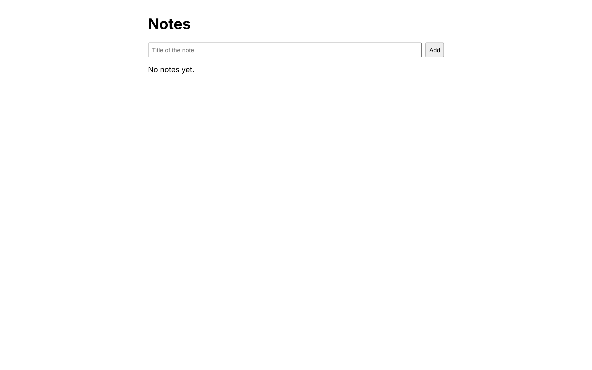

# Cloud session test: vsa-template

The cloud session builds the code, runs the Notes app and shows its form. The test step fails: 2 projects do not compile, so no test runs. CI on `main` also fails, so the failures are in the code, not in the cloud session.

- Commit: `3bba842` (`main`, 2026-11-23)
- Machine: Linux, 4 CPUs, 15 GB memory
- .NET: SDK 10.0.115, runtime 10.0.15 (from apt)

## Results

| Step | Result | Time |
|---|---|---|
| 1. Environment | Passed, no change necessary | Not measured |
| 2a. `dotnet run solution.cs` | Passed, 47 projects | 25 s |
| 2b. `dotnet test Umpire.slnx -c Release` | Failed: command syntax | 0 s |
| 2c. `dotnet test --solution Umpire.slnx -c Release` | Failed: 2 build errors | 59 s |
| 2d. Same command, Debug | Failed: same build errors | 48 s |
| 3. Notes app, `GET /` | Passed, HTTP 200 | 12 s |
| 4a. `report_preview_port` | Blocked: tool not in session | Not measured |
| 4b. Screenshot with Chromium | Passed | Not measured |

Test counts: 0 passed, 0 failed. The build stops before the first test.

## Failures of step 2

### 2b: command syntax

`global.json` selects Microsoft.Testing.Platform. With it, `dotnet test` does not accept a solution as a positional argument:

```text
Specifying a solution for 'dotnet test' should be via '--solution'.
```

Use `dotnet test --solution Umpire.slnx`, as `AGENTS.md` gives it.

### 2c and 2d: build errors

| Project | Code | Files |
|---|---|---|
| `tests/Framework.Tests` | CS0234, CS0246 | `Config/UmpireConfigTests.cs`, `Settings/SettingsTests.cs` |
| `tools/cli/Templates` | UMP020202 | `Views_App_razor.g.cs` and 3 other Razor files |

- **Framework.Tests:** the compiler does not find the namespace `Umpire.Config`. The project file has 2 references to `Umpire.Config.csproj`. One of them has `ReferenceOutputAssembly="false"`, through the item `PortableProject`. That reference is a probable cause.
- **Templates:** the architecture check puts the Razor generated files of `Views/` in no part of the definition.

CI evidence: the last 3 runs of `ci.yml` on `main` failed (runs 231 to 233, 2026-11-17).

## Form UI

Command:

```bash
ASPNETCORE_URLS=http://0.0.0.0:5080 dotnet run --project tests/Fixtures/Notes --no-launch-profile
```

The page has the title "Notes", 1 form, 1 text field and the button "Add". The screenshot is `notes-form.png` (1280 × 800, deviceScaleFactor 2).



## Environment settings

| Setting | Value |
|---|---|
| Environment | `Default`, personal |
| Network | Unrestricted |
| Allowed hosts | None necessary (unrestricted) |
| Variable names | `GH_PACKAGES_TOKEN`, `OP_SERVICE_ACCOUNT_TOKEN` |
| Network secrets | None |

The environment already installs the .NET 10 SDK, so the test did not change it. Its setup script:

```bash
export DEBIAN_FRONTEND=noninteractive
SUDO=""; [ "$(id -u)" -ne 0 ] && SUDO="sudo"
$SUDO apt-get update || true
$SUDO apt-get install -y dotnet-sdk-10.0 git-lfs
dotnet --version
git config --global user.name  "ABox-Agent"
git config --global user.email "294015314+ABox-Agent@users.noreply.github.com"
```

The script also has comment lines, not shown here. The repository has no `nuget.config`, so the restore uses only nuget.org. No GitHub Packages token is necessary.

## Open questions

- Fix the 2 build errors on `main` before the next cloud test?
- Add `--solution` to the test command of the cloud test brief?
