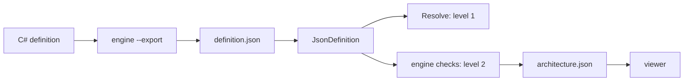

# Architecture data

`definition.json` holds an architecture definition as data: options, part tree and rules. `JsonDefinition` loads it as a working `ArchitectureDefinition`, and the engine app exports it from a C# definition. `architecture.json` holds the resolved app (level 2) for the viewer. Both models are in `VSA.Architecture.Data` (`framework/Engine/Data/`), and no tool owns them.



## Parts

| Part | Path | Contains |
|---|---|---|
| Definition model | `framework/Engine/Data/` | `DefinitionFile`, `DefinitionJson`, `DefinitionExport`, `JsonDefinition` |
| App model | `framework/Engine/Data/` | `ArchitectureFile`, `ArchitectureJson` |
| Export step | `engine/Features/Export/` | `ExportDefinition`: `--export <file>` writes `definition.json` |
| App export | `framework/Engine/Core/Export/` | `ArchitectureExport.Of(map, name, root)` gives an `ArchitectureFile` |
| Tests | `tests/Architecture.Tests/` | `DefinitionFileTests`, `DataConceptTests`, `ExportTests` |

## definition.json

| Field | Contains |
|---|---|
| `$schema` | `architecture-definition.v1.json` |
| `version` | `DefinitionJson.Version`. A reader fails on another version |
| `root` | The root folder of the definition |
| `options` | `defaultPermission`, `boundary`, `useSameConcept`, `depth`, `access` |
| `parts` | The full part tree: `concept`, `group`, `folder`, `depth`, `access`, `boundary`, `types`, `children` |
| `rules` | The rules of `Rules(RuleBook)`: `from`, `verb` (`Uses`, `Denies`), `to`, with filters on each term |

```json
{ "from": [{ "concept": "VSA.Architecture.Vsa.Infrastructure, VSA.Architecture.Vsa", "filters": [] }],
  "verb": "Uses",
  "to": [{ "concept": "VSA.Architecture.Vsa.Core, VSA.Architecture.Vsa", "depth": "Self", "filters": [] }] }
```

- A concept or a type is its full name and its assembly name. `JsonDefinition` finds it with `Type.GetType`, then in the loaded assemblies.
- No part and no rule has an ID. The tree nesting places each part, and a rule is only its content.
- The file holds each part, also the children that a concept adds in `Define`. `JsonDefinition` does not call `Define`.
- The concepts give their own rules (`Concept.Rules`) from code, so the file does not hold them.
- `DefinitionJson.Schema()` gives the JSON schema. It lists the closed values: `FilterKind`, `RuleVerb`, `Depth`, `Access`, `Boundary`, `Permission`.

## JsonDefinition

```csharp
public sealed class NotesDefinition() : JsonDefinition("definition.json");
```

A relative path starts at the folder of the assembly of the definition class. `JsonDefinition` reads the file one time.

## DataConcept

`DataConcept(Concept Inner, ConceptData Data)` wraps a code concept. It uses the `folder`, `groupFolder`, `depth` and `access` of `Data` if they are set, else the values of `Inner`. `Concept.Identity` gives the type of `Inner`, so the rules of `Inner` match the wrapper.

## Rules

| Rule | Reason |
|---|---|
| The reader fails on a missing field (`RespectRequiredConstructorParameters`) | A drift between the export and a reader fails the tests |
| The writer writes each field, also a null field | The reader needs each field |
| A definition from its file gives the same tree, pairs, report and findings | `DefinitionFileTests` checks four definitions and the bad fixture app |

## Open questions

- `FolderAliases` (Unity): in the file, or in code only?
- The data project targets `net10.0`, because the schema needs `System.Text.Json` 9. Must `JsonDefinition` run in Unity (`netstandard2.1`)?
- Viewer v1: does it read only `definition.json`, or also `architecture.json` for the types, uses and findings?
- The viewer edits and adds data in `definition.json`. This comes after viewer v1.
