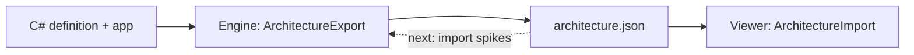

# Architecture data

`architecture.json` is the one file between the architecture tools. The architecture engine exports it from an app, and the viewer reads it. The model of the file is `VSA.Architecture.Data` (`framework/Engine/Data/`). No tool owns the model.

## Parts

| Part | Path | Contains |
|---|---|---|
| Model | `framework/Engine/Data/` (`VSA.Architecture.Data`) | The records, `ArchitectureJson` (`Read`, `Write`, `Save`, `Schema`) and `ArchitectureJson.Version` |
| Export | `framework/Engine/Core/Export/` | `ArchitectureExport.Of(map, name, root)` gives an `ArchitectureFile` from an `ArchitectureMap` |
| Export tool | `framework/Tooling/Export/` (`Architecture.Export`) | `Architecture.Export <app output folder> <app root> <architecture.json>`. It does not ship. A later `vsa export` command replaces it |
| Tests | `tests/Architecture.Tests/ExportTests.cs` | Round trip, options, uses, findings, version and schema, on the bad fixture app |

## The file

| Section | Contains |
|---|---|
| `version` | `ArchitectureJson.Version`. A reader fails on another version |
| `definition.options` | `defaultPermission`, `boundary`, `useSameLayer`, `depth`, `access` |
| `definition.parts` | Each part, with an ID (`p0`, `p1`, ...), its layer, its parent and its folder path |
| `definition.rules` | Each rule, with an ID (`r0`, `r1`, ...), its text, its access and its terms (`from`, `to`, with filters) |
| `definition.pairs` | Each part rule that the definition resolves, in order |
| `app` | The part instances, the types, the uses with the decision of each use, and the findings |

`ArchitectureJson.Schema()` gives the JSON schema of the file.

## Rules

| Rule | Reason |
|---|---|
| The reader fails on a missing field (`RespectRequiredConstructorParameters`) | A drift between the export and a reader fails the tests |
| The writer writes each field, also a null field | The reader needs each field |

## Open questions

- The engine import: a JSON file gives a working `ArchitectureDefinition`. Two spikes compare a definition built through the definition API and a JSON definition class.
- The viewer edits and adds data in the file. This comes after the import.
