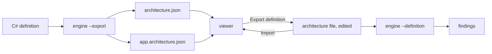

# Architecture data

Two files hold the architecture data. Both models are in `VSA.Architecture.Data` (`framework/Engine/Data/`), and no tool owns them. The engine and the viewer use the same library to export, edit and import, so each operation has one implementation.

| File | Name | Contents | Made by |
|---|---|---|---|
| Architecture file | `<architecture>.json`, for example `mvvm.json` | The architecture definition as data: name, options, part tree, rules. `JsonDefinition` loads it as a working `ArchitectureDefinition` | The engine export, or the viewer after an edit |
| Snapshot file | `<app>.<architecture>.json`, for example `notes.vsa.json` | One app at one time, against an architecture: types, uses, findings, and the architecture that it used | Only the engine. It is output only |

The architecture name comes from the definition class without "Definition": `MvvmDefinition` gives `Mvvm`, and `VsaDefinition` gives `Vsa`. One architecture can serve many apps, so the snapshot name starts with the app and ends with the architecture. A dot in a name becomes a hyphen, and the names are lower case. A name that other tools use for their own file, for example `global` or `package`, fails. Each file also says its kind in `$schema`. `DataFiles` gives the file names.

## The loop



1. The engine exports the coded definition: `--export <folder>` writes the architecture file and the snapshot file.
2. The viewer shows both files. You edit the rules in the Definition view.
3. "Export definition" writes a new architecture file with the edits.
4. The engine checks the app with that file: `--definition <file>`.
5. The viewer can import the new file and edit it again.

An import always gives a data-driven definition. No tool parses or writes C# code. If you change a coded definition in the viewer, the result is a new architecture file, not a change to the code.

```bash
dotnet engine/bin/Debug/net10.0/vsa-engine.dll --root samples/Notes --bin samples/Notes/bin/Debug/net10.0 --export out
dotnet engine/bin/Debug/net10.0/vsa-engine.dll --root samples/Notes --bin samples/Notes/bin/Debug/net10.0 --definition out/vsa.json
```

## Parts

| Part | Path | Contains |
|---|---|---|
| Definition model | `framework/Engine/Data/` | `DefinitionFile`, `DefinitionJson`, `DefinitionExport`, `JsonDefinition`, `DefinitionRules` |
| Definition edits | `framework/Engine/Data/` | `DefinitionEdit.Apply(file, edits)` with `RuleEdit` (`Add`, `Remove`, `ChangeVerb`) |
| App model | `framework/Engine/Data/` | `SnapshotFile`, `SnapshotJson` |
| App export | `framework/Engine/Core/Export/` | `SnapshotExport.Of(map, app)` gives a `SnapshotFile` |
| Export step | `engine/Features/Export/` | `ExportFiles`: `--export <folder>` writes the two files |
| Definition file input | `engine/Features/Definition/` | `LoadDefinition`: `--definition <file>` uses `JsonDefinition` |
| Viewer import and export | `framework/Tooling/Viewer/` | `ArchitectureImport` reads the architecture file. `DefinitionChanges` gives the edits to `DefinitionEdit` |
| Tests | `tests/Architecture.Tests/`, `tests/Engine.Tests/`, `tests/Viewer.Tests/Export/` | `DefinitionFileTests`, `DataConceptTests`, `ExportTests`, `RunEngineTests`, `LoopTests`, `MvvmLoopTests` |
| MVVM fixture | `tests/Fixtures/Architecture/MvvmApp/` | The app of the "Hello MVVM" guide, with its own `MvvmDefinition` and one rule break: `GreetingView` uses the model `Greeting` |

## The MVVM loop test

`MvvmLoopTests` runs the full loop on an app whose concepts are not VSA types:

| Step | Result |
|---|---|
| The engine checks the app with the coded definition, and exports the two files | 1 error: `GreetingView` uses `Greeting` |
| The engine checks the app with the exported architecture file | The same error text, line for line |
| The viewer reads the two files, with no app assembly | It shows the parts, the 4 rules, the types and the denied use |
| The viewer adds the rule View uses Model, and the engine checks with the new file | 0 errors |
| The viewer removes the rule ViewModel uses Model, and the engine checks with the new file | 3 errors: the old one, `GreetingViewModel` uses `Greeting`, and `ViewModelBase` uses `ModelBase` |
| The edited file is imported again, and a second edit removes the added rule | The original error again |

## The architecture file

| Field | Contains |
|---|---|
| `$schema` | `architecture-definition.v2.json` |
| `version` | `DefinitionJson.Version` (2). A reader fails on another version |
| `name` | The architecture name, for example `Mvvm`. A viewer edit keeps it |
| `root` | The root folder of the definition |
| `options` | `defaultPermission`, `boundary`, `useSameConcept`, `depth`, `access` |
| `parts` | The full part tree: `concept`, `group`, `folder`, `depth`, `access`, `boundary`, `types`, `children` |
| `rules` | The rules of `Rules(RuleBook)`: `from`, `verb` (`Uses`, `Denies`), `to`, with filters on each term |

```json
{ "from": [{ "concept": "VSA.Architecture.Vsa.Infrastructure, VSA.Architecture.Vsa", "filters": [] }],
  "verb": "Uses",
  "to": [{ "concept": "VSA.Architecture.Vsa.Core, VSA.Architecture.Vsa", "depth": "Self", "filters": [] }] }
```

- A concept or a type is its full name and its assembly name. `JsonDefinition` finds it with `Type.GetType`, then in the loaded assemblies.
- No part and no rule has an ID. The tree nesting places each part, and a rule is only its content.
- The file holds each part, also the children that a concept adds in `Define`. `JsonDefinition` does not call `Define`.
- The concepts give their own rules (`Concept.Rules`) from code, so the file does not hold them.
- `DefinitionJson.Schema()` gives the JSON schema. It lists the closed values: `FilterKind`, `RuleVerb`, `Depth`, `Access`, `Boundary`, `Permission`.

## Edits

`DefinitionEdit.Apply` finds a rule by its text and a term by its concept name, for example `Presenters`.

| Edit | Result |
|---|---|
| `Remove` of one pair of a rule | The rule is split into the rules that keep the other pairs. Each term keeps its depth, access and filters |
| `ChangeVerb` of one pair | The pair is removed from its rule, and a new rule gives the pair with the other verb |
| `Add` | A new rule at the end, with the filters of each term |

A rule of a concept comes from code, so an edit of it fails with a message. A concept name that is not in the file also fails.

## The snapshot file

| Field | Contains |
|---|---|
| `$schema` | `architecture-snapshot.v2.json` |
| `version` | `SnapshotJson.Version` (2). A reader fails on another version |
| `architecture` | `name`: the architecture name. `source`: the definition class, or the file name for `--definition`. `hash`: `sha256` of the exported architecture file |
| `app` | `name`, `instances`, `types`, `dependencies`, `findings` |

A use names its rule by its text. An instance has `many`: true if its part is a group. The definition is only in the architecture file.

The `hash` tells if a snapshot is from a given version of the architecture: `DefinitionJson.Hash(file)` of that architecture file gives the same value. The viewer reads the architecture file with the name `architecture.name`, from the folder of the snapshot.

## JsonDefinition

```csharp
var definition = new JsonDefinition("mvvm.json");
```

A relative path starts at the folder of the assembly of the definition class. `JsonDefinition` reads the file one time.

### Types that are not loaded

A definition file names its concepts and types, for example `Mvvm.Engine.Architecture.View, MvvmApp`. A tool that does not load the app assemblies, for example the viewer, does not have these types. The second argument of `JsonDefinition` selects what happens:

| `MissingTypes` | Result | Used by |
|---|---|---|
| `Fail` (default) | A missing type fails with its name | The engine. It checks the real types of the app |
| `StandIn` | A missing type gets a stand-in type with the same full name, assembly name and nesting. A stand-in concept has no own rules | The viewer import, `DefinitionEdit` |

With stand-ins, a file gives the same parts, pairs and rule texts as with the real types, and an export of it gives the same file. So the viewer can show and edit the definition of any app from the file alone.

## DataConcept

`DataConcept(Concept Inner, ConceptData Data)` wraps a code concept. It uses the `folder`, `groupFolder`, `depth` and `access` of `Data` if they are set, else the values of `Inner`. `Concept.Identity` gives the type of `Inner`, so the rules of `Inner` match the wrapper.

## Unity

`VSA.Architecture.Data` also targets `netstandard2.1`. Unity 6000.6 ships `System.Text.Json` 8, so that target uses the 8.0 package. Two features need version 9 or later, so they are only in the `net10.0` target:

- `DefinitionJson.Schema()` and `SnapshotJson.Schema()`.
- The strict read: a missing field or a null in a non-null field fails the read.

## Rules

| Rule | Reason |
|---|---|
| The reader fails on a missing field (`RespectRequiredConstructorParameters`, `net10.0`) | A drift between the export and a reader fails the tests |
| The writer writes each field, also a null field | The reader needs each field |
| A definition from its file gives the same tree, pairs, report and findings | `DefinitionFileTests` checks four definitions and the bad fixture app |
| The import gives a data-driven definition, and no tool writes C# | One model: the data. The tools transform data into the mapping |
| `FolderAliases` stay in code | Only the Unity host needs them, and they do not change the rules |
| An exported file is output only. No build hook reads an architecture file or a snapshot file back | A second source of truth can become stale, and the build then passes on the file, not on the code |
| `--definition <file>` is a manual engine option. `VSA.Architecture.Build.targets` does not use it | The loop and the tests use it. The build check uses the one definition of the app |
| An app with a data definition has only that definition | If an app adopts an architecture file as its definition, its coded definition is removed. The file is committed, and a person owns it. A build never reads a coded definition and a file next to it |
| A viewer export becomes the definition only when the user adopts it | No tool and no build step adopts a file automatically |
