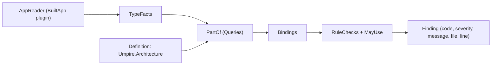

# Architecture engine

The rule engine checks each type of the app against one architecture definition. The definition gives the parts of the app and the rules between them. `architecture/Queries/` gives the answers on plain facts: the part of each type (`PartOf`), the decision for each use (`MayUse`), and the counts and the matches (`ResolvedArchitecture.Counts`, `Matches`). The engine app (`engine/`) reads the built app, asks these questions and writes each problem as a `Finding`, after each build of the host.



## Projects

| Project | Path | Contains |
|---|---|---|
| `Umpire.Architecture` | `architecture/` | The definition API and `Queries/`. No ArchUnitNET |
| `Umpire.Vsa` | `packs/Vsa/Architecture/` | `VsaArchitecture` and the VSA layers (`Concepts/`). No ArchUnitNET |
| `Umpire.Engine.Versions` | `engine/Versions/` | The version check (`UMP030201`). The engine app and the `umpire` tool bundle it |
| Engine app | `engine/` | The runner: Blocks, Versions, LoadApp, Rules, Baseline, Report. `Plugins/BuiltApp` reads the DLL and PDB files with ArchUnitNET and `MetadataLoadContext`. Its root project `engine/Engine.csproj` makes the build hook package `Umpire.Engine.Build` |

The runtime of an app references `Umpire.Architecture` through `Umpire.Kernel` (`Pack.Architecture`), and Umpire.Sdk gives each project `Umpire.Vsa`. So `Umpire.Architecture` and `Umpire.Vsa` use only the BCL and the VSA contracts. They also target `netstandard2.1`, for Unity. The runtime does not get ArchUnitNET.

## Definition API

A concept is a record that inherits `Concept`. A definition is a class that inherits `Architecture`. It adds the concepts to a tree in `Define`, and gives the rules in `Rules`. VSA calls its concepts layers: each VSA layer inherits `Layer : Concept`. A `Module` is the concept of the root part of a group instance: it is in the folder of its parent, for example the root class of each feature.

```csharp
public record Feature : Layer { public override string GroupFolder => "Features"; }
public record Kernel : External { public override string Assembly => "Umpire"; }

public class VsaArchitecture : Architecture {
    protected override void Configure(Options defaults) => defaults.DefaultPermission = Permission.Deny;

    protected override void Define(Block block) {
        block.Add<Framework>().Add<Kernel>();
        var feature = block.AddGroup<Feature>();
        feature.Add<Module>().OfType<Umpire.Kernel.Module>();
        feature.AddGroup<Slice>().Add<Contracts.Requests>().And<Handlers.Requests>().InParentFolder();
    }

    protected override void Rules(RuleBook rules) {
        rules.For<Feature>().Denies<Feature>().InOther<Feature>();
        rules.For<Feature>().Uses<Domain.Shared>().InOther<Feature>();
    }
}
```

| Call | Effect |
|---|---|
| `Add<T>()` | A part in the folder of the layer. It returns the `Part` |
| `And<T>()` | A sibling part. It returns a `PartGroup`: the next call applies to each part in it |
| `AddGroup<T>()` | A group: one part instance for each subfolder. It returns a `PartGroup` |
| `AddBlock<T>()` | The place of another block in the folder of `T`. The place is one part, with no children (see "Blocks and check entries") |
| `AddBlockGroup<T>()` | Each subfolder of the folder of `T` is the place of another block, for example `Packs/<Name>/` |
| `InParentFolder()` | The part shares the folder of its parent. Give it `OfType` |
| `OfType<T>(required)` | Each type of the part must be assignable to `T`. `required: true` also needs one type of `T` in each instance (see "Required") |
| `Uses<T>()`, `Denies<T>()` | A rule (type `Rule`). A later rule wins |
| `Has<T>()`, `Takes<T>()` | A count (type `Count`) or a match (type `Match`). See "Counts and matches" |
| `Under<T>()`, `InSame<T>()`, `InOther<T>()` | Filters: the place of the source or the target |

`Options` sets `DefaultPermission` (the permission when no rule applies), `Boundary`, `UseSameConcept`, `Depth`, `Access` and `Required`. Each field is nullable: a field that is not set takes the next value. The engine resolves each value in this order: the part (the rule call, the group parameter or the `OfType` call), the concept, the architecture, then `Options.BuiltIn`.

| Field | `Options.BuiltIn` | Set by |
|---|---|---|
| `DefaultPermission` | `Deny` | The architecture only |
| `UseSameConcept` | `false` | The architecture only |
| `Boundary` | `Open` | The architecture, a concept, a group |
| `Depth` | `WithChildren` | The architecture, a concept, a rule call |
| `Access` | `Public` | The architecture, a concept, a rule call |
| `Required` | `false` | The architecture, a concept, an `OfType` call |

The convention for a new option: if a concept or the architecture can also set it, it gets a nullable parameter at the call site and a nullable field in `Options`. The lookup reads the call site, then the concept, then the architecture, then `Options.BuiltIn`.

A concept sets its values in `Configure(Options defaults)`. If a concept sets `DefaultPermission` or `UseSameConcept`, the definition stops: "Only the architecture sets <name>. Move it to Configure of the architecture."

`defaults.UseSameConcept = true` lets each part use each part of the same concept, in all places: for example a feature `Infrastructure` uses the `Infrastructure` of the framework and of a plugin. The engine adds these pairs before the layer bodies and the rules, so a rule can deny them. Boundary also limits them (see Boundary). The default is `false`.

`VsaArchitecture.Define` calls one `virtual` define method for each base group and for the kernel: `DefineKernel`, `DefinePlugin`, `DefineFeature` and `DefineSlice`. A pack variant overrides one to add a part to each instance of that group (see `pack-variants.md`).

The test `VsaDecisionsTests` writes the decision of the VSA definition for each pair of parts to `tests/Architecture.Tests/VsaDecisions.txt`. If a change to the definition changes a decision, the test fails and writes `VsaDecisions.actual.txt`. Compare the two files. If the change is correct, copy the new file over the baseline.

### `using` placement

The placement of the `using` directives is a guideline, not an enforced rule (`IDE0065` is off). Use the next step only if the step before it is not enough:

1. Put the `using` directives inside the namespace. This is the default, and the editor suggests it (`csharp_using_directive_placement = inside_namespace`).
2. Put some `using` directives outside the namespace if the file is inside the namespace of the concept records, for example a pack variant in `Umpire.Vsa.Definition.*`.
3. Add an alias inside the namespace, for example `using Plugin = Umpire.Vsa.Definition.Plugin;`.

A definition file writes each real type with its full name, for example `OfType<Umpire.Kernel.Module>()`. Then it does not import the namespace of that type, and no clash occurs.

C# finds a name level by level, from the innermost namespace to the outermost. At each level, it examines the members of the namespace first, then the `using` directives of that level. A concept record has the name of a folder, and a folder is a part of a namespace. In app code, a `using` inside the namespace wins over the outer app namespaces:

```csharp
using Umpire.Vsa.Definition;
namespace Shop.App.Host {
    rules.For<App>();          // CS0118: 'App' is a namespace (Shop.App)
}

namespace Shop.App.Host {
    using Umpire.Vsa.Definition;
    rules.For<App>();          // the record App
}
```

In a pack variant, the records are in an outer namespace. There, a `using` inside the namespace wins over the records:

```csharp
namespace Umpire.Vsa.Definition.Ecs {
    using Umpire.Vsa.Composition;
    rules.For<Plugin>();       // the class Umpire.Vsa.Composition.Plugin: CS0311
}

using Umpire.Vsa.Composition;
namespace Umpire.Vsa.Definition.Ecs {
    rules.For<Plugin>();       // the record Umpire.Vsa.Definition.Plugin
}
```

Thus no one placement is correct for each file. `RuleBook.For<T>() where T : Concept` makes each wrong binding a compile error (`CS0104`, `CS0118` or `CS0311`), so no clash compiles silently. `IDE0065` selects files only by path, so it cannot make an exception for a definition file. If a rule is necessary after 0.1.0, write a custom analyzer.

## Boundary

A closed group keeps its instances apart: an allow rule reaches a part in another instance of the group only if the rule crosses the group. The first value that is set wins:

1. The parameter of the rule call: `Uses<Contracts.Commands>(Boundary.Open)` crosses each closed group.
2. The parameter of the group: `block.AddGroup<Plugin>(Boundary.Open)`.
3. The concept body, for example `defaults.Boundary = Boundary.Closed` in `Configure(Options)` of the concept.
4. `defaults.Boundary` of the architecture. Its default is `Boundary.Open`.

In the example, the first rule reaches the Domain of the own feature, of Kernel and of the plugins. The second rule also reaches the `Domain.Shared` of the other features. A rule with `InOther<T>()` crosses the group `T` and each group inside it. Boundary does not change a deny rule, and it does not apply to a user outside the group: for example `App/Views` uses the presenters of each feature.

```csharp
defaults.Boundary = Boundary.Closed;
rules.For<Infrastructure>().Uses<Domain>();
rules.For<Feature>().Uses<Domain.Shared>().InOther<Feature>();
```

## External parts

An `External` part binds the types of a DLL by its name, not by its folder. `Kernel` binds `Umpire.dll` and each `Umpire.*.dll`. A child of an external gets the DLL name of its parent and its folder, for example `Lib.Child`. A child can also name its own DLL with `InAssembly`: `VsaArchitecture` gives `Contracts` the DLL `Umpire.Messages.Contracts`, and `Contracts.Requests` the DLL `Umpire.Vsa.Contracts.Requests`. The longest matching DLL name wins. The types of an external DLL are rule targets: a rule can deny them.

`Umpire.Vsa.dll` (the pack: `Vsa<THost>`, `VsaArchitecture`) has no external part of its own. `Kernel` binds it by the name `Umpire`, and `App/Host` uses `Kernel` (`Uses<Kernel>(Depth.Self)`), so the app class can name the pack. Reason: no other part uses the pack, so a separate part gives no new rule.

The definition stops at these shapes. The first four give one error, because a DLL name has no group segment, and the child of an external gets its DLL name from its parent:

| Definition | Error |
|---|---|
| `AddGroup<External>()` | `AddGroup<Lib>() makes a group of an external.` |
| An external under a group | `Add<Lib>() is under the group Group.` |
| An external under an external | `Add<OtherLib>() is under the external Lib.` |
| `AddGroup` under an external | `AddGroup<Child>() is under the external Lib.` |
| `InParentFolder()` on an external part | Its name is a DLL name segment |

## Depth

`Depth.Self` gives the part only. `Depth.WithChildren` gives the part and all its child parts. The first value that is set wins:

1. The parameter of the rule call, for example `Uses<Contracts>(Depth.WithChildren)`.
2. The layer body, for example `defaults.Depth = Depth.Self` in `Configure(Options)` of the layer.
3. `defaults.Depth` of the architecture. Its default is `Depth.WithChildren`.

## Permission and access

A rule has two values:

| Value | Enum | Values | Question |
|---|---|---|---|
| Permission | `Permission` | `Allow`, `Deny` | May this part use that part? |
| Access | `Access` | `Internal`, `Public` | How visible may the use be? |

`Uses<T>()` allows the use. `Denies<T>()` denies it. An access limits an allowed use:

```csharp
rules.For<Contracts.Requests>().Uses<Domain.Shared>();               // use and expose
rules.For<Handlers.Requests>().Uses<Domain>(Access.Internal);        // use, but do not expose outside the assembly
```

A type exposes a part when a type of that part is in its signature: a base type, an interface, or the type of a member (a method return or parameter, a property, a field), with their generic arguments. The access of a member is the narrowest of the member and its type. `Internal` is within `Public`. The check maps each visibility to one of the two values: `public`, `protected internal` and `protected` are `Public`, because code outside the assembly can see them. `internal`, `private protected` and `private` are `Internal`.

The framework can require a public exposure, so the check ignores two exposures:

| Exposure | Example |
|---|---|
| A base type or an interface of an `External` part, with its generic arguments | `: Presenter(bus), IPresenterEvent<Rang>` |
| A member that implements a member of such an interface. The name and the signature must match. An explicit implementation also matches | `public Task OnEventAsync(Rang e)` |

An interface of the app or of .NET is not of an `External` part, so it counts. For example, `: IEquatable<Note>` and `public bool Equals(Note? other)` give `UMP020102` if the rule limits `Note`.

The first access that is set wins:

1. The parameter of the rule call, for example `Uses<Domain>(Access.Internal)`.
2. The layer body, for example `defaults.Access = Access.Internal` in `Configure(Options)` of the layer.
3. `defaults.Access` of the architecture. Its default is `Access.Public`, so a rule with no access allows use and exposure.

## Counts and matches

`Rules` has three kinds of statement. A use rule gives a decision for each use. A count and a match fail for each instance or type that does not obey them.

| Kind | Call | Fails when | Code |
|---|---|---|---|
| Use | `For<S>().Uses<T>()`, `Denies<T>()` | A type of `S` uses a type of `T`, and the decision is `Deny` | `UMP020101` |
| Count | `For<S>().Has<T>()` with `AtLeast(n)`, `AtMost(n)`, `Exactly(n)`, `OfOneKind()` | The number of types is not in the limit, or the types are in more than one part | `UMP020301` |
| Match | `For<S>().Takes<T>()`, optional `InSame<G>()` | A type of `S` has no type argument in `T`, or the argument is in another instance of `G` | `UMP020302` |

`Has<T>()` has two meanings. The subject `S` selects the meaning:

| Subject | Count | Example |
|---|---|---|
| A group | The types of `T` in each instance of the group | `rules.For<Slice>().Has<Handlers>().AtLeast(1)`: each slice has a handler or a hook |
| A part | For each type of `S`, the types of `T` that take it as a type argument of a base type | `rules.For<Contracts.Requests>().Has<Handlers.Requests>(Depth.Self).Exactly(1)`: each request has one handler |

The rules of a count:

- `T` includes each concept that is nested in `T` (the concept family). For example, `Has<Handlers>()` counts `Handlers.Commands` and `Handlers.Commands.Hooks`. `Has<T>(Depth.Self)` counts only `T`. The `Depth` of the concept does not apply to a count.
- A helper that follows its user does not count, and an abstract class or an interface does not count. Only a concrete type that binds by its own base type counts.
- A count counts only the types of the app in the block folder. A type of an external DLL does not count.
- A count with no limit stops the definition: "has no limit. Add AtLeast, AtMost, Exactly or OfOneKind."
- The finding is at the first type of the instance (by file, then line), or at the type of the subject.

`Takes<T>()` reads the type arguments of the base types and interfaces of the type and of each class in its base chain (`TypeFacts.BaseArguments`), so a handler that inherits a middle base matches. An abstract subject type is not checked. For example, `rules.For<Handlers.Requests>().Under<Feature>().Takes<Contracts.Requests>().InSame<Slice>()`: a request handler handles a request of its own slice. With no `InSame<G>()`, the match needs only one type argument in `T`. A subject type that is not in an instance of `G` fails, so use `Under<T>()` to select the subjects.

```text
error UMP020301: Slice Features/Notebook/Slices/Draft has 0 Handlers types: the rule "Slice has Handlers at least 1" needs at least 1. Add one, or move the other types to another part.
```

### Required

`OfType(type, required: true)` makes the base type required. Each instance of the nearest group of the part then has at least one type of that base in the part. If the part is in no group, the app is one instance. The engine checks it as a count, so it gives `UMP020301`.

```csharp
part.OfType(typeof(RequestHandler<,>), required: true);
```

| Order | Place | Form |
|---|---|---|
| 1 | The call site | `OfType(..., required: true)` or `required: false` |
| 2 | `Configure` of the concept | `defaults.Required = true` |
| 3 | `Configure` of the architecture | `defaults.Required = true` |
| 4 | `Options.BuiltIn` | `false`: the part is permitted, not required |

`VsaArchitecture` sets no `Required`. Its counts are lines in `Rules` (see "Counts and matches" in `architecture-rules.md`).

## Binding

| Type | Part |
|---|---|
| In a DLL that an `External` part names | That part. The longest name wins |
| Source file in a part folder | The deepest part that matches the folder. A group instance matches each name |
| Source file only in `obj/` or `bin/` | Not checked |
| Helper type in a `InParentFolder` folder | The part of the first type that uses it ("follows user") |
| Source file in no part folder | None: `UMP020202` |
| Source file out of the block folder | Not checked |
| Source file in no folder alias (if the definition has aliases) | Not checked |

The engine reads the source file and the first line of each type from the PDB file, with System.Reflection.Metadata (`SourceFiles`).

## Unity projects

If the block folder has `ProjectSettings/ProjectVersion.txt`, the app is a Unity project. Unity compiles `Assets/`, so the folders of a Unity app are not the folders of a .NET app.

| Folder | Binds as | Contains |
|---|---|---|
| `Assets/<UnityApp>/` | The block | `Features/`, `Plugins/` |
| `Assets/<UnityApp>/` | `App/` | `Views/`, `Host/` |
| `<UnitySource>/` (default `Source`) | The block | `Features/`, `Plugins/` of the .NET projects |

`Architecture.FolderAliases(blockFolder)` gives these folder aliases (`FolderAlias(Folder, As)`). With no aliases, each folder binds as it is. The binder tries each map and keeps the deepest part. `VsaArchitecture` gets them from `UnityLayout.Aliases`. `UnityLayout` finds `UnityApp`: the one folder in `Assets/` (not `Assets/Plugins/`) with `Features/`, `Plugins/` or `Views/`. If two folders match, set it in a definition class:

```csharp
public sealed class CardsArchitecture : VsaArchitecture {
    public CardsArchitecture() {
        UnityApp = "Cards";
        UnitySource = "Modules";
    }
}

public class MyApp : App<Vsa<CardsArchitecture, UnityVsaHost>>;
```

`AppReader` (`engine/Plugins/BuiltApp/Infrastructure`) also reads the DLLs that Unity compiles (`UnityProject.Scripts`):

| Step | Unity project |
|---|---|
| App DLLs | Also `Library/ScriptAssemblies/*.dll` |
| No `Library/ScriptAssemblies/` | The warning `UMP020203` |
| A DLL name in the host output too | The engine loads the host output DLL only |
| A type in two DLLs | The engine loads it once. The Unity copy wins, so the uses of the views stay checked |
| Source file under `Library/` | Not app code (package cache, generated types) |

## The checks of the Rules step

`RuleChecks.Of(type)` gives the use, exposure and type findings of one type. `ArchitectureCheck.Findings()` (the Rules step) gives the findings of all app types, the counts and the matches (`RuleChecks.Counts`, `RuleChecks.Matches`), the block places (`RuleChecks.Covered`, `RuleChecks.Empty`), and the warnings of the loader.

| ID | Severity | Problem |
|---|---|---|
| `UMP020101` | Error | A type uses a part that the rules deny |
| `UMP020102` | Error | A type exposes a part with more access than its rule allows |
| `UMP020201` | Error | A type is not assignable to the `OfType` of its part |
| `UMP020202` | Error | A type is in a folder that the definition does not have |
| `UMP020203` | Warning | A Unity project has no `Library/ScriptAssemblies/` folder |
| `UMP020301` | Error | A count of the definition is not in its limit (see "Counts and matches") |
| `UMP020302` | Error | A match of the definition does not hold (see "Counts and matches") |
| `UMP020401` | Error | A part of the definition covers the folder of another block (see "Blocks and check entries") |
| `UMP020402` | Error | A block place (`AddBlock<T>()`, `AddBlockGroup<T>()`) holds no check entry |

Each finding is a `Finding(Code, Severity, Message, File, Line)` of the Steps plugin. `File` is the full path. The engine app writes one line for each finding:

```text
C:/app/Features/Notes/Slices/Read/ReadHandler.cs(6,1): error UMP020101: ReadHandler in Handlers.Requests (Features/Notes/Slices/Read) uses Invoice in Domain (Features/Billing/Domain): no rule allows it (DefaultPermission = Deny). Remove the use, or change the rule in Rules.
```

## The checks of an app

The build hook package `Umpire.Engine.Build` on the host project runs the engine after each build. A test project does not check the architecture. See "The rule engine" in `AGENTS.md`.

One definition applies to one block: the folder tree of code that the definition checks. The definition applies to its block folder, not to the repository. `Define(Block block)` starts at the block folder, and each part path is relative to it. A source file outside the block folder is not checked.

```text
umpire-engine.dll --project <host project folder> [--block <block folder>] --bin <host output>
```

The hook gives `--project`. It gives `--block` only if the MSBuild property `UmpireBlock` is set. The nearest `umpire-baseline.txt` above the project is the baseline of its block.

| Step | Source |
|---|---|
| Block folder | `--block` (MSBuild `UmpireBlock`), else the folder of the nearest check entry at or above `--project` (see "Blocks and check entries") |
| Versions | Each Umpire version slot of the block folder and of the host output (see "One version") |
| App DLLs | Each DLL of the host output with PDB source files under the block folder |
| External DLLs | Each DLL of the host output whose name an `External` part names |
| Definition | The architecture of the check entry of the block. For an app class: `Pack.Architecture` of the one most derived app class (`App`). See "Engine codes" |
| Unity DLLs | See "Unity projects" |

### Engine codes

Each engine code is `UMP03`, the group and the case. Group `00` is the engine run. Each step has the next group, in the order of `RunEngineHandler`. A step command gives its group with `IStepGroup` (`public static int Group => 2;`), and `StepCode.Of<TStep>(n)` makes its codes. Each step module holds its codes in one class, for example `LoadAppCodes`.

| ID | Group | Severity | Problem |
|---|---|---|---|
| `UMP030001` | 00 Run | Error | A step throws an exception. The run continues |
| `UMP030002` | 00 Run | Info | A step is skipped, because an earlier step failed |
| `UMP030003` | 00 Run | Error | The build hook cannot find the rule engine. Restore `Umpire.Engine.Build` again |
| `UMP030101` | 01 Blocks | Error | A block has more than one check entry |
| `UMP030102` | 01 Blocks | Error | A check entry names a type that does not load or that is not an `Architecture` |
| `UMP030103` | 01 Blocks | Error | No check entry is at or above the project, and no `--block` is given. The run stops |
| `UMP030201` | 02 Versions | Error | An Umpire version is not the engine version (see "One version") |
| `UMP030301` | 03 LoadApp | Error | No DLL of the host output has source files under the block folder |
| `UMP030302` | 03 LoadApp | Error | The app has no app class |
| `UMP030303` | 03 LoadApp | Error | The app has more than one most derived app class |
| `UMP030304` | 03 LoadApp | Error | An app class has no public constructor with no parameters |
| `UMP030501` | 05 Baseline | Warning | A baseline entry matches no error (see "Baseline") |
| `UMP030502` | 05 Baseline | Error | A baseline line does not have the form |
| `UMP030503` | 05 Baseline | Warning | The update did not write the file, because a step failed or was skipped |

The Rules step (group `04`) gives the rule findings of area `02`. The Report step (group `06`) has no code. If `UMP030101` or `UMP030102` is about the block of the project, the run stops. If it is about an inner block, the run continues.

### Blocks and check entries

A block is a folder tree of code with one check entry. The check entry names the architecture of the block. The step `FindBlocks` (`engine/Features/Blocks/`) reads the entries before all other steps. The kinds of block and their entries are in `blocks.md`.

| Form | Example | Block folder |
|---|---|---|
| App class | `NotesApp : App<Vsa<WebVsaHost>>` | The project folder of its assembly |
| Typed base | `public abstract class Pack : Block<PackArchitecture>` | The folder of the source file of each concrete subclass |
| `AssemblyMetadata` | `<AssemblyMetadata Include="Umpire.Architecture" Value="Umpire.Vsa.Definition.VsaArchitecture, Umpire.Vsa" />` | The project folder of the assembly. `<AssemblyMetadata Include="Umpire.Root" Value=".." />` moves it, relative to the project folder |
| `umpire.json` | `{ "architecture": "Umpire.Vsa.Definition.VsaArchitecture, Umpire.Vsa" }` | The folder of the file |

- The engine reads the entries from the DLLs of the host output (with `MetadataLoadContext`, with no instance) and from the `umpire.json` files. The search for `umpire.json` skips `bin/`, `obj/` and each folder whose name ends with `~`.
- The project folder of an assembly is the deepest common folder of its source files (not the generated files), or the first folder above it with a `.csproj` file.
- For an app, the block folder is the folder of the root project. If the root project of a consumer is in a folder below `global.json`, its block folder is that project folder, not the folder of `global.json`. To keep the folder of `global.json`, give `--block` (MSBuild `UmpireBlock`).
- A typed base counts only for a type that is not abstract. Thus `Pack` (abstract, in `framework/Kernel/`) gives no entry, and `Vsa<THost>` gives one. Two types of one form with one architecture in one folder are one entry.
- The nearest block wins: a source file belongs to the deepest block folder above it.
- The outer definition does not check the types of an inner block. If a place (`AddBlock<T>()`, `AddBlockGroup<T>()`) marks the folder, the types bind to the place part, so outer rules can name the inner block as one part. The engine does not check their uses: the inner block checks them. With no place, the outer definition does not see the types.
- An outer part whose folder is at, above or below the folder of an inner block gives `UMP020401`, unless a place marks that folder. One finding names the deepest part at or above the folder of the inner block, else the nearest part below it. A block in another inner block is a problem of that inner block. A place with no check entry gives `UMP020402`.
- The rule check also reads the DLLs of the host output that the app DLLs reference, so a base type chain is complete. The engine does not check the types of these DLLs.

`PackArchitecture` (Umpire.Kernel) is the shape of a pack: the pack class in the pack folder (`<Name>Pack.cs`, required), and the folders `Architecture/`, `Kernel/` and `Tests/`. Each other file is unmapped (`UMP020202`). The pack class uses `Architecture/` and `Kernel/`, `Architecture/` uses `Kernel/`, and `Tests/` uses both. `Kernel/` uses no other part of the pack.

`VsaArchitecture` marks `Packs/` with `AddBlockGroup<Pack>()`, so each `Packs/<Name>/` of a VSA app is the place of a pack block. The app host and each module may use `Pack`. A pack variant in that folder inherits `VsaArchitecture` and adds parts and rules: see `pack-variants.md`.

## One version

The engine, Umpire.Sdk, the `umpire` tool and the `Umpire.*` packages have one version. The step `CheckVersions` compares each version slot with the version of the engine. If one slot is different, it gives one `UMP030201` error with each different slot, and the engine skips the load and the rule checks (`UMP030002`). `umpire doctor` runs the same check (`VersionCheck` of `Umpire.Engine.Versions`) with the version of the tool, without the host output.

| Slot | Item |
|---|---|
| `dotnet-tools.json`, `.config/dotnet-tools.json` | `umpire.cli` |
| `global.json` | `msbuild-sdks` → `Umpire.Sdk` |
| Each `.csproj` and `Directory.*.props` of the block folder | Each `Umpire.Sdk` pin and each `Umpire.*` package, also `Umpire.Engine.Build` |
| `*.deps.json` of the host output (engine only) | Each `Umpire.*` package library |

A file that does not exist gives no slot. The JSON files can have comments and trailing commas, as dotnet reads them.

| Value | Result |
|---|---|
| A version, or an exact range `[x]` | Compared as `x`. `umpire update` keeps the brackets |
| A `PackageReference` with no version | Uses its `PackageVersion` in the block folder, else in the nearest `Directory.Packages.props` above it. With none, the check fails: the package has no version |
| A value with an MSBuild property, for example `$(UmpireVersion)` | Not checked, not written. `umpire doctor` shows it as "not checked" |

`umpire update` changes only the version text of `global.json`, so the file keeps its comments, BOM and line endings. A project file keeps its BOM and its line endings.

The app class (`MyApp : App<Vsa<TArchitecture, THost>>`, see `composition.md`) gives the definition for the runtime and for the checks. To change the VSA rules, derive a definition from `VsaArchitecture` and override `Rules`. Call `base.Rules` first: a later rule wins.

```csharp
public sealed class MyArchitecture : VsaArchitecture {
    protected override void Rules(RuleBook rules) {
        base.Rules(rules);
        rules.For<Presenters>().Denies<Contracts.Events>();
    }
}

public class MyApp : App<Vsa<MyArchitecture, WebVsaHost>>;
```

## Baseline

The step `ApplyBaseline` runs after `CheckRules` and before the Report step. It reads `umpire-baseline.txt` in the block folder. An error with an entry in the file does not go to the report. A new error fails the build.

```text
UMP020101|App/Host/Probe.cs|Probe in Host uses CreateNoteRequest ...
UMP020202|Features/Old/Legacy.cs|Legacy is in a folder that the definition does not have ...
```

| Item | Rule |
|---|---|
| Line | `CODE\|path\|message`. The path is relative to the block folder, with `/`. A finding with no file has an empty path |
| Key | The code, the path and the full message. The line number is not in the key, so an edit above an error does not change its entry |
| Count | Two equal entries accept two errors with that key. A third error with that key is new |
| Content | Errors only. A warning does not fail the build. The engine codes `UMP030000`-`UMP039999` never go in the file, so a version error or a crash always fails |
| No file | No error is accepted |
| Update | `dotnet build -p:UmpireUpdateBaseline=true` (engine switch `--updatebaseline true`) writes each current error, sorted (ordinal), and removes the stale entries. With no error, the update deletes the file. The update never skips the check |
| Stale entry | An entry that no error matches gives the warning `UMP030501` at its line in the file. Remove the line, or run the update |
| Bad line | A line that does not have the form gives the error `UMP030502`. Then no error is accepted |
| Incomplete run | If a step failed or was skipped (an engine error, or `UMP030002`), the update does not write the file and gives the warning `UMP030503`. Reason: that run has not found each error |
| Build stamp | The stamp name tells if the file exists. A delete of the file runs the check again |

`--mode Warn` applies after the baseline: each remaining error becomes a warning.

The Report step sorts the findings: the findings with no file first, then by path, line, code and message (ordinal). Each run gives the same order.

## Tests of the engine

`tests/Architecture.Tests` uses the fixture apps in `tests/Fixtures/Architecture/` (`GoodApp`, `BadApp`, and the marker DLL `Kit`) with a small test definition. `BadApp` has one known problem for each rule ID. `VsaApp` is in the VSA layout and uses `VsaArchitecture`: it has one case for each VSA check, and `VsaAppTests` lists each finding that it expects. `CountTests` and `MatchTests` check the counts, the matches and `Required` on plain type facts, with no DLL.

## Tests of a definition

A consumer tests its own definition with the base `ArchitectureTest<TArchitecture>` (`architecture/Testing/`, in `Umpire.Architecture`). A test names a type and a folder of the block. The base binds the type to a part, and it gives the decision of a use. A VSA app uses `VsaArchitectureTest` (`Umpire.Vsa.Testing.Unit`), with the folder helpers `Feature`, `Slice` and `Plugin`.

```csharp
public sealed class NotesArchitectureTests : VsaArchitectureTest {
    [Test]
    public void The_presenter_uses_an_event_of_its_module() {
        var presenter = At<NotebookPresenter>(Feature("Notebook") + "/Presenters");
        var noteCreated = At<NoteCreated>(Slice("Notebook", "CreateNote"));

        Assert.That(MayUse(presenter, noteCreated).Permission, Is.EqualTo(Permission.Allow));
    }
}
```

| Member | Gives |
|---|---|
| `Definition` | The `TArchitecture` instance |
| `At<T>(folder)`, `At(type, folder)` | A `Place`: the binding of the type in that folder |
| `At(folder)` | A `Place` of a type with no base type in that folder |
| `MayUse(from, to)` | The `Decision`: `Permission` and the rule. If a place is not mapped, it throws |
| `Place.Part` | The part name, for example `Handlers.Requests`, or `None` |
| `Place.Path`, `Place.Values` | The path of the part instance and the group values, for example `Feature` = `Notebook` |
| `Place.IsMapped` | `false` if the engine gives `UMP020202` for that type in that folder |

The base reads the base types of the type by reflection, and it binds with `ResolvedArchitecture.Place`, the code of the Rules step. `ArchitectureTestEngineTests` checks that the base and the engine bind each type of `VsaApp` to the same part. The base binds one type alone, so a helper type does not follow its user (`FollowsUser`).

The base has no test framework, and a test asserts with NUnit. It needs no build of the app and no DLL: only the type. An internal type is not visible to a test project, so name a public type of the same base, or a plain type with `At(folder)`.

| Consumer | Test |
|---|---|
| An app | `Tests/<App>ArchitectureTests.cs`, written by `umpire new app` |
| A pack variant | `Packs/<Name>/Tests/`, the `Tests` part of `PackArchitecture`, for example `tests/Fixtures/PackVariant/Packs/Ecs/Tests` |
| The repository | `tests/Architecture.Tests/ArchitectureTest*Tests.cs`, on the VSA definition, the pack variant and `LayeredArchitecture` |
