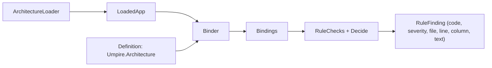

# Architecture engine

The rule engine checks each type of the app against one architecture definition. The definition gives the parts of the app and the rules between them. The core library (`VSA.Architecture.Engine`) loads the app, binds each type to a part, decides each use and gives each problem as a record. The engine app (`engine/`) runs the core after each build of the host.



## Projects

| Project | Path | Contains |
|---|---|---|
| `Umpire.Architecture` | `framework/Engine/Definition/` | The definition API. No ArchUnitNET |
| `VSA.Architecture.Engine` | `framework/Engine/Core/` | The core: load, bind, decide, check |
| `Umpire.Vsa` | `framework/Architectures/Vsa/Definition/` | `VsaArchitecture` and the VSA layers (`Concepts/`). No ArchUnitNET |
| `Umpire.Engine.Versions` | `framework/Engine/Versions/` | The version check (`UMP3001`). The engine app and the `vsa` tool bundle it |
| Engine app | `engine/` | The runner: Versions, Definition, Rules, Report. Its root project `engine/Engine.csproj` makes the build hook package `Umpire.Engine.Build` |

The runtime of an app references `Umpire.Architecture` through `Umpire.Kernel` (`Pack.Architecture`), and Umpire.Sdk gives each project `Umpire.Vsa`. So `Umpire.Architecture` and `Umpire.Vsa` use only the BCL and the VSA contracts. They also target `netstandard2.1`, for Unity. The runtime does not get ArchUnitNET.

## Definition API

A concept is a record that inherits `Concept`. A definition is a class that inherits `Architecture`. It adds the concepts to a tree in `Define`, and gives the rules in `Rules`. VSA calls its concepts layers: each VSA layer inherits `Layer : Concept`. A `Module` is the concept of the root part of a group instance: it is in the folder of its parent, for example the root class of each feature.

```csharp
public record Feature : Layer { public override string GroupFolder => "Features"; }
public record Kernel : External { public override string Assembly => "Umpire"; }

public class VsaArchitecture : Architecture {
    protected override void Configure(Options defaults) => defaults.DefaultPermission = Permission.Deny;

    protected override void Define(Root root) {
        root.Add<Framework>().Add<Kernel>();
        var feature = root.AddGroup<Feature>();
        feature.Add<Module>().OfType<Umpire.Kernel.Module>();
        feature.AddGroup<Slice>().Add<Contracts.Requests>().And<Handlers.Requests>().InParentFolder();
    }

    protected override void Rules(RuleBook rules) {
        rules.For<Feature>().Denies<Feature>().InOther<Feature>();
        rules.For<Feature>().Uses<Domain.Shared>().InOther<Feature>();
    }
}
```

| Call | Effect |
|---|---|
| `Add<T>()` | A part in the folder of the layer. It returns the `Part` |
| `And<T>()` | A sibling part. It returns a `PartGroup`: the next call applies to each part in it |
| `AddGroup<T>()` | A group: one part instance for each subfolder. It returns a `PartGroup` |
| `InParentFolder()` | The part shares the folder of its parent. Give it `OfType` |
| `OfType<T>()` | Each type of the part must be assignable to `T` |
| `Uses<T>()`, `Denies<T>()` | A rule (type `Rule`). A later rule wins |
| `Under<T>()`, `InSame<T>()`, `InOther<T>()` | Filters: the place of the source or the target |

`Options` sets `DefaultPermission` (the permission when no rule applies), `Boundary`, `UseSameConcept`, `Depth` and `Access`. Each field is nullable: a field that is not set takes the next value. The engine resolves each value in this order: the part (the rule call or the group parameter), the concept, the architecture, then `Options.BuiltIn`.

| Field | `Options.BuiltIn` | Set by |
|---|---|---|
| `DefaultPermission` | `Deny` | The architecture only |
| `UseSameConcept` | `false` | The architecture only |
| `Boundary` | `Open` | The architecture, a concept, a group |
| `Depth` | `WithChildren` | The architecture, a concept, a rule call |
| `Access` | `Public` | The architecture, a concept, a rule call |

A concept sets its values in `Configure(Options defaults)`. If a concept sets `DefaultPermission` or `UseSameConcept`, the definition stops: "Only the architecture sets <name>. Move it to Configure of the architecture."

`defaults.UseSameConcept = true` lets each part use each part of the same concept, in all places: for example a feature `Infrastructure` uses the `Infrastructure` of the framework and of a plugin. The engine adds these pairs before the layer bodies and the rules, so a rule can deny them. Boundary also limits them (see Boundary). The default is `false`.

The test `VsaDecisionsTests` writes the decision of the VSA definition for each pair of parts to `tests/Architecture.Tests/VsaDecisions.txt`. If a change to the definition changes a decision, the test fails and writes `VsaDecisions.actual.txt`. Compare the two files. If the change is correct, copy the new file over the baseline.

## Boundary

A closed group keeps its instances apart: an allow rule reaches a part in another instance of the group only if the rule crosses the group. The first value that is set wins:

1. The parameter of the rule call: `Uses<Contracts.Commands>(Boundary.Open)` crosses each closed group.
2. The parameter of the group: `root.AddGroup<Plugin>(Boundary.Open)`.
3. The concept body, for example `defaults.Boundary = Boundary.Closed` in `Configure(Options)` of the concept.
4. `defaults.Boundary` of the architecture. Its default is `Boundary.Open`.

In the example, the first rule reaches the Domain of the own feature, of Kernel and of the plugins. The second rule also reaches the `Domain.Shared` of the other features. A rule with `InOther<T>()` crosses the group `T` and each group inside it. Boundary does not change a deny rule, and it does not apply to a user outside the group: for example `App/Views` uses the presenters of each feature.

```csharp
defaults.Boundary = Boundary.Closed;
rules.For<Infrastructure>().Uses<Domain>();
rules.For<Feature>().Uses<Domain.Shared>().InOther<Feature>();
```

## External parts

An `External` part binds the types of a DLL by its name, not by its folder. `Kernel` binds `VSA.dll` and each `Umpire.*.dll`. A child of an external gets the DLL name of its parent and its folder, for example `Umpire.Vsa.Contracts.Requests`. The types of an external DLL are rule targets: a rule can deny them.

The definition stops at these shapes. The first four give one error, because a DLL name has no group segment, and the child of an external gets its DLL name from its parent:

| Definition | Error |
|---|---|
| `AddGroup<External>()` | `AddGroup<Lib>() makes a group of an external.` |
| An external under a group | `Add<Lib>() is under the group Group.` |
| An external under an external | `Add<OtherLib>() is under the external Lib.` |
| `AddGroup` under an external | `AddGroup<Child>() is under the external Lib.` |
| `InParentFolder()` on an external part | Its name is a DLL name segment |

## Depth

`Depth.Self` gives the part only. `Depth.WithChildren` gives the part and all its child parts. The first value that is set wins:

1. The parameter of the rule call, for example `Uses<Contracts>(Depth.WithChildren)`.
2. The layer body, for example `defaults.Depth = Depth.Self` in `Configure(Options)` of the layer.
3. `defaults.Depth` of the architecture. Its default is `Depth.WithChildren`.

## Permission and access

A rule has two values:

| Value | Enum | Values | Question |
|---|---|---|---|
| Permission | `Permission` | `Allow`, `Deny` | May this part use that part? |
| Access | `Access` | `Internal`, `Public` | How visible may the use be? |

`Uses<T>()` allows the use. `Denies<T>()` denies it. An access limits an allowed use:

```csharp
rules.For<Contracts.Requests>().Uses<Domain.Shared>();               // use and expose
rules.For<Handlers.Requests>().Uses<Domain>(Access.Internal);        // use, but do not expose outside the assembly
```

A type exposes a part when a type of that part is in its signature: a base type, an interface, or the type of a member (a method return or parameter, a property, a field), with their generic arguments. The access of a member is the narrowest of the member and its type. `Internal` is within `Public`. The check maps each visibility to one of the two values: `public`, `protected internal` and `protected` are `Public`, because code outside the assembly can see them. `internal`, `private protected` and `private` are `Internal`.

The framework can require a public exposure, so the check ignores two exposures:

| Exposure | Example |
|---|---|
| A base type or an interface of an `External` part, with its generic arguments | `: Presenter(bus), IPresenterEvent<Rang>` |
| A member that implements a member of such an interface. The name and the signature must match. An explicit implementation also matches | `public Task OnEventAsync(Rang e)` |

An interface of the app or of .NET is not of an `External` part, so it counts. For example, `: IEquatable<Note>` and `public bool Equals(Note? other)` give `UMP2003` if the rule limits `Note`.

The first access that is set wins:

1. The parameter of the rule call, for example `Uses<Domain>(Access.Internal)`.
2. The layer body, for example `defaults.Access = Access.Internal` in `Configure(Options)` of the layer.
3. `defaults.Access` of the architecture. Its default is `Access.Public`, so a rule with no access allows use and exposure.

## Binding

| Type | Part |
|---|---|
| In a DLL that an `External` part names | That part. The longest name wins |
| Source file in a part folder | The deepest part that matches the folder. A group instance matches each name |
| Source file only in `obj/` or `bin/` | Not checked |
| Helper type in a `InParentFolder` folder | The part of the first type that uses it ("follows user") |
| Source file in no part folder | None: `UMP2102` |
| Source file out of the definition root | Not checked |
| Source file in no folder alias (if the definition has aliases) | Not checked |

The engine reads the source file and the first line of each type from the PDB file, with System.Reflection.Metadata (`SourceFiles`).

## Unity projects

If the app root has `ProjectSettings/ProjectVersion.txt`, the app is a Unity project. Unity compiles `Assets/`, so the folders of a Unity app are not the folders of a .NET app.

| Folder | Binds as | Contains |
|---|---|---|
| `Assets/<UnityApp>/` | The root | `Features/`, `Plugins/` |
| `Assets/<UnityApp>/` | `App/` | `Views/`, `Host/` |
| `<UnitySource>/` (default `Source`) | The root | `Features/`, `Plugins/` of the .NET projects |

`Architecture.FolderAliases(appRoot)` gives these folder aliases (`FolderAlias(Folder, As)`). With no aliases, each folder binds as it is. The binder tries each map and keeps the deepest part. `VsaArchitecture` gets them from `UnityLayout.Aliases`. `UnityLayout` finds `UnityApp`: the one folder in `Assets/` (not `Assets/Plugins/`) with `Features/`, `Plugins/` or `Views/`. If two folders match, set it in a definition class:

```csharp
public sealed class CardsArchitecture : VsaArchitecture {
    public CardsArchitecture() {
        UnityApp = "Cards";
        UnitySource = "Modules";
    }
}

public class MyApp : App<Vsa<CardsArchitecture, UnityVsaHost>>;
```

`ArchitectureLoader` also reads the DLLs that Unity compiles (`UnityProject.Scripts`):

| Step | Unity project |
|---|---|
| App DLLs | Also `Library/ScriptAssemblies/*.dll` |
| No `Library/ScriptAssemblies/` | The warning `UMP2103` |
| A DLL name in the host output too | The engine loads the host output DLL only |
| A type in two DLLs | The engine loads it once. The Unity copy wins, so the uses of the views stay checked |
| Source file under `Library/` | Not app code (package cache, generated types) |

## The four checks

`RuleChecks.Of(type)` gives the findings of one type. `ArchitectureMap.Findings()` gives the findings of all app types, and the warnings of the loader.

| ID | Severity | Problem |
|---|---|---|
| `UMP2001` | Error | A type uses a part that the rules deny |
| `UMP2003` | Error | A type exposes a part with more access than its rule allows |
| `UMP2101` | Error | A type is not assignable to the `OfType` of its part |
| `UMP2102` | Error | A type is in a folder that the definition does not have |
| `UMP2103` | Warning | A Unity project has no `Library/ScriptAssemblies/` folder |

Each finding is a `RuleFinding(Code, Severity, File, Line, Column, Text)`. `File` is the full path. The engine app writes one line for each finding:

```text
C:/app/Features/Notes/Slices/Read/ReadHandler.cs(6,1): error UMP2001: ReadHandler in Handlers.Requests (Features/Notes/Slices/Read) uses Invoice in Domain (Features/Billing/Domain): no rule allows it (DefaultPermission = Deny). Remove the use, or change the rule in Rules.
```

## The checks of an app

The build hook package `Umpire.Engine.Build` on the host project runs the engine after each build. A test project does not check the architecture. See "The rule engine" in `AGENTS.md`.

| Step | Source |
|---|---|
| App root | `UmpireAppRoot`, else the nearest `global.json` |
| Versions | Each VSA version slot of the app root and of the host output (see "One version") |
| App DLLs | Each DLL of the host output with PDB source files under the app root |
| External DLLs | Each DLL of the host output whose name an `External` part names |
| Definition | `Pack.Architecture` of the one most derived app class (`App`). See "Engine errors" |
| Unity DLLs | See "Unity projects" |

### Engine errors

| ID | Problem |
|---|---|
| `UMP3000` | A step throws an exception. The run continues |
| `UMP3001` | A VSA version is not the engine version (see "One version") |
| `UMP3002` | No DLL of the host output has source files under the app root |
| `UMP3003` | The app has no app class |
| `UMP3004` | A step is skipped, because an earlier step failed |
| `UMP3005` | The app has more than one most derived app class |
| `UMP3006` | An app class has no public constructor with no parameters |

## One version

The engine, Umpire.Sdk, the `vsa` tool and the `Umpire.*` packages have one version. The step `CheckVersions` compares each version slot with the version of the engine. If one slot is different, it gives one `UMP3001` error with each different slot, and the engine skips the load and the rule checks (`UMP3004`). `umpire doctor` runs the same check (`VersionCheck` of `Umpire.Engine.Versions`) with the version of the tool, without the host output.

| Slot | Item |
|---|---|
| `dotnet-tools.json`, `.config/dotnet-tools.json` | `umpire.cli` |
| `global.json` | `msbuild-sdks` → `Umpire.Sdk` |
| Each `.csproj` and `Directory.*.props` of the app root | Each `Umpire.Sdk` pin and each `Umpire.*` package, also `Umpire.Engine.Build` |
| `*.deps.json` of the host output (engine only) | Each `Umpire.*` package library |

A file that does not exist gives no slot. The JSON files can have comments and trailing commas, as dotnet reads them.

| Value | Result |
|---|---|
| A version, or an exact range `[x]` | Compared as `x`. `umpire update` keeps the brackets |
| A `PackageReference` with no version | Uses its `PackageVersion` in the app root, else in the nearest `Directory.Packages.props` above it. With none, the check fails: the package has no version |
| A value with an MSBuild property, for example `$(UmpireVersion)` | Not checked, not written. `umpire doctor` shows it as "not checked" |

`umpire update` changes only the version text of `global.json`, so the file keeps its comments, BOM and line endings. A project file keeps its BOM and its line endings.

The app class (`MyApp : App<Vsa<TArchitecture, THost>>`, see `composition.md`) gives the definition for the runtime and for the checks. To change the VSA rules, derive a definition from `VsaArchitecture` and override `Rules`. Call `base.Rules` first: a later rule wins.

```csharp
public sealed class MyArchitecture : VsaArchitecture {
    protected override void Rules(RuleBook rules) {
        base.Rules(rules);
        rules.For<Presenters>().Denies<Contracts.Events>();
    }
}

public class MyApp : App<Vsa<MyArchitecture, WebVsaHost>>;
```

## Baseline

The step `ApplyBaseline` runs after `CheckRules` and before the Report step. It reads `umpire-baseline.txt` in the app root. An error with an entry in the file does not go to the report. A new error fails the build.

```text
UMP2001|App/Host/Probe.cs|Probe in Host uses CreateNoteRequest ...
UMP2102|Features/Old/Legacy.cs|Legacy is in a folder that the definition does not have ...
```

| Item | Rule |
|---|---|
| Line | `CODE\|path\|message`. The path is relative to the app root, with `/`. A finding with no file has an empty path |
| Key | The code, the path and the full message. The line number is not in the key, so an edit above an error does not change its entry |
| Count | Two equal entries accept two errors with that key. A third error with that key is new |
| Content | Errors only. A warning does not fail the build. The engine codes `UMP3000`-`UMP3999` never go in the file, so a version error or a crash always fails |
| No file | No error is accepted |
| Update | `dotnet build -p:UmpireUpdateBaseline=true` (engine switch `--updatebaseline true`) writes each current error, sorted (ordinal), and removes the stale entries. With no error, the update deletes the file. The update never skips the check |
| Stale entry | An entry that no error matches gives the warning `UMP3005` at its line in the file. Remove the line, or run the update |
| Bad line | A line that does not have the form gives the error `UMP3006`. Then no error is accepted |
| Incomplete run | If a step failed or was skipped (an engine error, or `UMP3004`), the update does not write the file and gives the warning `UMP3007`. Reason: that run has not found each error |
| Build stamp | The stamp name tells if the file exists. A delete of the file runs the check again |

`--mode Warn` applies after the baseline: each remaining error becomes a warning.

The Report step sorts the findings: the findings with no file first, then by path, line, code and message (ordinal). Each run gives the same order.

## Tests of the engine

`tests/Architecture.Tests` uses the fixture apps in `tests/Fixtures/Architecture/` (`GoodApp`, `BadApp`, and the marker DLL `Kit`) with a small test definition. `BadApp` has one known problem for each rule ID.
