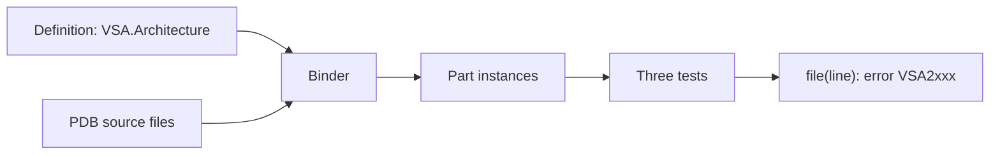

# Architecture engine

The architecture tests check each type of the app against one architecture definition. The definition gives the parts of the app and the rules between them. The engine binds each type to a part and runs three native ArchUnitNET tests.



## Projects

| Project | Path | Contains |
|---|---|---|
| `VSA.Architecture` | `framework/Architecture/Definition/` | The definition API. No ArchUnitNET |
| `VSA.Architecture.Engine` | `framework/Architecture/Engine/` | Binding, decisions, discovery, `.Check(app)` |
| `VSA.Architecture.Vsa` | `framework/Architecture/Vsa/` | `VsaDefinition` and the VSA layers. No ArchUnitNET |
| `VSA.Testing.Architecture` | `framework/Testing/Architecture/` | The test base, the build targets |

The runtime of an app references `VSA.Architecture.Vsa` through `VSA.Host` (`VsaApp<TApp>`). So `VSA.Architecture` and `VSA.Architecture.Vsa` use only the BCL and the VSA contracts. The runtime does not get ArchUnitNET or Mono.Cecil.

## Definition API

A layer is a record. A definition adds the layers to a tree in `Define`, and gives the rules in `Rules`.

```csharp
public record Feature : Layer { public override string GroupFolder => "Features"; }
public record Core : External { public override string Assembly => "VSA"; }

public class VsaDefinition : ArchitectureDefinition {
    protected override void Configure(Options options) => options.Unlisted = Permission.Deny;

    protected override void Define(Root root) {
        root.Add<Framework>().Add<Core>();
        var feature = root.AddMany<Feature>();
        feature.Add<RootClass>().NoFolder().OfType<VSA.Module.Module>();
        feature.AddMany<Slice>().Add<Contracts.Requests>().And<Handlers.Requests>().NoFolder();
    }

    protected override void Rules(Map map) {
        map.For<Feature>().Denies<Feature>().InOther<Feature>();
        map.For<Feature>().Uses<Domain.Shared>().InOther<Feature>();
    }
}
```

| Call | Effect |
|---|---|
| `Add<T>()`, `And<T>()` | A part in the folder of the layer, or a sibling part |
| `AddMany<T>()` | A group: one part instance for each subfolder |
| `NoFolder()` | The part shares the folder of its parent. Give it `OfType` |
| `OfType<T>()` | Each type of the part must be assignable to `T` |
| `Uses<T>()`, `Denies<T>()` | A rule. A later rule wins |
| `Under<T>()`, `InOwn<T>()`, `InOther<T>()` | Filters: the place of the source or the target |

`Options` sets `Unlisted` (the permission when no rule applies), `Own` (the permission between parts of the same group), `Reach` and `Access`.

## External parts

An `External` part binds the types of a DLL by its name, not by its folder. `Core` binds `VSA.dll` and each `VSA.*.dll`. A child of an external gets the DLL name of its parent and its folder, for example `VSA.Contracts.Requests`. The types of an external DLL are rule targets: a rule can deny them.

The definition stops at these errors:

| Definition | Error |
|---|---|
| `AddMany<External>()` | A DLL is not a group of folders |
| An external under a group | A DLL has no copy for each group item |
| An external under an external | The child gets its DLL name from its parent |
| `AddMany` under an external | DLL names have no item segment |
| `NoFolder()` on an external part | Its name is a DLL name segment |

## Reach

`Reach.Only` gives the part only. `Reach.WithChildren` gives the part and all its child parts. The first value that is set wins:

1. The parameter of the rule call, for example `Uses<Contracts>(Reach.WithChildren)`.
2. The layer body, for example `part.Reaches(Reach.Only)` in `Define(Part)` of the layer.
3. `options.Reach`.

## Permission and access

A rule has two values:

| Value | Enum | Values | Question |
|---|---|---|---|
| Permission | `Permission` | `Allow`, `Deny` | May this part use that part? |
| Access | `Access` | `Private`, `PrivateProtected`, `Protected`, `Internal`, `ProtectedInternal`, `Public` | How visible may the use be? |

`Uses<T>()` allows the use. `Denies<T>()` denies it. An access limits an allowed use:

```csharp
map.For<Contracts.Requests>().Uses<Domain.Shared>();               // use and expose
map.For<Handlers.Requests>().Uses<Domain>(Access.Internal);        // use, but do not expose outside the assembly
```

A type exposes a part when a type of that part is in its signature: a base type, an interface, or the type of a member (a method return or parameter, a property, a field), with their generic arguments. The access of a member is the narrowest of the member and its type. The order is partial: `Protected` and `Internal` are not comparable, so `Protected` is not within `Internal`.

The framework can require a public exposure, so the check ignores two exposures:

| Exposure | Example |
|---|---|
| A base type or an interface of an `External` part, with its generic arguments | `: Presenter(bus), IPresenterEvent<Rang>` |
| A member that implements a member of such an interface. The name and the signature must match. An explicit implementation also matches | `public Task OnEventAsync(Rang e)` |

An interface of the app or of .NET is not of an `External` part, so it counts. For example, `: IEquatable<Note>` and `public bool Equals(Note? other)` give `VSA2003` if the rule limits `Note`.

The first access that is set wins:

1. The parameter of the rule call, for example `Uses<Domain>(Access.Internal)`.
2. The layer body, for example `part.Accesses(Access.Private)` in `Define(Part)` of the layer.
3. `options.Access`. Its default is `Access.Public`, so a rule with no access allows use and exposure.

## Binding

| Type | Part |
|---|---|
| In a DLL that an `External` part names | That part. The longest name wins |
| Source file in a part folder | The deepest part that matches the folder. A group item matches each name |
| Source file only in `obj/` or `bin/` | The project folder of the file |
| Helper type in a `NoFolder` folder | The part of the first type that uses it ("follows user") |
| Source file in no part folder | None: `VSA2102` |
| Source file out of the definition root | Not checked |

The engine reads the source file and the first line of each type from the PDB file, with Mono.Cecil.

## The four tests

`ArchitectureTests<TDefinition>` has the four tests. `ArchitectureTests` is `ArchitectureTests<ArchitectureDefinition>`: it reads the definition of the app. Each test is one native ArchUnitNET rule:

```csharp
[TestCaseSource(nameof(PartInstances))]
public void Uses_only_allowed_parts(PartInstance instance) {
    Types().That().AreIn(instance).Should().NotDependOnAnyDeniedTo(instance).Check(Architecture);
}

[TestCaseSource(nameof(LimitedPartInstances))]
public void Has_the_type_of_its_part(PartInstance instance) {
    Types().That().Are(instance.Limited).Should().BeAssignableTo(instance.OfTypes).Check(Architecture);
}

[TestCaseSource(nameof(ExposureLimitedPartInstances))]
public void Exposes_only_allowed_parts(PartInstance instance) {
    Types().That().AreIn(instance).Should().ExposeOnlyWithinLimitsOf(instance).Check(Architecture);
}

[Test]
public void Each_type_is_in_a_part() {
    Types().That().Are(AppTypes).Should().Be(BoundTypes).Check(Architecture);
}
```

| ID | Test | Failure |
|---|---|---|
| `VSA2001` | `Uses_only_allowed_parts` | A type uses a part that the rules deny |
| `VSA2003` | `Exposes_only_allowed_parts` | A type exposes a part with more access than its rule allows |
| `VSA2101` | `Has_the_type_of_its_part` | A type is not assignable to the `OfType` of its part |
| `VSA2102` | `Each_type_is_in_a_part` | A type is in a folder that the definition does not have |

`.Check(Architecture)` gives one line for each failure:

```text
Features/Notes/Slices/Read/ReadHandler.cs(6): error VSA2001: ReadHandler in Handlers.Requests (Features/Notes/Slices/Read) uses Invoice in Domain (Features/Billing/Domain): no rule allows it (Unlisted = Deny). Remove the use, or change the rule in Rules.
```

## Test project of an app

The app class (`MyApp : VsaApp<MyApp>`, see `composition.md`) gives the rules for the runtime and for the tests. A test project references the host and `VSA.Testing.Architecture`. It writes no test class. The build adds this class to `obj/.../VsaArchitectureTests.g.cs`:

```csharp
namespace <RootNamespace>;
public partial class ArchitectureTests : VSA.Testing.Architecture.ArchitectureTests;
```

| Step | Source |
|---|---|
| App root | `AssemblyMetadata("VsaAppRoot")` of the test assembly, else the nearest `global.json` |
| App DLLs | Each DLL of the test output with PDB source files under the app root |
| External DLLs | Each DLL of the test output whose name an `External` part names |
| Definition | The `Architecture` of the most derived `IArchitectureSource` (the app class), if it is a `TDefinition` |
| Fallback definition | The most derived class with no constructor parameters that is or inherits `TDefinition` |
| Not loaded | The test assembly, `VSA.Architecture`, and each DLL that references `VSA.Architecture.Engine` |

To change the VSA rules, override `Rules` in the app class. `VsaDefinition` applies these rules after its own rules, and a later rule wins:

```csharp
using VSA.Architecture;
using VSA.Architecture.Vsa;
using VSA.Host;

public class MyApp : VsaApp<MyApp> {
    protected override void Rules(Map map) => map.For<Presenters>().Denies<Contracts.Events>();
}
```

To add a test of the app, write the other part of the class. `AreIn<TLayer>()` and `NotDependOnAny<TLayer>()` select the types of a layer. The layers are in the namespace `VSA.Architecture.Vsa`:

```csharp
public partial class ArchitectureTests {
    [Test]
    public void Domain_does_not_use_Infrastructure() {
        Types().That().AreIn<Domain>().Should().NotDependOnAny<Infrastructure>().Check(Architecture);
    }
}
```

To stop the generated class, set `<VsaArchitectureTests>false</VsaArchitectureTests>`.

## Tests of the engine

`tests/Architecture.Tests` uses the fixture apps in `tests/Fixtures/Architecture/` (`GoodApp`, `BadApp`, and the marker DLL `Kit`) with a small test definition. `BadApp` has one known problem for each rule ID.

## Legacy copy

`docs/legacy/architecture-tests/` has a copy of the layer map tests (`Layers.cs`, `VsaArchitectureTests`, the rule tests and their fixtures). The files do not build. They are there only to compare.
