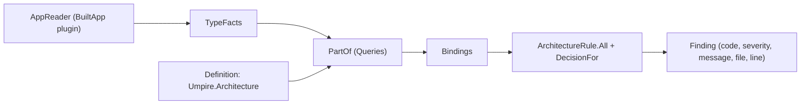

# Architecture engine

The rule engine checks each type of the app against one architecture definition. The definition gives the parts of the app and the rules between them. `new ResolvedArchitecture(definition)` compiles the definition one time: the block, the options of each part, the use rules, the counts and the matches. If the definition has an error, the constructor throws. `architecture/Queries/` gives the answers on plain facts: the part of each type (`PartOf`), the decision for each use (`ResolvedArchitecture.DecisionFor`), and the counts and the matches (`ResolvedArchitecture.Counts`, `Matches`). The engine app (`engine/`) reads the built app, asks these questions and writes each problem as a `Finding`, after each build of the host.



## Projects

| Project | Path | Contains |
|---|---|---|
| `Umpire.Architecture` | `architecture/` | The definition API and `Queries/`. No ArchUnitNET |
| `Umpire.Vsa` | `packs/Vsa/Architecture/` | `VsaArchitecture` and the VSA layers (`Concepts/`). No ArchUnitNET |
| `Umpire.Engine.Versions` | `engine/Versions/` | The version check (`UMP030401`). The engine app and the `umpire` tool bundle it |
| Engine app | `engine/` | The runner: Blocks, Versions, LoadApp, Rules, Report. `Plugins/BuiltApp` reads the DLL and PDB files: `BinReader` (`MetadataLoadContext`) one time for each run, `AppLoader` for the one definition type, and ArchUnitNET for the type facts. Its root project `engine/Engine.csproj` is not a package: the Umpire SDK packages hold the engine in `tools/net10.0/` |

The runtime of an app references `Umpire.Architecture` through `Umpire.Kernels` (`Pack.Architecture`), and Umpire.Sdk gives each project the package `Umpire` (one `Umpire.dll` with `Umpire.Architecture` and `Umpire.Vsa`). So `Umpire.Architecture` and `Umpire.Vsa` use only the BCL and the VSA contracts. They also target `netstandard2.1`, for Unity. The runtime does not get ArchUnitNET.

## Definition API

A concept is a record that inherits `Concept`. A definition is a class that inherits `Architecture`. It adds the concepts to a tree in `Define`, and gives the rules in `Rules`. The block kinds of `blocks.md` are concept records in `Umpire.Architecture.Blocks`: `App`, `Pack`, `Kernel`, `Component`, `Module` and `Library`, on the base `BlockKind`. `Kernel` is an external part: the `Umpire.*` DLLs. Each VSA layer inherits `Layer : Concept`, and only a real layer inherits it. A module kind, for example `Feature` or `Plugin`, inherits `Module`. The part `Add<Module>()` holds the module class: it is in the folder of its parent, for example the root class of each feature. A rule on `Module` selects only these parts, because a rule compares the exact concept type, not its base.

```csharp
public record Feature : Module { public override string GroupFolder => "Features"; }
public record Kernel : External { public override string Assembly => "Umpire"; }

public class VsaArchitecture : Architecture {
    protected override void Configure(Options defaults) => defaults.DefaultPermission = Permission.Deny;

    protected override void Define(Block block) {
        block.Add<Kernel>();
        var feature = block.AddGroup<Feature>();
        feature.Add<Module>().OfType<Umpire.Kernels.Module>();
        feature.AddGroup<Slice>().Add<Contracts.Requests>().And<Handlers.Requests>().InParentFolder();
    }

    protected override void Rules(RuleBook rules) {
        rules.For<Feature>().Denies<Feature>().InOther<Feature>();
        rules.For<Feature>().Uses<Domain.Shared>().InOther<Feature>();
    }
}
```

| Call | Effect |
|---|---|
| `Add<T>()` | A part in the folder of the layer. It returns the `Part` |
| `And<T>()` | A sibling part. It returns a `PartGroup`: the next call applies to each part in it |
| `AddGroup<T>()` | A group: one part instance for each subfolder. It returns a `PartGroup` |
| `AddBlock<T>()` | The place of another block in the folder of `T`. The place is one part, with no children (see "Blocks and check entries") |
| `AddBlockGroup<T>()` | Each subfolder of the folder of `T` is the place of another block, for example `Packs/<Name>/` |
| `InParentFolder()` | The part shares the folder of its parent. Give it `OfType` |
| `OfType<T>(required)` | Each type of the part must be assignable to `T`. `required: true` also needs one type of `T` in each instance (see "Required") |
| `Named(Name)` | The name of each type of the part (see "Content of a part") |
| `Uses<T>()`, `Denies<T>()` | A rule (type `Rule`). A later rule wins |
| `Has<T>()`, `Takes<T>()` | A count (type `Count`) or a match (type `Match`). See "Counts and matches" |
| `OnlyKind(TypeKind)`, `Owns<TAttribute>()` | The kinds of type of a part, and the parts that can have an attribute. See "Content of a part" |
| `Under<T>()`, `InSame<T>()`, `InOther<T>()` | Filters: the place of the source or the target. A filter applies to each entry before it in the chain |

`Options` sets `DefaultPermission` (the permission when no rule applies), `Boundary`, `UseSameConcept`, `Depth`, `Access` and `Required`. Each field is nullable: a field that is not set takes the next value. The engine resolves each value in this order: the part (the rule call, the group parameter or the `OfType` call), the concept, the architecture, then `Options.BuiltIn`.

| Field | `Options.BuiltIn` | Set by |
|---|---|---|
| `DefaultPermission` | `Deny` | The architecture, a concept (of the target part) |
| `UseSameConcept` | `false` | The architecture, a concept |
| `Boundary` | `Open` | The architecture, a concept, a group |
| `Depth` | `WithChildren` | The architecture, a concept, a rule call |
| `Access` | `Public` | The architecture, a concept, a rule call |
| `Required` | `false` | The architecture, a concept, an `OfType` call |

The convention for a new option: if a concept or the architecture can also set it, it gets a nullable parameter at the call site and a nullable field in `Options`. The lookup reads the call site, then the concept, then the architecture, then `Options.BuiltIn`.

A concept has the same three members as a definition: `Configure(Options defaults)`, `Define(Part part)` and `Rules(RuleBook rules)`. A thing that belongs to one concept goes in the body of that concept. `Define` runs when a definition adds a part of the concept. The compiler calls `Rules` one time for each concept that the definition has, before `Rules` of the architecture. A concept rule is only about the parts of its concept: the compiler adds `Under<T>()` of the concept to each subject entry, not to the targets. The use rules of the architecture come after the concept rules, so a use rule of the architecture or of a pack variant wins. The counts and the matches add up: a concept count or match always applies, and a pack variant cannot remove it. A concept rule that names a subject with no part under its concept fails, and the message names the implicit `Under<T>()`. The compiler calls `Rules` for each concept type. So a concept that inherits another concept with a `Rules` body runs that body again, with its own type as the scope.

```csharp
public record Slice : Layer {
    protected override void Define(Part part) {
        part.Add<Contracts.Requests>().And<Handlers.Requests>().And<Validators>().InParentFolder();
    }

    protected override void Rules(RuleBook rules) {
        rules.For<Validators>().Uses<Contracts.Requests>().InSame<Slice>();
    }
}
```

The rule in this example compiles as `For<Validators>().Under<Slice>().Uses<Contracts.Requests>().InSame<Slice>()`. A concept rule gives the same decisions as the same rule in the architecture, so `VsaDecisions.txt` does not show where a rule is.

A concept sets its values in `Configure(Options defaults)`. `Part.Options` holds the values of the concept, with the values of the call site on top. `ResolvedArchitecture.OptionsOf(part)` gives the full values of a part. When no rule applies to a use, the decision takes `DefaultPermission` of the target part.

A rule condition is a `Condition`: the groups that must have the same instance (`Same`) and the groups that must have another instance (`Other`). Its text is for example `same Feature, other Slice`, or `always`.

`defaults.UseSameConcept = true` lets each part use each part of the same concept, in all places: for example a feature `Infrastructure` uses the `Infrastructure` of the framework and of a plugin. The engine adds these pairs before the layer bodies and the rules, so a rule can deny them. Boundary also limits them (see Boundary). The default is `false`.

`VsaArchitecture.Define` calls one `virtual` define method for each base group and for the kernel: `DefineKernel`, `DefinePlugin`, `DefineFeature` and `DefineSlice`. The parts of a slice are in `Slice.Define`, so `DefineSlice` is empty in the base. It runs after `Slice.Define`. A pack variant overrides one to add a part to each instance of that group (see `pack-variants.md`).

Each architecture defines its kernel with two hooks of `Architecture`: `DefineKernel(Part kernel)` (the kernel parts) and `KernelRules(RuleBook rules)` (the rules inside the kernel). The kernel is defined on the architecture, never on the pack. Two checks use it:

| Check | Kernel parent | Binding | Rules |
|---|---|---|---|
| An app | The external `Kernel` part (`Define` calls `DefineKernel`) | By assembly, or by namespace in the bundled `Umpire.dll` | The rules of the app toward the kernel |
| The pack | `PackParts.Kernel`, the folder `Kernel/` of the pack | By folder | `KernelRules` |

For the pack check, the engine reads the architecture from the base chain of the pack class (`Pack<VsaArchitecture, …>`, `BlockEntry.Packed`) and creates `new PackArchitecture(architecture)`. The type requirements of the layer concepts (`OfType`) do not apply inside the kernel of a pack, because the kernel holds the bases themselves. Today `VsaArchitecture.KernelRules` allows each use between two kernel layers: the check covers the shape of the kernel, and the rules come later.

The test `VsaDecisionsTests` writes the decision of the VSA definition for each pair of parts to `tests/Architecture.Tests/VsaDecisions.txt`. If a change to the definition changes a decision, the test fails and writes `VsaDecisions.actual.txt`. Compare the two files. If the change is correct, copy the new file over the baseline.

### `using` placement

The placement of the `using` directives is a guideline, not an enforced rule (`IDE0065` is off). Use the next step only if the step before it is not enough:

1. Put the `using` directives inside the namespace. This is the default, and the editor suggests it (`csharp_using_directive_placement = inside_namespace`).
2. Put some `using` directives outside the namespace if the file is inside the namespace of the concept records, for example a pack variant in `Umpire.Vsa.Definition.*`.
3. Add an alias inside the namespace, for example `using Plugin = Umpire.Vsa.Definition.Plugin;`.

A definition file writes each real type with its full name, for example `OfType<Umpire.Kernels.Module>()`. Then it does not import the namespace of that type, and no clash occurs.

C# finds a name level by level, from the innermost namespace to the outermost. At each level, it examines the members of the namespace first, then the `using` directives of that level. A concept record has the name of a folder, and a folder is a part of a namespace. In app code, a `using` inside the namespace wins over the outer app namespaces:

```csharp
using Umpire.Architecture.Blocks;
namespace Shop.App.Host {
    rules.For<App>();          // CS0118: 'App' is a namespace (Shop.App)
}

namespace Shop.App.Host {
    using Umpire.Architecture.Blocks;
    rules.For<App>();          // the record App
}
```

In a pack variant, the records are in an outer namespace. There, a `using` inside the namespace wins over the records:

```csharp
namespace Umpire.Vsa.Definition.Ecs {
    using Umpire.Vsa.Composition;
    rules.For<Plugin>();       // the class Umpire.Vsa.Composition.Plugin: CS0311
}

using Umpire.Vsa.Composition;
namespace Umpire.Vsa.Definition.Ecs {
    rules.For<Plugin>();       // the record Umpire.Vsa.Definition.Plugin
}
```

Thus no one placement is correct for each file. `RuleBook.For<T>() where T : Concept` makes each wrong binding a compile error (`CS0104`, `CS0118` or `CS0311`), so no clash compiles silently. `IDE0065` selects files only by path, so it cannot make an exception for a definition file. If a rule is necessary after 0.1.0, write a custom analyzer.

## Boundary

A closed group keeps its instances apart: an allow rule reaches a part in another instance of the group only if the rule crosses the group. The first value that is set wins:

1. The parameter of the rule call: `Uses<Contracts.Commands>(Boundary.Open)` crosses each closed group.
2. The parameter of the group: `block.AddGroup<Plugin>(Boundary.Open)`.
3. The concept body, for example `defaults.Boundary = Boundary.Closed` in `Configure(Options)` of the concept.
4. `defaults.Boundary` of the architecture. Its default is `Boundary.Open`.

In the example, the first rule reaches the Domain of the own feature, of Kernel and of the plugins. The second rule also reaches the `Domain.Shared` of the other features. A rule with `InOther<T>()` crosses the group `T` and each group inside it. Boundary does not change a deny rule, and it does not apply to a user outside the group: for example `App/Views` uses the presenters of each feature.

```csharp
defaults.Boundary = Boundary.Closed;
rules.For<Infrastructure>().Uses<Domain>();
rules.For<Feature>().Uses<Domain.Shared>().InOther<Feature>();
```

## External parts

An `External` part binds the types of a DLL by its name, not by its folder. `Kernel` binds `Umpire.dll` and each `Umpire.*.dll`. A child of an external gets the DLL name of its parent and its folder, for example `Lib.Child`. A child can also name its own DLL with `InAssembly`: `VsaArchitecture` gives `Contracts` the DLL `Umpire.Messages.Contracts`, and `Contracts.Requests` the DLL `Umpire.Vsa.Contracts.Requests`. A type also matches by its namespace, so the bundle `Umpire.dll` binds `Umpire.Vsa.Contracts.Requests.IRequest` to `Contracts.Requests`. The longest matching name wins. The types of an external DLL are rule targets: a rule can deny them.

`Umpire.Vsa.dll` (the pack: `Vsa<THost>`, `VsaArchitecture`) has no external part of its own. `Kernel` binds it by the name `Umpire`, and `App/Host` uses `Kernel` (`Uses<Kernel>(Depth.Self)`), so the app class can name the pack. Reason: no other part uses the pack, so a separate part gives no new rule.

The definition stops at these shapes. The first four give one error, because a DLL name has no group segment, and the child of an external gets its DLL name from its parent:

| Definition | Error |
|---|---|
| `AddGroup<External>()` | `AddGroup<Lib>() makes a group of an external.` |
| An external under a group | `Add<Lib>() is under the group Group.` |
| An external under an external | `Add<OtherLib>() is under the external Lib.` |
| `AddGroup` under an external | `AddGroup<Child>() is under the external Lib.` |
| `InParentFolder()` on an external part | Its name is a DLL name segment |

## Depth

`Depth.Self` gives the part only. `Depth.WithChildren` gives the part and all its child parts. The first value that is set wins:

1. The parameter of the rule call, for example `Uses<Contracts>(Depth.WithChildren)`.
2. The layer body, for example `defaults.Depth = Depth.Self` in `Configure(Options)` of the layer.
3. `defaults.Depth` of the architecture. Its default is `Depth.WithChildren`.

## Permission and access

A rule has two values:

| Value | Enum | Values | Question |
|---|---|---|---|
| Permission | `Permission` | `Allow`, `Deny` | May this part use that part? |
| Access | `Access` | `Internal`, `Public` | How visible may the use be? |

`Uses<T>()` allows the use. `Denies<T>()` denies it. An access limits an allowed use:

```csharp
rules.For<Contracts.Requests>().Uses<Domain.Shared>();               // use and expose
rules.For<Handlers.Requests>().Uses<Domain>(Access.Internal);        // use, but do not expose outside the assembly
```

A type exposes a part when a type of that part is in its signature: a base type, an interface, or the type of a member (a method return or parameter, a property, a field), with their generic arguments. The access of a member is the narrowest of the member and its type. `Internal` is within `Public`. The check maps each visibility to one of the two values: `public`, `protected internal` and `protected` are `Public`, because code outside the assembly can see them. `internal`, `private protected` and `private` are `Internal`.

The framework can require a public exposure, so the check ignores two exposures:

| Exposure | Example |
|---|---|
| A base type or an interface of an `External` part, with its generic arguments | `: Presenter(bus), IPresenterHandler<Rang>` |
| A member that implements a member of such an interface. The name and the signature must match. An explicit implementation also matches | `public Task<Result<Unit>> HandleAsync(IEnvelope<Rang> e)` |

An interface of the app or of .NET is not of an `External` part, so it counts. For example, `: IEquatable<Note>` and `public bool Equals(Note? other)` give `UMP020102` if the rule limits `Note`.

The first access that is set wins:

1. The parameter of the rule call, for example `Uses<Domain>(Access.Internal)`.
2. The layer body, for example `defaults.Access = Access.Internal` in `Configure(Options)` of the layer.
3. `defaults.Access` of the architecture. Its default is `Access.Public`, so a rule with no access allows use and exposure.

## Counts and matches

`Rules` has three kinds of statement. A use rule gives a decision for each use. A count and a match fail for each instance or type that does not obey them.

| Kind | Call | Fails when | Code |
|---|---|---|---|
| Use | `For<S>().Uses<T>()`, `Denies<T>()` | A type of `S` uses a type of `T`, and the decision is `Deny` | `UMP020101` |
| Count | `For<S>().Has<T>()` with `AtLeast(n)`, `AtMost(n)`, `Exactly(n)`, `OfOneKind()` | The number of types is not in the limit, or the types are in more than one part | `UMP020301` |
| Match | `For<S>().Takes<T>()`, optional `InSame<G>()` | A type of `S` has no type argument in `T`, or the argument is in another instance of `G` | `UMP020302` |

`Has<T>()` has two meanings. The subject `S` selects the meaning:

| Subject | Count | Example |
|---|---|---|
| A group | The types of `T` in each instance of the group | `rules.For<Slice>().Has<Handlers>().AtLeast(1)`: each slice has a handler or a hook |
| A part | For each type of `S`, the types of `T` that take it as a type argument of a base type | `rules.For<Contracts.Requests>().Has<Handlers.Requests>(Depth.Self).Exactly(1)`: each request has one handler |

The rules of a count:

- `T` includes each concept that is nested in `T` (the concept family). For example, `Has<Handlers>()` counts `Handlers.Commands` and `Handlers.Commands.Hooks`. `Has<T>(Depth.Self)` counts only `T`. The `Depth` of the concept does not apply to a count.
- A helper that follows its user does not count, a nested type does not count, and an abstract class or an interface does not count. Only a concrete type that binds by its own base type counts. A static class counts: it is `abstract sealed` in IL, but it is not a base.
- A count counts only the types of the app in the block folder. A type of an external DLL does not count.
- A count with no limit stops the definition: "has no limit. Add AtLeast, AtMost, Exactly or OfOneKind."
- The finding is at the first type of the instance (by file, then line), or at the type of the subject.

`Takes<T>()` reads the type arguments of the base types and interfaces of the type and of each class in its base chain (`TypeFacts.BaseArguments`), so a handler that inherits a middle base matches. An abstract subject type is not checked. For example, `rules.For<Handlers.Requests>().Under<Feature>().Takes<Contracts.Requests>().InSame<Slice>()`: a request handler handles a request of its own slice. With no `InSame<G>()`, the match needs only one type argument in `T`. A subject type that is not in an instance of `G` fails, so use `Under<T>()` to select the subjects.

```text
error UMP020301: Slice Features/Notebook/Slices/Draft has 0 Handlers types: the rule "Slice has Handlers at least 1" needs at least 1. Add one, or move the other types to another part.
```

### Required

`OfType(type, required: true)` makes the base type required. Each instance of the nearest group of the part then has at least one type of that base in the part. If the part is in no group, the app is one instance. The engine checks it as a count, so it gives `UMP020301`.

```csharp
part.OfType(typeof(RequestHandler<,>), required: true);
```

| Order | Place | Form |
|---|---|---|
| 1 | The call site | `OfType(..., required: true)` or `required: false` |
| 2 | `Configure` of the concept | `defaults.Required = true` |
| 3 | `Configure` of the architecture | `defaults.Required = true` |
| 4 | `Options.BuiltIn` | `false`: the part is permitted, not required |

`VsaArchitecture` sets no `Required`. Its counts are lines in `Rules` (see "Counts and matches" in `architecture-rules.md`).

## Content of a part

The name of a type is structure, so `Named` is in `Define`, next to `OfType`. The kind of type and the place of an attribute are statements, so they are in `Rules`, next to the counts.

| Kind | Call | Fails when | Code |
|---|---|---|---|
| Name | `part.Named(Name)` | The type name does not obey the name rule | `UMP020204` |
| Kind of type | `rules.For<S>().OnlyKind(TypeKind)` | A type of `S` is of another kind | `UMP020303` |
| Attribute place | `rules.For<S>().Owns<TAttribute>()` | A type outside `S`, or one of its members, has the attribute | `UMP020304` |

```csharp
public sealed record CliCommand : Layer {
    protected override void Define(Part part) {
        part.Named(Name.OfGroup());
    }

    protected override void Rules(RuleBook rules) {
        rules.For<CliCommand>().OnlyKind(TypeKind.StaticClass);
        rules.For<CliCommand>().Owns<CliCommandAttribute>();
    }
}
```

| Name rule | A good name |
|---|---|
| `Name.Suffix("Hook")` | `ChimeHook` |
| `Name.Prefix("I")` | `IClock` |
| `Name.OfGroup()` | `Touch` in `Features/Touch/` (the nearest group instance) |
| `Name.OfGroup<Feature>().WithSuffix("Settings")` | `TouchSettings` in `Features/Touch/` |

The rules of the content checks:

- A name rule has no regex. The generic arity (for example `` `1 ``) is not part of the name. A `Name.OfGroup()` on a part with no group stops the definition.
- `TypeKind` is a flags enum: `Class`, `StaticClass`, `AbstractClass`, `Record`, `Struct`, `Interface`, `Enum`, `Delegate`. Combine kinds with `|`. `TypeKind.None` allows no type. With no `OnlyKind`, each kind is allowed. Each type has one kind: an abstract record is an `AbstractClass`, and a record struct is a `Struct`.
- If more than one statement owns an attribute, the attribute can be in each of their parts. The engine reads the attributes of the type and of its members. An attribute that derives from the owned attribute is also owned, and an owned generic attribute matches each closed form.
- The engine does not read an attribute on a parameter, a return value, a generic parameter or a local function.
- A nested type has the source file of its outer type, so the name and kind checks and the counts do not read it. The attribute check reads it.
- A part has one name rule. If `Named` is called again, the later call wins.
- A static class is not a subject of a match (`Takes<T>()`).
- The checks do not read a helper that follows its user, a type of an external DLL or a type in a block place.
- `ArchitectureTest.Problems(place)` gives the name, kind and attribute problems of one type.

## Binding

| Type | Part |
|---|---|
| In a DLL that an `External` part names | That part. The longest name wins |
| Source file in a part folder | The deepest part that matches the folder. A group instance matches each name |
| Source file only in `obj/` or `bin/` | Not checked |
| Helper type in a `InParentFolder` folder | The part of the first type that uses it ("follows user") |
| Helper type with no user in a `InParentFolder` folder | The part of its nearest base type in the same folder ("follows base"). For example, a rule class that the engine finds by reflection follows its base class |
| Source file in no part folder | None: `UMP020202` |
| Source file out of the block folder | Not checked |
| Source file in no folder alias (if the definition has aliases) | Not checked |

The engine reads the source file and the first line of each type from the PDB file, with System.Reflection.Metadata (`BinReader`, one time for each run).

## Unity projects

If the block folder has `ProjectSettings/ProjectVersion.txt`, the app is a Unity project. Unity compiles `Assets/`, so the folders of a Unity app are not the folders of a .NET app.

| Folder | Binds as | Contains |
|---|---|---|
| `Assets/<UnityApp>/` | The block | `Features/`, `Plugins/` |
| `Assets/<UnityApp>/` | `App/` | `Views/`, `Host/` |
| `<UnitySource>/` (default `Source`) | The block | `Features/`, `Plugins/` of the .NET projects |

`Architecture.FolderAliases(blockFolder)` gives these folder aliases (`FolderAlias(Folder, As)`). With no aliases, each folder binds as it is. The binder tries each map and keeps the deepest part. `VsaArchitecture` gets them from `UnityLayout.Aliases`. `UnityLayout` finds `UnityApp`: the one folder in `Assets/` (not `Assets/Plugins/`) with `Features/`, `Plugins/` or `Views/`. If two folders match, set it in a definition class:

```csharp
public sealed class CardsArchitecture : VsaArchitecture {
    public CardsArchitecture() {
        UnityApp = "Cards";
        UnitySource = "Modules";
    }
}

public class MyApp : App<Vsa<CardsArchitecture, UnityHost>>;
```

`AppReader` (`engine/Plugins/BuiltApp/Infrastructure`) also reads the DLLs that Unity compiles (`UnityProject.Scripts`):

| Step | Unity project |
|---|---|
| App DLLs | Also `Library/ScriptAssemblies/*.dll` |
| No `Library/ScriptAssemblies/` | The warning `UMP020203` |
| A DLL name in the host output too | The engine loads the host output DLL only |
| A type in two DLLs | The engine loads it once. The Unity copy wins, so the uses of the views stay checked |
| A relative source path in the PDB (Unity package code, `.\Packages\...`) | `SymbolReader` resolves it against the Unity project root: the nearest folder above the DLL with `ProjectSettings/ProjectVersion.txt` (`UnityProject.Root`) |
| Source file under `Library/` | Not app code (package cache, generated types) |

## The checks of the Rules step

Each architecture rule is one class in `engine/Features/Rules/Slices/CheckRules/` on a group base. The rule sets only its `Number` and, if it is not an error, its `Severity`. The group base sets the group, and `ArchitectureRule` makes the code: `UMP02` + group + number. `ArchitectureCheck.Findings()` (the Rules step) runs `ArchitectureRule.All`, so the engine knows no code. Other code finds a rule by its type: `ArchitectureRule.Of<DeniedUseRule>()`.

```csharp
sealed class DeniedUseRule : UseRule {
    public override int Number => 1;

    protected override IEnumerable<Finding> Find(ArchitectureCheck check, RuleValues values) => ...;
}
```

| ID | Class | Group base | Severity | Problem |
|---|---|---|---|---|
| `UMP020101` | `DeniedUseRule` | `UseRule` (01) | Error | A type uses a part that the rules deny |
| `UMP020102` | `WideExposureRule` | `UseRule` (01) | Error | A type exposes a part with more access than its rule allows |
| `UMP020201` | `WrongTypeRule` | `PlaceRule` (02) | Error | A type is not assignable to the `OfType` of its part |
| `UMP020202` | `UnmappedTypeRule` | `PlaceRule` (02) | Error | A type is in a folder that the definition does not have |
| `UMP020203` | `MissingScriptAssembliesRule` | `PlaceRule` (02) | Warning | A Unity project has no `Library/ScriptAssemblies/` folder |
| `UMP020204` | `WrongNameRule` | `PlaceRule` (02) | Error | A type name does not obey the `Named` rule of its part (see "Content of a part") |
| `UMP020301` | `CountRule` | `StatementRule` (03) | Error | A count of the definition is not in its limit (see "Counts and matches") |
| `UMP020302` | `MatchRule` | `StatementRule` (03) | Error | A match of the definition does not hold (see "Counts and matches") |
| `UMP020303` | `WrongKindRule` | `StatementRule` (03) | Error | A type is of a kind that `OnlyKind` of its part does not allow (see "Content of a part") |
| `UMP020304` | `AttributePlaceRule` | `StatementRule` (03) | Error | A type outside the owner parts of an attribute has the attribute (see "Content of a part") |
| `UMP020401` | `CoveredBlockRule` | `BlockPlaceRule` (04) | Error | A part of the definition covers the folder of another block (see "Blocks and check entries") |
| `UMP020402` | `EmptyBlockPlaceRule` | `BlockPlaceRule` (04) | Error | A block place (`AddBlock<T>()`, `AddBlockGroup<T>()`) holds no check entry |

The Rules step reads the values of the nearest `.umpireconfig` file at or above the block folder: each one-line scalar of the `umpire` table as a dotted key, with no case (`RuleKeys` in the Steps plugin). The base gives each rule its values (`RuleValues`): `umpire.<code>.<key>`, then `umpire.<key>`, then the default on the class. The severity key is the same as for the analyzers:

```toml
umpire.UMP020101.severity = "warning"   # error, warning, suggestion, or none (the rule does not run)
```

Each finding is a `Finding(Code, Severity, Message, File, Line)` of the Steps plugin. `File` is the full path. The engine app writes one line for each finding:

```text
C:/app/Features/Notes/Slices/Read/ReadHandler.cs(6,1): error UMP020101: ReadHandler in Handlers.Requests (Features/Notes/Slices/Read) uses Invoice in Domain (Features/Billing/Domain): no rule allows it (DefaultPermission = Deny). Remove the use, or change the rule in Rules.
```

## The checks of an app

An engine run does the checks of an app. The Umpire SDK package holds the engine in `tools/net10.0/` (property `UmpireEngineFile`). See "The rule engine" in `AGENTS.md`.

```text
umpire-engine --project <root> --block <block> --bin <output> [--stage Build,Check] [--mode Warn]
├─ Build stage
│  └─ 1 Build      dotnet build <root> -p:UmpireCheck=false → each build line becomes a finding
├─ Check stage
│  ├─ 2 Changes    same input hash as the stamp in --bin → the check stops (UMP030201)
│  ├─ 3 Blocks
│  ├─ 4 Versions
│  ├─ 5 LoadApp
│  └─ 6 Rules
└─ 7 Report        in each run

dotnet build <root project>
└─ UmpireCheck (Umpire.Sdk.Core.targets, AfterTargets="Build")
   └─ umpire-engine --stage Check --project <root> --bin <output> [--block $(UmpireBlock)] [--mode $(UmpireCheckMode)]
```

Each step declares its stages with `IStepStage` (`public static Stage Stages => Stage.Check;`). With no `--stage`, all stages run. The Report step runs in each run. A step that is not in the stage gives no finding.

| Value | Source | Scope |
|---|---|---|
| Mode (`Error` or `Warn`) | `--mode`, from `-p:UmpireCheckMode` in the hook | One run |
| Mode | `umpire.check.mode` in `.umpireconfig` | Each run |
| Check on or off | `-p:UmpireCheck=false` | One build |

The analyzers read `.umpireconfig` themselves (see "Rule files" in `architecture-rules.md`), so no step runs before the compile. The Build step of the engine builds with `-p:UmpireCheck=false`, so a manual run checks one time. If the Build step fails, the run skips the Check stage. If the engine file does not exist, the hook gives `UMP030003`. If the engine stops with an exit code that is not 0 and no finding line, the hook gives `UMP030004`. Only the executable project in the block root runs the hook. In source mode (this repository), the hook runs the engine of the source build: the engine checks itself with its own `TargetPath`, and each other root project gets a `ProjectReference` to `engine/Engine.csproj` with no assembly, so the engine builds first. `tests/Fixtures/` sets `UmpireCheck=false`.

The Changes step makes a hash of the inputs of the check: the DLL, PDB and EXE files of `--bin`, each `.umpireconfig` and project file of the block, the engine build and the run options. The stamp is `.umpire-check` in `--bin`. The engine writes it only after a check with no error and no warning, so a skip hides no finding.

One definition applies to one block: the folder tree of code that the definition checks. The definition applies to its block folder, not to the repository. `Define(Block block)` starts at the block folder, and each part path is relative to it. A source file outside the block folder is not checked.

```text
umpire-engine.dll --project <host project folder> [--block <block folder>] --bin <host output>
```

The hook gives `--project`. It gives `--block` only if the MSBuild property `UmpireBlock` is set.

| Step | Source |
|---|---|
| Block folder | `--block` (MSBuild `UmpireBlock`), else the folder of the nearest check entry at or above `--project` (see "Blocks and check entries") |
| Versions | Each Umpire version slot of the block folder and of the host output (see "One version") |
| App DLLs | Each DLL of the host output with PDB source files under the block folder |
| External DLLs | Each DLL of the host output whose name an `External` part names |
| Definition | The architecture of the check entry of the block. For an app class: the one most derived closed class that implements `IAppEntry<TPack>` (`App<TPack>` does). The engine reads type argument 0 of `Pack<TArchitecture, TKernel, THost>` from the metadata and makes only that architecture. It does not make the app class, so a launcher (for example a Unity shell with a private `App<TPack>`) is an app class too. If the pack has no such argument, the engine makes the pack and reads `Pack.Architecture`. See "Engine codes" |
| Unity DLLs | See "Unity projects" |

### Engine codes

Each engine code is `UMP03`, the group and the case. Group `00` is the engine run. Each step has the next group, in the order of `RunEngineHandler`. A step command gives its group with `IStepGroup` (`public static int Group => 2;`) and its stages with `IStepStage`, and `StepCode.Of<TStep>(n)` makes its codes. Each step module holds its codes in one class, for example `LoadAppCodes`.

| ID | Group | Severity | Problem |
|---|---|---|---|
| `UMP030001` | 00 Run | Error | A step throws an exception. The run continues |
| `UMP030002` | 00 Run | Info | A step is skipped, because an earlier step failed |
| `UMP030003` | 00 Run | Error | The hook does not find the engine file. Restore the project again. In source mode, build `engine/Engine.csproj` |
| `UMP030202` | 02 Changes | Info | The block did not change since its last clean check, so its check did not run |
| `UMP030004` | 00 Run | Error | The engine stops with an exit code that is not 0 and reports no finding, for example after a crash. The build fails |
| `UMP030101` | 01 Build | Error | The build of the root project fails. The Check stage does not run |
| `UMP030201` | 02 Changes | Info | No input changed since the last clean check, so the check did not run |
| `UMP030301` | 03 Blocks | Error | A block has more than one check entry |
| `UMP030302` | 03 Blocks | Error | A check entry names a type that does not load or that is not an `Architecture` |
| `UMP030303` | 03 Blocks | Error | No check entry is at or above the project, and no `--block` is given. The run stops |
| `UMP030304` | 03 Blocks | Warning | A folder has a check entry in code and the key `umpire.architecture` in its `.umpireconfig`. The entry in code wins |
| `UMP030305` | 03 Blocks | Warning | A project of the block has no Umpire main SDK (see "Projects of a block") |
| `UMP030306` | 03 Blocks | Warning | The block has more than one project and no `.umpireconfig` file |
| `UMP030401` | 04 Versions | Error | An Umpire version is not the engine version (see "One version") |
| `UMP030501` | 05 LoadApp | Error | No DLL of the host output has source files under the block folder |
| `UMP030502` | 05 LoadApp | Error | The app has no app class |
| `UMP030503` | 05 LoadApp | Error | The app has more than one most derived app class. An app class nested in an entry with the same pack does not count |
| `UMP030506` | 05 LoadApp | Error | An app class implements `IAppEntry<TPack>` for more than one pack |
| `UMP030505` | 05 LoadApp | Error | A pack names an architecture, but the block architecture has no constructor that takes it (an old Umpire version) |

A TOML error in `.umpireconfig` throws in the Blocks step, and the run gives `UMP030001` with the file, the line and the column. The Rules step (group `06`) gives the rule findings of area `02`. The Report step (group `07`) has no code. If `UMP030301` or `UMP030302` is about the block of the project, the run stops. If it is about an inner block, the run continues.

### Blocks and check entries

A block is a folder tree of code with one check entry. The check entry names the architecture of the block. The step `FindBlocks` (`engine/Features/Blocks/`) reads the entries before all other steps. The kinds of block and their entries are in `blocks.md`.

| Form | Example | Block folder |
|---|---|---|
| App class | `NotesApp : App<Vsa<WebHost>>` | The project folder of its assembly |
| Typed base | `public abstract class Pack : Block<PackArchitecture>` | The folder of the source file of each concrete subclass |
| `AssemblyMetadata` | `<AssemblyMetadata Include="Umpire.Architecture" Value="Umpire.Vsa.Definition.VsaArchitecture, Umpire.Vsa" />` | The project folder of the assembly. `<AssemblyMetadata Include="Umpire.Root" Value=".." />` moves it, relative to the project folder |
| `.umpireconfig` | `umpire.architecture = "Umpire.Vsa.Definition.VsaArchitecture, Umpire.Vsa"` | The folder of the file |

- The engine reads the entries from the DLLs of the host output (with `MetadataLoadContext`, with no instance) and from the `.umpireconfig` files. The search for `.umpireconfig` skips `bin/`, `obj/` and each folder whose name ends with `~`.
- A `.umpireconfig` file is a check entry only if it has the key `umpire.architecture` at the top level. With no key, it is only the root of the build output, of the rule values and of the module settings. The file is TOML. `UmpireConfig` (Umpire.Config) is its one reader, in the engine, the kernel and the `umpire` tool. A string needs quotes. A file-pattern section, for example `[*.cs]`, is not valid TOML.
- The entries in code come first. If one folder has an entry in code and the key `umpire.architecture`, the entry in code wins, and the engine gives the warning `UMP030304`.
- The project folder of an assembly is the deepest common folder of its source files (not the generated files), or the first folder above it with a `.csproj` file.
- For an app, the block folder is the folder of the root project. If the root project of a consumer is in a folder below `global.json`, its block folder is that project folder, not the folder of `global.json`. To keep the folder of `global.json`, give `--block` (MSBuild `UmpireBlock`).
- A typed base counts only for a type that is not abstract. Thus `Pack` (abstract, in `framework/Kernel/`) gives no entry, and `Vsa<THost>` gives one. Two types of one form with one architecture in one folder are one entry.
- The nearest block wins: a source file belongs to the deepest block folder above it.
- The outer definition does not check the types of an inner block. If a place (`AddBlock<T>()`, `AddBlockGroup<T>()`) marks the folder, the types bind to the place part, so outer rules can name the inner block as one part. The engine does not check their uses: the inner block checks them. With no place, the outer definition does not see the types.
- An outer part whose folder is at, above or below the folder of an inner block gives `UMP020401`, unless a place marks that folder. One finding names the deepest part at or above the folder of the inner block, else the nearest part below it. A block in another inner block is a problem of that inner block. A place with no check entry gives `UMP020402`.
- The rule check also reads the DLLs of the host output that the app DLLs reference, so a base type chain is complete. The check of the block does not check the types of these DLLs.
- After the check of the block, the run checks each used block with its own definition, the same bin and the same steps (FindBlocks, Versions, LoadApp, Rules). A used block is an inner block, or a block with a check entry in a DLL that the block references through a project reference (`deps.json` type `project`, transitive). A DLL of a package is the block of another repository, so the run skips it. With no `deps.json` (Unity), only the inner blocks are used. The run does not check the projects of a used block (`UMP0303xx`), and it does not look for the blocks that a used block uses: the reference walk is already transitive.
- Each block has its own check stamp in `artifacts~/umpire-checks/` of the block folder. A run reads the stamp before the check of the block, and writes it after a check with no error and no warning. The key has the name of the definition, the content of the block DLLs, of the DLLs that they reference, of the DLL that holds the definition type and of each DLL that the engine shares with the app (`AppLoader.Shared`), the project and config files of the block and above it, the engine and the run options. So a change in the body of a definition makes a new key. The name of the stamp file has the DLL names, not their content: two hosts with the same DLL names and other content use one file, and each run of one host writes over the stamp of the other. The stamp is written to a temporary file and then moved, and a stamp that cannot be read counts as no stamp. The key does not have the path of the bin, so two apps that use one block share its stamp, and a run at a lower level skips a block that a run at a top level checked (`UMP030202`). Delete `umpire-checks/` to check the block again. The run stamp (`.umpire-check` in the bin) still skips the full run when no input of the run changed (`UMP030201`).
- Known gap of a used block: the bin has only the DLLs of the block that the host references, so the check sees only that part (for example, the engine bin has no `Umpire.Vsa.Analyzers`). Each set of DLLs gets its own stamp.

### Projects of a block

After it finds the block, the step `FindBlocks` reads the `.csproj` files of the block folder. It skips the folders of the inner blocks and the folders that the search for `.umpireconfig` skips. Both checks are warnings.

| Check | Code | Pass |
|---|---|---|
| Each project has an Umpire main SDK | `UMP030305` | The `Sdk` attribute of `<Project>` names `Umpire.Sdk` or `Umpire.Sdk.Web`, with or without a version, or the project imports `Umpire.Sdk.Dev.props` (the source form of this repository) |
| A block with more than one project has a `.umpireconfig` file | `UMP030306` | The file is in the block folder |

`PackArchitecture` (Umpire.Kernels) is the shape of a pack: the pack class in the pack folder (`<Name>Pack.cs`, required), and the folders `Architecture/`, `Kernel/` and `Tests/`. Each other file is unmapped (`UMP020202`). The pack class uses `Architecture/` and `Kernel/`, `Architecture/` uses `Kernel/`, and `Tests/` uses both. `Kernel/` uses no other part of the pack.

`VsaArchitecture` marks `Packs/` with `AddBlockGroup<Pack>()`, so each `Packs/<Name>/` of a VSA app is the place of a pack block. The app host and each module may use `Pack`. A pack variant in that folder inherits `VsaArchitecture` and adds parts and rules: see `pack-variants.md`.

## One version

The engine, the Umpire SDKs, the `umpire` tool and the `Umpire.*` packages have one version. The step `CheckVersions` compares each version slot with the version of the engine. If one slot is different, it gives one `UMP030401` error with each different slot, and the engine skips the load and the rule checks (`UMP030002`). `umpire doctor` runs the same check (`VersionCheck` of `Umpire.Engine.Versions`) with the version of the tool, without the host output.

| Slot | Item |
|---|---|
| Each `.csproj` and `Directory.*.props` of the block folder | Each `Umpire.Sdk` and `Umpire.Sdk.Web` pin and each `Umpire.*` package |
| `*.deps.json` of the host output (engine only) | Each `Umpire.*` package library |

A file that does not exist gives no slot. `global.json` and a tool manifest give no slot: the version of the Umpire SDK is on the first line of each project. The `*.deps.json` files can have comments and trailing commas, as dotnet reads them.

| Value | Result |
|---|---|
| A version, or an exact range `[x]` | Compared as `x`. `umpire update` keeps the brackets |
| A `PackageReference` with no version | Uses its `PackageVersion` in the block folder, else in the nearest `Directory.Packages.props` above it. With none, the check fails: the package has no version |
| A value with an MSBuild property, for example `$(UmpireVersion)` | Not checked, not written. `umpire doctor` shows it as "not checked" |

`umpire update` changes only the version text. A project file keeps its BOM and its line endings.

The app class (`MyApp : App<Vsa<TArchitecture, THost>>`, see `composition.md`) gives the definition for the runtime and for the checks. To change the VSA rules, derive a definition from `VsaArchitecture` and override `Rules`. Call `base.Rules` first: a later rule wins.

```csharp
public sealed class MyArchitecture : VsaArchitecture {
    protected override void Rules(RuleBook rules) {
        base.Rules(rules);
        rules.For<Presenters>().Denies<Contracts.Events>();
    }
}

public class MyApp : App<Vsa<MyArchitecture, WebHost>>;
```

The Report step sorts the findings: the findings with no file first, then by path, line, code and message (ordinal). Each run gives the same order.

## Tests of the engine

`tests/Architecture.Tests` uses the fixture apps in `tests/Fixtures/Architecture/` (`GoodApp`, `BadApp`, and the marker DLL `Kit`) with a small test definition. `BadApp` has one known problem for each rule ID. `VsaApp` is in the VSA layout and uses `VsaArchitecture`: it has one case for each VSA check, and `VsaAppTests` lists each finding that it expects. `CountTests` and `MatchTests` check the counts, the matches and `Required` on plain type facts, with no DLL.

## Tests of a definition

A consumer tests its own definition with the base `ArchitectureTest<TArchitecture>` (`architecture/Testing/`, in `Umpire.Architecture`). A test names a type and a folder of the block. The base binds the type to a part, and it gives the decision of a use. A VSA app uses `VsaArchitectureTest` (`Umpire.Vsa.Testing.Unit`), with the folder helpers `Feature`, `Slice` and `Plugin`.

```csharp
public sealed class NotesArchitectureTests : VsaArchitectureTest {
    [Test]
    public void The_presenter_uses_an_event_of_its_module() {
        var presenter = At<NotebookPresenter>(Feature("Notebook") + "/Presenters");
        var noteCreated = At<NoteCreated>(Slice("Notebook", "CreateNote"));

        Assert.That(MayUse(presenter, noteCreated).Permission, Is.EqualTo(Permission.Allow));
    }
}
```

| Member | Gives |
|---|---|
| `Definition` | The `TArchitecture` instance |
| `At<T>(folder, neighbors)`, `At(type, folder, neighbors)` | A `Place`: the binding of the type in that folder. The neighbors are the other types of the folder, so a helper can follow its user |
| `At(folder)` | A `Place` of a type with no base type in that folder |
| `MayUse(from, to)` | The `Decision`: `Permission` and the rule. If a place is not mapped, it throws |
| `Place.Part` | The part name, for example `Handlers.Requests`, or `None` |
| `Place.Path`, `Place.Values` | The path of the part instance and the group values, for example `Feature` = `Notebook` |
| `Place.IsMapped` | `false` if the engine does not bind the type: `UMP020202`, a folder outside the block, a build output folder, or an inner block folder with no block place |

The base reads the base types and the member types of each type by reflection, and it binds with `ResolvedArchitecture.Place`, the code of the Rules step. A helper type follows its user (`FollowsUser`) only if the user is in `neighbors`. `FollowsUser` is also true for a type with no user that follows its base type in the same folder. `ArchitectureTestEngineTests` checks that the base and the engine bind each type of `VsaApp` to the same part, and that the base does not map a type that the engine does not map. Reflection does not see the types that a method body uses, so a helper that only a method body uses does not follow its user.

The folder is the path in the block with no Unity alias. In a Unity project, write `Features/Notebook`, not `Assets/<App>/Features/Notebook`.

The base has no test framework, and a test asserts with NUnit. It needs no build of the app and no DLL: only the type. An internal type is not visible to a test project, so name a public type of the same base, or a plain type with `At(folder)`.

| Consumer | Test |
|---|---|
| An app | `Tests/<App>ArchitectureTests.cs`, written by `umpire new app` |
| A pack variant | `Packs/<Name>/Tests/`, the `Tests` part of `PackArchitecture`, for example `tests/Fixtures/PackVariant/Packs/Ecs/Tests` |
| The repository | `tests/Architecture.Tests/ArchitectureTest*Tests.cs`, on the VSA definition, the pack variant and `LayeredArchitecture` |
