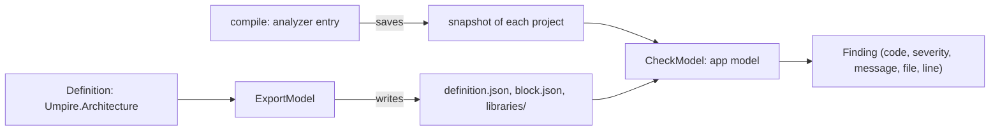
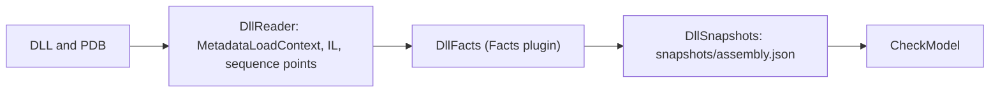

# Architecture engine

The rule engine checks each type of the app against one architecture definition. The definition gives the parts of the app and the rules between them. `new ResolvedArchitecture(definition)` compiles the definition one time: the block, the options of each part, the use rules, the counts and the matches. If the definition has an error, the constructor throws. The queries of the engine (`engine/App/Plugins/Facts/Domain/Shared/Queries/`) give the answers on plain facts: the part of each type (`PartOf`), the decision for each use (`ResolvedArchitecture.DecisionFor`), and the counts and the matches (`ResolvedArchitecture.Counts`, `Matches`). The engine app (`engine/`) writes the definition as data, reads the snapshots of the compile, and writes each problem as a `Finding`, after each build of the host. The check model (`docs/check-model.md`) does the checks.



## Projects

| Project | Path | Contains |
|---|---|---|
| `Umpire.Architecture` | `architecture/` | The definition API and the plain data of its compiled form. No DLL reader |
| `Umpire.Vsa` | `packs/Vsa/Definition/` | `VsaArchitecture` and the VSA layers (`Concepts/`). No DLL reader |
| `Umpire.Engine.Versions` | `engine/Versions/` | The version check (`UMP030401`). The engine app and the `umpire` tool bundle it |
| Engine core | `engine/` | One `netstandard2.0` library (`Umpire.Engine`). The queries (`App/Plugins/Facts/Domain/Shared/Queries/`), the jobs (`App/Features/Jobs/`: the compile job, the build job and the check job) and the operations Build, Changes, Blocks, Versions, LoadApp, CodeCheck and the operations of the check model. `App/Plugins/Facts` reads the DLL and PDB files, each reader behind a fact source (`IFactSource<TQuery, TFacts>`): `BinSource` (`BinReader`, `MetadataLoadContext`) one time for each block, `DllSource` (`DllReader`) for the type facts of a DLL with no snapshot, and the interface `IDefinitionLoader` for the one definition type. The type facts of a project come from the snapshots of the compile. Its root project `engine/Engine.csproj` is not a package |
| Console entry | `engine/Entries/Console/` | `net8.0` executable `umpire-engine`: `EngineConsoleHost`, `ConsoleReport`, `HookMismatch` and `DefinitionSource` (`AppLoader`, an `AssemblyLoadContext`). The package `Umpire.Engine` holds it in `tools/net8.0/` |
| Analyzer entry | `engine/Entries/Analyzer/` | `netstandard2.0` Roslyn analyzer `Umpire.Engine.Analyzer`: `EngineAnalyzer`, `CompileHost` (a `LocalHost`), the fact readers of the compile job in `Facts/`. The package `Umpire.Engine` holds it in `analyzers/dotnet/cs/` |

The runtime of an app does not reference `Umpire.Architecture`, and `Umpire.Architecture` references no runtime project. A definition project references `Umpire.Vsa.Definition` (with `Umpire.Vsa`), which depends on `Umpire.Definition` (with `Umpire.Architecture`). Each other project gets the runtime package `Umpire`, which holds no definition code. So `Umpire.Architecture` and `Umpire.Vsa` use only the BCL, the kernel and the VSA contracts. They also target `netstandard2.0`, for Unity and for the compiler.

## Definition API

The model has three levels:

| Level | Members | Role |
|---|---|---|
| `Concept` | `Folder`, `GroupFolder`, `OwnedBy`, `Configure(PartOptions defaults)`, `OfTypes`, `NameStartsWith`, `NameEndsWith` | A name for a part, with data only. No body |
| `Block : Concept` | Adds `Define(Part part)` and `Rules(RuleBook rules)` | A concept with a body: its child parts and its rules |
| `Architecture` | `Configure(ArchitectureConfig config)`, `Define(Part root, Part kernel)`, `Rules` | The root of one check. It is not a concept |

The block kinds of `blocks.md` are records. `Umpire.Architecture.Blocks` has `Block`, `App`, `Definition`, `Kernel` and `Component`. `Umpire.Kernels.Blocks` has `Core`, `Module` and `Pack`. `Feature` and `Plugin` derive from `Module`, and `Slice` is a block. Each VSA layer inherits `Layer : Concept`.

```csharp
public record Feature : Module {
    public override string GroupFolder => "Features";

    protected override void Define(Part part) {
        part.Add<Domain>().Add<Domain.Shared>();
        part.AddGroup<Slice>();
    }
}

public record Requests : Layer {
    public override IReadOnlyList<Type> OfTypes => [typeof(IRequest), typeof(IResponse)];
}

public class VsaArchitecture<TKernel> : Umpire.Kernels.Architecture<TKernel> where TKernel : VsaKernel {
    protected override void Configure(ArchitectureConfig config) {
        config.Defaults.Boundary = Boundary.Closed;
        config.Roots.Add<App>("App");
        config.Roots.Add<Views>();
    }

    protected override void Define(Part root, Part kernel) {
        kernel.Add<Domain>().And<Infrastructure>().And<Presenters>();
        root.AddGroup<Feature>();
    }

    protected override void Rules(RuleBook rules) {
        rules.For<Feature>().Denies<Feature>().InOther<Feature>();
        rules.For<Feature>().Uses<Domain.Shared>().InOther<Feature>();
    }
}
```

- A rule on a concept also covers each concept that derives from it. For example, a rule on `Module` covers `Feature`, `Plugin` and `EcsFeature`.
- A class at the top of a block folder binds to the block part, for example the module class in `App/Features/<Feature>/`. `rules.For<Module>(Depth.Self).HasTypes<Umpire.Kernels.Module>().Exactly(1)` counts it: `HasTypes<T>()` counts the types that inherit the runtime type `T`.
- A rule covers each matching part in all blocks. If a rule is for one place only, add `Under<T>()`. If two places need different rules, use two concepts.
- The engine calls `Configure`, `Define` and `Rules` of each class in the inheritance chain, from the base down. A level does not call its base level (`UMP010107`).
- For a pair of parts, the last matching use rule wins. The levels add their rules in stack order, so the level on top wins, both to loosen and to tighten a rule of its base. One method selects that rule: `ResolvedArchitecture.ActingRule(from, fromValues, to, toValues)`, and `DecisionFor` calls it.

| Call | Effect |
|---|---|
| `Add<T>()` | A part in the folder of the layer. It returns the `Part` |
| `And<T>()` | A sibling part. It returns a `PartGroup`: the next call applies to each part in it |
| `AddGroup<T>()` | A group: one part instance for each subfolder. It returns a `PartGroup` |
| `AddBlock<T>()` | The place of the block `T` in its folder. The place gets the body of the record `T` (see "Blocks and check entries") |
| `For<T>()` | A find: `For<T>().Add<TPart>()` adds a part to each placed part of concept `T`, a block or a plain concept. `Under<S>()` narrows the find, and more `Under` calls go deeper. `For<T>().ExtendedBy<TBlock>()` stacks the body of the block record on each found part and adds its rules one time. A find with no match is an error. It only adds: it cannot remove, move or replace a part |
| Two `Add<T>()` calls | Two calls of one concept under one parent give one part: the second call returns the first part. Two different concepts with one folder under one parent give a Define error |
| `AddBlockGroup<T>()` | Each subfolder of the folder of `T` is the place of another block, for example `App/Packs/<Name>/` |
| `InParentFolder()` | The part shares the folder of its parent. Give it `OfType`, or give its concept `OfTypes` |
| `OfType<T>(required)` | Each type of the part must be assignable to `T`. `required: true` also needs one type of `T` in each instance (see "Required") |
| `NameStartsWith`, `NameEndsWith`, `NamedAfterGroup` | The name of each type of the part (see "Content of a part") |
| `Uses<T>()`, `Denies<T>()` | A rule (type `Rule`). A later rule wins |
| `Has<T>()`, `Takes<T>()` | A count (type `Count`) or a match (type `Match`). See "Counts and matches" |
| `Are(Trait)`, `Are<T>()`, `Type<T>().OnlyIn<P>()` | The traits of each type of a part, and the parts that can use a type. See "Content of a part" |
| `Under<T>()`, `InSame<T>()`, `InOther<T>()` | Filters: the place of the source or the target. A filter applies to each entry before it in the chain |

### Roots and configuration

`Architecture.Configure(ArchitectureConfig config)` sets the values of the whole definition:

| Member | Holds |
|---|---|
| `config.Defaults` | The `PartOptions` of the architecture (see the table below) |
| `config.Roots` | The roots of the block: `Roots.Add<T>()`, or `Roots.Add<T>(folder)` to set the folder |
| `config.FolderAliases` | The folder aliases in code (see "Folder aliases") |

The roots of each level:

| Level | Roots |
|---|---|
| `Architecture` | `App` (folder `""`), `Definition` (folder `Definition`) |
| `Architecture<TKernel>` (`framework/Kernel/Definition/`) | `Core` (folder `framework/Kernel`, record in `Umpire.Kernels.Blocks`) |
| `VsaArchitecture<TKernel>` | `App` with the folder `App`, and `Views` |

A second `Roots.Add<T>()` of one record keeps one root. `Roots.Add<T>(folder)` on a later level sets its folder. `Define(Part root, Part kernel)` gets two parts. `root` is the `App` root. `kernel` is the kernel root: a part of the concept `Kernel` with the folder `Kernel`. If `Define` adds no part to `kernel`, the kernel root is not in the definition.

`PartOptions` sets `DefaultPermission` (the permission when no rule applies), `Boundary`, `UseSameConcept`, `Depth`, `Access` and `Required`. Each field is nullable: a field that is not set takes the next value. The engine resolves each value in this order: the part (the rule call, the group parameter or the `OfType` call), the concept, the architecture, then `PartOptions.BuiltIn`.

| Field | `PartOptions.BuiltIn` | Set by |
|---|---|---|
| `DefaultPermission` | `Deny` | The architecture, a concept (of the target part) |
| `UseSameConcept` | `false` | The architecture, a concept |
| `Boundary` | `Open` | The architecture, a concept, a group |
| `Depth` | `WithChildren` | The architecture, a concept, a rule call |
| `Access` | `Public` | The architecture, a concept, a rule call |
| `Required` | `false` | The architecture, a concept, an `OfType` call |

The convention for a new option: if a concept or the architecture can also set it, it gets a nullable parameter at the call site and a nullable field in `PartOptions`. The lookup reads the call site, then the concept, then the architecture, then `PartOptions.BuiltIn`.

A concept has the same three members as a definition: `Configure(PartOptions defaults)`, `Define(Part part)` and `Rules(RuleBook rules)`. A thing that belongs to one concept goes in the body of that concept. `Define` runs when a definition adds a part of the concept. The compiler calls `Rules` one time for each concept that the definition has, before `Rules` of the architecture. A concept rule is only about the parts of its concept: the compiler adds `Under<T>()` of the concept to each subject entry, not to the targets. The use rules of the architecture come after the concept rules, so a use rule of the architecture or of a pack variant wins. The counts and the matches add up: a concept count or match always applies, and a pack variant cannot remove it. A concept rule that names a subject with no part under its concept fails, and the message names the implicit `Under<T>()`. The compiler calls `Rules` for each concept type. So a concept that inherits another concept with a `Rules` body runs that body again, with its own type as the scope.

```csharp
public record Slice : Layer {
    protected override void Define(Part part) {
        part.Add<Contracts.Requests>().And<Handlers.Requests>().And<Validators>().InParentFolder();
    }

    protected override void Rules(RuleBook rules) {
        rules.For<Validators>().Uses<Contracts.Requests>().InSame<Slice>();
    }
}
```

The rule in this example compiles as `For<Validators>().Under<Slice>().Uses<Contracts.Requests>().InSame<Slice>()`. A concept rule gives the same decisions as the same rule in the architecture, so `VsaDecisions.txt` does not show where a rule is.

A concept sets its values in `Configure(PartOptions defaults)`. `Part.Options` holds the values of the concept, with the values of the call site on top. `ResolvedArchitecture.OptionsOf(part)` gives the full values of a part. When no rule applies to a use, the decision takes `DefaultPermission` of the target part.

A rule condition is a `Condition`: the groups that must have the same instance (`Same`) and the groups that must have another instance (`Other`). Its text is for example `same Feature, other Slice`, or `always`.

`config.Defaults.UseSameConcept = true` lets each part use each part of the same concept, in all places: for example a feature `Infrastructure` uses the `Infrastructure` of the framework and of a plugin. The engine adds these pairs before the layer bodies and the rules, so a rule can deny them. Boundary also limits them (see Boundary). The default is `false`.

The body of each block is in its record: `Feature`, `Plugin`, `Slice` and the kernel records. A derived block record gets the body of its base and adds its own. To add a part to each placed block of a kind, a derived architecture uses an overlay:

```csharp
public sealed class UnityTestArchitecture : VsaArchitecture {
    protected override void Define(Part root, Part kernel) {
        root.For<Feature>().Add<PlayTests>();
    }
}
```

The kernel is three blocks: the root `Core`, `MessagesComponent` and the kernel root. `Architecture<TKernel>` adds `Core`, and `VsaArchitecture` places `MessagesComponent` and writes the layers into `kernel`. `MessagesComponent` holds only the message contracts. The message bus is the part `KernelParts.Messages` of `Core` (`framework/Kernel/Messages/`). Two checks use the kernel:

| Check | Kernel form | Binding | Rules |
|---|---|---|---|
| An app | A DLL: the project DLLs, or `Umpire.dll` and `Umpire.Vsa.dll` in a package | By the source path of each type in its library facts | The rules of the app toward the kernel |
| The pack | Source: the folder `Kernel/` of the pack | By folder | The rules of the architecture under `Kernel` |

For the pack check, the engine reads the definition in `Definition/` of the pack (`BlockEntry.Packed`) and creates `new PackArchitecture(architecture)`. `PackArchitecture` gets the kernel body of the packed architecture into its own `kernel` part. The type requirements of the layer concepts (`OfTypes`) do not apply inside the kernel of a pack, because the kernel holds the bases themselves. `rules.For<Kernel>().Uses<Kernel>()` allows each use between two kernel layers: the check covers the shape of the kernel.

### Extend a base architecture

A derived architecture changes a base architecture in two ways, for example for one host (#318). It cannot replace a concept of the base with a derived concept.

| Case | Form | Example |
|---|---|---|
| Change one rule of the base | A rule on the level on top. The last matching rule wins (`ActingRule`) | `rules.For<Presenters>().Denies<Contracts.Events>();` |
| Add an overlay for one host | A subclass with its own levels, `For<T>()` and `ExtendedBy<T>()` | `root.For<Feature>().ExtendedBy<PlayTestFeature>();` |
| Replace a concept with a derived one | Not supported. Use `ExtendedBy<T>()` | None |

```csharp
public sealed record PlayTests : Layer;

public sealed record PlayTestFeature : Block {
    protected override void Define(Part part) => part.Add<PlayTests>();
}

public sealed class UnityArchitecture : VsaArchitecture {
    protected override void Define(Part root, Part kernel) {
        root.For<Feature>().ExtendedBy<PlayTestFeature>();
    }

    protected override void Rules(RuleBook rules) {
        rules.For<Presenters>().Denies<Contracts.Events>();
    }
}
```

`ExtendedBy<TBlock>()` stacks the `Define` body of `TBlock` on each found part, and it adds the `Rules` of `TBlock` one time, with the scope of the found concept. The rules apply to each part of the found concept inside the `Under` filters, not only to the found parts. The compiler adds the rules in this order: the same-concept rules, the block bodies, the extensions, then the levels of the architecture from the base to the top. Thus a rule of the architecture wins over a rule of an extension body.

The test `VsaDecisionsTests` writes the decision of the VSA definition for each pair of parts to `tests/Architecture.Tests/VsaDecisions.txt`. If a change to the definition changes a decision, the test fails and writes `VsaDecisions.actual.txt`. Compare the two files. If the change is correct, copy the new file over the baseline.

### `using` placement

The placement of the `using` directives is a guideline, not an enforced rule (`IDE0065` is off). Use the next step only if the step before it is not enough:

1. Put the `using` directives inside the namespace. This is the default, and the editor suggests it (`csharp_using_directive_placement = inside_namespace`).
2. Put some `using` directives outside the namespace if the file is inside the namespace of the concept records, for example a pack variant in `Umpire.Vsa.Definition.*`.
3. Add an alias inside the namespace, for example `using Plugin = Umpire.Vsa.Definition.Plugin;`.

A definition file writes each real type with its full name, for example `OfType<Umpire.Kernels.Module>()`. Then it does not import the namespace of that type, and no clash occurs.

C# finds a name level by level, from the innermost namespace to the outermost. At each level, it examines the members of the namespace first, then the `using` directives of that level. A concept record has the name of a folder, and a folder is a part of a namespace. In app code, a `using` inside the namespace wins over the outer app namespaces:

```csharp
using Umpire.Architecture.Blocks;
namespace Shop.Host {
    rules.For<App>();          // CS0118: 'App' is a namespace (Shop.App)
}

namespace Shop.Host {
    using Umpire.Architecture.Blocks;
    rules.For<App>();          // the record App
}
```

In a pack variant, the records are in an outer namespace. There, a `using` inside the namespace wins over the records:

```csharp
namespace Umpire.Vsa.Definition.Ecs {
    using Umpire.Vsa.Composition;
    rules.For<Plugin>();       // the class Umpire.Vsa.Composition.Plugin: CS0311
}

using Umpire.Vsa.Composition;
namespace Umpire.Vsa.Definition.Ecs {
    rules.For<Plugin>();       // the record Umpire.Vsa.Definition.Plugin
}
```

Thus no one placement is correct for each file. `RuleBook.For<T>() where T : Concept` makes each wrong binding a compile error (`CS0104`, `CS0118` or `CS0311`), so no clash compiles silently. `IDE0065` selects files only by path, so it cannot make an exception for a definition file. If a rule is necessary after 0.1.0, write a custom analyzer.

## Ownership

A concept that is nested in an `Architecture` class belongs to it, at any depth. Only the owner, or an architecture that derives from the owner, can place it.

| Form | Owner |
|---|---|
| `class BravoArchitecture { record B1 : Layer; }` | `BravoArchitecture` (the nesting) |
| `record B2 : Layer, IOwnedBy<BravoArchitecture>;` | `BravoArchitecture` |
| `record B3 : Concept<BravoArchitecture>;` | `BravoArchitecture` |
| `OwnedBy => [typeof(BravoArchitecture)]` | `BravoArchitecture` |
| `OwnedBy => []` | None, also when nested |
| A top-level record with no owner | None: shared vocabulary |

The check reads `OwnedBy` first, then the `IOwnedBy<T>` interfaces, then the nesting. An owner that is not an `Architecture` is an error. The body of a block adds parts as its home: the nesting architecture and the declared owners of the record. Thus a block with `OwnedBy => []` can still add the concepts of its home in another architecture.

## Boundary

A closed group keeps its instances apart: an allow rule reaches a part in another instance of the group only if the rule crosses the group. The first value that is set wins:

1. The parameter of the rule call: `Uses<Contracts.Commands>(Boundary.Open)` crosses each closed group.
2. The parameter of the group: `block.AddGroup<Plugin>(Boundary.Open)`.
3. The concept body, for example `defaults.Boundary = Boundary.Closed` in `Configure(PartOptions)` of the concept.
4. `config.Defaults.Boundary` of the architecture. Its default is `Boundary.Open`.

In the example, the first rule reaches the Domain of the own feature, of Kernel and of the plugins. The second rule also reaches the `Domain.Shared` of the other features. A rule with `InOther<T>()` crosses the group `T` and each group inside it. Boundary does not change a deny rule, and it does not apply to a user outside the group: for example `Views` uses the presenters of each feature.

```csharp
config.Defaults.Boundary = Boundary.Closed;
rules.For<Infrastructure>().Uses<Domain>();
rules.For<Feature>().Uses<Domain.Shared>().InOther<Feature>();
```

## External parts

An `External` part is an opaque DLL with no body, for example `Microsoft.Extensions`. It binds the types of a DLL by its name, not by its folder. A type also matches by its namespace. The longest matching name wins. A rule that names an `External` gives it its part: `rules.For<Infrastructure>().Uses<ConfigLibraries>()`. The types of an external DLL are rule targets only: a rule can allow or deny them, and an `External` is never the subject of a rule.

The Umpire DLLs are DLLs with structure. A type in a kernel body (the root `Core`, `MessagesComponent` and the kernel root `Kernel`) binds to that body by its PDB path (see "Binding"). Each other Umpire type, for example a marker, `UmpireConfig` or `VsaArchitecture`, binds to the External `UmpireLibraries` (`Assembly => "Umpire"`, in `VsaArchitecture`). This applies only to a type with its source outside the block folder: a package DLL, or a library file in `tools/net8.0/libraries/`. A type with its source in the block binds by its folder, also if its assembly name starts with `Umpire`. The module classes, `Host`, the `App` root and the `Definition` root can use `UmpireLibraries`, so the app class can name the pack. Other parts cannot.

The engine binds a DLL type by its PDB path only if an `External` names its assembly. Thus a placed block in a DLL whose name does not start with `Umpire` needs a rule that names an `External` for its assembly. Without it, the types of that DLL have no part, and their uses are allowed. This gate stops a false part for a library with the same folder names, for example `../Shared/Messages/Contracts/`.

The definition stops at these shapes:

| Definition | Error |
|---|---|
| `Add<Lib>()` or `AddGroup<Lib>()` of an `External` | `Define: Add<Lib>() adds an External. An External is a DLL, not a folder, so it has no place in Define.` Name it in a rule |
| `rules.For<Lib>()` | `Lib is an External. An External is only the target of a rule, never its subject` |

## Depth

`Depth.Self` gives the part only. `Depth.WithChildren` gives the part and all its child parts. The first value that is set wins:

1. The parameter of the rule call, for example `Uses<Contracts>(Depth.WithChildren)`.
2. The layer body, for example `defaults.Depth = Depth.Self` in `Configure(PartOptions)` of the layer.
3. `config.Defaults.Depth` of the architecture. Its default is `Depth.WithChildren`.

## Permission and access

A rule has two values:

| Value | Enum | Values | Question |
|---|---|---|---|
| Permission | `Permission` | `Allow`, `Deny` | May this part use that part? |
| Access | `Access` | `Internal`, `Public` | How visible may the use be? |

`Uses<T>()` allows the use. `Denies<T>()` denies it. An access limits an allowed use:

```csharp
rules.For<Contracts.Requests>().Uses<Domain.Shared>();               // use and expose
rules.For<Handlers.Requests>().Uses<Domain>(Access.Internal);        // use, but do not expose outside the assembly
```

A type exposes a part when a type of that part is in its signature: a base type, an interface, or the type of a member (a method return or parameter, a property, a field), with their generic arguments. The access of a member is the narrowest of the member and its type. `Internal` is within `Public`. The check maps each visibility to one of the two values: `public`, `protected internal` and `protected` are `Public`, because code outside the assembly can see them. `internal`, `private protected` and `private` are `Internal`.

The framework can require a public exposure, so the check ignores two exposures:

| Exposure | Example |
|---|---|
| A base type or an interface of an `External` part, with its generic arguments | `: Presenter(bus), IIntegrationEventHandler<Rang>` |
| A member that implements a member of such an interface. The name and the signature must match. An explicit implementation also matches | `public Task<Result<Unit>> HandleAsync(IEnvelope<Rang> e)` |

An interface of the app or of .NET is not of an `External` part, so it counts. For example, `: IEquatable<Note>` and `public bool Equals(Note? other)` give `UMP020102` if the rule limits `Note`.

The first access that is set wins:

1. The parameter of the rule call, for example `Uses<Domain>(Access.Internal)`.
2. The layer body, for example `defaults.Access = Access.Internal` in `Configure(PartOptions)` of the layer.
3. `config.Defaults.Access` of the architecture. Its default is `Access.Public`, so a rule with no access allows use and exposure.

## Counts and matches

`Rules` has three kinds of statement. A use rule gives a decision for each use. A count and a match fail for each instance or type that does not obey them.

| Kind | Call | Fails when | Code |
|---|---|---|---|
| Use | `For<S>().Uses<T>()`, `Denies<T>()` | A type of `S` uses a type of `T`, and the decision is `Deny` | `UMP020101` |
| Count | `For<S>().Has<T>()` or `For<S>().HasTypes<T>()` with `AtLeast(n)`, `AtMost(n)`, `Exactly(n)`, `OfOneKind()` | The number of types is not in the limit, or the types are in more than one part | `UMP020301` |
| Match | `For<S>().Takes<T>()`, optional `InSame<G>()` | A type of `S` has no type argument in `T`, or the argument is in another instance of `G` | `UMP020302` |

`Has<T>()` has two meanings. The subject `S` selects the meaning:

| Subject | Count | Example |
|---|---|---|
| A group | The types of `T` in each instance of the group | `rules.For<Slice>().Has<Handlers>().AtLeast(1)`: each slice has a handler or a hook |
| A part | For each type of `S`, the types of `T` that take it as a type argument of a base type | `rules.For<Contracts.Requests>().Has<Handlers.Requests>(Depth.Self).Exactly(1)`: each request has one handler |

The rules of a count:

- `T` includes each concept that is nested in `T` (the concept family). For example, `Has<Handlers>()` counts `Handlers.Commands` and `Handlers.Commands.Hooks`. `Has<T>(Depth.Self)` counts only `T`. The `Depth` of the concept does not apply to a count.
- A helper that follows its user does not count, a nested type does not count, and an abstract class or an interface does not count. Only a concrete type that binds by its own base type counts. A static class counts: it is `abstract sealed` in IL, but it is not a base.
- A count counts only the types of the app in the block folder. A type of an external DLL does not count.
- A count with no limit stops the definition: "has no limit. Add AtLeast, AtMost, Exactly or OfOneKind."
- The finding is at the first type of the instance (by file, then line), or at the type of the subject.

`Takes<T>()` reads the type arguments of the base types and interfaces of the type and of each class in its base chain (`TypeFacts.BaseArguments`), so a handler that inherits a middle base matches. An abstract subject type is not checked. For example, `rules.For<Handlers.Requests>().Under<Feature>().Takes<Contracts.Requests>().InSame<Slice>()`: a request handler handles a request of its own slice. With no `InSame<G>()`, the match needs only one type argument in `T`. A subject type that is not in an instance of `G` fails, so use `Under<T>()` to select the subjects.

```text
error UMP020301: Slice App/Features/Notebook/Slices/Draft has 0 Handlers types: the rule "Slice has Handlers at least 1" needs at least 1. Add one, or move the other types to another part.
```

### Required

`OfType(type, required: true)` makes the base type required. Each instance of the nearest group of the part then has at least one type of that base in the part. If the part is in no group, the app is one instance. The engine checks it as a count, so it gives `UMP020301`.

```csharp
part.OfType(typeof(RequestHandler<,>), required: true);
```

| Order | Place | Form |
|---|---|---|
| 1 | The call site | `OfType(..., required: true)` or `required: false` |
| 2 | `Configure` of the concept | `defaults.Required = true` |
| 3 | `Configure` of the architecture | `config.Defaults.Required = true` |
| 4 | `PartOptions.BuiltIn` | `false`: the part is permitted, not required |

`VsaArchitecture` sets no `Required`. Its counts are lines in `Rules` (see "Counts and matches" in `architecture-rules.md`).

## Content of a part

A name rule is a call on the part, in `Define`. A trait rule and a place rule are statements in `Rules`, next to the counts.

| Rule | Call | Fails when | Code |
|---|---|---|---|
| Name | `part.NameEndsWith("Hook")` | The type name does not obey the rule | `UMP020204` |
| Traits | `rules.For<S>().Are<Static>()` | A type of `S` does not have the traits | `UMP020303` |
| Type place | `rules.Type<T>().OnlyIn<S>()` | Code outside `S` uses `T` | `UMP020304` |

```csharp
protected override void Define(Part root, Part kernel) {
    root.For<Feature>().Add<CliCommand>().NamedAfterGroup();
}

protected override void Rules(RuleBook rules) {
    rules.For<CliCommand>().Are<Static>();
    rules.Type<CliCommandAttribute>().OnlyIn<CliCommand>();
}
```

### Name rules

| Call | A good name |
|---|---|
| `NameEndsWith("Hook")` | `ChimeHook` |
| `NameStartsWith("I")` | `IClock` |
| `NamedAfterGroup()` | `Touch` in `App/Features/Touch/` (the nearest group) |
| `NamedAfterGroup("Settings")` | `TouchSettings` in `App/Features/Touch/` |
| `NamedAfterGroup<Feature>()` | `Billing` in `App/Features/Billing/Slices/Pay/` (the group `Feature`) |

- A name rule has no regex. The generic arity (for example `` `1 ``) is not part of the name.
- `NameStartsWith` and `NameEndsWith` join, for example `NameStartsWith("I").NameEndsWith("Source")`. A second call of the same method replaces the first.
- `NamedAfterGroup("Settings")` and `NameEndsWith("Settings")` set the same end text, so the later call wins. `NamedAfterGroup()` with no suffix keeps an earlier end text.
- Use `NamedAfterGroup<T>()` only when the part is under two groups. A `NamedAfterGroup` on a part with no group stops the definition.
- Put a name rule at the call site of the pack definition, not in the `Define` of a concept.

### Traits

A trait is one fact about a type. Each trait is a record in `Umpire.Architecture.Traits` that inherits `Trait`: `Static`, `Abstract`, `Sealed`, `Record`, `Struct`, `Interface`, `Enum`, `Delegate` and `Immutable`. `Trait` has one static member for each trait, for example `Trait.Sealed`.

```csharp
rules.For<X>().Are<Static>();                                     // one trait
rules.For<X>().Are<Sealed>().And<Record>();                       // a chain: each trait
rules.For<X>().Are((Trait.Sealed & Trait.Record) | Trait.Enum);   // the operators &, | and !
```

- `Are` checks each type of the part, one type at a time. It does not count. A count is `Has<T>().AtMost(n)`.
- `Abstract` is an abstract class, not an interface or a static class. `Sealed` is a sealed class, not a static class.
- `Record` is a record class or a record struct.
- `Immutable` is a type with no member that can change. Such a member is a field that is not `readonly` or `const`, a property with a `set` accessor (`init` is permitted), or a field event. A field that the compiler makes, for example for a primary constructor parameter, is not a member that can change. An enum is immutable. The check does not read the type of a member, so a `List<T>` property with no `set` accessor passes.
- A trait reads only the facts in `TypeFacts`, so the framework gives the traits. A consumer combines them.
- With no `Are`, each type is allowed.

### Type places

`rules.Type<T>().OnlyIn<S>()` keeps each use of `T` in the parts `S`. `T` can be any type: an attribute, a base class, an interface, or a type that code calls.

```csharp
rules.Type<CliCommandAttribute>().OnlyIn<CliCommand>();   // the attribute is only on code in CliCommand
rules.Type<HttpClient>().OnlyIn<Infrastructure>();       // only Infrastructure uses HttpClient
```

- For an attribute, a use is the attribute on the type or on one of its members. An attribute that derives from `T` is also a use, and a generic `T` matches each closed form.
- For another type, a use is a base type, a field, a parameter, a call or an attribute. The type `T` itself is not a use.
- A use in a member that the compiler makes, for example the `ToString` of a record, is not a use.
- If more than one statement names `T`, `T` can be in each of their parts.
- The engine does not read an attribute on a parameter, a return value, a generic parameter or a local function.

### Shared rules of the content checks

- A nested type has the source file of its outer type, so the name and trait checks and the counts do not read it. The place check reads it. A trait rule with only the `Immutable` trait also reads it.
- A static class is not a subject of a match (`Takes<T>()`).
- The name and trait checks do not read a helper that follows its user. The place check reads it.
- No content check reads a type of an external DLL or a type in a block place.
- The engine reads the method bodies, for example a call inside a lambda. The in-process facts of an `ArchitectureTest` read only the signatures: the base types, the fields, the properties and the parameters.
- `ArchitectureTest.Problems(place)` gives the name, trait and place problems of one type.

## Binding

| Type | Part |
|---|---|
| In a DLL that an `External` part names, with a source outside the block folder that matches the body of a placed block | The body part of that block, for example `/_/packs/Vsa/Kernel/Domain/Entity.cs` → `Kernel/Domain`. A target only. Two matching blocks give an error |
| In a DLL that an `External` part names, with no matching body path | The `External` part. The longest name wins |
| In a DLL that no `External` part names | No part. Its uses are allowed. The engine does not read its PDB path |
| Source file at the top of a block folder | The block part, for example the module class → `Feature` |
| Source file in a part folder | The deepest part that matches the folder. A group instance matches each name |
| Source file in the block folder (and in a folder alias, if the definition has aliases), in a DLL that an `External` part names | Its part by its folder, as each other source file in the block. The name of the assembly does not select an `External` for a type with its source in the block. A target type with no facts (for example, the snapshot of its project is missing) still binds by the name of its assembly, and its findings are warnings (see "Trust" in `docs/check-model.md`) Thus an assembly of the block with a name `Umpire.*`, for example the engine core `Umpire.Engine` or the tool `Umpire.Cli`, is checked |
| Source file only in `obj/` or `bin/`, or in a folder whose name starts with `.` or ends with `~` (for example `Polyfills~/`) | Not checked |
| Helper type in a `InParentFolder` folder | The part of the first type that uses it ("follows user") |
| Helper type with no user in a `InParentFolder` folder | The part of its nearest base type in the same folder ("follows base"). For example, a rule class that the engine finds by reflection follows its base class |
| Source file in no part folder | None: `UMP020202` |
| Source file out of the block folder | Not checked |
| Source file in no folder alias (if the definition has aliases) | Not checked. If an `External` part names its assembly, the `External` part, as for a source file out of the block folder |

The check model reads the source file and the place of each type from the snapshot of its project. For a DLL of another block or of a package, it reads the library facts (`libraries/<assembly>.json`): the full name, the source path and the base types of each type. A project DLL gets its library facts from its snapshot. A package DLL gets them from the file that the package `Umpire.Engine` ships in `tools/net8.0/libraries/`, with the source paths under `/_/`. The Blocks operation reads the PDB of each DLL to find the check entries and the DLLs of a block (`BinReader`). A DLL with no snapshot gets its facts from the DLL itself (see "DLL facts").

### DLL facts

A DLL of a reference folder (`umpire.check.references`, for example the Unity `ScriptAssemblies`) has no snapshot, because no compile of this build makes it. ExportModel reads its type facts with `DllSource` of the Facts plugin, and CheckModel checks its types as the types of a project.



| DLL | Condition | Facts |
|---|---|---|
| App DLL | Source under the block, no snapshot, not a project of `deps.json` | A snapshot in `snapshots/<assembly>.json` of the state folder |
| DLL of an `External` | No snapshot, no file in `tools/net8.0/libraries/`, a PDB | Library facts in `libraries/<assembly>.json` |
| Project DLL with no snapshot | A project of `deps.json` | `UMP030802`: build the project again |

| Fact | Source |
|---|---|
| Type, bases, interfaces, members, attributes, traits | `MetadataLoadContext`. If a base DLL does not resolve, the name of the direct base comes from the metadata |
| Uses in method bodies | The IL tokens of each method, also of the compiler-made nested types (lambdas, closures, state machines) |
| File, line and column of a type | The first sequence point of the type in the PDB, as `TypeSources` of `SymbolReader` |
| Line of a use | The sequence point of the IL instruction |
| Hash of a file | The SHA-256 checksum of the PDB document. With another algorithm, the file has no hash and is not marked old |

The facts of a DLL follow the IL, not the source: a `nameof`, a constant and an enum value are not a use, and a type only in compiler output is a use. If two DLLs have one type, the DLL that comes first wins: the reference folders come before `--bin`.

## Folder aliases

A folder alias (`FolderAlias(Folder, As)`) reads the source files of one folder as if they were in another folder of the block. For example, an app that keeps its code in `src/Game/` gives the aliases below. With no alias, each folder binds as it is. The binder tries each path and keeps the deepest part.

```toml
[umpire.check.folder_aliases]
"src/Game" = [""]            # src/Game/App/... binds as App/..., src/Game/Views/... as Views/...
"Source" = [""]               # Source/App/... binds as App/...
```

| Source | Gives the aliases |
|---|---|
| `umpire.check.folder_aliases` in the `.umpireconfig` of the block folder | Each key is a folder of the block, and each item of its list is the folder that it binds as (`""` is the block root). ExportModel reads the table for each block (`FolderAliasConfig`) |
| `config.FolderAliases` in `Architecture.Configure` | A definition adds aliases in code. The engine uses the aliases of the code and of the config file together |

Rules:

- With one alias or more, a file binds only through an alias. A folder with no alias is not read. To keep the folders at the block root, add the key `""` (or `"."`): `"" = [""]`.
- Only the `.umpireconfig` in the block folder itself gives aliases, because each alias folder is a path in that block. An inner block with no `.umpireconfig` of its own has no aliases.
- A key or a value with `\` or a leading `./` is normalized: `".\src\Game"` is `src/Game`.
- A value that is not a list, for example `"src/Game" = ""`, gives the warning `UMP020206`. Put quotes on a key with `/` or `.`, because TOML reads an unquoted dotted key as a table.
- `ArchitectureTest<T>` binds logical paths, for example `At<T>("App/Features/Notebook")`, so it uses no folder alias.

The framework has no host layout of its own: the host package (for example vsa-unity) writes the aliases.

### Check settings

The engine knows no host build system. A host that compiles the app in its own way (for example Unity) gives its folders to the engine with these settings. Each setting has a key in `.umpireconfig`, and a flag with the same name overrides it for one run. The order is: the flag, then `.umpireconfig`, then the default. A list is text with `,` or `;` between the items. A relative folder in `.umpireconfig` starts at the folder of that file, and a relative folder in a flag starts at the current folder.

| Key | Flag | Default | Effect |
|---|---|---|---|
| `umpire.check.references` | `--references` | None | More folders of DLLs. The engine reads them as it reads `--bin`: a DLL with source files under the block is app code, and each DLL resolves the types of the others |
| `umpire.check.source_root` | `--sourceroot` | None | The root of a relative source path in a PDB. With no root, a relative path stays relative and is not under the block |
| `umpire.check.ignored_folders` | `--ignoredfolders` | None | Folders of the block (relative paths) that hold no app code, for example a package cache. The change check does not read them |
| `umpire.check.project_checks` | `--projectchecks` | `true` | `false` stops the project checks (`UMP030305`, `UMP030306`), for example for project files that the host writes |

| Case | Result |
|---|---|
| A DLL name in `--bin` and in a reference folder | The engine reads the `--bin` DLL only |
| A type in two DLLs | The engine loads it once. The copy in a reference folder wins |

`CheckSettings` (`engine/App/Plugins/Operations/Infrastructure`) reads the settings, and `RunOptions` (same folder) gives them to the operations.

## The architecture findings

The build job and the check job check with the check model: ExportModel, then CheckModel. The model rules are in `engine/App/Features/Model/Domain/Rules/`, and `RuleCodes` holds their codes. ExportModel gives the setup findings `UMP020205` and `UMP020206`. See `check-model.md`.

| ID | Model rule | Severity | Problem |
|---|---|---|---|
| `UMP020101` | `ReferenceCheck` | Error | A type uses a part that the rules deny |
| `UMP020102` | `ReferenceCheck` | Error | A type exposes a part with more access than its rule allows |
| `UMP020201` | `LocationCheck` | Error | A type is not assignable to the `OfType` of its part |
| `UMP020202` | `LocationCheck` | Error | A type is in a folder that the definition does not have |
| `UMP020204` | `ContentCheck` | Error | A type name does not obey the name rule of its part (see "Content of a part") |
| `UMP020205` | ExportModel | Warning | A reference folder (`umpire.check.references`, `--references`) does not exist, so the checks do not read its DLLs |
| `UMP020206` | ExportModel | Warning | A value in `umpire.check.folder_aliases` is not a list of folders, so the checks do not use it |
| `UMP020301` | `ReferenceCheck` | Error | A count of the definition is not in its limit (see "Counts and matches") |
| `UMP020302` | `ReferenceCheck` | Error | A match of the definition does not hold (see "Counts and matches") |
| `UMP020303` | `ContentCheck` | Error | A type does not have the traits that `Are` of its part needs (see "Content of a part") |
| `UMP020304` | `ReferenceCheck` | Error | Code outside the parts of `Type<T>().OnlyIn<S>()` uses `T` (see "Content of a part") |
| `UMP020401` | `BlockPlaceCheck` | Error | A part of the definition covers the folder of another block (see "Blocks and check entries") |
| `UMP020402` | `BlockPlaceCheck` | Error | A block place folder (`AddBlock<T>()`, `AddBlockGroup<T>()`) holds no check entry. A place with no folder is the DLL form |

ExportModel reads the nearest `.umpireconfig` file at or above the block folder and writes the severity of each code to `block.json`. The key `umpire.<code>.severity` has no case. It is the same key as for the analyzers:

```toml
umpire.UMP020101.severity = "warning"   # error, warning, suggestion, or none (the rule does not run)
```

Each finding is a `Finding(Code, Severity, Message, File, Line)` of the Operations plugin. `File` is the full path. The engine app writes one line for each finding:

```text
C:/app/App/Features/Notes/Slices/Read/ReadHandler.cs(6,1): error UMP020101: ReadHandler in Handlers.Requests (App/Features/Notes/Slices/Read) uses Invoice in Domain (App/Features/Billing/Domain): no rule allows it (DefaultPermission = Deny). Remove the use, or change the rule in Rules.
```

## The checks of an app

An engine run does the checks of an app. The package `Umpire.Engine` holds the engine in `tools/net8.0/` (property `UmpireEngineFile`, set by its `build/Umpire.Engine.props`). The root project of the app references it with `PrivateAssets="all"`. The engine targets `net8.0` with `RollForward` `Major`, so one build runs on .NET 8 and on each newer runtime. It needs only `Microsoft.NETCore.App`: `AppLoader` loads the ASP.NET Core types of a web app from the shared folder of the runtime. It loads the definition of the app, so the hook runs it with `--roll-forward LatestMajor` (property `UmpireEngineRollForward`): a `net10.0` app does not load on .NET 8. See "The rule engine" in `AGENTS.md`.

```text
umpire-engine jobs check --project <root> --block <block> --bin <output> [--mode Error]
├─ 1 Build      dotnet build <root> -p:UmpireCheck=false → each build line becomes a finding
└─ the operations of the build job

umpire-engine jobs build --project <root> --block <block> --bin <output> [--mode Error]
├─ 2 Changes    same input hash as the stamp in --bin → the check stops (UMP030201)
├─ 3 Blocks
├─ 4 Versions
├─ 5 LoadApp
├─ 7 ExportModel writes definition.json, block.json and libraries/ to the state folder
└─ 8 CheckModel  checks all types from the state folder and the snapshots

dotnet build <root project>
├─ CoreCompile of each project: the analyzer entry saves obj/.../umpire/snapshot.json
├─ _UmpireSnapshotList: obj/.../umpire/snapshots.txt (the snapshot of each project of the root)
└─ UmpireCheck (Umpire.After.targets of the package Umpire, AfterTargets="Build")
   └─ umpire-engine jobs build --project <root> --bin <output> --state <obj>/umpire/check --snapshots <obj>/umpire/snapshots.txt [--block $(UmpireBlock)] [--mode $(UmpireCheckMode)]
```

A job is one call of the engine: one request, one input and one report. The words `jobs build` and `jobs check` select the job. The console entry has no word for the compile job: only the analyzer entry sends it (see "The compile job"). A call with no job word comes from a hook of another Umpire version, for example the old form `--stage Check`. The engine then runs no job and gives `UMP030401`: give `Umpire` and `Umpire.Engine` the same version, or run `umpire update`. Each job handler names its operations in order. The operations fill the report (`JobReport`: the mode and the findings), and the caller converts it. The console entry (`EngineConsoleHost`, `ConsoleReport`) writes the `file(line,col): error CODE: text` lines and gives the exit code.

| Value | Source | Scope |
|---|---|---|
| Mode (`Error` or `Warn`) | `--mode`, from `-p:UmpireCheckMode` in the hook | One run |
| Mode | `umpire.check.mode` in `.umpireconfig` | Each run |
| Mode `Warn` | The default | Each run with no other source |
| Check on or off | `-p:UmpireCheck=false` | One build |

In the mode `Warn`, each error is a warning, also the codes of the group `00` and of the groups `02` to `05`. The findings of the Build operation (compiler errors and `UMP030101`) stay errors. A mode value that is not valid and a `.umpireconfig` that is not valid TOML give the default mode. An error line fails the build, and a warning line does not.

`tools/bundle/Umpire/build/Umpire.Codes.props` is the one list of the Umpire codes. The package `Umpire` adds it to `WarningsNotAsErrors` and `MSBuildWarningsNotAsErrors`, so `TreatWarningsAsErrors` and `-warnaserror` do not make a warning an error. A code in `WarningsAsErrors` of the project stays an error. This repository uses the mode `Error` (`UmpireCheckMode` in the root `Directory.Build.props`).

The compile job of the analyzer entry gets the text of `.umpireconfig` from the compiler (see "Rule files" in `architecture-rules.md`), so no operation runs before the compile. The Build operation of the check job builds with `-p:UmpireCheck=false`, so a manual run checks one time. If the Build operation fails, the check job skips the other operations. If the engine file does not exist, for example because the root project has no `Umpire.Engine`, the hook gives `UMP030003`. If the engine crashes, the hook gives `UMP030004`: the exit code is not 0, and it is not 1 with a finding line. The two codes are warnings, and errors in the mode `Error`. Only the executable project in the block root runs the hook. In source mode (this repository), the hook runs the engine of the source build: the engine checks itself with its own `TargetPath`, and each other root project gets a `ProjectReference` to `engine/Engine.csproj` with no assembly, so the engine builds first. `tests/Fixtures/` sets `UmpireCheck=false`.

The Changes operation makes a hash of the inputs of the check: the DLL, PDB and EXE files of `--bin`, each `.umpireconfig` and project file of the block, the engine build and the run options. The stamp is `.umpire-check` in the state folder. The engine writes it only after a check with no error and no warning, so a skip hides no finding.

### State files

All state files are in the intermediate output path (`obj/`, or `artifacts~/obj/` with `UseArtifactsOutput`). A build of the root project writes them with no manual step.

| File | Place | Written by |
|---|---|---|
| `snapshot.json` | `$(IntermediateOutputPath)umpire/` of each project and target framework | The analyzer entry, at the end of a compile (`UmpireSnapshot`) |
| `state.txt` | Next to each snapshot | ExportModel: the state folder of the block of the project |
| `snapshots.txt` | `$(IntermediateOutputPath)umpire/` of each project | The build (`UmpireSnapshotList`): one line `assembly\|target\|file` for each project that the project uses |
| `definition.json`, `block.json`, `libraries/` | The state folder: `$(IntermediateOutputPath)umpire/check/` of the root project (`UmpireStateFolder`) | ExportModel |
| The same files of a used block | `check/used/<folder>-<hash>/` | ExportModel |
| `.umpire-check` | The state folder | Changes, after a clean check |

The compile saves a snapshot with no definition, so the first build also has all files. The compile in a build saves only, and the build job gives all findings. A compile in an editor finds the state of the last build with `state.txt` and checks each type. ExportModel completes the surface of each reference in a snapshot of the block, and it deletes the snapshot of a target that the list no longer has. A project with two target frameworks has one snapshot for each target. CheckModel checks each target, and a finding that two targets give is in the report one time. With no `--state`, the job takes the key `umpire.check.state`, else the folder `umpire/check` in the intermediate path of `--bin` (the folder `bin` of the path becomes `obj`). With no `--snapshots`, it takes `umpire/snapshots.txt` there.

`block.json` stays a separate file: the compile of a project needs the projects of the block, the place of each snapshot, the mode, the severities and the marks of the inputs, and the definition does not hold them. ExportModel writes the two files in one run, and `block.json` has the hash of `definition.json`.

One definition applies to one block: the folder tree of code that the definition checks. The definition applies to its block folder, not to the repository. `Architecture.Configure` places the roots in the block folder, and each part path is relative to it. A source file outside the block folder is not checked.

```text
umpire-engine.dll jobs build --project <host project folder> [--block <block folder>] --bin <host output>
```

The hook gives `--project`. It gives `--block` only if the MSBuild property `UmpireBlock` is set.

| Step | Source |
|---|---|
| Block folder | `--block` (MSBuild `UmpireBlock`), else the folder of the nearest check entry at or above `--project` (see "Blocks and check entries") |
| Versions | Each Umpire version slot of the block folder and of the host output (see "One version") |
| App DLLs | Each DLL of the host output with PDB source files under the block folder |
| External DLLs | Each DLL of the host output whose name an `External` part names |
| Referenced DLLs | Each DLL that an app DLL references, also a shared framework DLL (#293) |
| Definition | See "Find the definition" |
| DLLs of a host build (for example Unity) | See "Check settings" and "Folder aliases" |

### Find the definition

The app class names its kernel and its host, and the definition names its kernel. No runtime type names a definition. The engine makes only the definition. It reads the app class, the kernel and the definitions from the metadata, and it makes no app type.

| Step | Definition of an app block | Example |
|---|---|---|
| 1 | The most derived architecture with its source in `<block>/Definition/` | `EngineArchitecture` |
| 2 | The architecture that a check entry of the block folder names | `umpire.architecture = "..."` |
| 3 | The definition of the kernel: the base-most `Architecture<TKernel>` class for the kernel of the app | `VsaArchitecture` for `VsaKernel` |

- The app class is the one most derived closed class that implements `IAppEntry<TKernel>` (`App<TKernel>` does). A launcher, for example a Unity shell with a private app class, is an app class too.
- If no definition names the kernel of the app, the engine searches the base classes of that kernel, the nearest first.
- The definition of steps 1 and 2 must name the kernel of the app, or the kernel that step 3 finds. Else the engine gives `UMP030507`.
- A definition is in its own check-time DLL. The package `Umpire` builds each nested project `Definition/*.csproj` before the project around it, with no reference to its assembly. In package mode, it restores that project first (`_UmpireRestoreAddedReferences`), because the first restore of the project around it does not import the package files. It copies the DLL, the PDB and each DLL that only the definition uses (not the `System.*`, `Microsoft.Extensions.*` and `Microsoft.AspNetCore.*` DLLs) to the folder `umpire-definitions/` of the output. The engine reads that folder as a part of the bin, and `dotnet publish` does not copy it.
- A definition can derive from a definition in another DLL, for example of the company. Only the definition project references that DLL.
- The definitions below a nested project belong to that project. A project that references it gets them in its output too.
- The folder name `Definition` ignores the case.
- Each definition with its source in the app block must be the used definition, a base of it, or the definition of an inner block. Else the engine gives `UMP030511`. The definition of an inner pack that names another kernel than the app is not ignored, also if it is a base of the kernel of the app: the pack check uses it. Definitions in a `Tests/` folder, in `umpire.check.ignored_folders` and in DLLs that are not app DLLs do not count.
- The SDK finds the definition projects below the folder of the project. For a pack kernel outside that folder, put a reference to its definition project in the project file: `<ProjectReference Include="..." ReferenceOutputAssembly="false" Private="false" OutputItemType="_UmpireDefinition" SkipGetTargetFrameworkProperties="true" GlobalPropertiesToRemove="TargetFramework;RuntimeIdentifier;SelfContained;OutputPath;OutDir;_CommandLineDefinedOutputPath" />`. Without it, the app gets the definition of a base kernel.
- If another check entry is in the folder of an app with a definition, the definition wins.
- An app class and the key `umpire.architecture` in one folder: the app class makes the folder an app block. If `Definition/` has a definition, it wins, and the key gives `UMP030304`. Else the key names the definition, with no warning. The analyzer entry reads the kernel of the app class in both cases.
- The analyzer entry also reads each `Kernel` subclass of the compilation as an entry. A kernel of another pack in a project with no app turns the rules of this pack off.

### Engine codes

Each engine code is `UMP03`, the group and the case. Group `00` is the job run. Each operation has the next group, in the order of the check job. An operation command gives its group with `IOperationGroup` (`public static int Group => 2;`), and `OperationCode.Of<TOperation>(n)` makes its codes. Each operation module holds its codes in one class, for example `LoadAppCodes`.

The table gives the severity in the mode `Error`.

| ID | Group | Severity | Problem |
|---|---|---|---|
| `UMP030001` | 00 Run | Error | An operation throws an exception. The job continues |
| `UMP030002` | 00 Run | Info | An operation is skipped, because an earlier operation failed |
| `UMP030003` | 00 Run | Error | The hook does not find the engine file. Restore the project again. In source mode, build `engine/Entries/Console/Engine.Console.csproj` |
| `UMP030202` | 02 Changes | Info | The block did not change since its last clean check, so its check did not run |
| `UMP030004` | 00 Run | Error | The engine stops with an exit code that is not 0 and does not report its findings, for example after a crash |
| `UMP030101` | 01 Build | Error | The build of the root project fails. The check job does not run its other operations |
| `UMP030201` | 02 Changes | Info | No input changed since the last clean check, so the check did not run |
| `UMP030301` | 03 Blocks | Error | A block has more than one check entry |
| `UMP030302` | 03 Blocks | Error | A check entry names a type that does not load or that is not an `Architecture` |
| `UMP030303` | 03 Blocks | Error | No check entry is at or above the project, and no `--block` is given. The run stops |
| `UMP030304` | 03 Blocks | Warning | A folder has a check entry in code and the key `umpire.architecture` in its `.umpireconfig`. The entry in code wins |
| `UMP030305` | 03 Blocks | Warning | A project of the block has no Umpire package (see "Projects of a block") |
| `UMP030306` | 03 Blocks | Warning | The block has more than one project and no `.umpireconfig` file |
| `UMP030307` | 03 Blocks | Error | A DLL of the host output targets a newer .NET than the runtime of the engine, so the engine cannot load the app. Install that .NET, or run the engine with `dotnet exec --roll-forward LatestMajor`. The run stops |
| `UMP030308` | 03 Blocks | Warning | `Definition/` of an app has source files and no project, so the definition is not in its own check-time DLL. `umpire.check.project_checks = false` stops it, for example in Unity |
| `UMP030401` | 04 Versions | Error | An Umpire version is not the engine version (see "One version") |
| `UMP030501` | 05 LoadApp | Error | No DLL of the host output has source files under the block folder |
| `UMP030502` | 05 LoadApp | Error | No type of the app failed to load, and the app has no app class |
| `UMP030503` | 05 LoadApp | Error | The app has more than one most derived app class. An app class nested in an entry with the same kernel does not count |
| `UMP030506` | 05 LoadApp | Error | An app class implements `IAppEntry<TKernel>` for more than one kernel |
| `UMP030507` | 05 LoadApp | Error | The app class and the definition name different kernels, or the definition names no kernel |
| `UMP030508` | 05 LoadApp | Error | The folder `Definition/` or a kernel has more than one definition, and none inherits the others |
| `UMP030509` | 05 LoadApp | Error | No definition names the kernel of the app |
| `UMP030511` | 05 LoadApp | Error | A definition of the app block is not the used definition and not a base of it |
| `UMP030512` | 05 LoadApp | Error | `Definition/` of the app has source files, and no definition loads from it |
| `UMP030513` | 05 LoadApp | Warning | A folder `Definition/` below the block folder has source files, and no DLL of the bin has them, for example below a project that the root project does not reference. The definition folder of the block, a folder `Tests/`, the folder of a `*.Tests.csproj`, the ignored folders and a folder with its own `.umpireconfig` and project do not count. The check runs if the definition of the block loads, and not for a used block. `umpire.check.project_checks = false` stops it |
| `UMP030510` | 05 LoadApp | Error | No app class or no definition of the app loads, because an assembly is not in the bin or the reference folders. The message names each class, the type that did not load and its assembly (at most five) |
| `UMP030505` | 05 LoadApp | Error | A pack names an architecture, but the block architecture has no constructor that takes it (an old Umpire version) |

A TOML error in `.umpireconfig` throws in the Blocks operation, and the job gives `UMP030001` with the file, the line and the column. CheckModel (group `08`) gives the rule findings of area `02`. Group `06` has no operation. The console report has no code. If `UMP030301` or `UMP030302` is about the block of the project, the run stops. If it is about an inner block, the run continues.

### Blocks and check entries

A block is a folder tree of code with one check entry. The check entry names the architecture of the block. The operation `FindBlocks` (`engine/App/Features/Blocks/`) reads the entries before all other operations of the check. The kinds of block and their entries are in `blocks.md`.

| Form | Example | Block folder |
|---|---|---|
| App class | `NotesApp : App<VsaKernel>` | The project folder of its assembly |
| Definition of a kernel | `VsaArchitecture` in `packs/Vsa/Definition/` | The folder around `Definition/` |
| Typed base | `public class ToolsBlock : Block<ToolsArchitecture>` | The folder of the source file of each concrete subclass |
| `AssemblyMetadata` | `<AssemblyMetadata Include="Umpire.Architecture" Value="Umpire.Vsa.Definition.VsaArchitecture, Umpire.Vsa.Definition" />` | The project folder of the assembly. `<AssemblyMetadata Include="Umpire.Root" Value=".." />` moves it, relative to the project folder |
| `.umpireconfig` | `umpire.architecture = "Umpire.Vsa.Definition.VsaArchitecture, Umpire.Vsa.Definition"` | The folder of the file |

- The engine reads the entries from the DLLs of the host output (with `MetadataLoadContext`, with no instance) and from the `.umpireconfig` files. The search for `.umpireconfig` skips `bin/`, `obj/` and each folder whose name ends with `~`.
- A `.umpireconfig` file is a check entry only if it has the key `umpire.architecture` at the top level. With no key, it is only the root of the build output, of the rule values and of the module settings. The file is TOML. `UmpireConfig` (Umpire.Config) is its one reader, in the engine, the kernel and the `umpire` tool. A string needs quotes. A file-pattern section, for example `[*.cs]`, is not valid TOML.
- The reader is our own (`TomlReader`, no package, #247). It reads this TOML subset: comments, tables `[a.b]`, bare, quoted and dotted keys, basic strings with escapes, literal strings, decimal integers, floats (a fraction, an exponent, `inf` and `nan`), booleans, arrays and inline tables. An array can have many lines. The keys of an inline table are on one line. Each other form gives a `ConfigFormatException` with the line and the column, for example a date, a hex integer, a multi-line string or an array of tables `[[name]]`.
- Umpire reads each key with no case: `Value`, `Values`, `Get<T>` and the code check. Thus two keys of one table that differ only in case, for example `Max` and `max`, give a `ConfigFormatException`.
- The entries in code come first. If one folder has an entry in code and the key `umpire.architecture`, the entry in code wins, and the engine gives the warning `UMP030304`.
- The project folder of an assembly is the deepest common folder of its source files (not the generated files), or the first folder above it with a `.csproj` file.
- For an app, the block folder is the folder of the root project. If the root project of a consumer is in a folder below `global.json`, its block folder is that project folder, not the folder of `global.json`. To keep the folder of `global.json`, give `--block` (MSBuild `UmpireBlock`).
- A typed base and a definition count only for a type that is not abstract and not open generic. Two types of one form with one architecture in one folder are one entry.
- In a block with an app class, a definition is the definition of the app, and it is not a second check entry. With no app class, the block is a pack: `PackArchitecture` checks it with the definition. If another check entry of the folder names that definition, the definition itself checks the block.
- An app class also counts for the block if its source is under the block folder and not in an inner block or in a project folder of its own.
- In a block with an app class and no definition, another check entry of the folder names the definition of the app.
- A folder alias of the block root moves a definition too: with `"Assets/Game" = [""]`, the definition in `Assets/Game/Definition/` is the definition of the block.
- The nearest block wins: a source file belongs to the deepest block folder above it.
- The outer definition does not check the types of an inner block. If a place (`AddBlock<T>()`, `AddBlockGroup<T>()`) marks the folder, the types bind to the place part, so outer rules can name the inner block as one part. The place gets the body of its record, and an overlay (`For<T>().Add<TPart>()` or `For<T>().ExtendedBy<TBlock>()`) can add parts to it. The outer definition adds no other part to a place. The engine does not check their uses: the inner block checks them. With no place, the outer definition does not see the types.
- An outer part whose folder is at, above or below the folder of an inner block gives `UMP020401`, unless a place marks that folder. One finding names the deepest part at or above the folder of the inner block, else the nearest part below it. A block in another inner block is a problem of that inner block. A place folder with no check entry gives `UMP020402`. A place of a block with a body and no folder is the DLL form: its types bind by their PDB path (see "Binding"). A place with no body and no folder gives `UMP020402`.
- The check also reads the library facts of the DLLs of the host output that the app DLLs reference, so a base type chain is complete. The check of the block does not check the types of these DLLs.
- After the check of the block, the run checks each used block with its own definition, the same bin and the same operations (FindBlocks, Versions, LoadApp, ExportModel, CheckModel). A used block is an inner block, or a block with a check entry in a DLL that the block references through a project reference (`deps.json` type `project`, transitive). A DLL of a package is the block of another repository, so the run skips it. With no `deps.json` (Unity), only the inner blocks are used. The run does not check the projects of a used block (`UMP0303xx`), and it does not look for the blocks that a used block uses: the reference walk is already transitive.
- Each block has its own check stamp in `artifacts~/umpire-checks/` of the block folder. A run reads the stamp before the check of the block, and writes it after a check with no error and no warning. The key has the name of the definition, the content of the block DLLs, of the DLLs that they reference, of the DLL that holds the definition type, of for an app block each DLL with a definition of a kernel, and of each DLL that the engine shares with the app (`AppLoader.Shared`), the project and config files of the block and above it, the engine and the run options. So a change in the body of a definition makes a new key. The name of the stamp file has the DLL names, not their content: two hosts with the same DLL names and other content use one file, and each run of one host writes over the stamp of the other. The stamp is written to a temporary file and then moved, and a stamp that cannot be read counts as no stamp. The key does not have the path of the bin, so two apps that use one block share its stamp, and a run at a lower level skips a block that a run at a top level checked (`UMP030202`). Delete `umpire-checks/` to check the block again. The run stamp (`.umpire-check` in the state folder) skips the full run when no input of the run changed (`UMP030201`). The block stamp stays in the block folder and not in the state folder of one root project, because each app that uses the block reads it.
- Known gap of a used block: the bin has only the DLLs of the block that the host references, so the check sees only that part (for example, the engine bin has no `Umpire.Engine.Analyzer`). Each set of DLLs gets its own stamp.

### Projects of a block

After it finds the block, the operation `FindBlocks` reads the `.csproj` files of the block folder. It skips the folders of the inner blocks and the folders that the search for `.umpireconfig` skips. Both checks are warnings.

| Check | Code | Pass |
|---|---|---|
| Each project has an Umpire package | `UMP030305` | The project file has a `PackageReference` to `Umpire` or to an `Umpire.*` package, with or without a version, so it gets the build files of the package `Umpire` |
| A block with more than one project has a `.umpireconfig` file | `UMP030306` | The file is in the block folder |

`PackArchitecture` (Umpire.Kernels.Definition) is the shape of a pack: the folders `Definition/` (at least one `Architecture` class), `Kernel/` and `Tests/`. A file in another folder is unmapped (`UMP020202`). `Definition/` uses `Kernel/`, and `Tests/` uses both. `Kernel/` uses no other part of the pack. In the check of a pack, `Kernel/` has the kernel body of that architecture, and it has at most one `Kernel` class.

`VsaArchitecture` marks `Packs/` of the `App` root with `AddBlockGroup<Pack>("Packs")`, so each `App/Packs/<Name>/` of a VSA app is the place of a pack block. The app host and each module may use `Pack`. A pack variant in that folder inherits `VsaArchitecture` and adds parts and rules: see `pack-variants.md`.

## The compile job

The analyzer entry (`engine/Entries/Analyzer/`) runs the compile job in the compiler. It runs `EngineApp` on a `CompileHost` one time for each compiler process, and it sends one request for each stage of a compilation.

```csharp
static readonly Lazy<CompileHost> Running = new(Start, LazyThreadSafetyMode.ExecutionAndPublication);

public static CompileJobReport Send(CompileJobRequest request, CancellationToken cancellation) {
    var result = Running.Value.SendAsync(request, cancellation).GetAwaiter().GetResult();
    return result.IsSuccess ? result.Value : throw new InvalidOperationException(...);
}
```

| Part | Path | Does |
|---|---|---|
| `CompileJobRequest` | `App/Features/Jobs/Slices/CompileJob/` | The project facts, the stage, the facts of one file or one type |
| `CheckCodeCommand` | `App/Features/CodeCheck/Slices/CheckCode/` | The code rules (`CodeRule`, `UMP01xxxx`) |
| `CheckTypesCommand` | `App/Features/Model/Slices/CheckTypes/` | The type checks of the check model, type scope only |
| Compile facts | `App/Plugins/Facts/Domain/Shared/Compile/` | Plain records: `CompileProject`, `CodeFile`, `CodeType` |
| Snapshot facts | `App/Plugins/Facts/Domain/Shared/Snapshot/` | The records of a snapshot (`Snapshot`, `TypeFacts`, `TypeContent`, `MemberFact` and the others), `TypeName`, `BlockPath`, `Surface` and the JSON writer. The fact readers of the entry make them. They keep the namespace `Umpire.CheckModel` |
| `PackSource`, `ModelSource` | `engine/Entries/Analyzer/` | The fact sources of the compilation (`PackQuery`, `ModelQuery` and `IModelFacts` are in `App/Plugins/Facts/Infrastructure/`) |

The entry gets the codes of its descriptors from the engine. When the compiler loads the analyzer, the entry sends the compile job with the stage `Load` and the project `CompileProject.None`. The CodeCheck and CheckTypes operations then give their codes (`FindingCode`), and they check nothing. The entry adds only its own codes: `UMP010003` (a library does not load) and `UMP030001` (an operation did not run). If the engine does not load, the entry has only these two descriptors.

The analyzer entry passes the VSA rules of the engine definition. As a host, it may use the module classes (`Depth.Self`), the requests and their responses of each module, the VSA composition (`LocalRequests`), the message contracts (`Result`, `Error`), and the published domain and the infrastructure of a plugin. `BlockStampTests` checks the bin of `Engine.Tests`, which has the analyzer DLL.

The rules with app scope (counts of a block, block places, the setup findings) run only in the build job and in the check job. In the compile job, the check model checks each type of its project: the place, the content and the uses of the type. A `nameof`, a constant and an enum value of a type are a use of that type. `CompileHost` has a fixed module list and no module settings, and `CompileHost.Modules()` names each module of the engine assembly (`RunEngineTests`).

## One version

The engine, the `umpire` tool and the Umpire packages have one version. The operation `CheckVersions` compares each version slot with the version of the engine. If one slot is different, it gives one `UMP030401` error with each different slot, and the engine skips the load and the rule checks (`UMP030002`). `umpire doctor` runs the same check (`VersionCheck` of `Umpire.Engine.Versions`) with the version of the tool, without the host output.

| Slot | Item |
|---|---|
| Each `.csproj` and `Directory.*.props` of the block folder | Each `Umpire` and `Umpire.*` package |
| `*.deps.json` of the host output (engine only) | Each `Umpire.*` package library |

A file that does not exist gives no slot. `global.json` and a tool manifest give no slot: the version is on each package reference. The `*.deps.json` files can have comments and trailing commas, as dotnet reads them.

| Value | Result |
|---|---|
| A version, or an exact range `[x]` | Compared as `x`. `umpire update` keeps the brackets |
| A `PackageReference` with no version | Uses its `PackageVersion` in the block folder, else in the nearest `Directory.Packages.props` above it. With none, the check fails: the package has no version |
| A value with an MSBuild property, for example `$(UmpireVersion)` | Not checked, not written. `umpire doctor` shows it as "not checked" |

`umpire update` changes only the version text. A project file keeps its BOM and its line endings.

To change the VSA rules, add the project `Definition/<Name>.Definition.csproj` (a `Microsoft.NET.Sdk` project with `<PackageReference Include="Umpire.Vsa.Definition" Version="<version>" PrivateAssets="all" />`), derive a definition from `VsaArchitecture` there and override `Rules`. The app class does not name it. Do not call `base.Rules`: the engine calls the `Rules` of each class in the chain, from the base down, so a later rule wins (`UMP010107`).

```csharp
public sealed class MyArchitecture : VsaArchitecture {
    protected override void Rules(RuleBook rules) {
        rules.For<Presenters>().Denies<Contracts.Events>();
    }
}
```

The console report (`ConsoleReport`) sorts the findings: the findings with no file first, then by path, line, code and message (ordinal). Each run gives the same order.

## Tests of the engine

`tests/Architecture.Tests` uses the fixture apps in `tests/Fixtures/Architecture/` (`GoodApp`, `BadApp`, and the marker DLL `Kit`) with a small test definition. The test harness (`FixtureApps`, `CheckedApp`) reads the DLLs of the test bin with the DLL reader of the Facts plugin, writes a state folder and runs `ModelCheck`: it is the path of a reference folder. `BadApp` has one known problem for each rule ID. `VsaApp` is in the VSA layout and uses `VsaArchitecture`: it has one case for each VSA check, and `VsaAppTests` lists each finding that it expects. `CountTests` and `MatchTests` check the counts, the matches and `Required` on plain type facts, with no DLL.

## Tests of a definition

A consumer tests its own definition with the base `ArchitectureTest<TArchitecture>` (`packs/Vsa/Tests/Unit/`, in `Umpire.Testing`). It asks the queries of the engine core, so its project and the package `Umpire.Testing` compile a copy of the query files, and the definition package does not depend on the engine. The base does not send a job to an `EngineApp` on a `LocalHost`. Reason: a job needs a built block, a bin and the loader of the definition, and the loader is an `AssemblyLoadContext` in the console entry only. A test of a definition has only a type and a folder. The queries are the code of the engine, so the test base has no copy of the rules. A test names a type and a folder of the block. The base binds the type to a part, and it gives the decision of a use. A VSA app uses `VsaArchitectureTest` (`Umpire.Vsa.Testing.Unit`), with the folder helpers `Feature`, `Slice` and `Plugin`.

```csharp
public sealed class NotesArchitectureTests : VsaArchitectureTest {
    [Test]
    public void The_presenter_uses_an_event_of_its_module() {
        var presenter = At<NotebookPresenter>(Feature("Notebook") + "/Presenters");
        var noteCreated = At<NoteCreated>(Slice("Notebook", "CreateNote"));

        Assert.That(MayUse(presenter, noteCreated).Permission, Is.EqualTo(Permission.Allow));
    }
}
```

| Member | Gives |
|---|---|
| `Definition` | The `TArchitecture` instance |
| `At<T>(folder, neighbors)`, `At(type, folder, neighbors)` | A `Place`: the binding of the type in that folder. The neighbors are the other types of the folder, so a helper can follow its user |
| `At(folder)` | A `Place` of a type with no base type in that folder |
| `MayUse(from, to)` | The `Decision`: `Permission` and the rule. If a place is not mapped, it throws |
| `Place.Part` | The part name, for example `Handlers.Requests`, or `None` |
| `Place.Path`, `Place.Values` | The path of the part instance and the group values, for example `Feature` = `Notebook` |
| `Place.IsMapped` | `false` if the engine does not bind the type: `UMP020202`, a folder outside the block, a build output folder, or an inner block folder with no block place |

The base reads the base types and the member types of each type by reflection, and it binds with `ResolvedArchitecture.Place` of the engine queries. A helper type follows its user (`FollowsUser`) only if the user is in `neighbors`. `FollowsUser` is also true for a type with no user that follows its base type in the same folder. `ArchitectureTestEngineTests` checks that the base and the engine bind each type of `VsaApp` to the same part, and that the base does not map a type that the engine does not map. Reflection does not see the types that a method body uses, so a helper that only a method body uses does not follow its user.

The folder is the path in the block with no folder alias. For an app with the alias `"src/Game" = [""]`, write `App/Features/Notebook`, not `src/Game/App/Features/Notebook`.

The base has no test framework, and a test asserts with NUnit. It needs no build of the app and no DLL: only the type. An internal type is not visible to a test project, so name a public type of the same base, or a plain type with `At(folder)`.

| Consumer | Test |
|---|---|
| An app | `App/Tests/<App>ArchitectureTests.cs`, written by `umpire new app` |
| A pack variant | `App/Packs/<Name>/Tests/`, the `Tests` part of `PackArchitecture`, for example `tests/Fixtures/PackVariant/App/Packs/Ecs/Tests` |
| The repository | `tests/Architecture.Tests/ArchitectureTest*Tests.cs`, on the VSA definition, the pack variant and `LayeredArchitecture` |
