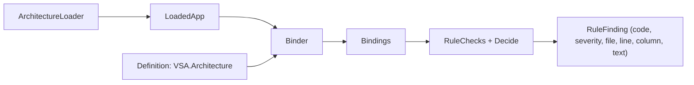

# Architecture engine

The rule engine checks each type of the app against one architecture definition. The definition gives the parts of the app and the rules between them. The core library (`VSA.Architecture.Engine`) loads the app, binds each type to a part, decides each use and gives each problem as a record. The engine app (`engine/`) runs the core after each build of the host.



## Projects

| Project | Path | Contains |
|---|---|---|
| `VSA.Architecture` | `framework/Architecture/Definition/` | The definition API. No ArchUnitNET |
| `VSA.Architecture.Engine` | `framework/Architecture/Engine/` | The core: load, bind, decide, check |
| `VSA.Architecture.Vsa` | `framework/Architecture/Vsa/` | `VsaDefinition` and the VSA layers. No ArchUnitNET |
| Engine app | `engine/` | The runner: Definition, Rules, Report. Its root project `engine/Engine.csproj` makes the build hook package `VSA.Architecture.Build` |

The runtime of an app references `VSA.Architecture.Vsa` through `VSA.Composition` (`VsaApp<TApp>`). So `VSA.Architecture` and `VSA.Architecture.Vsa` use only the BCL and the VSA contracts. They also target `netstandard2.1`, for Unity. The runtime does not get ArchUnitNET.

## Definition API

A layer is a record. A definition adds the layers to a tree in `Define`, and gives the rules in `Rules`.

```csharp
public record Feature : Layer { public override string GroupFolder => "Features"; }
public record Core : External { public override string Assembly => "VSA"; }

public class VsaDefinition : ArchitectureDefinition {
    protected override void Configure(Options options) => options.DefaultPermission = Permission.Deny;

    protected override void Define(Root root) {
        root.Add<Framework>().Add<Core>();
        var feature = root.AddGroup<Feature>();
        feature.Add<Module>().InParentFolder().OfType<VSA.Module.Module>();
        feature.AddGroup<Slice>().Add<Contracts.Requests>().And<Handlers.Requests>().InParentFolder();
    }

    protected override void Rules(RuleBook rules) {
        rules.For<Feature>().Denies<Feature>().InOther<Feature>();
        rules.For<Feature>().Uses<Domain.Shared>().InOther<Feature>();
    }
}
```

| Call | Effect |
|---|---|
| `Add<T>()`, `And<T>()` | A part in the folder of the layer, or a sibling part |
| `AddGroup<T>()` | A group: one part instance for each subfolder |
| `InParentFolder()` | The part shares the folder of its parent. Give it `OfType` |
| `OfType<T>()` | Each type of the part must be assignable to `T` |
| `Uses<T>()`, `Denies<T>()` | A rule. A later rule wins |
| `Under<T>()`, `InSame<T>()`, `InOther<T>()` | Filters: the place of the source or the target |

`Options` sets `DefaultPermission` (the permission when no rule applies), `Boundary`, `UseSameLayer`, `Depth` and `Access`.

`options.UseSameLayer = true` lets each part use each part of the same layer, in all places: for example a feature `Infrastructure` uses the `Infrastructure` of the framework and of a plugin. The engine adds these pairs before the layer bodies and the rules, so a rule can deny them. Boundary also limits them (see Boundary). The default is `false`.

The test `VsaDecisionsTests` writes the decision of the VSA definition for each pair of parts to `tests/Architecture.Tests/VsaDecisions.txt`. If a change to the definition changes a decision, the test fails and writes `VsaDecisions.actual.txt`. Compare the two files. If the change is correct, copy the new file over the baseline.

## Boundary

A closed group keeps its instances apart: an allow rule reaches a part in another instance of the group only if the rule crosses the group. The first value that is set wins:

1. The parameter of the rule call: `Uses<Contracts.Commands>(Boundary.Open)` crosses each closed group.
2. The parameter of the group: `root.AddGroup<Plugin>(Boundary.Open)`.
3. `options.Boundary`. Its default is `Boundary.Open`.

In the example, the first rule reaches the Domain of the own feature, of Core and of the plugins. The second rule also reaches the `Domain.Shared` of the other features. A rule with `InOther<T>()` crosses the group `T` and each group inside it. Boundary does not change a deny rule, and it does not apply to a user outside the group: for example `App/Views` uses the presenters of each feature.

```csharp
options.Boundary = Boundary.Closed;
rules.For<Infrastructure>().Uses<Domain>();
rules.For<Feature>().Uses<Domain.Shared>().InOther<Feature>();
```

## External parts

An `External` part binds the types of a DLL by its name, not by its folder. `Core` binds `VSA.dll` and each `VSA.*.dll`. A child of an external gets the DLL name of its parent and its folder, for example `VSA.Contracts.Requests`. The types of an external DLL are rule targets: a rule can deny them.

The definition stops at these errors:

| Definition | Error |
|---|---|
| `AddGroup<External>()` | A DLL is not a group of folders |
| An external under a group | A DLL has no copy for each group instance |
| An external under an external | The child gets its DLL name from its parent |
| `AddGroup` under an external | DLL names have no instance segment |
| `InParentFolder()` on an external part | Its name is a DLL name segment |

## Depth

`Depth.Self` gives the part only. `Depth.WithChildren` gives the part and all its child parts. The first value that is set wins:

1. The parameter of the rule call, for example `Uses<Contracts>(Depth.WithChildren)`.
2. The layer body, for example `options.Depth = Depth.Self` in `Configure(LayerOptions)` of the layer.
3. `options.Depth`.

## Permission and access

A rule has two values:

| Value | Enum | Values | Question |
|---|---|---|---|
| Permission | `Permission` | `Allow`, `Deny` | May this part use that part? |
| Access | `Access` | `Private`, `PrivateProtected`, `Protected`, `Internal`, `ProtectedInternal`, `Public` | How visible may the use be? |

`Uses<T>()` allows the use. `Denies<T>()` denies it. An access limits an allowed use:

```csharp
rules.For<Contracts.Requests>().Uses<Domain.Shared>();               // use and expose
rules.For<Handlers.Requests>().Uses<Domain>(Access.Internal);        // use, but do not expose outside the assembly
```

A type exposes a part when a type of that part is in its signature: a base type, an interface, or the type of a member (a method return or parameter, a property, a field), with their generic arguments. The access of a member is the narrowest of the member and its type. The order is partial: `Protected` and `Internal` are not comparable, so `Protected` is not within `Internal`.

The framework can require a public exposure, so the check ignores two exposures:

| Exposure | Example |
|---|---|
| A base type or an interface of an `External` part, with its generic arguments | `: Presenter(bus), IPresenterEvent<Rang>` |
| A member that implements a member of such an interface. The name and the signature must match. An explicit implementation also matches | `public Task OnEventAsync(Rang e)` |

An interface of the app or of .NET is not of an `External` part, so it counts. For example, `: IEquatable<Note>` and `public bool Equals(Note? other)` give `VSA2003` if the rule limits `Note`.

The first access that is set wins:

1. The parameter of the rule call, for example `Uses<Domain>(Access.Internal)`.
2. The layer body, for example `options.Access = Access.Private` in `Configure(LayerOptions)` of the layer.
3. `options.Access`. Its default is `Access.Public`, so a rule with no access allows use and exposure.

## Binding

| Type | Part |
|---|---|
| In a DLL that an `External` part names | That part. The longest name wins |
| Source file in a part folder | The deepest part that matches the folder. A group instance matches each name |
| Source file only in `obj/` or `bin/` | The project folder of the file |
| Helper type in a `InParentFolder` folder | The part of the first type that uses it ("follows user") |
| Source file in no part folder | None: `VSA2102` |
| Source file out of the definition root | Not checked |
| Source file in no folder alias (if the definition has aliases) | Not checked |

The engine reads the source file and the first line of each type from the PDB file, with System.Reflection.Metadata (`SourceFiles`).

## Unity projects

If the app root has `ProjectSettings/ProjectVersion.txt`, the app is a Unity project. Unity compiles `Assets/`, so the folders of a Unity app are not the folders of a .NET app.

| Folder | Binds as | Contains |
|---|---|---|
| `Assets/<UnityApp>/` | The root | `Features/`, `Plugins/` |
| `Assets/<UnityApp>/` | `App/` | `Views/`, `Host/` |
| `<UnitySource>/` (default `Source`) | The root | `Features/`, `Plugins/` of the .NET projects |

`ArchitectureDefinition.FolderAliases(appRoot)` gives these folder aliases (`FolderAlias(Folder, As)`). With no aliases, each folder binds as it is. The binder tries each map and keeps the deepest part. `VsaDefinition` finds `UnityApp`: the one folder in `Assets/` (not `Assets/Plugins/`) with `Features/`, `Plugins/` or `Views/`. If two folders match, set it:

```csharp
public class MyApp : VsaApp<MyApp> {
    public override ArchitectureDefinition Architecture => new VsaDefinition(Rules) { UnityApp = "Cards", UnitySource = "Modules" };
}
```

`ArchitectureLoader` also reads the DLLs that Unity compiles (`UnityProject.Scripts`):

| Step | Unity project |
|---|---|
| App DLLs | Also `Library/ScriptAssemblies/*.dll` |
| No `Library/ScriptAssemblies/` | The warning `VSA2103` |
| A DLL name in the host output too | The engine loads the host output DLL only |
| A type in two DLLs | The engine loads it once. The Unity copy wins, so the uses of the views stay checked |
| Source file under `Library/` | Not app code (package cache, generated types) |

## The four checks

`RuleChecks.Of(type)` gives the findings of one type. `ArchitectureMap.Findings()` gives the findings of all app types, and the warnings of the loader.

| ID | Severity | Problem |
|---|---|---|
| `VSA2001` | Error | A type uses a part that the rules deny |
| `VSA2003` | Error | A type exposes a part with more access than its rule allows |
| `VSA2101` | Error | A type is not assignable to the `OfType` of its part |
| `VSA2102` | Error | A type is in a folder that the definition does not have |
| `VSA2103` | Warning | A Unity project has no `Library/ScriptAssemblies/` folder |

Each finding is a `RuleFinding(Code, Severity, File, Line, Column, Text)`. `File` is the full path. The engine app writes one line for each finding:

```text
C:/app/Features/Notes/Slices/Read/ReadHandler.cs(6,1): error VSA2001: ReadHandler in Handlers.Requests (Features/Notes/Slices/Read) uses Invoice in Domain (Features/Billing/Domain): no rule allows it (DefaultPermission = Deny). Remove the use, or change the rule in Rules.
```

## The checks of an app

The build hook package `VSA.Architecture.Build` on the host project runs the engine after each build. A test project does not check the architecture. See "The rule engine" in `AGENTS.md`.

| Step | Source |
|---|---|
| App root | `VsaAppRoot`, else the nearest `global.json` |
| App DLLs | Each DLL of the host output with PDB source files under the app root |
| External DLLs | Each DLL of the host output whose name an `External` part names |
| Definition | The `Architecture` of the most derived `IArchitectureProvider` (the app class) |
| Fallback definition | The most derived class with no constructor parameters that inherits `ArchitectureDefinition` |
| Unity DLLs | See "Unity projects" |

The app class (`MyApp : VsaApp<MyApp>`, see `composition.md`) gives the rules for the runtime and for the checks. To change the VSA rules, override `Rules` in the app class. `VsaDefinition` applies these rules after its own rules, and a later rule wins:

```csharp
using VSA.Architecture;
using VSA.Architecture.Vsa;
using VSA.Composition;

public class MyApp : VsaApp<MyApp> {
    protected override void Rules(RuleBook rules) => rules.For<Presenters>().Denies<Contracts.Events>();
}
```

## Tests of the engine

`tests/Architecture.Tests` uses the fixture apps in `tests/Fixtures/Architecture/` (`GoodApp`, `BadApp`, and the marker DLL `Kit`) with a small test definition. `BadApp` has one known problem for each rule ID.

## Legacy copy

`docs/legacy/architecture-tests/` has a copy of the layer map tests (`Layers.cs`, `VsaArchitectureTests`, the rule tests and their fixtures). The files do not build. They are there only to compare.
