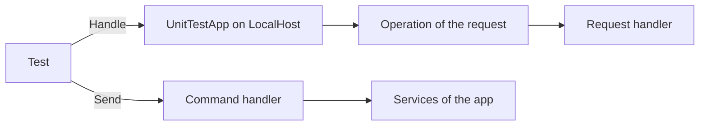

# VSA checks

The VSA checks ship with the framework and run on the modules of the consumer. Libraries do the work: the .NET analyzers, Roslyn, `System.Reflection.Metadata`, NUnit and NSubstitute. VSA adds base classes and one architecture definition (`packs/Vsa/Definition/VsaArchitecture.cs`, see `architecture-engine.md`).

## Levels

| Group | Level | Package | IDs |
|---|---|---|---|
| Editor and build | Analyzers | Built-in .NET analyzers + the analyzer entry of the engine (package `Umpire.Engine`) | `CAxxxx`, `IDExxxx`, `UMP01xxxx` |
| Build of the host | Architecture | The rule engine in the package `Umpire.Engine` (the check model) | `UMP02xxxx` |
| Tests | Unit | `Umpire.Vsa.Testing.Unit` (NUnit, NSubstitute) | None |
| Tests | End-to-end | `Umpire.Vsa.Testing.EndToEnd` | Not started |

The editor and the build run the first group in each consumer project. The build of the host project runs the architecture checks. The last group runs in a consumer test project.

## Rules

| ID | Level | Rule |
|---|---|---|
| `UMP010201` | Analyzers | Requests and responses are records. A record that is not sealed passes, so a request can derive from another request. An abstract request base is not checked. Option: `check_responses`. A team that wants sealed payloads states it in its definition with the `Sealed` and `Record` traits. |
| `UMP010001` | Analyzers | Each option of each running rule has a valid value: from the config, or the default of its rule. |
| `UMP010002` | Analyzers | The `.umpireconfig` file of the block is valid TOML. Else the Umpire rules do not run. |
| `UMP010003` | Analyzers | The analyzer entry loads the engine and each DLL that it needs. Else the Umpire rules do not run. |
| `UMP010101` | Analyzers | A line has at most `max` characters. Formatting, warning. |
| `UMP010102` | Analyzers | A method, constructor, accessor or local function has at most `max` lines. Formatting, warning. |
| `UMP010103` | Analyzers | A file has at most `max` lines. Formatting, warning. |
| `UMP010104` | Analyzers | A file has one top-level type. Option `allow_same_name` permits `Module` and `Module<T>`. Formatting, warning. |
| `UMP010105` | Analyzers | Members are ordered by kind, then by access, then static before instance. Options: `kind_order`, `access_order`, `static_first`. Formatting, warning. |
| `UMP010106` | Analyzers | The code has no comments: no `//`, no `/* */`, no `///` and no `/** */`, also after a directive such as `#pragma`. A directive, for example `#region`, is not a comment. Code in an inactive `#if` is not checked. Formatting, warning. |
| `UMP010107` | Analyzers | A `Configure`, `Define` or `Rules` override of a definition (an `Architecture`, a `Block` record or a concept) does not call its base level. The engine calls each level of the inheritance chain, from the base down. Warning. |
| `UMP020101` | Architecture | Each type uses only the parts that the VSA definition permits. A plugin module is a base, and it uses no module. |
| `UMP020102` | Architecture | Each type exposes another part only within the access of its rule, for example a handler uses `Domain` but does not expose it outside its assembly. |
| `UMP020201` | Architecture | Each type is assignable to the `OfType` of its part, for example a handler in `Handlers.Requests` inherits `RequestHandler<,>`. |
| `UMP020202` | Architecture | Each type of the app is in a folder of a part. |
| `UMP020204` | Architecture | Each type name obeys the name rule of its part, for example the name of a hook ends with `Hook`. See "Content of a part" in `architecture-engine.md`. |
| `UMP020205` | Architecture | A warning: a reference folder (`umpire.check.references`) does not exist, so the checks do not read its DLLs. |
| `UMP020206` | Architecture | A warning: a value in `umpire.check.folder_aliases` is not a list of folders, so the checks do not use it. |
| `UMP020301` | Architecture | Each count of the definition is in its limit, for example each slice has at least one handler. See "Counts and matches". |
| `UMP020302` | Architecture | Each match of the definition holds, for example a request handler handles a request of its own slice. See "Counts and matches". |
| `UMP020303` | Architecture | Each type of a part has the traits that `Are` needs. See "Content of a part" in `architecture-engine.md`. |
| `UMP020304` | Architecture | Each use of a type with `Type<T>().OnlyIn<S>()` is in the parts `S`. See "Content of a part" in `architecture-engine.md`. |
| `UMP020401` | Architecture | No part of the definition covers the folder of another block. Mark the folder with `AddBlock<T>()` or `AddBlockGroup<T>()`. |
| `UMP020402` | Architecture | Each block place holds a check entry. |
| `UMP03xxxx` | Engine | The engine run: a step throws or is skipped, the check entries, the projects of a block, a version, the load of the app. One table: "Engine codes" in `architecture-engine.md`. |

Each ID is `UMP` and six digits: the area (2), the group (2) and the case (2). Area `01` is the code check of the engine: group `00` the base (`UMP010001`, `UMP010002`, `UMP010003`), `01` the kernel rules (`KernelRule`), `02` the VSA rules (`VsaRule`). Area `02` is the rule findings of the engine: `01` uses, `02` binding and names, `03` counts, matches, kinds and attribute places, `04` block places. Area `03` is the engine run: group `00` the run, then one group for each step. `tests/Rules.Tests/CodeTests.cs` and `tests/Engine.Tests/CodeTests.cs` check the form.

Retired analyzer IDs: `UMP010202`, `UMP010203`, `UMP010204`, `UMP010205`, `UMP010206` and `UMP010207`. Do not use a retired ID again (`CodeTests`).

### Rule lines of the VSA definition

`VsaArchitecture.Rules` has these lines. Each code is in the table above. `VsaAppTests` has a type that obeys and a type that breaks each line.

| Rule | Line | Code |
|---|---|---|
| A request and a response of a feature is a record (a class or a struct) or an abstract class | `For<Contracts.Requests>().Under<Feature>().Are(Trait.Record \| Trait.Abstract)` | `UMP020303` |
| An event handler uses no request, no response and no `IRequestSender` | `For<Handlers.Events>().Denies<Contracts.Requests>()` | `UMP020101` |
| A presenter does not publish events. `Contracts.Events.Publishing` is the kernel folder of `IIntegrationEventPublisher` | `For<Presenters>().Denies<Contracts.Events.Publishing>().Under<Kernel>()` | `UMP020101` |
| A `Domain.Shared` type is immutable | `For<Domain.Shared>().Are<Immutable>()` | `UMP020303` |
| A presenter implements `IIntegrationEventHandler<TEvent>` of the kernel | `For<Presenters>().Uses<Handlers.Events>().Under<Kernel>()` | `UMP020101` |

A presenter also does not use `Pipelines`: no rule lets `Presenters` use `MessagesParts.Handlers`. The marker `IHandler<T>` is in `MessagesParts.Contracts`, so a presenter can implement an event handler interface. The base types of `Domain.Shared` types and the types of a contract folder are uses and bindings, so `UMP020101` and `UMP020202` check them.

`UMP010201` also runs, because the record line does not read these cases:

- A request or a response of a plugin module, or of a module kind of a pack variant that does not derive from `Feature`.
- A request or a response in `Slices/Shared/`.
- A nested request or a nested response.

The option `check_responses` is only for `UMP010201`. The record line always checks a response of a feature, and it does not permit an interface that derives from `IRequest` or `IResponse`.

The deny lines check the part of the used type:

- A request type or an own interface that derives from `IRequestSender` or `IIntegrationEventPublisher`, in `Slices/Shared/`, is in the part `Slice.Shared`. The deny lines do not read it.
- The last rule wins. An app line such as `For<Presenters>().Uses<Contracts.Events>()` also allows `Contracts.Events.Publishing`. Add `.Under<Feature>()`, or write the deny line again after it.

### Rules between the kernel layers

`VsaArchitecture.KernelRules` gives the uses between the VSA kernel layers. They are the project references of the kernel, with the references that these bring. A kernel part uses its own part and:

| Kernel part | Kernel parts that it uses |
|---|---|
| `Domain`, `Contracts.Requests`, `Contracts.Commands` | None |
| `Contracts.Events` | `Contracts.Events.Publishing` |
| `Infrastructure` | `Domain` |
| `Handlers.Requests`, `Handlers.Events`, `Handlers.Commands` | The contract part of the same kind |
| `Presenters` | `Contracts.Requests`, `Contracts.Events` (not `Publishing`), `Handlers.Events` |
| `Views` | `Presenters`, the parts that `Presenters` uses, and `Contracts.Events.Publishing` |
| `Composition` | `Presenters`, each handler part and each contract part |
| The top of the kernel (`VsaKernel`) | Each kernel part |

The rules do not limit the uses of `Core`, the uses to and from the top of the kernel, or a new top layer of a pack variant. A part below a VSA layer, or a record that derives from a VSA layer, has the rules of that layer.

The check of `packs/Vsa/` uses `PackArchitecture`, which permits each use between kernel parts and does not read these rules. There, the project references enforce the layers.

## Disabled rules

If the design of an analyzer or a rule is not clear, it is disabled, not deleted. Each disabled rule has a row in issue #143, and the review of all rows comes before 0.1.0. Its class sets `IsOnByDefault => false`, so the code check does not run it. The code and the tests of each disabled rule stay. If the user decides to remove a disabled rule, its ID becomes a retired ID. A consumer can turn a rule on in the `.umpireconfig` file of its block, for example `umpire.<code>.severity = "warning"`.

No rule is disabled now, so the table has no row.

| Code | Class | Why disabled | Issue |
|---|---|---|---|

`DisabledRuleTests` makes sure that the rules with `IsOnByDefault => false` are the codes of this table. To disable a rule, set `IsOnByDefault => false` on its class and add a row here and in #143.

## Plugin modules

A plugin module has the layers of a module and the folder layout of the framework: one folder for each layer, and no slices (see `slice-layout.md`). It is for the base types of the app, as the VSA pack (`packs/Vsa`) is the base of each layer. The VSA definition gives its rules:

| Rule | Check |
|---|---|
| A plugin module uses no feature module | `UMP020101` |
| The `Domain` of a plugin module uses no `Domain` of another plugin module | `UMP020101` |
| A module class uses the plugin modules | `UMP020101` |
| `Infrastructure` uses the `Handlers` and `Contracts` parts (the pipeline step bases), not their child parts | `UMP020101` |
| The module class of a plugin inherits `Plugin` (`For<Plugin>(Depth.Self).HasTypes<Umpire.Vsa.Composition.Plugin>().Exactly(1)`) | `UMP020101` and `UMP020301`, and the host at startup |
| The module class of a feature module does not inherit `Plugin` (`For<Feature>(Depth.Self).Denies<Composition>()`) | `UMP020101`, and the host at startup |
| A module has exactly one module class (`For<Module>(Depth.Self).HasTypes<Umpire.Kernels.Module>().Exactly(1)`) | `UMP020301`, and the host at startup |
| A plugin layer uses the same layer of another plugin module (the plugin group is open) | Permitted |
| A plugin module has no `Slices/` folder | `UMP020202` |

## The host part

The app part `Host` is the folder `App/Host/` of the app, for custom host code only. The kernel part `Hosts` is the folder `framework/Kernel/Hosts/` of the root `Core`: `Umpire.Hosts.Web` and `Umpire.Hosts.Console`. The app class and `Program.cs` are at the top of `App/`, so they bind to the `App` root.

| Rule | Check |
|---|---|
| `Host` uses `Composition`, the core (`Core`, with `Hosts`) and `UmpireLibraries` | `UMP020101` |
| `Host` uses the module class of a module (`For<Host>().Uses<Module>(Depth.Self)`), for example a module list in `FixedModules`, and no other part of a module | `UMP020101` |
| The top of a module folder holds only the module class: exactly one `Umpire.Kernels.Module` class, and at most one type (`For<Module>(Depth.Self).HasTypes<object>().AtMost(1)`). Move a helper into a layer folder | `UMP020301` |
| The `App` root (`Depth.Self`) uses `Host`, `Definition`, `Composition`, `Core`, `UmpireLibraries` and `Pack` | `UMP020101` |
| `Views` uses the `Hosts` part of the kernel (`ViewsRoot` is in `Umpire.Hosts.Web`) | `UMP020101` |

The project references do not enforce the layers. The Umpire packages give each project the base of each layer, and the rule engine checks each use after the build (see `architecture-engine.md`).

The host finds the module classes from the types, with no build records:

| Fact | Source |
|---|---|
| Module class | A public, top-level class that inherits `Module` or `Plugin` |
| Module name | The last part of the namespace of the module class |
| Plugin module | The module class inherits `Plugin` |

One assembly can have many modules. Two module classes in one module namespace stop startup. A nested or internal class that inherits `Module`, for example in a test, does not make a module class.

The host configures the plugin modules first, then the other modules. In each group the order is by name. The host gets the plugin modules through the module classes, so an app with no module does not load its plugin modules.

## Code check: the analyzer entry and `CodeRule`

All Umpire analyzer rules are rules of the code check operation of the engine. The only Umpire analyzer DLL is the analyzer entry of the engine (`engine/Entries/Analyzer/`, assembly `Umpire.Engine.Analyzer`). It reads the facts of the compilation, and the engine checks them.

```
compiler (Roslyn 4.10 or later)
 └─ EngineAnalyzer: compilation start, each file, each named type, compilation end
     └─ CompileApp: EngineApp on a CompileHost, composed one time for each compiler process (static Lazy)
         └─ host.SendAsync(CompileJobRequest): the compile job
             ├─ CheckCode: the code rules (CodeRule) on the facts of one file or one type
             └─ CheckTypes: the type checks of the check model (only with a state folder)
```

| Stage | The entry sends | The engine gives |
|---|---|---|
| `Start` | The project facts: the `.umpireconfig` text, the rules that the compiler turns off, the build properties | `UMP010001`, `UMP010002`, `UMP030801` (reported at the end) |
| `File` | The facts of one source file: the lines, the comments, the types, the members, the methods, the base calls | The format findings (`UMP0101xx`) |
| `Type` | The facts of one named type: its name, its kind, its request and response | `UMP010201` and the type findings of the check model (`UMP02xxxx`) |
| `End` | Compile errors (only for a project of the check model) | The data findings of the check model (`UMP0308xx`) |

The entry gives two facts through fact sources (`CompileHost`): the pack selection (`PackSource`, `PackSelection`) and the facts of the check model (`ModelSource`, `ProjectFacts`). The engine asks for them only when a rule needs them. The entry composes the app with a fixed module list (`FixedModules`) and with no module settings, because the compiler folder is not the folder of an app. It does no file I/O of its own: the engine reads the state of the check model.

A rule is one class on a group base in `engine/App/Features/CodeCheck/Slices/CheckCode/`: `KernelRule` (group `01`, about any code) or `VsaRule` (group `02`, only in a compilation that selects the VSA pack). The engine finds each rule class in its assembly (`CodeRule.All`). A rule sets its `Number`, its `Title`, its `Message` and the defaults of its options, and it checks the facts of a file or of a type. A rule option wins over a global option.

```csharp
public sealed class RecordPayloadRule : VsaRule {
    public const string CheckResponsesKey = "check_responses";

    public override int Number => 1;

    public override IReadOnlyList<RuleOption> Options { get; } = [RuleOption.Bool(CheckResponsesKey, true)];

    public override string Title => "Requests and responses are records";

    public override string Message => "{0} is {1}. Make it a record.";

    public override IEnumerable<CodeFinding> Check(CodeType type, RuleOptions options) { ... }
}
```

```toml
umpire.UMP010201.severity = "error"       # error, warning, suggestion, or none (the rule does not run)
umpire.check_responses = false            # global option
umpire.UMP010201.check_responses = true   # rule option
```

Each analyzer finding is a warning by default. The check mode does not change it. `TreatWarningsAsErrors` does not make it an error (see `Umpire.Codes.props` in `architecture-engine.md`).

A `dotnet_diagnostic.UMP010201.severity` key in an `.editorconfig` of the consumer also works: the compiler applies it over the Umpire severity. With `TreatWarningsAsErrors`, the value `error` has no effect there: use `WarningsAsErrors` or `umpire.<ID>.severity`. It cannot start a rule that is off on its class (`IsOnByDefault => false`): only `umpire.<ID>.severity` starts that rule.

## Rule files

| File | Holds |
|---|---|
| `.editorconfig` (repository root) | The style of this repository: the built-in .NET rules, editor and code style options, severities. A test section turns off CA1707 (underscores in test names). No `UMP` key |
| `.umpireconfig` (block root) | The rule values and severities of the block (`umpire.<ID>.<key>`). The defaults are on the rule classes |
| `Directory.Build.props` (repository root) | The style switches of this repository: `EnforceCodeStyleInBuild`, `GenerateDocumentationFile`, the formatting rules as warnings, and the Umpire codes that are errors (`WarningsAsErrors`) |

`Umpire.After.targets` of the package `Umpire` gives `.umpireconfig` to the compiler as an additional file. The analyzer entry gives its text to the compile job, and the engine reads it with Umpire.Config (`CodeConfig`). If the file is not valid TOML, the build gives `UMP010002`, and the Umpire rules do not run. The definition holds no analyzer value.

### The analyzer entry in the compiler

The compiler owns some assemblies, for example Roslyn and `System.Collections.Immutable` (SCI). An analyzer always gets the copy of the compiler. The oldest supported compiler is the one of Unity 6: Roslyn 4.10 with SCI 8.0. The compiler loads a dependency of an analyzer only if that file is an analyzer item, so each DLL of the entry is an analyzer item from one folder.

| Analyzer item | Source |
|---|---|
| `Umpire.Engine.Analyzer.dll` | The entry |
| `Umpire.Engine.dll`, `Umpire.Engine.Versions.dll` | The engine core |
| `Umpire.dll`, `Umpire.Vsa.dll`, `Umpire.Definition.dll`, `Umpire.Vsa.Definition.dll` | The bundles |
| `Microsoft.Extensions.*`, `Microsoft.Bcl.AsyncInterfaces.dll` | The dependency injection |
| `System.Reflection.MetadataLoadContext.dll` and others | The other dependencies of the engine core |

- The compiler gives `Microsoft.CodeAnalysis*` and the `System.*` libraries, so they are not analyzer items. `System.Reflection.MetadataLoadContext` is not in the runtime, so it is an analyzer item.
- The package `Umpire.Engine` holds the items in `analyzers/dotnet/cs/`. The package `Umpire` depends on it, so each project with an Umpire package gets the analyzer.
- In this repository, `tools/bundle/SourceMode/Umpire.EngineAnalyzer.targets` makes each DLL of the output folder of the entry an analyzer item.
- The engine core of the analyzer targets `netstandard2.0` and uses SCI and `System.Reflection.Metadata` 8.0 (`System.Reflection.MetadataLoadContext` 8.0.1).
- `AnalyzerRoslynTests` checks that each Umpire analyzer DLL references only the assemblies of the Unity compiler, at the Unity version or lower, the `System` libraries of .NET 8, and the other analyzer items.
- `AnalyzerLoadTests` compiles a file with a real .NET 8 compiler (Roslyn 4.10, SCI 8.0), for example the one of a Unity 6 install, with the analyzer items and a `.umpireconfig`. If the computer has no .NET 8 compiler, the test is ignored. `UMPIRE_NET8_DOTNET_ROOT` selects a dotnet folder.
- `SharedCompilerTests` checks that a deleted copy of an analyzer DLL on the compiler server does not stop the rules (`CS8032`).

The Umpire packages ship no native style: no .NET rule severity, no `TreatWarningsAsErrors` and no `AnalysisLevel`. A consumer app sets its own style in its `.editorconfig`. The root `.editorconfig` and `Directory.Build.props` are the style of this repository only. `tools/bundle/SourceMode/Umpire.SourceMode.props` also sets `AnalysisLevel = latest-recommended` for the apps of this repository (the engine, the fixtures and the templates). `Directory.Build.targets` gives the framework projects the analyzer entry, with `UmpireFrameworkCode = true`: then only the rules about any code run (`IsModuleRule` is false), not the module rules.

The analyzer of this repository is the analyzer build of the entry (`UmpireAnalyzerBuild=true`). The entry and the engine core build on the bundles, in the output folder `<config>-analyzer`, with no analyzer. The bundles get no analyzer (`UmpireNoAnalyzer`), because the analyzer builds on them, and the runtime projects check the same files. Thus each runtime project, the engine and the entry get the analyzer, and no project is a dependency of its own analyzer.

The base makes the ID (`UMP01` + group + number). The entry makes the descriptors from `CodeRule.All` and `CodeRule.Notices`, with the message format `{0}`. `CodeTests` checks that the rules table of this file lists each rule ID. Tests find a rule by its type, for example `new LineLengthRule().Id`.

A rule lists its options in `Options`, each with its default on the class. The lookup is: `umpire.<rule ID>.<key>`, then `umpire.<key>`, then the default. At the start of a compilation, the code check checks each option. If a value is not valid, or an option has no default and no value, it reports `UMP010001`, and that rule does not run. A consumer changes a value in the `.umpireconfig` file of its block.

## Formatting rules

In this repository, the formatting rules are warnings, so a build does not fail on them (`WarningsNotAsErrors` in the root `Directory.Build.props`).

| Rule | Checks | Option |
|---|---|---|
| `IDE0055` | Relaxed until 0.1.0: each brace on the line of its statement, and `else`, `catch` and `finally` on the line of the closing brace. Target value: each brace on its own line (Allman), and `else`, `catch` and `finally` on a new line | `csharp_new_line_before_open_brace`, `csharp_new_line_before_else`, `csharp_new_line_before_catch`, `csharp_new_line_before_finally` |
| `IDE0011` | Braces on each `if`, `for`, `while` | `csharp_prefer_braces` |
| `IDE2000` | No two blank lines in a row | `dotnet_style_allow_multiple_blank_lines_experimental` |
| `IDE0008` | Relaxed until 0.1.0: `var` is correct everywhere. Target value: explicit type, except where the line shows the type | `csharp_style_var_*` |
| `IDE0040` | Relaxed until 0.1.0: off. Target value: access modifier on each member, except in an interface | `dotnet_style_require_accessibility_modifiers` |
| `IDE0055` | One statement on each line | `csharp_preserve_single_line_statements` |
| `IDE2002` | No blank line between two closing braces | `csharp_style_allow_blank_lines_between_consecutive_braces_experimental` |
| `IDE0036` | Modifiers in the default order | `csharp_preferred_modifier_order` |
| `IDE0049` | `int`, not `Int32` (editor only) | `dotnet_style_predefined_type_*` |
| `IDE0054` | `x += 1`, not `x = x + 1` | `dotnet_style_prefer_compound_assignment` |
| `IDE1005` | `Changed?.Invoke(...)` | `csharp_style_conditional_delegate_call` |
| `IDE0083` | `is not`, not `!(x is T)` | `csharp_style_prefer_not_pattern` |
| `IDE0021`, `IDE0022`, `IDE0061` | Block body for constructors, methods and local functions. `IDE0022` is relaxed until 0.1.0: off. Target value: a block body for methods | `csharp_style_expression_bodied_*` |
| `IDE0023`–`IDE0027`, `IDE0053` | `=>` for operators, properties, indexers, accessors and lambdas when it fits on one line (`IDE0053` editor only) | `csharp_style_expression_bodied_*` |
| `IDE1006` | Names: `I` + PascalCase interfaces, `T` + PascalCase type parameters, PascalCase types, members and constants, camelCase private fields, parameters and locals | `dotnet_naming_*` |
| `IDE0051`, `IDE0052` | No private member that no code uses, or that code writes and never reads | |
| `IDE0059` | No value that no code reads. Fix: `_ = Save(order);` | `csharp_style_unused_value_assignment_preference` |
| `IDE0060` | No parameter that no code uses | `dotnet_code_quality_unused_parameters` |
| `IDE0005` | No `using` that the file does not need | `GenerateDocumentationFile` in the root `Directory.Build.props` |
| `IDE0004` | No cast to the type that the value already has | |
| `IDE0079` | No suppression that hides no warning (editor only) | |
| `CA1052`, `CA1012` | A class with only static members is `static`. An abstract class has no public constructor | `dotnet_code_quality.<ID>.api_surface` |
| `CA2000` | Dispose each `IDisposable` object | |
| `CA1849` | No blocking call, such as `.Result`, in an `async` method | |
| `CA1812` | An internal or private class that no code creates | Handlers and the types that dependency injection creates give false warnings until issue #41 is closed |
| `UMP010101` | Characters in a line | `umpire.UMP010101.max` |
| `UMP010102` | Lines in a method | `umpire.UMP010102.max` |
| `UMP010103` | Lines in a file | `umpire.UMP010103.max` |
| `UMP010104` | One top-level type in a file | `umpire.UMP010104.allow_same_name` |
| `UMP010105` | Member order | `umpire.UMP010105.kind_order`, `access_order`, `static_first` |
| `UMP010106` | No comments | |
| `UMP010107` | No base call in a definition level | |

A rule with a maximum inherits `LimitRule`, which reads the option `max`. In `kind_order` and `access_order`, a name that the list does not have comes after the names of the list.

A rule key wins over a global key, for example `umpire.UMP010201.check_responses` over `umpire.check_responses`. A global key, for example `umpire.max`, applies to each rule that reads the key and has no rule key of its own, also when the rule has a default. In a config file line, a semicolon starts a comment, so a list option uses commas between its items.

The code check skips each rule that the compiler turns off in each file (`RuleSuppression`), because Roslyn skips an analyzer only when all of its IDs are off. If it cannot tell that a rule is off, the rule runs, and Roslyn drops its diagnostics.

| Test | Checks |
|---|---|
| `FormattingRuleTests` | Each format rule and its options, on small sources, through the analyzer entry |
| `FormattingBuildTests` | The build of the Umpire packages, on the built fixture `tests/Fixtures/Built/Formatting`: each rule gives a warning, the build passes, and the migrations give no warning |
| `RuleOptionTests` | `UMP010001` |
| `RuleValueOwnerTests` | Each option of each rule has a valid default. The package files have no option value. Each key has a rule. The general files have no `UMP` key. No key is a definition option |

The analyzer tests read both analyzer package files, without the severity lines. A test config overrides a value, because each package file has `global_level = -1`.

EF Core writes the files in `Infrastructure/Migrations/`. The package `Umpire` marks them as generated code (`Umpire.Migrations.globalconfig` in `obj/`), so no rule checks them.

## Architecture: the rule engine

The rule engine binds each type of the app to a part of the VSA definition. Its checks give `UMP020101`, `UMP020102`, `UMP020201`, `UMP020202`, `UMP020204`, `UMP020301` to `UMP020304` and the warnings `UMP020205` and `UMP020206`. The package `Umpire` runs it (from the package `Umpire.Engine`) after each build of the host project. A test project does not check the architecture. See `architecture-engine.md` for the definition API, the binding and app rules. A consumer changes the severity of a `UMP02xxxx` code in the `.umpireconfig` file of its block, with the key `umpire.<code>.severity`, the same key as for the analyzers.

### Counts and matches

The VSA definition has these count and match lines. S1 to S3 are in `Slice.Rules`, so each one has an implicit `Under<Slice>()`. M1 is in `VsaArchitecture.Rules` (see "Counts and matches" in `architecture-engine.md`):

| ID | Rule | Line | Code |
|---|---|---|---|
| S1 | A slice has at least one handler or hook | `For<Slice>().Has<Handlers>().AtLeast(1)` | `UMP020301` |
| S2 | The handlers of one slice are of one kind. A hook is a kind | `For<Slice>().Has<Handlers>().OfOneKind()` | `UMP020301` |
| S3a | A request handler handles a request of its own slice | `For<Handlers.Requests>().Takes<Contracts.Requests>().InSame<Slice>()` | `UMP020302` |
| S3b | Each request and each response of a feature has exactly one handler | `For<Contracts.Requests>().Has<Handlers.Requests>(Depth.Self).Exactly(1)` | `UMP020301` |
| S3c, S3d | The same two lines for the commands | `Handlers.Commands`, `Contracts.Commands` | `UMP020302`, `UMP020301` |
| M1 | Each module has exactly one module class | `For<Module>(Depth.Self).HasTypes<Umpire.Kernels.Module>().Exactly(1)`, in the record `Module` | `UMP020301` |
| M2 | A plugin module has exactly one `Plugin` class | `For<Plugin>(Depth.Self).HasTypes<Umpire.Vsa.Composition.Plugin>().Exactly(1)`, in the record `Plugin` | `UMP020301` |

An event has zero or more handlers, so it has no line. A hook takes its command, so S3d counts `Handlers.Commands` with `Depth.Self`: the nested `Handlers.Commands.Hooks` part does not count. A command result follows its command, so it does not count. S3a-d are slice rules (implicit `Under<Slice>()`), so they do not check a plugin module: a plugin has no slice, and its base commands have no handler. So a plugin request with two handlers, or a plugin command with no handler, gives no finding.

The hooks have their own parts: `Handlers.Commands.Hooks` (`BeforeCommandHook<>`, `AfterCommandHook<,>`) and `Handlers.Events.Hooks` (`BeforeEventHook<>`, `AfterEventHook<>`). Each hook part has `NameEndsWith("Hook")`, so the name of a hook ends with `Hook` (`UMP020204`). A hook has each use of the handlers of its kind. In a slice, the hook parts are siblings of the handler parts in the slice folder. In a plugin module, `Handlers.Commands.Hooks` is a child of `Handlers.Commands` (and the same for the events), with `InParentFolder()`. Reason: a plugin has one folder for each layer, so its hooks are in `Handlers/Commands/`, and only a child part can share that folder. A sibling with `InParentFolder()` would be in `Handlers/`.

A validator (`Validator<T>`) in a slice is the optional part `Slice.Validators`, next to the handler. No part uses it: the pipeline finds it by type. It uses the kernel and plugin handlers and contracts, the contracts of its own slice, `Slice.Shared` of its feature, `Domain` (internal) and `Domain.Shared`. It does not use the infrastructure or the contracts of another slice. It is not a handler, so S1 and S2 do not count it.

`Slices/Shared/` is the part `Slice.Shared`, not a slice, so S1, S2 and S3 do not count it. It has the uses of a slice contract, and the slices and the presenters of its own feature use it.

## Unit: `VsaUnitTest`

The test starts the app on a `LocalHost`, with no HTTP and no database. `Handle` sends a request with `host.SendAsync(request)`, so the request goes through the operation of the app, its pipeline and its validators. A host does not expose a command, so `Send` runs the command handler with the services of the started app.



The app of a test is `UnitTestApp<VsaKernel>`, an `App<VsaKernel>` that runs on a `UnitTestHost`, and `UnitTestHost` is a `LocalHost`. The class has an open kernel, so the rule engine does not count it as a check entry of `Umpire.Testing`. Before each test, the base makes new test services with the default fakes and calls `Configure`. At the first `Handle`, `Send`, `Provider`, `Events` or `Repository` call, the base starts the app. The composition installs the core, the kernel and the modules, then the test services. A test service replaces each service of the app with the same service type. An open generic test service, for example `IRepository<,>`, also replaces each closed form of it. After each test, the base stops the app. `LocalHost` makes one scope for each request, so a test reads a singleton from `Provider`, not a scoped service of the request.

`Modules` gives the modules of the app. The default is `ScannedModules`: the modules in the DLLs of the test output, with no test assembly. A test class that must use other modules overrides it, for example `new FixedModules(new GoodModule())`.

```csharp
public sealed class CreateNotePublisherTests : VsaUnitTest {
    IIntegrationEventPublisher publisher = null!;

    protected override void Configure(IServiceCollection services) {
        publisher = Mock<IIntegrationEventPublisher>();
        publisher.PublishAsync(Arg.Any<NoteCreated>(), Arg.Any<CancellationToken>()).ThrowsAsync(new TimeoutException());
    }

    [Test]
    public void Failure_of_the_publisher_stops_the_request() =>
        Assert.ThrowsAsync<TimeoutException>(() => Handle(new CreateNoteRequest(author, "Title")));
}
```

| Service | Default | Seed or replace |
|---|---|---|
| `IRepository<T, TId>` | `InMemoryRepository<T, TId>` | `Repository<T, TId>().With(...)` |
| `IIntegrationEventPublisher` | `RecordingEventPublisher` (`Events`) | `Mock<IIntegrationEventPublisher>()` |
| `ILogger<T>` | Logging with no output | `services.AddLogging(...)` (the test base has ASP.NET Core) |
| `ICommandSender` | None | `Mock<ICommandSender>()` |
| Other services | None | `Mock<T>()` |

`Handle` needs the request handler in a module of the app, else the `LocalHost` stops with "has no operation". `Send` finds the one handler in the assembly of the command. If the handler sends other commands, add `Mock<ICommandSender>()` in `Configure`.

Add or replace services before the app starts. After the start, the test services are read-only, and a change fails.

## Add a rule

1. If a built-in .NET rule does the check, set its severity in the root `.editorconfig`. This is the style of this repository only: the Umpire packages ship no native style, and a consumer sets its own.
2. If one file or one type shows the problem, write a rule of the code check operation of the engine: a class on `KernelRule` or `VsaRule` in `engine/App/Features/CodeCheck/Slices/CheckCode/`. Set the next free `Number` of its group, and the defaults of its options. If the rule needs a fact that the compile job does not have, add the fact to `App/Plugins/Facts/Domain/Shared/Compile/` and read it in the analyzer entry (`engine/Entries/Analyzer/Facts/`).
3. Else change the rules of the VSA definition (`packs/Vsa/Definition/VsaArchitecture.cs`).
4. Add tests. For a code rule, use `tests/Rules.Tests/AnalyzerTests.cs` (the Roslyn analyzer test library on the analyzer entry). For the engine, add a case to `tests/Architecture.Tests` with the fixture apps in `tests/Fixtures/Architecture/`.
5. Add the rule to the table in this file.
