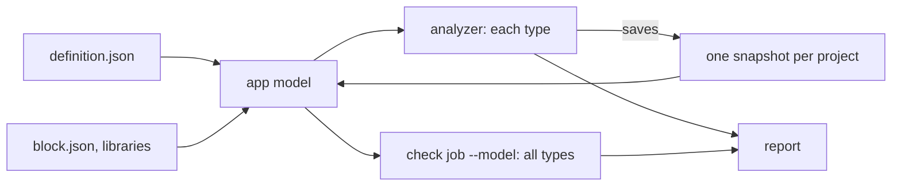

# Check model

The check model is the check side of the K3 decision (#293). It is a part of the engine core: the feature module `engine/App/Features/Model/`. The build job checks with it after each build (ExportModel, then CheckModel). The names and the packages of the check model are working names (K4, K6).

## Projects

| Part | Folder | Contains |
|---|---|---|
| Model domain | `engine/App/Features/Model/Domain/` | Data, app model, state files, report, model rules (`Rules/`, run by `ModelCheck`). Namespace `Umpire.CheckModel` |
| Export | `engine/App/Features/Model/Domain/Export/` | The definition, block and library files. Namespace `Umpire.CheckModel.Export` |
| ExportModel operation | `engine/App/Features/Model/Slices/ExportModel/` | Writes the state files in the build job and the check job |
| CheckModel operation | `engine/App/Features/Model/Slices/CheckModel/` | Checks all types from the state, after ExportModel or with `jobs check --model true` |
| CheckTypes operation | `engine/App/Features/Model/Slices/CheckTypes/` | The checks of each type in a compile (the compile job) |
| DLL snapshots | `engine/App/Features/Model/Infrastructure/DllSnapshots.cs` | The snapshot of a DLL from the DLL facts of the Facts plugin (`DllSource`) |
| Analyzer entry | `engine/Entries/Analyzer/` | The facts from symbols (`Facts/`, `ProjectFacts`). It sends the compile job |

The model domain is generic: no part of it knows a slice or a feature. The domain uses no Roslyn and no package, so the compiler can load the engine core for the analyzer. No part is a package.

## Saved files

A build writes the state folder of a block in the intermediate output path of the root project (`umpire/check/`, see "State files" in `architecture-engine.md`). The option `--state` of a job gives another folder. The MSBuild property `UmpireCheckState` gives the state folder to the analyzer: it then reads and saves `snapshots/<project>.json` in that folder, and it reports its findings in a build too (the parity tests use it). With no `--state`, the key `umpire.check.state` in `.umpireconfig` gives the folder, else the folder `umpire/check` in the intermediate output path of `--bin`, else `artifacts~/umpire` in the block folder.

| File | Contains | Written by |
|---|---|---|
| `definition.json` | Parts, rules, names, places | `DefinitionExport` |
| `block.json` | Block folder, projects, place and target of each snapshot, libraries, inner blocks, severities, mode, marks | `BlockExport` |
| `snapshot.json` of a project | The type facts of a project and target, the folder of its paths (`root`) and the target framework | The analyzer, in the intermediate output path of the project |
| `snapshots/<project>.json` | The type facts of a project, with `UmpireCheckState` | The analyzer |
| `snapshots/<assembly>.json` of a DLL | The DLL facts of an app DLL with no snapshot, for example of a reference folder | ExportModel (`DllSnapshots`) |
| `libraries/<assembly>.json` | The source paths and base types of DLL types | `LibraryExport`, from a snapshot, from the DLL facts or from the file of the package `Umpire.Engine` |

A writer does not write a file again if only its date is different. A writer leaves out an empty list and a value that is false. A reader fails on an unknown field, another missing field or another format.

### definition.json

`DefinitionExport` writes the resolved definition (`ResolvedArchitecture.Compiled`), and `Decisions` gives the same decision for each pair of parts. The file has no ID and no rule text: a part is its place in the part tree, a concept or a type is its full name and its assembly, and each rule is its terms. The text of a rule comes from the terms. Each rule form of the definition API has a form as data. A new trait needs a line in `TraitKind`, `TraitExport` and `TraitFit`, and the export fails until then.

### Snapshot

| Level | Contains |
|---|---|
| Snapshot | Format, date, project |
| File | Path, hash, modified time |
| Type location | Namespace, line, column, outer type |
| Type content | Kind, access, modifiers, bases, attributes, members with full signatures, mutable members |
| Type references | Each used type with its kind, member, line and column |

The facts of a type are complete: no check reads the code again. A partial type has facts in each of its files. The snapshot does not have the part of a type or a rule, so a changed rule needs no compile.

## App model and model rules

`AppModel.Load(state)` joins the definition and the snapshots, and nothing saves the result. A type gets its part from its file. A type with no part of its own in a shared folder gets the part of the type that uses it.

| Model rule | Findings |
|---|---|
| `LocationCheck` | `UMP020201`, `UMP020202` |
| `ContentCheck` | `UMP020204`, `UMP020303` |
| `ReferenceCheck` | `UMP020101`, `UMP020102`, `UMP020301`, `UMP020302`, `UMP020304` |
| `BlockPlaceCheck` | `UMP020401`, `UMP020402`, all types only |
| `DataCheck` | `UMP030802`, `UMP030803`, all saved data |

A model rule gets the app model, the types and the report. A report that did not run to its end has `Succeeded` false and a reason. A report with findings can succeed.

## Trust

A finding is an error only if each fact that decides it is current (`Trust`). If one fact is old or missing, the finding is a warning, in the analyzer and in the check job.

| Finding | Facts that decide it |
|---|---|
| Each finding | The definition and the block file |
| Place, name, trait, type place | The projects of the type, of its bases, of the types that share its folder |
| Use | The same, for the type and the used type |
| Exposure | Also the types of the bases and of the members |
| Match | Also the base arguments |
| Count, block place | All saved data and all config files |

A saved project is current if all its files and all projects and libraries that it references are current, each source file is in a snapshot, and it compiled against the same surface of each referenced project. The surface is the declarations that a dependent project can see, with no lines and no method bodies. A type that the model does not find in a project of the model is not current.

| Data | Mark |
|---|---|
| Snapshot | The hash and the time of each file |
| Library | The hash and the time of its DLL. `block.json` lists each necessary library |
| Definition | The sources and folders of the definition, or its DLL. A source that is newer than its DLL is not current. `block.json` has the hash of `definition.json` |
| Block file | The input files, for example `.umpireconfig` and the project files |

A `block.json` with no mark of the definition is not current. Thus the compile of a changed definition has no architecture error and does not stop the job that writes the files. A count in the analyzer is a warning if the block has many projects, because a file that is not compiled is in no snapshot.

## Analyzer

The analyzer entry of the engine sends the compile job, and the CheckTypes operation does the work:

1. At the start the engine finds the state folder and asks the entry for the declarations of its project (`ModelSource`). It loads the app model with them.
2. For each type the entry gives the name, and the engine runs the three checks with the references of that type.
3. At the end the engine saves the snapshot of the project.

It saves only in a compiler process (`csc`, `VBCSCompiler`), and not with `DesignTimeBuild` or a compile error. `UmpireSaveSnapshot` selects another answer for one run. A compile that saves to its own `snapshot.json` (`UmpireSnapshot`) does steps 1 and 2 only in an editor. In a build it only saves, with no definition, and the build job gives the findings. An editor compile finds the state of the last build with `state.txt` next to the snapshot. It checks only the projects in `block.json`, and it does nothing in a block with no `definition.json`.

The package build runs the compile job on the source of each shipped Umpire DLL (`UmpireLibraryPass` in `tools/bundle/Engine/Umpire.Engine.csproj`). With `UmpireLibrary`, the compile saves the library facts of the DLL, with the source paths under `/_/`. The package `Umpire.Engine` ships them in `tools/net8.0/libraries/`.

| Code | Meaning |
|---|---|
| `UMP030801` | The model cannot load, or the job failed |
| `UMP030802` | A snapshot is missing or not valid |
| `UMP030803` | A snapshot, a library, the definition or the block file is old |
| `UMP030804` | The snapshot is not saved |
| `UMP030805` | The check is not complete |

The package `Umpire` puts these codes and all rule codes in `WarningsNotAsErrors` (`tools/bundle/Umpire/build/Umpire.Codes.props`), so `TreatWarningsAsErrors` makes no error of a warning.

## Check job with the model

`umpire-engine jobs check --model true --project <block folder> --bin <folder> [--block <block folder>] [--state <state folder>] [--mode Error|Warn]` checks all types with no compile (the CheckModel operation, group `08`). The job does not read `--bin`. Its lines are the lines of the engine report: `file(line,col): error|warning CODE: text`. `umpire.check.mode` is in `block.json`, and `--mode` wins over it. If `block.json` cannot be read, the mode comes from `.umpireconfig`, and the default is `Warn`: each error is a warning.

| Exit code | Meaning |
|---|---|
| 0 | The check has no error |
| 1 | The check has an error |

A check that does not come to its end gives `UMP030801`: a warning in the mode `Warn`, else an error.

## Compile facts and DLL facts

The model gets the type facts of a project from one of two sources. `tests/Engine.Tests/Model/Parity` compares them on the fixtures and on the blocks of this repository.

| Source | Made by | Used for |
|---|---|---|
| Compile facts | The analyzer entry, at the end of each compile | Each project of a build |
| DLL facts | `DllSource` of the Facts plugin, in ExportModel | A DLL of a reference folder, and an `External` DLL with no library file |

The findings of the model rules, the diagnostics of the analyzer and the severities are the same on the two sources. The texts are the same. These facts differ:

| Topic | DLL facts | Compile facts |
|---|---|---|
| Place of a denied use | Line of the sequence point of the use | Line and column of the use |
| Place of a type | First method body | Type name |
| Razor view | `_razor.g.cs` path | `.razor` file |
| `nameof`, constants, enum values | Not a use | A use |
| Written type arguments | Not always a use | A use |
| Type only in compiler output | A use | Not a use |
| Deconstruct of a generic type | Not an exposure | An exposure |

"Type only in compiler output" is the array of a `params` call, the type of a default argument, the result type of an `await` and the `Dispose` call of a `using`. `FactParity` lists each case.

## Limits

- `[field: X]` on an event with no accessors is not a fact: the compiler API does not give the field.
- A file that another process adds between the start of a build and the start of the compile is not a new file until the next compile.
- A snapshot lists the source files of its project folder that the compile does not read. A new excluded file lowers findings until that project compiles. A folder with its own project and no snapshot is not examined.
- A definition helper outside the definition folder has no mark.
- A reference that is not in the model, for example a package with no library file, has no mark.
- The caller selects the DLL path of a mark. A path in `bin` is absent after a clean, and then the findings of that build are warnings.

## Open questions

- What writes the library facts of a package (`Umpire.dll`) for a host with no engine, for example Unity?
- A snapshot has about 7 KB for each type. Is a name table necessary?
- A missing snapshot gives a warning only in a project that references the missing project. Must each project of the block give it?
- Does a `nameof`, a constant or an enum value of a denied type break a use rule?
