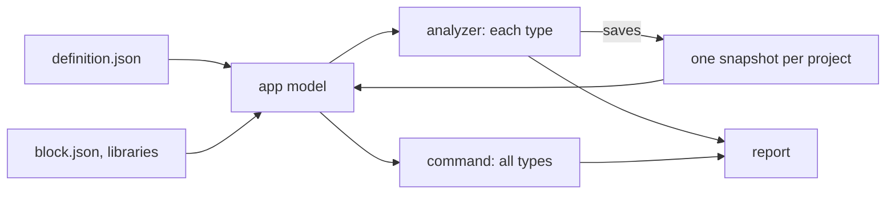

# Check model

The check model is the check side of the K3 decision (#293). It is in `check/`, next to the rule engine. The rule engine runs in the builds, and no build uses the check model. The names and the packages of the check model are working names (K4, K6).

## Projects

| Project | Folder | Target | Contains |
|---|---|---|---|
| Umpire.CheckModel | `check/Model/` | `netstandard2.0` | Data, app model, report, operations. No Roslyn, no package |
| Umpire.CheckModel.Export | `check/Export/` | `net8.0` | The definition, block and library files |
| Umpire.CheckModel.Analyzer | `check/Analyzer/` | `netstandard2.0` | The facts from symbols, the checks in a compile |
| Umpire.CheckModel.Command | `check/Command/` | `net8.0` | The last job, `umpire-check` |

The core is generic: no project of the check model knows a slice or a feature. No project is a package.

## Saved files

All files are in one state folder. The default is `artifacts~/umpire-model` in the block folder. The key `umpire.check.state` in `.umpireconfig` changes it: a relative folder starts at the folder of the file. The flag `--state` of the command and the MSBuild property `UmpireCheckState` of the analyzer win over the key.

| File | Contains | Written by |
|---|---|---|
| `definition.json` | Parts, rules, names, places | `DefinitionExport` |
| `block.json` | Block folder, projects, libraries, inner blocks, severities, mode, marks | `BlockExport` |
| `snapshots/<project>.json` | The type facts of a project | The analyzer |
| `libraries/<assembly>.json` | The source paths of DLL types | `LibraryExport` |

A writer does not write a file again if only its date is different. A writer leaves out an empty list and a value that is false. A reader fails on an unknown field, another missing field or another format.

### definition.json

`DefinitionExport` writes the resolved definition (`ResolvedArchitecture.Compiled`), and `Decisions` gives the same decision for each pair of parts. The file has no ID and no rule text: a part is its place in the part tree, a concept or a type is its full name and its assembly, and each rule is its terms. The text of a rule comes from the terms. Each rule form of the definition API has a form as data. A new trait needs a line in `TraitKind`, `TraitExport` and `TraitFit`, and the export fails until then.

### Snapshot

| Level | Contains |
|---|---|
| Snapshot | Format, date, project |
| File | Path, hash, modified time |
| Type location | Namespace, line, column, outer type |
| Type content | Kind, access, modifiers, bases, attributes, members with full signatures |
| Type references | Each used type with its kind, member, line and column |

The facts of a type are complete: no check reads the code again. A partial type has facts in each of its files. The snapshot does not have the part of a type or a rule, so a changed rule needs no compile.

## App model and operations

`AppModel.Load(state)` joins the definition and the snapshots, and nothing saves the result. A type gets its part from its file. A type with no part of its own in a shared folder gets the part of the type that uses it.

| Operation | Findings |
|---|---|
| `LocationCheck` | `UMP020201`, `UMP020202` |
| `ContentCheck` | `UMP020204`, `UMP020303` |
| `ReferenceCheck` | `UMP020101`, `UMP020102`, `UMP020301`, `UMP020302`, `UMP020304` |
| `BlockPlaceCheck` | `UMP020401`, `UMP020402`, all types only |
| `DataCheck` | `UMP030802`, `UMP030803`, all saved data |

An operation gets the app model, the types and the report. A report that did not run to its end has `Succeeded` false and a reason. A report with findings can succeed.

## Trust

A finding is an error only if each fact that decides it is current (`Trust`). If one fact is old or missing, the finding is a warning, in the analyzer and in the command.

| Finding | Facts that decide it |
|---|---|
| Each finding | The definition and the block file |
| Place, name, trait, type place | The projects of the type, of its bases, of the types that share its folder |
| Use | The same, for the type and the used type |
| Exposure | Also the types of the bases and of the members |
| Match | Also the base arguments |
| Count, block place | All saved data, and each source file is in a snapshot |

A saved project is current if all its files, and all projects and libraries that it references, are current. A type that the model does not find in a project of the model is not current.

| Data | Mark |
|---|---|
| Snapshot | The hash and the time of each file |
| Library | The hash and the time of its DLL. `block.json` lists each necessary library |
| Definition | The sources and folders of the definition, or its DLL. A source that is newer than its DLL is not current. `block.json` has the hash of `definition.json` |
| Block file | The input files, for example `.umpireconfig` and the project files |

A `block.json` with no mark of the definition is not current. Thus the compile of a changed definition has no architecture error and does not stop the job that writes the files. A count in the analyzer is a warning if the block has many projects, because a file that is not compiled is in no snapshot.

## Analyzer

1. At the start it makes the declarations of its project and loads the app model with them.
2. For each type it reads the references and runs the three operations.
3. At the end it saves the snapshot of its project.

It saves only in a compiler process (`csc`, `VBCSCompiler`), and not with `DesignTimeBuild` or a compile error. `UmpireSaveSnapshot` selects another answer for one run. It checks only the projects in `block.json`, and it does nothing in a block with no `definition.json`.

| Code | Meaning |
|---|---|
| `UMP030801` | The model cannot load, or the job failed |
| `UMP030802` | A snapshot is missing or not valid |
| `UMP030803` | A snapshot, a library, the definition or the block file is old |
| `UMP030804` | The snapshot is not saved |
| `UMP030805` | The check is not complete |

A project with `TreatWarningsAsErrors` must put these codes and all rule codes in `WarningsNotAsErrors` (see `tests/CheckModel.Tests/Parity/Inject.targets`).

## Command

`umpire-check [--root <block folder>] [--state <state folder>] [--mode Error|Warn]` checks all types with no compile. Its lines are `file(line,col): error CODE: text`. The exit code is 0 with no error, 1 with an error, and 2 with bad flags. An incomplete check with no error gives 0. `umpire.check.mode` is in `block.json`, and `--mode` or `UmpireCheckMode` wins over it.

## Differences from the rule engine

`tests/CheckModel.Tests/Parity` compares the two sides on the fixtures and on the blocks of this repository. The findings of the command, the diagnostics of the analyzer, the severities and the facts are the same, with these differences in the facts:

| Topic | Rule engine | Check model |
|---|---|---|
| Place of a denied use | First line of the type | Line of the use |
| Place of a type | First method body | Type name |
| Razor view | `_razor.g.cs` path | `.razor` file |
| `nameof`, constants, enum values | Not a use | A use |
| Written type arguments | Not always a use | A use |
| Top-level program | No type | The type `Program` |
| Class with only nested types | No type | A type |
| Type only in compiler output | A use | Not a use |
| Framework DLL in an External | Not read | A use by its name |
| Deconstruct of a generic type | Not an exposure | An exposure |
| Count in the analyzer, many projects | Error | Warning |
| Type that fits two parts | The job stops | `UMP020201` |
| `UMP020205`, `UMP020206` | Setup findings | Not in the model |

"Type only in compiler output" is the array of a `params` call, the type of a default argument, the result type of an `await` and the `Dispose` call of a `using`. `FactParity` lists each case. `UMP020205` and `UMP020206` are about the setup of the DLL folders and of the folder aliases, not about types.

## Limits

- `[field: X]` on an event with no accessors is not a fact: the compiler API does not give the field.
- The analyzer imports the namespace `Umpire.Vsa.Analyzers`, because the kernel analyzers use it.
- A source file that a project excludes is in no snapshot, so a count is a warning. A folder with its own project and no snapshot is not examined.
- A definition helper outside the definition folder has no mark. The definition has its own DLL with D1, and then all its sources can have a mark.
- The caller selects the DLL path of a mark. A path in `bin` is absent after a clean, and then the findings of that build are warnings.

## Open questions

- When and by which job does a build write `definition.json`, `block.json` and the library files? `check/Export` has no build step.
- What writes the library facts of a package (`Umpire.dll`) for a host with no engine, for example Unity?
- Must an incomplete check have another exit code than 0?
- Can the build setup put the codes in `WarningsNotAsErrors`, so that `TreatWarningsAsErrors` makes no error of a warning on old data?
- A project with many target frameworks has one snapshot file, and the last compile wins (#362). One file for each target, or only one target?
- A snapshot has about 7 KB for each type. Is a name table necessary?
- A missing snapshot gives a warning only in a project that references the missing project. Must each project of the block give it?
- Does a `nameof`, a constant or an enum value of a denied type break a use rule?
