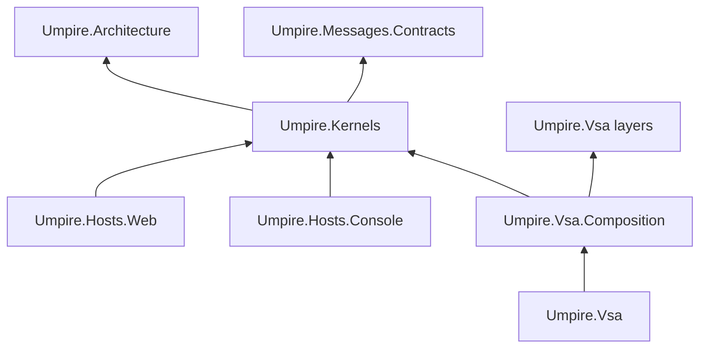

# Composition: the app, the pack, the kernel and the hosts

An app starts with one call on all hosts: `new MyApp().Run(args)`. The app class selects one pack. The pack joins the architecture (for the rule engine), the kernel (the install of the architecture) and the host (the platform). All registrations go to `IServiceCollection`, so module code does not know which container the app uses.

## Startup shape

```
App.Run(args)
├─ Start(args)
│  ├─ host = Pack.CreateHost()
│  ├─ Services = host.Build(args, this)
│  │  └─ host.Compose(services, configuration, Pack.Kernel, types)
│  ├─ host.Start(Services, AppStop)          the host work: operation, web, signals
│  ├─ State = Running
│  └─ OnStart()
├─ wait for a stop request
└─ the stop
   ├─ State = Stopping
   ├─ OnStop()
   ├─ host.Dispose()
   └─ State = Stopped
```

The calls go one way. The app calls `Build`, `Start` and `Dispose` on the host. The host calls only `Compose` and `AppStop.Request`.

```csharp
// App/Host/Program.cs
return new ShopApp().Run(args);

// App/Host/ShopApp.cs: the web host and the VSA rules
public class ShopApp : App<Vsa<WebHost>>;

// The console host and an architecture of the app
public class ToolApp : App<Vsa<ToolArchitecture, ConsoleHost>>;

// Custom root services: one host class
public sealed class ShopHost : WebHost {
    protected override void Configure(IServiceCollection services, AppTypes types) =>
        services.AddSingleton<ShopClock>();
}
public class ShopApp : App<Vsa<ShopHost>>;
```

The app class file imports `Umpire.Kernels` (`App<TPack>`), `Umpire.Vsa` (`Vsa<THost>`) and the namespace of the host (`Umpire.Hosts.Web` or `Umpire.Hosts.Console`). The concept record `App` is in `Umpire.Architecture.Blocks`, and the app class file does not import that namespace. So `App` in the app class file is the class `Umpire.Kernels.App`.

## The kernel types

| Type | Package | Job |
|---|---|---|
| `IApp` | Umpire.Kernels | `State`, `Services`, `Start`, `Stop`, `Run`. A shell makes the app class through it |
| `App`, `App<TPack>` | Umpire.Kernels | The lifecycle of the app. `App<TPack>` makes its pack with `new TPack()` |
| `Pack`, `Pack<TArchitecture, TKernel, THost>` | Umpire.Kernels | Gives `Architecture`, `Kernel` and `CreateHost()` |
| `Kernel` | Umpire.Kernels | The install point of an architecture: `Install` (the core, fixed), then `Configure` |
| `AppHost` | Umpire.Kernels | The platform: `Build`, `Start`, `Dispose`, `Compose` (fixed), `Configure` |
| `AppState` | Umpire.Kernels | `Stopped`, `Running` or `Stopping` |
| `AppStop` | Umpire.Kernels | A singleton service. `Request(exitCode)` stops the app. The first request gives the exit code |
| `Operation` | Umpire.Kernels | A request that a host exposes: `Group`, `Name`, `Effect`, `Input`, `Invoke` |
| `Module`, `Module<TSettings>` | Umpire.Kernels | The root class of a module. `Order` 1 |
| `AppTypes` | Umpire.Kernels | The one type source: the modules and their types |

The VSA pack adds `Vsa<THost>` (the VSA rules) and `Vsa<TArchitecture, THost>` (the rules of the app) in Umpire.Vsa. It adds `VsaKernel`, `Plugin` and `Plugin<TSettings>` (the root class of a plugin module, `Order` 0) in Umpire.Vsa.Composition. Each type argument is a class with `new()`, so IL2CPP keeps one shared generic code.

## The app class

`umpire new app <Name>` writes `App/Host/<Name>App.cs`. The app class is the one entry of the app: the runtime starts it, and the rule engine reads `Pack.Architecture` from it (see `architecture-engine.md`). The app class has the lifecycle only. It has no install point.

| Member | Default | Override to |
|---|---|---|
| `OnStart()` | Nothing | Run code after the build. `Services` is set |
| `OnStop()` | Nothing | Run code before the host disposes the services |

To add app rules, derive an architecture from `VsaArchitecture`, override `Rules`, and use `Vsa<TArchitecture, THost>` (see `architecture-engine.md`).

| Lifecycle member | Use |
|---|---|
| `Start(string[] args)` | Builds a new host, starts the host work, calls `OnStart`. Returns |
| `Stop()` | Stops the app and returns when `State` is `Stopped` |
| `Run(string[] args)` | `Start`, then waits until `State` is `Stopped`. Gives the exit code |
| `State` | `Running` from the start of the host work until the stop |
| `Services` | The services of the running app, else `null` |

A second `Start` or `Run` while the app runs is an error. If the app does not run, `Stop` does nothing. Each `Start` makes a new host, so `Start` after `Stop` starts the app again in the same process.

### One stop path

The app has two stop entries. `App.Stop()` is for the code that owns the app: a Unity shell, `Program.cs`, a test. `AppStop.Request(code)` is for the code inside the app: a module, a handler, a service. Both entries go to the same stop.

```text
any source ──► AppStop.Request(code)
                 └─► App posts the stop to the app thread
                       └─► OnStop ─► host.Dispose ─► State = Stopped
App.Stop() on the app thread ──► the stop runs inline: no post, no wait
App.Stop() on another thread ──► request, then wait until Stopped
Run ──► the stop runs on the thread of Run, after the wait
```

| App thread | Where the stop runs |
|---|---|
| `Start` on a thread with a `SynchronizationContext` | That context. `Start` keeps `SynchronizationContext.Current` |
| `Start` on a thread with no context | The thread pool |
| `Run` | The thread of `Run` |

- The inline rule prevents a deadlock. `Stop()` on the Unity main thread does not wait for work that it posted to the main thread.
- A stop request during `Start`, for example in `OnStart`, runs after `Start` ends.
- The first request gives the exit code. The app ignores a request of an earlier start.
- `Stop()` in host work only requests the stop, and returns. The stop waits for the host work, so a wait in `Stop()` is a deadlock. Host work is the console operation and each HTTP request of `WebHost`. Code inside the app uses `AppStop.Request`.
- `ConsoleHost` runs the operation on the thread pool, so the operation does not continue on the app thread.
- If `OnStop` or `host.Dispose` throws, `Stop()` gives the error to its caller. A stop on the thread pool also writes the error to the app log. A stop on an app thread gives the error to its `SynchronizationContext`.
- If the console operation cancels itself, the exit code is 1. A cancel from the stop is not an error.

| Stop source | Exit code of `Run` |
|---|---|
| `App.Stop()` | 0 |
| `AppStop.Request(code)`, from app code | `code` |
| The end of the console operation | The exit code of the response |
| Ctrl+C, or SIGTERM on `net10.0` (console and web hosts) | 0 |
| `IHostApplicationLifetime.StopApplication()` (web host) | 0 |

Code inside the app uses the same call in all hosts:

```csharp
sealed class QuitHandler(AppStop stop) : CommandHandler<QuitCommand, Done> {
    public override Task<Result<Done>> HandleAsync(Envelope<QuitCommand> envelope) {
        stop.Request(envelope.Message.ExitCode);
        return Task.FromResult<Result<Done>>(new Done());
    }
}
```

## The hosts

A host is the platform. It builds the services and starts the host work. It does not wait. A host class is also the one place for the custom root services of an app (`Configure`).

| Host | Package | Use |
|---|---|---|
| `AppHost` | Umpire.Kernels | A `ServiceProvider` with an empty configuration. Exposes no operation |
| `ConsoleHost` | Umpire.Hosts.Console | Command-line configuration. Runs one request, then `AppStop.Request(exitCode)` |
| `WebHost` | Umpire.Hosts.Web | ASP.NET Core: one HTTP route for each operation, and the views |
| `UnityHost` | `vsa-unity` | A Unity app. Its `Configure` adds the Unity log provider and the main thread `Dispatch` |

| `AppHost` member | Kind | Default |
|---|---|---|
| `Build(args, app)` | Virtual | `ServiceCollection`, `Compose`, `BuildServiceProvider`. Composes only |
| `Start(services, stop)` | Virtual | Nothing. Starts the host work, and sends each stop source to `stop.Request` |
| `Dispose()` | Virtual | Disposes the provider |
| `Compose(services, configuration, kernel, types)` | Fixed | See "What Compose does" |
| `Configure(services, types)` | Virtual | Nothing. The custom root services, last |
| `Modules` | `init` property | `null`: `AppTypes` finds the modules. A test gives a list |

- `ConsoleHost.Build` selects the request from the words before the first option. `ConsoleHost.Start` starts the request and listens for Ctrl+C and SIGTERM.
- `WebHost.Build` builds the `WebApplication` and maps the operations and the views. `WebHost.Start` calls `StartAsync`, connects `ApplicationStopping` to `AppStop`, and listens for Ctrl+C and SIGTERM. `WebHost.Dispose` calls `StopAsync`.
- `WebHost` turns off the native console lifetime, so only the stop path of the app reacts to Ctrl+C.
- `AppHost` does no OS work, so a Unity app does not listen for Ctrl+C.
- Each host has a public constructor with no parameters, and `AppHost` has `[RequireDerived]`.

## What Compose does

```
AppHost.Compose(services, configuration, kernel, types)    fixed order
├─ kernel.Install(services, types, configuration)          Umpire.Kernels
│  ├─ IConfiguration                                        keep one that exists, else the given one
│  ├─ AddLogging                                            no log provider
│  ├─ AppTypes, AppStop                                     singletons
│  ├─ auto-register                                         each [AutoRegister] type
│  └─ Configure(services, types)                            VsaKernel:
│     ├─ AddRequestHandlers                                 each kind adds its sender and calls AddPipeline
│     ├─ AddEventHandlers, AddCommandHandlers
│     ├─ AddPresenters
│     └─ AddRequestOperations                               one Operation for each request handler
├─ settings = new ModuleSettings(Settings(types))           the providers of the host
├─ Module.Compose(services, settings)                      each module, in Order, then by name
│  ├─ Module                                                Configure(services)
│  └─ Module<TSettings>, Plugin<TSettings>                  get the settings, then Configure(services, settings)
└─ host.Configure(services, types)                         last
```

The order is inside `Compose`, so a host cannot change it. A module replaces a default with `services.Replace<TService, TImplementation>()` (Umpire.Kernels). A pack variant kernel derives from `VsaKernel` and calls `base.Configure` first. An app that owns its container calls `Compose` with its own services, configuration, kernel and `AppTypes`.

## Definitions and transports

A module defines its requests, commands, events, handlers and presenters one time. The same code works on every host. The host selects only the transports:

| Kind | Part | `AppHost` | `ConsoleHost` | `WebHost` |
|---|---|---|---|---|
| Definition | Messages, in-process senders | Yes | Yes | Yes |
| Definition | Presenters, `LivePresenters` | Yes | Yes | Yes |
| Transport | Command line: one request | No | Yes | No |
| Transport | HTTP API: one route for each request | No | No | Yes |
| Transport | Views (`ViewsRoot`): Razor components | No | No | Yes |

```
Presenter → IRequestSender.SendAsync(request) → RequestHandler<,>             every host
API client → HTTP /api/{group}/{name} → Operation → RequestHandler<,>          web host
Command line → {group} {name} --arg value → Operation → RequestHandler<,>      console host
```

A request is the message that comes from outside the app. A command is the message between features, so a host does not expose commands. The VSA kernel makes one `Operation` for each request handler. `Invoke` sends the request with `IRequestSender`. The hosts read only the `Operation` list, so they know no VSA type.

```csharp
public interface IRequest : IMessage {
#if NET
    static virtual string? Group => null;
    static virtual string? Name => null;
    static virtual Effect Effect => Effect.Write;
#endif
}

public sealed record ListNotesRequest : IRequest<ListNotesResponse> {
    public static Effect Effect => Effect.Read;
}
```

| Member | Default | Web | Console |
|---|---|---|---|
| `Group` | The module name, kebab case | Route segment | First word, optional |
| `Name` | The type name with no `Request` suffix, kebab case | Route segment | Second word, optional |
| `Effect` | `Write` | `Read` GET, `Write` POST, `Delete` DELETE | Not used |

- `Effect` is in `Umpire.Messages.Contracts` (#199).
- On `netstandard2.1`, `IRequest` has no members (`#if NET`, #200). Unity has no transport, so it reads nothing.
- A response that implements `IExitCode` gives the exit code of the console. An error gives 1. Else the code is 0.
- If the app has one request, the console words are optional. Else the console needs the name, or the group and the name.
- `IResponse` is the marker of a response type. `IRequest<TResponse>`, `RequestHandler<,>` and `IRequestSender` require it. Umpire.Sdk also uses it to find the contract files of a slice.

## AppTypes finds the parts of the app

`AppTypes` (Umpire.Kernels) reads 2 sources and keeps each loaded assembly that references a given assembly:

| Source | Finds |
|---|---|
| The loaded assemblies | Unity: all script assemblies load when the domain starts |
| The `.dll` files in `AppContext.BaseDirectory` | .NET: a module assembly loads only when code uses one of its types |

- The scan reads the metadata of a file with `System.Reflection.Metadata`. It loads only the files that reference the assembly.
- A file that the runtime cannot load by name (not in `deps.json`) is not part of the app. The scan ignores it.
- Each source finds nothing where it does not apply, so the scan has no Unity case.
- If an assembly has types that do not load, the scan keeps the types that load (`ReflectionTypeLoadException`).
- The scan skips each assembly that references `nunit.framework`: a test assembly is not part of the app.
- To select other modules, give a list in `AppHost.Modules`.
- `Build` makes one `AppTypes` instance: `new AppTypes(Modules, app.GetType().Assembly)`. If `Modules` is `null`, the instance finds the modules itself. The instance keeps the types of each assembly and the assemblies that reference each assembly, so it reads each assembly one time. A second `Start` makes a new instance, so it also finds the assemblies that loaded later.
- `LoadedTypes.Of(assembly)` (Umpire.Architecture) is the one load-safe read of the types of an assembly. The kernel, the unit test base and the rule engine use it.

| Member | Gives |
|---|---|
| `new AppTypes(modules, appAssembly)` | The one constructor. With `null` modules, the instance finds the modules itself. `AppHost` gives the assembly of the app class (the root project) |
| `Modules` | One module for each module root, or the given modules, in order |
| `ConcreteTypesOf(baseType)` | The concrete classes that derive from `baseType`, in the assemblies of the modules and the assembly of the app class. A type in another assembly, for example a test assembly, is not found |
| `Registered()`, `Implementations(baseType)` | The marked types (see "One discovery path") |

| Part | Scan for | Rule |
|---|---|---|
| Module root | A reference to `Umpire.Kernels`, or to an assembly with an abstract `Module` base (for example `Plugin` in `Umpire.Vsa.Composition`) | One class that inherits `Module` in each namespace (`ModuleRoot.Create`) |
| Views root | The assemblies of the modules and of the app class (`ConcreteTypesOf(typeof(ViewsRoot))`) | One component that inherits `ViewsRoot` |

The modules are in order of `Module.Order`, then by name: a plugin (`Order` 0) comes before a module (`Order` 1). If the app has a views root, the views run in that process. Two views roots stop the build.

## One discovery path

`AppTypes` finds the types of the modules one time. Each layer registration reads the same result. It reads the root assembly and each layer assembly of a module, so a module that is one assembly (for example one Unity `.asmdef`) also works. Each send goes through a pipeline (`docs/handler-pipeline.md`).

```text
AppTypes.Registered()
├─ each concrete class with [AutoRegister]     closed class: as it is
│  (on the class, a base class or an interface) open class: closed for each type argument
└─ the core step                               registers each type and each marked base
   The layer registrations                     add only the sender, the pipeline and the checks
```

| Marker | Side | Meaning |
|---|---|---|
| `[AutoRegister(lifetime)]` | Open or closed class, its base class or its interface | VSA registers each concrete class. Lifetime default: `Scoped`. |
| `[TypeArgument]` | Type argument, its base class or its interface | A struct or a concrete class that closes the open classes. |
| `[assembly: TypeArgument(typeof(int))]` | Type argument | A type that cannot have the attribute. |

The markers are in `Umpire.Markers`. The same package has the stripping markers for IL2CPP. The UnityLinker finds them by class name, so do not rename them:

| Marker | Target | The linker keeps | VSA puts it on |
|---|---|---|---|
| `[RequireDerived]` | Class | Each derived class | The `[AutoRegister]` bases, `Presenter`, `BeforeStep`, `AfterStep` and their typed forms, `Module`, `App`, `Pack`, `AppHost` |
| `[RequireImplementors]` | Interface | Each implementor | `IApp`, `IRunner`, `IBeforeCall`, `IAfterCall` |
| `[Preserve]` | Any | The marked member | The `[AutoRegister]` bases, `Presenter`, `BeforeStep`, `AfterStep` and their typed forms, the envelope create method of the pipeline |

The pipeline creates the runner, the envelope factory and the steps from a `Type` (`Activator`, `ActivatorUtilities`). The app makes its pack and the pack makes its host with `new()`. The linker cannot see these uses, so each of their bases has a marker. `MarkedTypes` names the marker types with `typeof`, so Umpire.Kernels uses the markers assembly in code.

The template bases have `[AutoRegister]`: `CommandHandler<,>`, `RequestHandler<,>`, `IntegrationEventHandler<>`, `Validator<>` and the four hook bases. A class that derives from one of them needs no marker.

```csharp
[TypeArgument]
public interface IResource;

public readonly record struct Health(int Value) : IResource;

sealed class ChangeResourceHandler<T> : CommandHandler<ChangeResourceCommand<T>, int>
    where T : struct, IResource { ... }                     // closed for Health, Mana

[AutoRegister]
public interface IDamageRule;
sealed class DamageRule<T> : IDamageRule where T : struct, IWeapon { ... }   // closed for Sword, Dagger

[AutoRegister(Lifetime.Singleton)]
sealed class WeaponCache<T> where T : struct, IWeapon { ... }
```

### Rules

| Rule | Detail |
|---|---|
| Registration | The class itself, and each base class or interface with the marker. |
| One instance | Each marked base resolves the class itself, so a scope has one instance. |
| Type arguments | Only marked types and assembly types. A type without the marker is never a type argument. |
| Constraints | `class`, `struct`, `unmanaged` and each type constraint. A struct with a reference field does not meet `unmanaged`. |
| Parameters | One generic parameter. An open class with two or more parameters stops the start, with a message. |
| No marker | VSA does not close or register the class. |
| No type argument fits | The open class gets no closed type. A send of that command fails with "has no handler". |
| Owner | A layer registration can register a class first, for example a presenter with a factory. The core step does not replace it. |

`AppTypes` is a singleton service. `Implementations(typeof(TBase))` gives a `ServiceImplementation(Service, Implementation)` for each registered type that derives from `TBase`, with that base as the service. A plugin reads its own types with it.

The type arguments of an open class are the marked types that meet each constraint of its generic parameter (`ConstraintTypeArguments`, internal). An app cannot replace this source.

### Reflection uses

Umpire uses reflection only in the places below. Each other part gets its types from `AppTypes`.

| Place | Use | Reason |
|---|---|---|
| `AppAssemblies` (Kernel) | `AppDomain.GetAssemblies`, `Assembly.Load`, `PEReader` | Finds the module assemblies. Only the `AppTypes` instance calls it |
| `LoadedTypes.Of` (Architecture) | `GetTypes` | The one load-safe type read |
| `ModuleRoot.Create` (Kernel) | `Activator.CreateInstance` | Creates the module class. A class with no public constructor with no parameters stops the start, with a message |
| `AppTypes`, `ConstraintTypeArguments` (Kernel) | `MakeGenericType`, `GetFields` | Closes an open class for each type argument |
| `MarkedTypes` (Kernel) | `GetCustomAttributesData` | Reads `[AutoRegister]` and `[TypeArgument]` by name |
| `MessageRoute` (Messages.Handlers) | `MakeGenericMethod` | Makes the envelope of the runtime message type |
| `Pipeline` (Messages.Handlers) | `ActivatorUtilities.CreateInstance` | Creates the runner. A runner that it cannot create stops the send, with the pipeline and runner names |
| `PipelineRun` (Messages.Handlers) | `GetServiceOrCreateInstance` | Creates the steps and hooks from their types |
| `PresenterServiceCollectionExtensions` (Presenters) | `GetInterfaces`, `ActivatorUtilities` | Registers each presenter one time, and connects each presenter with events |
| `Views` (Hosts.Web) | `MakeGenericMethod` | Calls `MapRazorComponents<TRoot>` for the views root |
| `RequestOperations` (Composition) | `MakeGenericMethod` | Reads the static `Group`, `Name` and `Effect` of each request, and makes its `Operation` |
| `CommandLine` (Hosts.Console) | `GetConstructors`, `Invoke` | Binds the command-line values to the constructor of the request |
| `VsaUnitTest` (Testing.Unit) | `LoadedTypes.Of`, `MakeGenericType` | Finds the handler of a request or a command |
| `AppLoader` (engine) | `AssemblyLoadContext`, `Activator`, `GetProperty` | Creates the one definition type: the app class (then reads its architecture) or the architecture |
| `RuleAnalyzer` (Kernels.Analyzers) | `GetTypes`, `Activator` | Finds the rule classes in its own assembly, in the compiler |

The table does not list the uses that only read metadata, for example `IsAssignableFrom`, `GetInterfaces` and `GetGenericArguments`.

### Checks

The checks read the registered types. They do not find types.

| Check | Rule |
|---|---|
| Commands | One handler for each command |
| Requests | One handler for each request |

## The HTTP API

`WebHost` maps one route for each `Operation`, with ASP.NET Core minimal APIs (`MapMethods`). The route is `Route(operation)`, by default `/api/{group}/{name}`. A web host can override `Route`.

| Step | Source |
|---|---|
| Bind the request | The JSON body (`POST`, `PUT`, `PATCH`), then the route values, then the query |
| Run the handler | `Operation.Invoke`, with the services of the scope of the HTTP request |
| Success | 200 with the response as JSON |
| Error of the handler | A problem response: 404 if the code ends with `.not_found`, else 400 |
| Value that does not bind | A problem response, 400, title `request.not_valid` |

`Invoke` sends each request with the registered `IRequestSender`. If a module replaces `IRequestSender`, for example with a remote sender, the HTTP API uses that replacement too. A remote sender that calls the same app makes a loop.

If the app has one `ViewsRoot`, `WebHost` adds `AddRazorComponents().AddInteractiveServerComponents()` and maps `MapRazorComponents<TRoot>()` (#204). `Umpire.Vsa.Views` has only the presenter components (`PresenterWatcher`, `PresenterComponent<T>`).

## Projects

```
framework/Kernel/                      Umpire.Kernels
  App/                                 App, App<TPack>, IApp, Pack, Pack<TArchitecture, TKernel, THost>, AppStop
  Kernels/                             Kernel, the core step (AutoRegistration)
  Operations/                          Operation, OperationInvoke, OperationResult
  Hosts/                               AppHost
  Hosts/Web/                           Umpire.Hosts.Web: WebHost, ViewsRoot, the HTTP API, the request binder
  Hosts/Console/                       Umpire.Hosts.Console: ConsoleHost, the command-line binder
  Modules/                             Module, Module<TSettings>, ModuleSettings, ISettingsProvider, UmpireConfigSettings
  Services/                            ServiceCollectionExtensions: Replace<TService, TImplementation>
  Scan/                                AppTypes, ModuleRoot, ServiceImplementation, ConstraintTypeArguments, MarkedTypes
  Factories/                           IFactory<T>, AddFactory
architecture/                          Umpire.Architecture: Architecture (the kernel references it for Pack)
framework/Components/Messages/
  Contracts/                           IMessage, Envelope, Result, Error, Effect
  Handlers/                            PipelineBuilder, Pipeline, Pipelines, InlineRunner, Validator, Before, After, AddPipeline
packs/Vsa/
  VsaPack.cs                           Umpire.Vsa: Vsa<THost>, Vsa<TArchitecture, THost>
  Architecture/                        Umpire.Vsa.Definition: VsaArchitecture, the VSA layers, Feature and Plugin
  Kernel/
    Handlers/Events/                   AddEventHandlers, InProcessEventPublisher
    Handlers/Commands/                 AddCommandHandlers, InProcessCommandSender
    Handlers/Requests/                 RequestHandler, AddRequestHandlers
    Presenters/                        AddPresenters
    Views/                             PresenterWatcher, PresenterComponent<T>
    Composition/                       Umpire.Vsa.Composition: VsaKernel, RequestOperations, Plugin, Plugin<TSettings>
```



- The kernel knows no layer. `VsaKernel.Configure` calls each layer registration by a direct call, in a fixed order.
- No host knows VSA. The hosts read only `Operation`.
- `Umpire.Kernels` does not reference `Microsoft.Extensions.Hosting`. Only `Umpire.Hosts.Web` uses a .NET Generic Host, inside `WebApplication`.
- `Umpire.Vsa` references `Umpire.Vsa.Composition`, because its definition names `Module` and `Plugin` with `OfType`, and `Vsa<THost>` names `VsaKernel`. `Umpire.Vsa.Composition` does not reference `Umpire.Vsa`.

## The container

Module code and the layer registrations use two shared interfaces from .NET:

| Interface | Job | Package |
|---|---|---|
| `IServiceCollection` | Registration: a list of `ServiceDescriptor` | `Microsoft.Extensions.DependencyInjection.Abstractions` |
| `IServiceProvider` | Resolution: `GetService(Type)` | `System` |

`AppHost.Build` builds the Microsoft container. An app with its own container calls `Compose`, then builds its container. Other containers read `IServiceCollection` too:

| Container | Reads `IServiceCollection` |
|---|---|
| Autofac | `builder.Populate(services)` (`Autofac.Extensions.DependencyInjection`) |
| DryIoc, Lamar, SimpleInjector | Their own integration packages |
| VContainer | No support. The app routes to the Microsoft container |

A Unity app that uses VContainer builds the Microsoft container from `Compose`, then routes to it. For each VSA service type, VContainer gets a registration that resolves the service from the Microsoft container. A singleton comes from the root. A scoped or transient service comes from one Microsoft scope for each VContainer scope. So VSA keeps the Microsoft semantics, and Unity classes get VSA services by constructor injection.

A copy of each `ServiceDescriptor` into `IContainerBuilder` does not work. VContainer refuses two registrations of one implementation type, and VSA registers several instances of one type and reads them as a list (`AddPipeline`). The spike is on the branch `spike/compose-containers` of `vsa-consumer-unity`.

## Factories

A factory makes objects that the container cannot make, for example Unity objects from a prefab. The factory gets one service, and it gives the made object what it needs. Only the composition root and the factories resolve services. The made objects do not get `IServiceProvider`.

| Type | Use |
|---|---|
| `IFactory<T>` | `T Create()` |
| `services.AddFactory<T, TService>(create)` | A factory: a function of one service |

```csharp
services.AddFactory<CounterLabel, CounterPresenter>(presenter => {
    var label = Object.Instantiate(labelPrefab);
    label.Bind(presenter);
    return label;
});
```

A factory resolves its service on each `Create`, from the scope that resolved the factory. A factory knows no view and no presenter: views, enemies and other objects use the same factories. For a factory with more services, write a class that implements `IFactory<T>` and register it as a normal service.

## Module settings

```text
module.Compose(services, settings)                 internal, from AppHost.Compose
└─ settings.Use<TSettings>(services, this, Validate)
   ├─ providers[0].Get<TSettings>(module) → null
   ├─ providers[1].Get<TSettings>(module) → TSettings   the first answer wins
   ├─ no answer → new TSettings()
   ├─ Validate errors → InvalidOperationException, all errors in one message
   └─ services.AddSingleton(settings)
→ Configure(services, settings)
```

The host gives the providers in `AppHost.Settings(types)`. The default is `[new UmpireConfigSettings(UmpireConfig.In(AppContext.BaseDirectory))]`: the table with the module name in the `.umpireconfig` file of the output folder, for example `[Notebook]`. `In` reads only that folder, not the folders above it. The name of a module is the last part of its namespace. The SDK copies `.umpireconfig` to the output folder. With no file or no base folder, `In` gives `UmpireConfig.Empty`, and the next provider answers. The table name and the property names match with no case. A value of the wrong type stops the start with the table name, the file and the Tomlyn message. A host adds a provider in front: `[new MyProvider(), .. base.Settings(types)]`. `ModuleSettings.Get<TSettings>(module)` reads the settings with no registration.

```toml
[Notebook]
MaxNotes = 50
Limits.MaxLines = 80
Modes = { easy = 1, hard = 5 }
```

`UmpireConfigSettings` reads with Tomlyn reflection. For no reflection, give a Tomlyn context (the context sets its own options, so its property names match with case): `new UmpireConfigSettings(config, MyToml.Default)` with `[TomlSerializable(typeof(NotebookSettings))] partial class MyToml : TomlSerializerContext`. A direct call of `Configure(services)` on a settings module does nothing. Settings have no `IOptions<TSettings>` and no reload, so each container gets the same behavior.

## What each host gives

| Service | `WebHost` | `ConsoleHost` | `AppHost` |
|---|---|---|---|
| `ICommandSender`, `IRequestSender`, `IIntegrationEventPublisher` | In process | In process | In process |
| `ILogger<T>` | Yes, ASP.NET Core providers | Yes, no providers | Yes, no providers. A host adds them in `Configure` |
| `IConfiguration` | `appsettings.json`, environment, `args` | `args` (`--key value`) | Empty |
| `IHostedService` start | Yes, inside `WebApplication` | No | No |

## Unity target

`Umpire.Kernels`, `Umpire.Vsa.Composition`, `Umpire.Architecture`, `Umpire.Vsa` and all definition layers are portable layers (`UmpirePortableLayer`): they build for `net10.0` and `netstandard2.1`. The transports (Umpire.Hosts.Web, Umpire.Vsa.Views) need ASP.NET Core, so they build for `net10.0` only. The Unity limits and their tests are in `docs/unity.md`.

A Unity app has the app class `App<Vsa<UnityHost>>`. The shell of the UPM package (repo `vsa-unity`) calls `app.Start(args)` on the main thread and `app.Stop()`, and it owns the frame loop. `Start` keeps the Unity main thread as the app thread, so `AppStop.Request` from any thread stops the app on the main thread. A stop request stops the app only, and Unity continues. A game that must quit overrides `OnStop` and calls `Application.Quit`. The Unity host is an `AppHost` with `Configure`:

```csharp
public sealed class UnityHost : AppHost {
    protected override void Configure(IServiceCollection services, AppTypes types) {
        services.AddLogging(logging => logging.AddProvider(new UnityLogProvider()));
        services.AddSingleton<LivePresenters.Dispatch>(async work => {
            await Awaitable.MainThreadAsync();
            await work();
        });
    }
}
```

An app that owns its container calls `Compose` and builds the container itself:

```csharp
var host = new UnityHost();
host.Compose(collection, configuration, new VsaKernel(), new AppTypes(null, typeof(GameApp).Assembly));
```

A bridge to another container (fallback or side by side) reads `App.Services` after `Start`. `UnityLogProvider` is app code that calls `Debug.Log`. The Unity check runs the EditMode tests of `vsa-consumer-unity` (Mono) against a local pack.

## Non-goals

- No VSA container interface. Reason: `IServiceCollection` and `IServiceProvider` are already container-neutral, and most containers read them.
- No kernel scan. Reason: the pack names its kernel, so a kernel of another architecture in the bin folder does nothing.
- No `IHost` in Umpire.Kernels. Reason: only the web platform needs it, and Unity must not vendor the Hosting DLLs.
- No install point on `App`. Reason: the app class is the lifecycle. The custom host `Configure` is the central root install.
- No operation for a command. Reason: a command is the message between features. A request is the message from outside.
- No VContainer bridge in the framework. Reason: only a Unity app with VContainer needs it, so the app keeps it. Use the router, not a copy of the registrations.
- No Unity code in this repository (`UnityHost`, `UnityLogProvider`, a view base). Reason: it needs `UnityEngine`. The UPM package (repo `vsa-unity`) keeps it.
- No view injector and no scene scan. Reason: a factory gives each object its services, and a Unity app often has its own container for scene objects.
- No middleware hook on the web host. Reason: no app needs one. Add it when an app needs authentication or CORS before the routes.

## Open questions

- Remote request sender: an `IRequestSender` over HTTP, for a view or a Unity client in another process. It can use the same routes as the HTTP API.
- Other type sources: a source generator or a hand list, behind one source interface that an app can replace (#138). Umpire.Sdk knows the module projects at build time, so it can write the list in the host assembly.
- IL2CPP check: the Unity check runs on Mono only. Run `AppTypes` and `Compose` in an IL2CPP player build of `vsa-consumer-unity`.
- The pack: keep it as a join of architecture, kernel and host, or replace it at the app level (#198).
- The copy of the base `Build` in `ConsoleHost` (#203).
