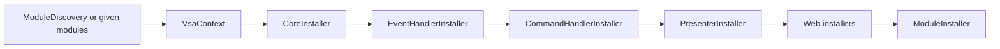

# Composition: the composer and its installers

A `VsaComposer` registers an app. It finds the modules, then runs a list of installers in order. Each installer is one class for one kind of registration. `builder.AddVsa()` (VSA.Host) runs the composer with the web installers. A Unity app or a console app runs the composer from `VSA.Composition`, which has no ASP.NET Core.

## The composer runs the installers in order



| Installer | Project | Registers |
|---|---|---|
| `CoreInstaller` | `VSA.Composition` | `IIntegrationEventPublisher`, `ICommandSender` (in process) |
| `EventHandlerInstaller` | `VSA.Composition` | Each `IntegrationEventHandler<T>` of `Handlers.Events` |
| `CommandHandlerInstaller` | `VSA.Composition` | Each `CommandHandler<,>`. Stops at two handlers of one command |
| `PresenterInstaller` | `VSA.Composition` (`net10.0`) | `LivePresenters` and each `Presenter` of `Presenters` |
| `LoopbackBusInstaller` | `VSA.Host` | `IBus` as `HttpBus` to the server address |
| `RequestEndpointInstaller` | `VSA.Host` | FastEndpoints for `Handlers.Requests` |
| `ModuleInstaller` | `VSA.Composition` | `Module.Configure` of each module. Always last |

`EventHandlerInstaller`, `CommandHandlerInstaller` and `PresenterInstaller` inherit `LayerInstaller`. It gives each concrete type of one layer of each module to the installer.

`ModuleInstaller` runs last, because a module can replace a default in `Configure` (`ModuleBuilder.Replace`). Each installer that registers a default goes before it.

## Entry points

| App | Code |
|---|---|
| ASP.NET Core, default | `builder.AddVsa();` |
| ASP.NET Core, changed | `WebComposer.Create(builder).Remove<PresenterInstaller>().Install();` |
| Unity or console | `new VsaComposer(new MicrosoftServices(services), configuration, modules).Install();` |
| No composer | Make a `VsaContext`, then call `Install(context)` on each installer |

With no `modules` argument, the composer finds the modules with `ModuleDiscovery`. Unity has no `deps.json`, so a Unity app gives the modules.

The composer changes its list with `AddBefore<T>(installer)`, `Replace<T>(installer)` and `Remove<T>()`. If the list has no `T`, the call throws.

## The container adapter

Module code and installers register on `IVsaServices`, a VSA interface. They do not use a container type.

```csharp
public interface IVsaServices {
    void Add(Type service, Type implementation, VsaLifetime lifetime);
    void Add(Type service, Func<IVsaResolver, object> factory, VsaLifetime lifetime);
    void AddInstance(Type service, object instance);
    VsaLifetime? LifetimeOf(Type service);
    void RemoveAll(Type service);
}
```

- `IVsaServices` also has `AddSingleton`, `AddScoped` and `AddTransient`, with the same forms as Microsoft DI.
- `IVsaResolver` resolves services at run time: `Resolve`, `ResolveAll` and `Create`. The in-process publisher and sender use it.
- `MicrosoftServices` is the adapter for Microsoft DI. It also registers `IVsaResolver`.
- Another container, for example VContainer, needs one class that implements `IVsaServices` and one that implements `IVsaResolver`.

A web installer uses `IServiceCollection` directly, because FastEndpoints and `AddHttpClient` need it. The web host always uses Microsoft DI.

## Module settings

`Module<TSettings>` binds `Modules:{Name}` to `TSettings` and checks it. Then it registers the instance as a singleton. Settings have no `IOptions<TSettings>` and no reload, so each container gets the same behavior.

## What a headless app gives

| Service | Web host | Headless app |
|---|---|---|
| `IBus` | `LoopbackBusInstaller` | The app registers one |
| `ILogger<T>` | ASP.NET Core logging | The app registers logging |
| `IConfiguration` | `builder.Configuration` | An argument of the composer |

## Unity target

`VSA.Composition` is a Unity layer (`VsaUnityLayer`). On `netstandard2.1` it has no `PresenterInstaller`, because `VSA.Contracts.Requests` uses `static abstract` members. Issue #44 tracks this.

## Open questions

- In-process bus: `HttpBus` is the only `IBus`. A request handler is a FastEndpoints endpoint, so a request needs HTTP.
- Views: `AddVsaViews` is an extension of `WebApplicationBuilder`. It can become an installer of `VSA.Views`.
