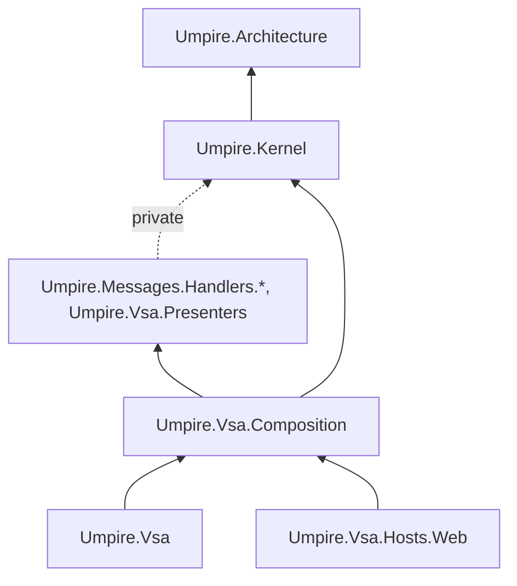

# Composition: the app, the pack and the hosts

An app starts with one call on all hosts: `new MyApp().Run(args)`. The app class selects one pack. The pack joins the architecture (for the rule engine) and the host (the composition root). All registrations go to `IServiceCollection`, so module code does not know which container the app uses.

## Startup shape

```
Program.cs                          return new ShopApp().Run(args);
ShopApp : App<Vsa<WebVsaHost>>      ConfigureServices (last), OnStart, OnStop
└─ Pack (Vsa<THost>)                Architecture (for the engine), CreateHost()
   ├─ VsaArchitecture               rules, read by the engine at build time
   └─ WebVsaHost : VsaHost : AppHost
        Create(args, app) = CreateBuilder → Compose → Build
```

```csharp
// App/Host/Program.cs
return new ShopApp().Run(args);

// App/Host/ShopApp.cs: the web host and the VSA rules
public class ShopApp : App<Vsa<WebVsaHost>>;

// The console host and an architecture of the app
public class ToolApp : App<Vsa<ToolArchitecture, ConsoleVsaHost>>;

// Unity, or an app that owns its container: no host run
new Vsa<UnityVsaHost>().CreateHost().Compose(services, app);
```

The app class file imports `Umpire.Kernel` (`App<TPack>`), `Umpire.Vsa` (`Vsa<THost>`) and the namespace of the host. The concept record `App` is in `Umpire.Architecture.Blocks`, and the app class file does not import that namespace. So `App` in the app class file is the class `Umpire.Kernel.App`.

## The kernel types

| Type | Package | Job |
|---|---|---|
| `IApp` | Umpire.Kernel | `Run`, `Stop`, `IsRunning`, `Services`. A shell makes the app class through it |
| `App`, `App<TPack>` | Umpire.Kernel | The lifetime of the app. `App<TPack>` makes its pack with `new TPack()` |
| `Pack`, `Pack<TArchitecture, THost>` | Umpire.Kernel | Gives `Architecture` and `CreateHost()` |
| `AppHost` | Umpire.Kernel | The composition root: `Create`, `Compose`, `Run`, `Stop` |
| `Module`, `Module<TSettings>` | Umpire.Kernel | The root class of a module. `Order` 1 |
| `AppTypes` | Umpire.Kernel | The one type source: the modules and their types |

The VSA pack adds `Vsa<THost>` (the VSA rules) and `Vsa<TArchitecture, THost>` (the rules of the app) in Umpire.Vsa, and `VsaHost`, `Plugin` and `Plugin<TSettings>` (the root class of a plugin module, `Order` 0) in Umpire.Vsa.Composition. Each type argument is a class with `new()`, so IL2CPP keeps one shared generic code.

## The app class

`umpire new app <Name>` writes `App/Host/<Name>App.cs`. The app class is the one entry of the app: the runtime starts it, and the rule engine reads `Pack.Architecture` from it (see `architecture-engine.md`).

| Member | Default | Override to |
|---|---|---|
| `ConfigureServices(IServiceCollection)` | No registrations | Add app registrations. They come last, so they win |
| `OnStart()` | Nothing | Run code after the build, before the host runs. `Services` is set |
| `OnStop()` | Nothing | Run code when the host stops (`ApplicationStopped`) |
| `Modules()` | `null`: `AppTypes` finds the modules | Give the modules, for example in a test |

To add app rules, derive an architecture from `VsaArchitecture`, override `Rules`, and use `Vsa<TArchitecture, THost>` (see `architecture-engine.md`).

| Lifetime member | Use |
|---|---|
| `Run(string[] args)` | Makes a host from the pack, composes and runs the app. A second `Run` while the app starts or runs is an error, before it makes a host |
| `Stop()` | Stops the app. If the app does not run, it does nothing |
| `IsRunning` | True from `Run` until the host stops |
| `Services` | The services of the running app, else `null` |

Each `Run` makes a new host, so `Run` after `Stop` starts the app again in the same process. A host that waits (web, generic, console) returns from `Run` after `Stop`. A host that returns (Unity) keeps the app until `Stop`. When the host stops, the app calls `OnStop` and clears its state.

## The hosts

| Host | Package | Use |
|---|---|---|
| `VsaHost` | Umpire.Vsa.Composition | The .NET Generic Host with the VSA layers |
| `ConsoleVsaHost` | Umpire.Vsa.Composition | A console app with one entry command (`IConsoleCommand<TResult>`) |
| `WebVsaHost` | Umpire.Vsa.Hosts.Web | ASP.NET Core: the HTTP API of the requests, and the views |
| `UnityVsaHost` | `vsa-unity` | A Unity app. `Run` returns |

| `AppHost` member | Kind | Default |
|---|---|---|
| `Create(args, app)` | Fixed | `CreateBuilder`, then `Compose`, then `Build` |
| `Compose(services, app)` | Fixed | See "What Compose does" |
| `CreateBuilder(args)` | Open | `Host.CreateApplicationBuilder(args)` |
| `Install(services, types)` | Open | Nothing. `VsaHost` adds each VSA layer |
| `Build(builder)` | Open | Builds the `HostApplicationBuilder` |
| `Run(app)`, `Stop(app)` | Open | Runs until the stop; stops the app |

Each host has a public constructor with no parameters, and `AppHost` has `[RequireDerived]`.

## What Compose does

```
AppHost.Compose(services, app)                 fixed order
├─ core                                        Umpire.Kernel
│  ├─ IConfiguration                           keep one that exists, else an empty one
│  ├─ AddLogging                               no log provider
│  ├─ AppTypes                                 a singleton
│  └─ auto-register                            each [AutoRegister] type
├─ Install(services, types)                    VsaHost:
│  ├─ AddPipelines, AddRequestHandlers         Umpire.Messages.Handlers, Umpire.Vsa.Handlers.Requests
│  ├─ AddEventHandlers, AddCommandHandlers     Umpire.Vsa.Handlers.Events, Umpire.Vsa.Handlers.Commands
│  ├─ AddPresenters, IBus                      Umpire.Vsa.Presenters, Umpire.Vsa.Composition
│  └─ the platform                             WebVsaHost: HTTP API, views. ConsoleVsaHost: entry command
├─ Module.Configure(services)                  each module, in Order, then by name (with no override: nothing)
└─ app.ConfigureServices(services)             last
```

The order is inside `Compose`, so an app cannot change it. A module replaces a default with `services.Replace<TService, TImplementation>()` (Umpire.Kernel). `Create` gives the configuration of the host builder to `Compose`. With no host run, `Compose` uses the `IConfiguration` instance of `services`, else an empty one. If `services` registers `IConfiguration` with a factory or a type, `Compose` cannot read it before the build, so it stops with an error.

## Definitions and transports

A module defines its requests, commands, events, handlers and presenters one time. The same code works on every host. The host selects only the transports:

| Kind | Part | Generic host | Web host |
|---|---|---|---|
| Definition | Events (`IntegrationEventHandler<T>`), in-process publisher | Yes | Yes |
| Definition | Commands (`CommandHandler<,>`), in-process sender | Yes | Yes |
| Definition | Requests (`RequestHandler<,>`), `InProcessBus` (`IBus`) | Yes | Yes |
| Definition | Presenters, `LivePresenters` | Yes | Yes |
| Transport | HTTP API: one route for each request | No | Yes |
| Transport | Views (`ViewsRoot`): Razor components | No | Yes |

```
Presenter → IBus.Send(request) → InProcessBus → RequestHandler<,>       every host
API client → HTTP → route of the request → RequestHandler<,>            web host
```

A request is a message (`IMessage`), as a command is. It goes to its handler in process (`IBus`), or over HTTP on the web host. Each request gives its `Method` and `Route` as static members on the type itself. Only the HTTP API reads them, to map the route. On `netstandard2.1`, `IRequest` has no members (`#if NET`), so the same request compiles in Unity, and nothing reads the route there.

```csharp
public interface IRequest : IMessage {
#if NET
    static abstract HttpMethod Method { get; }
    static abstract string Route { get; }
#endif
}

public interface IRequest<TResponse> : IRequest where TResponse : IResponse;
```

- `IRequest` is an interface, because only an interface can make each request give the static members.
- On `net10.0`, an interface with static abstract members cannot be a type argument (CS8920). Name it with `typeof(IRequest)`, for example in the definition.
- `IResponse` is the marker of a response type. `IRequest<TResponse>`, `RequestHandler<,>` and `IBus` require it, so the compiler finds a response with no marker. Umpire.Sdk also uses it to find the contract files of a slice.

## AppTypes finds the parts of the app

`AppTypes` (Umpire.Kernel) reads 2 sources and keeps each loaded assembly that references a given assembly:

| Source | Finds |
|---|---|
| The loaded assemblies | Unity: all script assemblies load when the domain starts |
| The `.dll` files in `AppContext.BaseDirectory` | .NET: a module assembly loads only when code uses one of its types |

- The scan reads the metadata of a file with `System.Reflection.Metadata`. It loads only the files that reference the assembly.
- A file that the runtime cannot load by name (not in `deps.json`) is not part of the app. The scan ignores it.
- Each source finds nothing where it does not apply, so the scan has no Unity case.
- If an assembly has types that do not load, the scan keeps the types that load (`ReflectionTypeLoadException`).
- The scan skips each assembly that references `nunit.framework`: a test assembly is not part of the app.
- To select other modules, the app gives its modules in `Modules()`.
- `Compose` makes one `AppTypes` instance: `new AppTypes(app.Modules())`. If `Modules()` gives `null`, the instance finds the modules itself. The instance keeps the types of each assembly and the assemblies that reference each assembly, so it reads each assembly one time. A second `Run` makes a new instance, so it also finds the assemblies that loaded later.
- `LoadedTypes.Of(assembly)` (Umpire.Architecture) is the one load-safe read of the types of an assembly. The kernel, the unit test base and the rule engine use it.

| Member | Gives |
|---|---|
| `new AppTypes(modules)` | The one constructor. With `null`, the instance finds the modules itself |
| `Modules` | One module for each module root, or the given modules, in order |
| `ConcreteTypesOf(baseType)` | The concrete classes that derive from `baseType`, in each assembly that references the assembly of `baseType` |
| `Registered()`, `Implementations(baseType)` | The marked types (see "One discovery path") |

| Part | Scan for | Rule |
|---|---|---|
| Module root | A reference to `Umpire.Kernel`, or to an assembly with an abstract `Module` base (for example `Plugin` in `Umpire.Vsa.Composition`) | One class that inherits `Module` in each namespace (`ModuleRoot.Create`) |
| Views root | A reference to `Umpire.Vsa.Views` (`ConcreteTypesOf(typeof(ViewsRoot))`) | One component that inherits `ViewsRoot` |

The modules are in order of `Module.Order`, then by name: a plugin (`Order` 0) comes before a module (`Order` 1). If the app has a views root, the views run in that process. Two views roots stop the build.

## One discovery path

`AppTypes` finds the types of the modules one time. Each layer registration reads the same result. It reads the root assembly and each layer assembly of a module, so a module that is one assembly (for example one Unity `.asmdef`) also works. Each send goes through a pipeline (`docs/handler-pipeline.md`).

```text
AppTypes.Registered()
├─ each concrete class with [AutoRegister]     closed class: as it is
│  (on the class, a base class or an interface) open class: closed for each type argument
└─ the core step                               registers each type and each marked base
   The layer registrations                     add only the sender, the pipeline and the checks
```

| Marker | Side | Meaning |
|---|---|---|
| `[AutoRegister(lifetime)]` | Open or closed class, its base class or its interface | VSA registers each concrete class. Lifetime default: `Scoped`. |
| `[TypeArgument]` | Type argument, its base class or its interface | A struct or a concrete class that closes the open classes. |
| `[assembly: TypeArgument(typeof(int))]` | Type argument | A type that cannot have the attribute. |

The markers are in `Umpire.Markers`. The same package has the stripping markers for IL2CPP. The UnityLinker finds them by class name, so do not rename them:

| Marker | Target | The linker keeps | VSA puts it on |
|---|---|---|---|
| `[RequireDerived]` | Class | Each derived class | The `[AutoRegister]` bases, `BeforeStep`, `AfterStep` and their typed forms, `Module`, `App`, `Pack`, `AppHost` |
| `[RequireImplementors]` | Interface | Each implementor | `IApp`, `IRunner`, `IBeforeCall`, `IAfterCall` |
| `[Preserve]` | Any | The marked member | The `[AutoRegister]` bases, `BeforeStep`, `AfterStep` and their typed forms, the envelope create method of the pipeline |

The pipeline creates the runner, the envelope factory and the steps from a `Type` (`Activator`, `ActivatorUtilities`). The app makes its pack and the pack makes its host with `new()`. The linker cannot see these uses, so each of their bases has a marker. `MarkedTypes` names the marker types with `typeof`, so Umpire.Kernel uses the markers assembly in code.

The template bases have `[AutoRegister]`: `CommandHandler<,>`, `RequestHandler<,>`, `IntegrationEventHandler<>`, `Validator<>`, the four hook bases and `Presenter`. A class that derives from one of them needs no marker.

```csharp
[TypeArgument]
public interface IResource;

public readonly record struct Health(int Value) : IResource;

sealed class ChangeResourceHandler<T> : CommandHandler<ChangeResourceCommand<T>, int>
    where T : struct, IResource { ... }                     // closed for Health, Mana

[AutoRegister]
public interface IDamageRule;
sealed class DamageRule<T> : IDamageRule where T : struct, IWeapon { ... }   // closed for Sword, Dagger

[AutoRegister(Lifetime.Singleton)]
sealed class WeaponCache<T> where T : struct, IWeapon { ... }
```

### Rules

| Rule | Detail |
|---|---|
| Registration | The class itself, and each base class or interface with the marker. |
| One instance | Each marked base resolves the class itself, so a scope has one instance. |
| Type arguments | Only marked types and assembly types. A type without the marker is never a type argument. |
| Constraints | `class`, `struct`, `unmanaged` and each type constraint. A struct with a reference field does not meet `unmanaged`. |
| Parameters | One generic parameter. An open class with two or more parameters stops the start, with a message. |
| No marker | VSA does not close or register the class. |
| No type argument fits | The open class gets no closed type. A send of that command fails with "has no handler". |
| Owner | A layer registration can register a class first, for example a presenter with a factory. The core step does not replace it. |

`AppTypes` is a singleton service. `Implementations(typeof(TBase))` gives a `ServiceImplementation(Service, Implementation)` for each registered type that derives from `TBase`, with that base as the service. A plugin reads its own types with it.

The type arguments of an open class are the marked types that meet each constraint of its generic parameter (`ConstraintTypeArguments`, internal). An app cannot replace this source.

### Reflection uses

Umpire uses reflection only in the places below. Each other part gets its types from `AppTypes`.

| Place | Use | Reason |
|---|---|---|
| `AppAssemblies` (Kernel) | `AppDomain.GetAssemblies`, `Assembly.Load`, `PEReader` | Finds the module assemblies. Only the `AppTypes` instance calls it |
| `LoadedTypes.Of` (Architecture) | `GetTypes` | The one load-safe type read |
| `ModuleRoot.Create` (Kernel) | `Activator.CreateInstance` | Creates the module class. A class with no public constructor with no parameters stops the start, with a message |
| `AppTypes`, `ConstraintTypeArguments` (Kernel) | `MakeGenericType`, `GetFields` | Closes an open class for each type argument |
| `MarkedTypes` (Kernel) | `GetCustomAttributesData` | Reads `[AutoRegister]` and `[TypeArgument]` by name |
| `MessageRoute` (Messages.Handlers) | `MakeGenericMethod` | Makes the envelope of the runtime message type |
| `Pipeline` (Messages.Handlers) | `ActivatorUtilities.CreateInstance` | Creates the runner. A runner that it cannot create stops the send, with the pipeline and runner names |
| `PipelineRun` (Messages.Handlers) | `GetServiceOrCreateInstance` | Creates the steps and hooks from their types |
| `PresenterServiceCollectionExtensions` (Presenters) | `GetInterfaces`, `ActivatorUtilities` | Registers each presenter for its events |
| `ViewsInstaller` (Views) | `MakeGenericMethod` | Calls `MapRazorComponents<TRoot>` for the views root |
| `HttpApi` (Hosts.Web) | `MakeGenericMethod` | Reads the static `Route` and `Method` of each request |
| `ConsoleEntry` (Composition) | `MakeGenericMethod`, `Task.Result` | Sends the entry command. It reads the result through `IMessageResult` |
| `VsaUnitTest` (Testing.Unit) | `LoadedTypes.Of`, `MakeGenericType` | Finds the handler of a request or a command |
| `DefinitionFinder` (engine) | `LoadedTypes.Of`, `Activator`, `GetProperty` | Finds the app class and reads its architecture |
| `RuleAnalyzer` (Kernel.Analyzers) | `GetTypes`, `Activator` | Finds the rule classes in its own assembly, in the compiler |

The table does not list the uses that only read metadata, for example `IsAssignableFrom`, `GetInterfaces` and `GetGenericArguments`.

### Checks

The checks read the registered types. They do not find types.

| Check | Rule |
|---|---|
| Commands | One handler for each command |
| Requests | One handler for each request |

## The HTTP API

The web host maps one route for each `RequestHandler<,>`, with ASP.NET Core minimal APIs (`MapMethods`).

| Step | Source |
|---|---|
| Bind the request | The JSON body (`POST`, `PUT`, `PATCH`), then the route values, then the query |
| Run the handler | The pipeline of the request, with the services of the scope of the HTTP request |
| Success | 200 with the response as JSON |
| Error of the handler | A problem response: 404 if the code ends with `.not_found`, else 400 |
| Value that does not bind | A problem response, 400, title `request.not_valid` |

## Projects

```
framework/Kernel/                      Umpire.Kernel
  App/                                 App, App<TPack>, IApp, Pack, Pack<TArchitecture, THost>
  Modules/                             Module, Module<TSettings>, the settings
  Services/                            ServiceCollectionExtensions: Replace<TService, TImplementation>
  Hosting/                             AppHost, the core step (AutoRegistration)
  Scan/                                AppTypes, ModuleRoot, ServiceImplementation, ConstraintTypeArguments, MarkedTypes
  Factories/                           IFactory<T>, AddFactory
architecture/                          Umpire.Architecture: Architecture (the kernel references it for Pack)
framework/Components/Messages/
  Handlers/                            PipelineBuilder, Pipelines, the runners, Validator, Before, After, AddPipelines
packs/Vsa/
  VsaPack.cs                           Umpire.Vsa: Vsa<THost>, Vsa<TArchitecture, THost>
  Architecture/                        Umpire.Vsa.Definition: VsaArchitecture, the VSA layers, Feature and Plugin
  Kernel/
    Handlers/Events/                   AddEventHandlers, InProcessEventPublisher
    Handlers/Commands/                 AddCommandHandlers, InProcessCommandSender
    Handlers/Requests/                 RequestHandler, AddRequestHandlers
    Presenters/                        AddPresenters
    Views/                             ViewsRoot, ViewsInstaller
    Composition/                       Umpire.Vsa.Composition: VsaHost, Plugin, Plugin<TSettings>, InProcessBus
      Hosts/Console/                   ConsoleVsaHost, ConsoleEntry, ConsoleExit
    Hosts/                             Umpire.Vsa.Hosts.Web: WebVsaHost, HttpApi, HttpRequestBinder
```



- The kernel knows no layer. `VsaHost.Install` calls each layer registration by a direct call, in a fixed order.
- `Umpire.Vsa` references `Umpire.Vsa.Composition`, because its definition names `Module` and `Plugin` with `OfType`, and `Vsa<THost>` uses `VsaHost`. `Umpire.Vsa.Composition` does not reference `Umpire.Vsa`.

## The container

Module code and the layer registrations use two shared interfaces from .NET:

| Interface | Job | Package |
|---|---|---|
| `IServiceCollection` | Registration: a list of `ServiceDescriptor` | `Microsoft.Extensions.DependencyInjection.Abstractions` |
| `IServiceProvider` | Resolution: `GetService(Type)` | `System` |

`Run` builds the Microsoft container. With no host run, the app selects the container after `Compose`. Other containers read `IServiceCollection` too:

| Container | Reads `IServiceCollection` |
|---|---|
| Autofac | `builder.Populate(services)` (`Autofac.Extensions.DependencyInjection`) |
| DryIoc, Lamar, SimpleInjector | Their own integration packages |
| VContainer | No support. The app routes to the Microsoft container |

A Unity app that uses VContainer builds the Microsoft container from `Compose`, then routes to it. For each VSA service type, VContainer gets a registration that resolves the service from the Microsoft container. A singleton comes from the root. A scoped or transient service comes from one Microsoft scope for each VContainer scope. So VSA keeps the Microsoft semantics, and Unity classes get VSA services by constructor injection.

A copy of each `ServiceDescriptor` into `IContainerBuilder` does not work. VContainer refuses two registrations of one implementation type, and VSA registers several instances of one type and reads them as a list (`AddPipeline`). The spike is on the branch `spike/compose-containers` of `vsa-consumer-unity`.

## Factories

A factory makes objects that the container cannot make, for example Unity objects from a prefab. The factory gets one service, and it gives the made object what it needs. Only the composition root and the factories resolve services. The made objects do not get `IServiceProvider`.

| Type | Use |
|---|---|
| `IFactory<T>` | `T Create()` |
| `services.AddFactory<T, TService>(create)` | A factory: a function of one service |

```csharp
services.AddFactory<CounterLabel, CounterPresenter>(presenter => {
    var label = Object.Instantiate(labelPrefab);
    label.Bind(presenter);
    return label;
});
```

A factory resolves its service on each `Create`, from the scope that resolved the factory. A factory knows no view and no presenter: views, enemies and other objects use the same factories. For a factory with more services, write a class that implements `IFactory<T>` and register it as a normal service.

## Module settings

`Module<TSettings>` and `Plugin<TSettings>` bind `{Section}:{Name}` to `TSettings` and check it with the data annotations and `Validate`. The section of a module is `Modules` (`Module.Section`), and the name is the last part of its namespace. `Compose` gives its configuration to the module (internal `Module.Compose`). A direct call of `Configure(services)` on a settings module does nothing. Then the module registers the instance as a singleton and calls `Configure(services, settings)`. Settings have no `IOptions<TSettings>` and no reload, so each container gets the same behavior.

## What each host gives

| Service | `WebVsaHost` | `VsaHost`, `ConsoleVsaHost` | `Compose` (no host run) |
|---|---|---|---|
| `IBus` | `InProcessBus` | `InProcessBus` | `InProcessBus` |
| `ILogger<T>` | Yes, host providers | Yes, host providers | Yes, no providers. The app adds them |
| `IConfiguration` | `appsettings.json`, environment, `args` | `appsettings.json`, environment, `args` | The one in the services, else an empty one |
| Lifetime, environment, `IHostedService` start | Yes | Yes | None |

## Unity target

`Umpire.Kernel`, `Umpire.Vsa.Composition`, `Umpire.Architecture`, `Umpire.Vsa` and all definition layers are portable layers (`UmpirePortableLayer`): they build for `net10.0` and `netstandard2.1`. The transports (Umpire.Vsa.Hosts.Web, Umpire.Vsa.Views) need ASP.NET Core, so they build for `net10.0` only. The Unity limits and their tests are in `docs/unity.md`.

A Unity app calls `new MyApp().Run(args)` from the shell of the UPM package (repo `vsa-unity`). Its app class is `App<Vsa<UnityVsaHost>>`. The Unity host returns from `Run`, and the shell calls `Stop` when the app quits or the play mode stops. The default .NET host expects an app that owns its process, and Unity owns the process. In Unity, the default host fails: the EventLog logger provider throws on Mono, and an empty host has the content root `Unity.exe\`.

An app that owns its container calls `Compose` and builds the container:

```csharp
public sealed class AppRoot : MonoBehaviour {
    ServiceProvider services;

    public IServiceProvider Services => services;

    void Awake() {
        var collection = new ServiceCollection().AddLogging(l => l.AddProvider(new UnityLogProvider()));
        services = new Vsa<UnityVsaHost>().CreateHost().Compose(collection, new GameApp()).BuildServiceProvider();
    }

    void OnDestroy() => services.Dispose();
}
```

The app selects the entry point: a component, a VContainer `LifetimeScope` or a test. `UnityLogProvider` is app code that calls `Debug.Log`. The Unity check runs the EditMode tests of `vsa-consumer-unity` (Mono) against a local pack.

## Non-goals

- No VSA container interface. Reason: `IServiceCollection` and `IServiceProvider` are already container-neutral, and most containers read them.
- No installer scan. Reason: the host is the composition root. It calls each layer registration directly, in one fixed order.
- No VContainer bridge in the framework. Reason: only a Unity app with VContainer needs it, so the app keeps it. Use the router, not a copy of the registrations.
- No Unity code in this repository (the Unity host, `UnityLogProvider`, a view base). Reason: it needs `UnityEngine`. The UPM package (repo `vsa-unity`) keeps it.
- No view injector and no scene scan. Reason: a factory gives each object its services, and a Unity app often has its own container for scene objects.
- No middleware hook on the web host. Reason: no app needs one. Add it when an app needs authentication or CORS before the routes.

## Open questions

- Remote bus: an `IBus` over HTTP, for a view or a Unity client in another process. It can use the same routes as the HTTP API.
- Other type sources: a source generator or a hand list, behind one source interface that an app can replace (#138). Umpire.Sdk knows the module projects at build time, so it can write the list in the host assembly.
- IL2CPP check: the Unity check runs on Mono only. Run `AppTypes` and `Compose` in an IL2CPP player build of `vsa-consumer-unity`.
- Hosting DLLs in Unity: Umpire.Kernel references `Microsoft.Extensions.Hosting` for `AppHost`, so a Unity app still vendors it. The reference can move to the `net10.0` target only.
