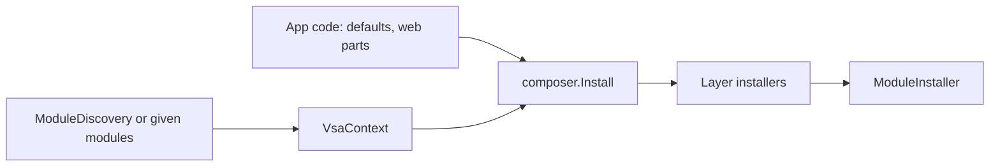

# Composition: the composer and its installers

A `VsaComposer` registers an app in one call: `Install()`. Each layer has one static installer class in its own project. All registrations go to `IServiceCollection`, so module code does not know which container the app uses.

## One call



| Order | Installer | Registers |
|---|---|---|
| 1 | `EventHandlerInstaller` | The publisher and each `IntegrationEventHandler<T>` |
| 2 | `CommandHandlerInstaller` | The sender and each `CommandHandler<,>`. Stops at two handlers |
| 3 | `PresenterInstaller` (`net10.0`) | `LivePresenters` and each `Presenter` |
| 4 | `ModuleInstaller` | `Module.Configure` of each module |

`ModuleInstaller` runs last, because a module can replace a default in `Configure` (`ModuleBuilder.Replace`). App code that registers a default runs before `Install()`.

## Installers find their types

An installer is a static class with one method, `Install(VsaContext context)`. `context.Implementations(typeof(TBase))` gives each concrete type of each module that derives from `TBase`, with its service type:

```csharp
public static class EventHandlerInstaller {
    public static void Install(VsaContext context) {
        context.Services.AddScoped<IIntegrationEventPublisher, InProcessEventPublisher>();
        foreach (var (service, handler) in context.Implementations(typeof(IntegrationEventHandler<>))) {
            context.Services.AddScoped(service, handler);
        }
    }
}
```

- For an open generic base, the service is the closed base, for example `IntegrationEventHandler<Rang>`.
- For a plain base, for example `Presenter`, the service is the base.
- The context reads the types of all layer projects of the modules one time. The layer rules keep each type in its layer, so no layer name is necessary.

## Projects

```
Module/              VsaContext, ModuleInstaller, Module, ModuleBuilder, ModuleDiscovery, ...
Handlers/Events/     EventHandlerInstaller, InProcessEventPublisher
Handlers/Commands/   CommandHandlerInstaller, InProcessCommandSender
Handlers/Requests/   RequestEndpointInstaller (Install, Map)
Presenters/          PresenterInstaller
Composition/         VsaComposer
Host/                VsaHostExtensions (AddVsa, MapVsaRequests, AddLoopbackBus), HttpBus
```

Each layer project references `VSA.Module` with `PrivateAssets="all"`. So a module project of that layer does not see `VSA.Module`. The module root references `VSA.Module`, so the app has it at run time.

## Entry points

```csharp
builder.AddVsa();

var composer = new VsaComposer(services, configuration, modules);
composer.Install();
```

`builder.AddVsa()` does these steps:

1. `AddLoopbackBus(services)`: `IBus` as `HttpBus` to the server address.
2. `RequestEndpointInstaller.Install(composer.Context)`: FastEndpoints for each `RoutedHandler<,>`.
3. `composer.Install()`.

`app.MapVsaRequests()` calls `RequestEndpointInstaller.Map(app)`. It starts FastEndpoints only if the app has request handlers.

With no `modules` argument, the composer finds the modules with `ModuleDiscovery`: the module roots of `deps.json`, the Shared modules first. Unity has no `deps.json`, so a Unity app gives the modules.

## The container

Module code and installers use two shared interfaces from .NET:

| Interface | Job | Package |
|---|---|---|
| `IServiceCollection` | Registration: a list of `ServiceDescriptor` | `Microsoft.Extensions.DependencyInjection.Abstractions` |
| `IServiceProvider` | Resolution: `GetService(Type)` | `System` |

The app selects the container that reads the list:

| Container | Reads `IServiceCollection` |
|---|---|
| Microsoft | `services.BuildServiceProvider()` |
| Autofac | `builder.Populate(services)` (`Autofac.Extensions.DependencyInjection`) |
| DryIoc, Lamar, SimpleInjector | Their own integration packages |
| VContainer | No support. The app needs a bridge |

A Unity app that uses VContainer writes its own bridge. The bridge does two jobs: it copies each `ServiceDescriptor` into `IContainerBuilder`, and it wraps `IObjectResolver` as `IServiceProvider`.

## Module settings

`Module<TSettings>` binds `Modules:{Name}` to `TSettings` and checks it. Then it registers the instance as a singleton. Settings have no `IOptions<TSettings>` and no reload, so each container gets the same behavior.

## What a headless app gives

| Service | Web host | Headless app |
|---|---|---|
| `IBus` | `AddLoopbackBus` | The app registers one |
| `ILogger<T>` | ASP.NET Core logging | The app registers logging |
| `IConfiguration` | `builder.Configuration` | An argument of the composer |

## Unity target

`VSA.Composition` is a Unity layer (`VsaUnityLayer`). On `netstandard2.1`, `Install` does not run `PresenterInstaller`, because `VSA.Contracts.Requests` uses `static abstract` members. Issue #44 tracks this. A Unity app also vendors `VSA.Composition.dll`.

## Non-goals

- No VSA container interface. Reason: `IServiceCollection` and `IServiceProvider` are already container-neutral, and most containers read them.
- No VContainer bridge in the framework. Reason: only a Unity app with VContainer needs it, so the app keeps it.

## Open questions

- In-process bus: `HttpBus` is the only `IBus`. A request handler is a FastEndpoints endpoint, so a request needs HTTP.
- Views: `AddVsaViews` is an extension of `WebApplicationBuilder`. It can become an installer of `VSA.Views`.
