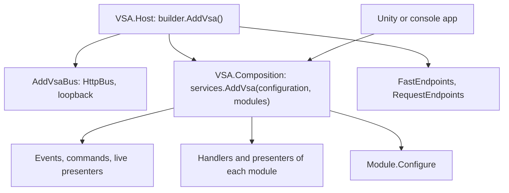

# Composition: the headless entry point and the web host

`VSA.Composition` registers the modules of an app on an `IServiceCollection`, with no ASP.NET Core. `VSA.Host` calls it and adds only the web parts. A Unity app or a console app calls `VSA.Composition` directly.

## Two entry points, one composition

| Entry point | Project | Targets | Registers |
|---|---|---|---|
| `services.AddVsa(configuration)` | `VSA.Composition` | `net10.0`, `netstandard2.1` | The modules that `ModuleDiscovery` finds |
| `services.AddVsa(configuration, modules)` | `VSA.Composition` | `net10.0`, `netstandard2.1` | The given modules |
| `builder.AddVsa()` | `VSA.Host` | `net10.0` | The bus, the composition, the endpoints |
| `builder.AddVsa(modules)` | `VSA.Host` | `net10.0` | The bus, the composition, the endpoints |

## What the composition registers

For each module, in the order of the modules:

1. Each `IntegrationEventHandler<TEvent>` of `Handlers.Events`, as scoped.
2. Each `CommandHandler<TCommand, TResult>` of `Handlers.Commands`, as scoped. If a command has two handlers, `AddVsa` throws.
3. Each `Presenter` of `Presenters`, with `AddVsaPresenter`. Only the `net10.0` target does this step.
4. `Module.Configure`, with a `ModuleBuilder` on the same services and configuration.

Before the modules, it registers `AddVsaEvents`, `AddVsaCommands` and, on `net10.0`, `AddVsaLivePresenters`.

## What the app gives

| Service | Web host | Headless app |
|---|---|---|
| `IBus` | `HttpBus` to the loopback address | The app registers one before `AddVsa` |
| `ILogger<T>` | ASP.NET Core logging | The app registers logging |
| `IConfiguration` | `builder.Configuration` | An argument of `AddVsa` |

A module can replace a default in `Configure` (`ModuleBuilder.Replace`). So the host registers its defaults, for example `IBus`, before it calls `AddVsa`.

## Unity target

`VSA.Composition` is a Unity layer (`VsaUnityLayer`). On `netstandard2.1` it has no reference to `VSA.Presenters`, because `VSA.Contracts.Requests` uses `static abstract` members. So the Unity target registers no presenters and no `LivePresenters`.

Unity has no `deps.json`. A Unity app gives the modules to `AddVsa(configuration, modules)`.

## Open questions

- In-process bus: `HttpBus` is the only `IBus`. A request handler is a FastEndpoints endpoint, so a request needs HTTP. A headless app with presenters has no bus from VSA.
- Container: `IServiceCollection` is the container contract. An `IVsaServices` interface with one adapter for each container (Microsoft DI, VContainer) can replace it.
