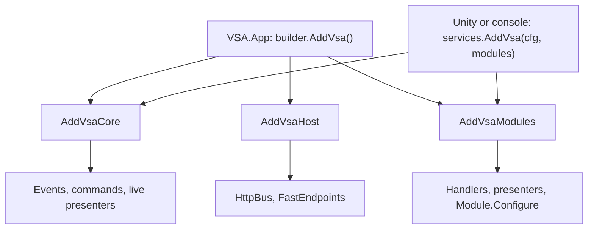

# Composition: Core, Modules, Host and App

An app registers VSA in three parts: Core, Modules and Host. `VSA.App` calls the three parts in the correct order, and it is the entry point of an ASP.NET Core app. A Unity app or a console app calls only Core and Modules, from `VSA.Composition`, which has no ASP.NET Core.

## The entry points call the parts

| Method | Package | Targets | Registers |
|---|---|---|---|
| `services.AddVsaCore()` | `VSA.Composition` | `net10.0`, `netstandard2.1` | `IIntegrationEventPublisher`, `ICommandSender`, `LivePresenters` |
| `services.AddVsaModules(cfg[, modules])` | `VSA.Composition` | `net10.0`, `netstandard2.1` | Handlers, presenters, then `Module.Configure` |
| `services.AddVsa(cfg[, modules])` | `VSA.Composition` | `net10.0`, `netstandard2.1` | Core, then Modules |
| `services.AddVsaHost(modules)` | `VSA.Host` | `net10.0` | `HttpBus` to the loopback address, FastEndpoints |
| `app.MapVsaRequests()` | `VSA.Host` | `net10.0` | The endpoints of the request handlers |
| `builder.AddVsa([modules])` | `VSA.App` | `net10.0` | Core, then Host, then Modules |

With no `modules` argument, a method finds the modules with `ModuleDiscovery`. `VsaServiceExtensions.DiscoveredModules()` gives the same list.

## Order of the calls

`AddVsaModules` calls `Module.Configure`. A module can replace a default there (`ModuleBuilder.Replace`), so each default must exist before `AddVsaModules`.

1. Call `AddVsaCore`.
2. Call each part that registers a default, for example `AddVsaHost` for `IBus`.
3. Call `AddVsaModules`.

If `IIntegrationEventPublisher` or `ICommandSender` is missing, `AddVsaModules` throws. The message tells you to call `AddVsaCore` first.

## What Modules registers

For each module, in the order of the modules:

1. Each `IntegrationEventHandler<TEvent>` of `Handlers.Events`, as scoped.
2. Each `CommandHandler<TCommand, TResult>` of `Handlers.Commands`, as scoped. If a command has two handlers, `AddVsaModules` throws.
3. Each `Presenter` of `Presenters`, with `AddVsaPresenter`. Only the `net10.0` target does this step.
4. `Module.Configure`, with a `ModuleBuilder` on the same services and configuration.

## What a headless app gives

| Service | `VSA.App` | Headless app |
|---|---|---|
| `IBus` | `HttpBus` (`AddVsaHost`) | The app registers one before `AddVsaModules` |
| `ILogger<T>` | ASP.NET Core logging | The app registers logging |
| `IConfiguration` | `builder.Configuration` | An argument of `AddVsa` |

## Unity target

`VSA.Composition` is a Unity layer (`VsaUnityLayer`). On `netstandard2.1` it has no reference to `VSA.Presenters`, because `VSA.Contracts.Requests` uses `static abstract` members. So the Unity target registers no presenters and no `LivePresenters`. Issue #44 tracks this.

Unity has no `deps.json`. A Unity app gives the modules to `AddVsa(configuration, modules)`.

## Open questions

- In-process bus: `HttpBus` is the only `IBus`. A request handler is a FastEndpoints endpoint, so a request needs HTTP.
- Container: `IServiceCollection` is the container contract. An `IVsaServices` interface with one adapter for each container (Microsoft DI, VContainer) can replace it.
