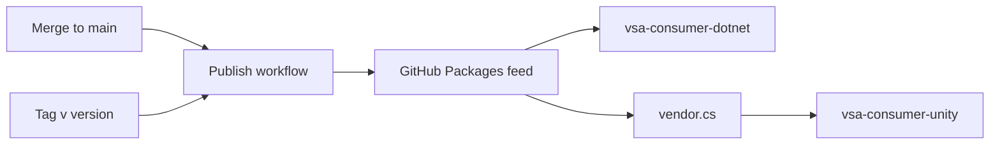

# Release and consumers

Each push to `main` publishes all Umpire packages to GitHub Packages as the next preview. A tag `v<version>` publishes a stable version. Two public consumer repos use the published packages: a .NET app and a Unity project. They are the release check: the test apps of this repository build from source, and the consumers use only what ships.

## Release flow: a merge reaches the consumers



| Item | Value |
|---|---|
| Workflow | `.github/workflows/publish.yml` |
| Steps | Test, get the version, pack each project under `framework/`, push |
| Version on `main` | `<base>-preview.<n>`: `<base>` is `<Version>` in `Directory.Build.props`, `<n>` is the highest preview tag plus one |
| Version on a tag | The tag name without `v` |
| Tag on `main` | The workflow pushes `v<base>-preview.<n>` before the packages. A rerun of the same commit uses that tag again |
| Feed | `https://nuget.pkg.github.com/MgCohen/index.json` |
| Package visibility | Public, the same as this repository |

A preview needs no manual step: merge the change to `main`.

To release a stable version:

1. Tag a commit on `main`: `git tag -a v0.2.0 -m v0.2.0`.
2. Push the tag: `git push origin v0.2.0`.
3. Set `<Version>` in `Directory.Build.props` to the next version, for example `0.3.0`. If you do not, the next previews (`0.2.0-preview.<n>`) sort below `0.2.0`, and consumers do not get them.

After a new version, update the Umpire version in each consumer repo, then make sure that its checks pass.

## Feed access

GitHub Packages needs a token to restore, also for public packages.

| Where | Token |
|---|---|
| GitHub Actions | `GITHUB_TOKEN` of the workflow, with `packages: read` |
| Dev machine | `gh auth token`, after `gh auth refresh -s read:packages` |

The `nuget.config` that `umpire new app` writes reads the token from the environment variable `GITHUB_TOKEN`:

```xml
<add key="ClearTextPassword" value="%GITHUB_TOKEN%" />
```

If `GITHUB_TOKEN` is not set, restore fails with 401.

## The architecture check of a new app

The root project of a new app has the package `Umpire.Engine.Build`. So the rule engine checks the architecture after each build, and an error fails the build. `-p:UmpireCheck=false` turns the check off for one build. `-p:UmpireCheckMode=Warn` reports each error as a warning. `umpire doctor` and `umpire update` include this package in the one version.

## Consumer repos

| Repo | Contains | Gets VSA | Check |
|---|---|---|---|
| [vsa-consumer-dotnet](https://github.com/MgCohen/vsa-consumer-dotnet) | `umpire new app`, one module | `<Project Sdk="Umpire.Sdk" />` | CI: build and test |
| [vsa-consumer-unity](https://github.com/MgCohen/vsa-consumer-unity) | Unity 6 project, one module | DLLs in `Assets/Plugins/VSA` | Unity Test Framework, batch mode |

## Unity

Unity cannot restore NuGet packages. The Unity repo keeps the DLLs in git, and `vendor.cs` writes them: it publishes a `netstandard2.1` project with the VSA packages, then copies the DLLs to `Assets/Plugins/VSA`.

### Unity app build

Umpire.Sdk has no Unity build steps. The UPM package `vsa-unity` gives the Unity parts: the copy of the module DLLs to `Assets/Plugins/VSA/` and the .NET tests of the module sources in `Assets/` (MgCohen/vsa-unity#8). Umpire.Sdk does not compile `Assets/` (`UmpireExcludedFolders`).

Umpire.Vsa.Analyzers references Roslyn 4.10, the compiler of Unity 6. A newer compiler also runs it. An analyzer that references a newer Roslyn does not run in Unity (`CS9057`).

### Build output

An app that `umpire new app` makes writes all build output to `artifacts~/` in the block folder. Its `Directory.Build.props` sets `UseArtifactsOutput` and `ArtifactsPath`. Unity skips each folder whose name ends with `~`, so it does not import the DLLs of the build a second time.

| Need | Do this in `Directory.Build.props` |
|------|-------------------------------------|
| Another output folder | Set `ArtifactsPath` to that folder |
| Output next to each project (`bin/`, `obj/`) | Set `UseArtifactsOutput` to `false` |

The .NET SDK reads these two properties only from `Directory.Build.props` or the command line. A value in a project file gives `NETSDK1199`.

### Layers that Unity can use

| Layer | Package | Unity |
|---|---|---|
| Domain | `Umpire.Vsa.Domain` | Yes |
| Contracts (`IMessage`, `Envelope`, `Result`) | `Umpire.Messages.Contracts` | Yes |
| Handler pipeline | `Umpire.Messages.Handlers` | Yes |
| Contracts, events | `Umpire.Vsa.Contracts.Events` | Yes |
| Handlers, events | `Umpire.Vsa.Handlers.Events` | Yes |
| Infrastructure | `Umpire.Vsa.Infrastructure` | Yes |
| Kernel (`App`, `Pack`, `AppHost`, `Module`) | `Umpire.Kernel` | Yes |
| Composition | `Umpire.Vsa.Composition` | Yes, without presenters. `VsaHost` and `Plugin` are here |
| Contracts, requests | `Umpire.Vsa.Contracts.Requests` | Yes. The route members are only on `net10.0` |
| Handlers, requests | `Umpire.Vsa.Handlers.Requests` | Yes |
| Presenters | `Umpire.Vsa.Presenters` | Yes |
| Architecture definition | `Umpire.Architecture`, `Umpire.Vsa` | Yes. `Pack` needs them, and `Vsa<THost>` is here |
| Host; Views | ASP.NET Core packages | No: ASP.NET Core |

The root `Directory.Build.props` lists the portable layers (`UmpirePortableLayer`). They target `net10.0` and `netstandard2.1`.

### Rules for the netstandard2.1 target

- Unity 6 ships some `Microsoft.Extensions` DLLs at version 8.0, in `Editor/Data/BCLExtensions`. So the `netstandard2.1` target uses the 8.0 packages (`Directory.Packages.props`). A higher version is a compile error in Unity (`CS1705`).
- `vendor.cs` does not copy a DLL that Unity ships. A second copy is a compile error.
- `netstandard2.1` does not have `IsExternalInit`. The layers compile `tools/sdk/Polyfills/` for that target. The polyfill is internal, so each Unity assembly with a record has its own copy.
- `AppTypes` finds the modules in the loaded assemblies, so a Unity app gives no modules. A Unity app calls `new MyApp().Run(args)` through the Unity host, or `new Vsa<UnityVsaHost>().CreateHost().Compose(services, app)` with no host run (`docs/composition.md`). It vendors `Microsoft.Extensions.Hosting` 8.0 and its dependencies, because Umpire.Vsa.Composition references them.
- In Unity, an assembly definition (`.asmdef`) is one layer. Its `precompiledReferences` give the VSA DLLs that the layer can use.

## Open questions

- Unity CI: a Unity license in GitHub Actions needs a secret of the license. The Unity check runs on a dev machine only.
- Unity package: a UPM package can replace the vendored DLLs.
