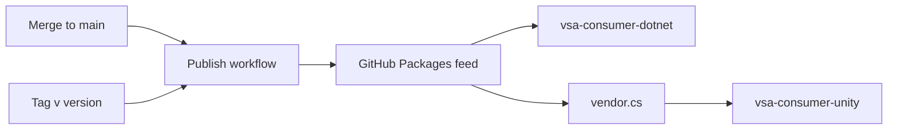

# Release and consumers

Each push to `main` publishes all Umpire packages to GitHub Packages as the next preview. A tag `v<version>` publishes a stable version. Two public consumer repos use the published packages: a .NET app and a Unity project. They are the release check: the test apps of this repository build from source, and the consumers use only what ships.

To make a first app and fix a first rule error, see [getting-started.md](getting-started.md).

## Release flow: a merge reaches the consumers



| Item | Value |
|---|---|
| Workflow | `.github/workflows/publish.yml` |
| Steps | Test, get the version, pack each project under `framework/`, push |
| Version on `main` | `<base>-preview.<n>`: `<base>` is `<Version>` in `Directory.Build.props`, `<n>` is the highest preview tag plus one |
| Version on a tag | The tag name without `v` |
| Tag on `main` | The workflow pushes `v<base>-preview.<n>` before the packages. A rerun of the same commit uses that tag again |
| Feed | `https://nuget.pkg.github.com/MgCohen/index.json` |
| Package visibility | Public, the same as this repository |

A preview needs no manual step: merge the change to `main`.

To release a stable version:

1. Tag a commit on `main`: `git tag -a v0.2.0 -m v0.2.0`.
2. Push the tag: `git push origin v0.2.0`.
3. Set `<Version>` in `Directory.Build.props` to the next version, for example `0.3.0`. If you do not, the next previews (`0.2.0-preview.<n>`) sort below `0.2.0`, and consumers do not get them.

After a new version, update the Umpire version in each consumer repo, then make sure that its checks pass.

## Feed access

GitHub Packages needs a token to restore, also for public packages.

| Where | Token |
|---|---|
| GitHub Actions | `GITHUB_TOKEN` of the workflow, with `packages: read` |
| Dev machine | `gh auth token`, after `gh auth refresh -s read:packages` |

The `nuget.config` that `umpire new app` writes reads the token from the environment variable `GITHUB_TOKEN`:

```xml
<add key="ClearTextPassword" value="%GITHUB_TOKEN%" />
```

If `GITHUB_TOKEN` is not set, restore fails with 401.

## An existing app

`umpire init` adds the Umpire setup to an app that exists. Run it in the folder of the root project:

```bash
dotnet tool exec Umpire.Cli@<version> -y -- init --check true   # show the missing setup, write nothing
dotnet tool exec Umpire.Cli@<version> -y -- init                # add it
```

It adds the missing parts of `nuget.config` and `.gitignore`, and it checks that a `global.json` does not pin `Umpire.Sdk`. It makes the Umpire SDK the main SDK of the root project, with the version (`Umpire.Sdk.Web` for a web project), and it writes `.umpireconfig` if the app has more than one project. It shows each step that it cannot do, for example with central package versions. Then write the app class (`UMP030502`) and run `dotnet build`. See "Setup pipeline" in [scaffolding.md](scaffolding.md).

## The architecture check of a new app

The Umpire SDK package holds the rule engine, so an app has no engine package. After each build of the root project, the SDK runs the engine check, and each finding is a build error (or a warning with `umpire.check.mode = "Warn"`). `-p:UmpireCheck=false` stops the check for one build. A manual engine run builds the root project, then checks it, and gives one report with the build findings and the architecture findings. The engine has the version of the SDK package, so `umpire doctor` and `umpire update` need no other slot.

## Packages of an app

`<Project Sdk="Umpire.Sdk" />` gives the general packages (Umpire.Kernels, Umpire.Markers) and the default pack `Umpire.Vsa`, with its own version. The code selects the pack: the app class names it (`App<Vsa<...>>`). A package only makes a pack available. Another pack is a normal `PackageReference`, and `-p:UmpireDefaultPack=false` (or the property in the project) leaves out `Umpire.Vsa` and its test bases. `Umpire.Vsa` depends on each VSA layer base and on `Umpire.Vsa.Analyzers`, so the analyzers and their rule values flow to each project that gets `Umpire.Vsa`, also through another project. The analyzers of a pack run only in a compilation that selects that pack: an app class of the pack, a `Block<T>` or an `AssemblyMetadata` entry that names its architecture, the `umpire.architecture` key, or, with no entry, a reference to the pack assembly. `Umpire.Vsa.Analyzers` holds the VSA analyzer and the kernel analyzer in one folder, with the rule values of both (pinned choice, `framework/Kernel/Analyzers/Umpire.KernelBundle.targets`). To change a rule value or a severity, set the key in the `.umpireconfig` file of the block.

There are two Umpire SDKs, one for each platform SDK of .NET:

| SDK | Platform SDK | Root project |
|---|---|---|
| `Umpire.Sdk` | `Microsoft.NET.Sdk` | `<Project Sdk="Umpire.Sdk/0.2.0" />` |
| `Umpire.Sdk.Web` | `Microsoft.NET.Sdk.Web` | `<Project Sdk="Umpire.Sdk.Web/0.2.0" />` |

An Umpire SDK must be the main SDK of the project, because it sets the output folder before the platform SDK does. It also does these things:

- **Block root.** The block root is the folder of the nearest `.umpireconfig` file at or above the project. With no `.umpireconfig` file, it is the project folder. A block with more than one project needs a `.umpireconfig` file, also an empty one.
- **Output.** Each project writes to one `artifacts~` folder in the block root, in the .NET artifacts layout (`artifacts~/bin/<Project>/`, `artifacts~/obj/<Project>/`). No `bin/` or `obj/` folder is next to the code. A `Directory.Build.props` file that sets `ArtifactsPath` wins.
- **Rule values.** `.umpireconfig` is TOML, and it holds only Umpire values (`umpire.<ID>.<key>`, `umpire.<ID>.severity`). The SDK gives the file to the compiler as an additional file, and the Umpire analyzers read it with Umpire.Config. A value there wins over the default on the rule class. A file-pattern section, for example `[*.cs]`, is not valid TOML: the build gives `UMP010002`, and the engine run stops with the line of the error. The severities of the .NET rules stay in the `.editorconfig` of the app.
- **Module settings.** The SDK copies `.umpireconfig` to the output folder of each project. A module reads the table with its name (`docs/composition.md`).
- **Rule engine.** The root project of the app (an executable that is not a test project) runs the engine of the SDK package after its build. `-p:UmpireEngine=false` turns it off.
- **Test project.** A project whose name ends with `.Tests` gets NUnit on Microsoft.Testing.Platform, `using NUnit.Framework` and the test bases of the pack. It references the projects that it tests itself. To make such a project a normal project, set `UmpireTestProject=false` in a `Directory.Build.props` file: the project body is too late, because the platform SDK reads `OutputType` first. A `*.Tests` project never gets the rule engine.

Umpire.Sdk ships no native .NET style. The app sets its own style in its `.editorconfig`.

## Consumer repos

| Repo | Contains | Gets VSA | Check |
|---|---|---|---|
| [vsa-consumer-dotnet](https://github.com/MgCohen/vsa-consumer-dotnet) | `umpire new app`, one module | `<Project Sdk="Umpire.Sdk" />` | CI: build and test |
| [vsa-consumer-unity](https://github.com/MgCohen/vsa-consumer-unity) | Unity 6 project, one module | DLLs in `Assets/Plugins/VSA` | Unity Test Framework, batch mode |

## Unity

The Unity consumer gets the DLLs, not the packages. The Unity limits, their tests and the extension points are in `docs/unity.md`.
