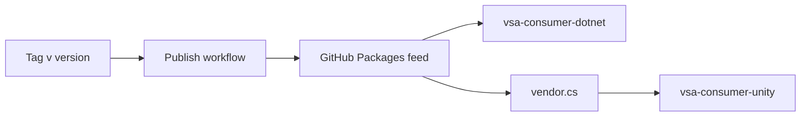

# Release and consumers

A tag `v<version>` publishes all VSA packages to GitHub Packages with that version. Two public consumer repos use the published packages: a .NET app and a Unity project. They are the release check: the local samples build VSA from source, and the consumers use only what ships.

## Release flow: a tag reaches the consumers



| Item | Value |
|---|---|
| Workflow | `.github/workflows/publish.yml` |
| Steps | Test, pack each project under `framework/`, push |
| Feed | `https://nuget.pkg.github.com/MgCohen/index.json` |
| Package visibility | Public, the same as this repository |

To release:

1. Merge the change to `main`.
2. Tag the merge commit: `git tag -a v0.2.0 -m v0.2.0`.
3. Push the tag: `git push origin v0.2.0`.
4. Update the VSA version in each consumer repo, then make sure that its checks pass.

## Feed access

GitHub Packages needs a token to restore, also for public packages.

| Where | Token |
|---|---|
| GitHub Actions | `GITHUB_TOKEN` of the workflow, with `packages: read` |
| Dev machine | `gh auth token`, after `gh auth refresh -s read:packages` |

The `nuget.config` that `vsa new app` writes reads the token from the environment variable `GITHUB_TOKEN`:

```xml
<add key="ClearTextPassword" value="%GITHUB_TOKEN%" />
```

If `GITHUB_TOKEN` is not set, restore fails with 401.

## Consumer repos

| Repo | Contains | Gets VSA | Check |
|---|---|---|---|
| [vsa-consumer-dotnet](https://github.com/MgCohen/vsa-consumer-dotnet) | `vsa new app`, one module | `<Project Sdk="VSA.Sdk" />` | CI: build and test |
| [vsa-consumer-unity](https://github.com/MgCohen/vsa-consumer-unity) | Unity 6 project, one module | DLLs in `Assets/Plugins/VSA` | Unity Test Framework, batch mode |

## Unity

Unity cannot restore NuGet packages. The Unity repo keeps the DLLs in git, and `vendor.cs` writes them: it publishes a `netstandard2.1` project with the VSA packages, then copies the DLLs to `Assets/Plugins/VSA`.

### Layers that Unity can use

| Layer | Package | Unity |
|---|---|---|
| Domain | `VSA.Domain` | Yes |
| Contracts, events | `VSA.Contracts.Events` | Yes |
| Handlers, events | `VSA.Handlers.Events` | Yes |
| Infrastructure | `VSA.Infrastructure` | Yes |
| Module | `VSA.Module` | Yes |
| Composition | `VSA.Composition` | Yes, without presenters |
| Contracts, requests | `VSA.Contracts.Requests` | No: `static abstract` members |
| Handlers, requests; Host; App; Views | ASP.NET Core packages | No: ASP.NET Core |

The root `Directory.Build.props` lists the Unity layers (`VsaUnityLayer`). They target `net10.0` and `netstandard2.1`.

### Rules for the netstandard2.1 target

- Unity 6 ships some `Microsoft.Extensions` DLLs at version 8.0, in `Editor/Data/BCLExtensions`. So the `netstandard2.1` target uses the 8.0 packages (`Directory.Packages.props`). A higher version is a compile error in Unity (`CS1705`).
- `vendor.cs` does not copy a DLL that Unity ships. A second copy is a compile error.
- `netstandard2.1` does not have `IsExternalInit`. The layers compile `framework/Layers/Polyfills/` for that target. The polyfill is internal, so each Unity assembly with a record has its own copy.
- Unity has no `deps.json`, so `ModuleDiscovery` cannot find the modules. The Unity app gives the modules to `services.AddVsa(configuration, modules)` (`docs/composition.md`).
- In Unity, an assembly definition (`.asmdef`) is one layer. Its `precompiledReferences` give the VSA DLLs that the layer can use.

## Open questions

- Unity CI: a Unity license in GitHub Actions needs a secret of the license. The Unity check runs on a dev machine only.
- Unity package: a UPM package can replace the vendored DLLs.
