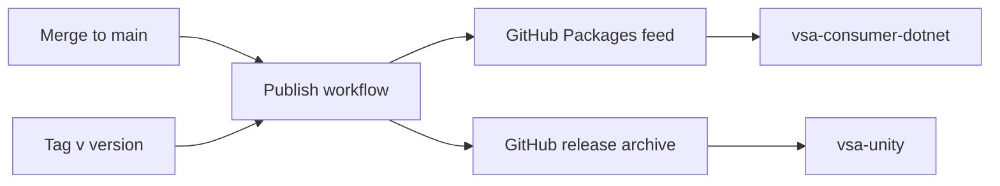

# Release and consumers

Each push to `main` publishes all Umpire packages to GitHub Packages as the next preview. A tag `v<version>` publishes a stable version. Two public consumer repos use the published packages: a .NET app and a Unity project. They are the release check: the test apps of this repository build from source, and the consumers use only what ships.

To make a first app and fix a first rule error, see [getting-started.md](getting-started.md).

## Release flow: a merge reaches the consumers



| Item | Value |
|---|---|
| Workflow | `.github/workflows/publish.yml` |
| Steps | Test, get the version, pack each project under `framework/`, push, make the release archive, attach it to the GitHub release |
| Version on `main` | `<base>-preview.<n>`: `<base>` is `<Version>` in `Directory.Build.props`, `<n>` is the highest preview tag plus one |
| Version on a tag | The tag name without `v` |
| Tag on `main` | The workflow pushes `v<base>-preview.<n>` before the packages. A rerun of the same commit uses that tag again |
| Feed | `https://nuget.pkg.github.com/MgCohen/index.json` |
| Package visibility | Public, the same as this repository |

A preview needs no manual step: merge the change to `main`.

To release a stable version:

1. Tag a commit on `main`: `git tag -a v0.2.0 -m v0.2.0`.
2. Push the tag: `git push origin v0.2.0`.
3. Set `<Version>` in `Directory.Build.props` to the next version, for example `0.3.0`. If you do not, the next previews (`0.2.0-preview.<n>`) sort below `0.2.0`, and consumers do not get them.

After a new version, update the Umpire version in each consumer repo, then make sure that its checks pass.

## Release archive

Each release tag `v<version>` has a GitHub release with one archive, `umpire-<version>.zip`. It is for a host that cannot restore NuGet packages, for example vsa-unity. A version with a suffix (`-preview.<n>`) is a prerelease. The repository is public, so a download needs no token. `tools/archive/archive.cs` makes the archive from the packed feed, so each file has the bytes of the NuGet packages.

```text
umpire-<version>.zip
├── manifest.json            version, commit, Roslyn version, engine runtime, one entry for each file
├── THIRD-PARTY-NOTICES.txt  the license of each third-party package, and the notices of the analyzer package
├── runtime/netstandard2.0/  Umpire.dll, Umpire.Vsa.dll and their full third-party closure
├── definition/netstandard2.0/  Umpire.Definition.dll, Umpire.Vsa.Definition.dll (check-time code, not for the runtime)
├── analyzers/dotnet/cs/     Umpire.Kernels.Analyzers.dll, Umpire.Vsa.Analyzers.dll
└── engine/net8.0/           umpire-engine.dll, its runtimeconfig, its deps.json and its DLLs
```

| Manifest key | Value |
|---|---|
| `version` | The exact package version, for example `0.2.0-preview.21` |
| `commit` | The commit of the release (`--commit`, else the local `HEAD`) |
| `analyzers.roslyn` | The highest Roslyn version that the analyzers reference, for example `4.10` |
| `engine.targetFramework`, `engine.rollForward` | `net8.0`, `Major` |
| `engine.umpireBuild` | `netstandard2.0`: the build of `Umpire.dll` that the engine uses. Code that compiles against `runtime/netstandard2.0` has the same shape |
| `engine.frameworks` | Each shared framework that the engine needs, with its `name` and `version` |
| `files[].path` | The path in the archive |
| `files[].assemblyVersion` | The assembly version of a DLL. `null` for a file that is not a DLL |
| `files[].package`, `files[].packageVersion` | The NuGet package that gives the bytes. The analyzer files are `Umpire.Vsa.Analyzers`, and the Umpire engine files are `Umpire.Engine` |
| `files[].asset` | The path of the file in that package, for example `lib/netstandard2.0/Microsoft.Extensions.Logging.dll` |
| `files[].sha256` | The SHA-256 hash of the file |

- The folder names and the file names stay the same in each release.
- The runtime holds no definition code. A definition of the host compiles against `runtime/netstandard2.0` and `definition/netstandard2.0`.
- The runtime holds all its DLLs, also the DLLs that a host ships itself. The host skips its own DLLs: the archive has no host list.
- The archive has no host files, for example no Unity `.meta` files.
- The runtime files come only from `netstandard2.x` assets, and the `Microsoft.Extensions` files are 8.0 (`tests/Release.Tests`).
- The script restores with the SDK of the `global.json` of this repository.

While CI is off, make the release on a local computer, after the pack:

1. Make the archive: `dotnet run tools/archive/archive.cs -- --feed feed --version <version> --out release --commit $(git rev-list -n1 v<version>)`.
2. Make the release: `gh release create v<version> release/umpire-<version>.zip --verify-tag --title v<version> --notes "Umpire <version>"`.
3. For a preview, add `--prerelease` to step 2.

`tests/Release.Tests` makes an archive from the local feed and checks its layout and its manifest.

## Feed access

GitHub Packages needs a token to restore, also for public packages.

| Where | Token |
|---|---|
| GitHub Actions | `GITHUB_TOKEN` of the workflow, with `packages: read` |
| Dev machine | `gh auth token`, after `gh auth refresh -s read:packages` |

The `nuget.config` that `umpire new app` writes reads the token from the environment variable `GITHUB_TOKEN`:

```xml
<add key="ClearTextPassword" value="%GITHUB_TOKEN%" />
```

If `GITHUB_TOKEN` is not set, restore fails with 401.

## An existing app

`umpire init` adds the Umpire setup to an app that exists. Run it in the folder of the root project:

```bash
dotnet tool exec Umpire.Cli@<version> -y -- init --check true   # show the missing setup, write nothing
dotnet tool exec Umpire.Cli@<version> -y -- init                # add it
```

It does these steps:

1. It adds the missing parts of `nuget.config` and `.gitignore`.
2. It writes `Directory.Build.props` with the artifacts output (`UseArtifactsOutput`, `ArtifactsPath`), if the app folder has no such file. The new file imports the `Directory.Build.props` of a parent folder, if one exists.
3. It adds the Umpire packages to the root project: `Umpire.Web` for a web project, else `Umpire.Vsa`, and `Umpire.Engine`. A project that references `Umpire` itself (another pack) gets no VSA package. With central package versions, it writes `VersionOverride`.
4. It changes the removed Umpire SDK of the root project to the .NET SDK: `Umpire.Sdk` becomes `Microsoft.NET.Sdk`, and `Umpire.Sdk.Web` becomes `Microsoft.NET.Sdk.Web`. If the project has no `TargetFramework`, it adds `TargetFramework` `net10.0`, `Nullable` and `ImplicitUsings`, which the removed SDK gave. Change each other project of the app by hand: `umpire doctor` and `umpire update` list them.
5. It writes `.umpireconfig` if the app has more than one project.

It shows each step that it cannot do, for example a `global.json` that pins `Umpire.Sdk`. Then write the app class (`UMP030502`) and run `dotnet build`. See "Setup pipeline" in [scaffolding.md](scaffolding.md).

## The architecture check of a new app

The package `Umpire.Engine` holds the rule engine. The root project references it with `PrivateAssets="all"`. After each build of the root project, the build files of the package `Umpire` run the engine check, and each finding is a build warning. If the root project has no `Umpire.Engine`, the build gives the warning `UMP030003`. `umpire.check.mode = "Error"` in `.umpireconfig` makes each error finding a build error, and `-p:UmpireCheckMode=Error` does it for one build. `TreatWarningsAsErrors` does not change an Umpire warning. The mode does not change the analyzer findings: `umpire.<ID>.severity = "error"` makes one an error. `-p:UmpireCheck=false` stops the check for one build. The check also covers each block that the app uses: each inner block (for example `App/Packs/<Name>/`) and each block with a check entry in a project reference. A block in a package is not checked again. Each block has a check stamp in `artifacts~/umpire-checks/`, so a block that did not change is not checked again. A manual engine run builds the root project, then checks it, and gives one report with the build findings and the architecture findings. `Umpire.Engine` has the version of the other Umpire packages, and `umpire doctor` and `umpire update` read it as one more package.

## Packages of an app

An app project is a normal .NET project: `<Project Sdk="Microsoft.NET.Sdk">`, or `<Project Sdk="Microsoft.NET.Sdk.Web">` for a web root project, with a `PackageReference` to each Umpire package that it uses. Each Umpire package brings its own build files in `build/` and `buildTransitive/`, and NuGet imports them. There is no Umpire SDK.

| Project | File |
|---|---|
| Web root project | `<PackageReference Include="Umpire.Web" Version="0.2.0" />` and `<PackageReference Include="Umpire.Engine" Version="0.2.0" PrivateAssets="all" />` |
| Console root project | `Umpire.Vsa`, `Umpire.Console` and `Umpire.Engine` (`PrivateAssets="all"`) |
| Definition project (`Definition/`) | `<PackageReference Include="Umpire.Vsa.Definition" Version="0.2.0" PrivateAssets="all" />` |
| Test project (`*.Tests`) | `Umpire.Testing`, `NUnit` and `NUnit3TestAdapter`, with `OutputType` `Exe` and `EnableNUnitRunner` `true` |
| Kernel of a pack variant, or a module library | `<PackageReference Include="Umpire.Vsa" Version="0.2.0" />` |

| Package | Holds | Depends on |
|---|---|---|
| `Umpire` | The core of the runtime (the markers, the config reader, the kernel, the messages) and the build files of each Umpire project | `Umpire.Kernels.Analyzers` |
| `Umpire.Vsa` | The VSA kernel: each layer base, `VsaKernel`, `Plugin` and the composition. Its build props name the VSA definition for the check | `Umpire`, `Umpire.Vsa.Analyzers` |
| `Umpire.Web` | The web host and the views | `Umpire.Vsa` |
| `Umpire.Console` | The console host | `Umpire` |
| `Umpire.Definition` | The definition API (`Umpire.Architecture`) and the definitions of the framework blocks (`Umpire.Kernels.Definition`) | `Umpire` |
| `Umpire.Vsa.Definition` | The VSA definition (`VsaArchitecture`, the layers, `Feature`, `Plugin`) | `Umpire.Definition`, `Umpire.Vsa` |
| `Umpire.Testing` | The test bases `VsaUnitTest` and `VsaArchitectureTest` | `Umpire.Vsa`, `Umpire.Definition`, `Umpire.Vsa.Definition`, `NUnit` |
| `Umpire.Engine` | The rule engine in `tools/net8.0/`, and `build/Umpire.Engine.props` with its path (`UmpireEngineFile`, `UmpireEngineDir`) | None |

Each dependency between the Umpire packages has no excluded assets, so the build files and the analyzers flow to each project that gets a package through another package. `Umpire.dll` holds the kernel and no pack. `Umpire.Vsa.dll` holds the VSA kernel with each layer base. The two DLLs hold no definition code.

An app project does not compile against the definition packages. The architecture check still needs the definition of the pack, so the root project copies `Umpire.Definition.dll` and `Umpire.Vsa.Definition.dll` from the engine folder of `Umpire.Engine` (`tools/net8.0/`, the same build) to its folder `umpire-definitions/`. The package of the pack names its definition: `build/Umpire.Vsa.props` adds the item `_UmpirePackDefinition`. A publish does not copy that folder. A project with definition code outside a folder `Definition/` references the definition package with `PrivateAssets="all"`, so the package does not flow to the root project. Or it sets the property `UmpireDefinitionProject` to `true`. The code selects the pack: the app class names its kernel (`App<VsaKernel, ...>`). A package only makes a pack available. Another pack is a normal `PackageReference`. A project that references only `Umpire` gets no VSA analyzer and no VSA definition. The analyzers of a pack run only in a compilation that selects that pack: an app class of the pack, a `Block<T>` or an `AssemblyMetadata` entry that names its architecture, the `umpire.architecture` key, or, with no entry, a reference to a type in the namespace of the pack. `Umpire.Vsa.Analyzers` holds the VSA analyzer and the kernel analyzer in one folder, with the rule values of both (pinned choice, `framework/Kernel/Analyzers/Umpire.KernelBundle.targets`). A VSA app thus gets two copies of the kernel analyzer. The target `_UmpireOneKernelAnalyzer` of the package `Umpire` removes the copy of `Umpire.Kernels.Analyzers` from the compilation, so each kernel finding comes one time. To change a rule value or a severity, set the key in the `.umpireconfig` file of the block.

The build files of the package `Umpire` (`build/Umpire.props`, and `build/Umpire.After.targets`, which the .NET SDK imports after its own targets through `AfterMicrosoftNETSdkTargets`) do these things:

- **Block root.** The block root is the folder of the nearest `.umpireconfig` file at or above the project. With no `.umpireconfig` file, it is the project folder. A block with more than one project needs a `.umpireconfig` file, also an empty one.
- **Source folders.** The root project compiles each file in its folder tree, except the folders of the nested projects, `bin/`, `obj/` and the folders in `UmpireExcludedFolders` (default `node_modules`).
- **Definitions.** The project builds each nested project in a folder `Definition/` first, with no reference to its assembly, and copies the definitions to `umpire-definitions/`. It also references each pack variant kernel in `App/Packs/<Name>/Kernel/`.
- **Rule values.** `.umpireconfig` is TOML, and it holds only Umpire values (`umpire.<ID>.<key>`, `umpire.<ID>.severity`). The package gives the file to the compiler as an additional file, and the Umpire analyzers read it with Umpire.Config. A value there wins over the default on the rule class. A file-pattern section, for example `[*.cs]`, is not valid TOML: the build gives `UMP010002`, and the engine run stops with the line of the error. The severities of the .NET rules stay in the `.editorconfig` of the app.
- **Module settings.** The package copies `.umpireconfig` to the output folder of each executable project. A module reads the table with its name (`docs/composition.md`).
- **Codes.** `Umpire.Codes.props` lists each Umpire code in `WarningsNotAsErrors`, so `TreatWarningsAsErrors` does not make an Umpire finding an error.
- **Polyfills.** A `netstandard2.0` or `netstandard2.1` project gets `IsExternalInit`. A project with its own type sets `UmpireIsExternalInitPolyfill` to `false`.
- **Rule engine.** The root project of the app (an executable in the block root that is not a test project) runs the engine of `Umpire.Engine` after its build. `-p:UmpireEngine=false` turns it off. A `*.Tests` project never runs the engine.

The packages do not set the output folder. The .NET SDK reads `UseArtifactsOutput` and `ArtifactsPath` before the project body and before the props of a package, so they go in `Directory.Build.props`. `umpire new app` and `umpire init` write this file:

```xml
<Project>
  <PropertyGroup>
    <UseArtifactsOutput>true</UseArtifactsOutput>
    <ArtifactsPath>$(MSBuildThisFileDirectory)artifacts~</ArtifactsPath>
  </PropertyGroup>
</Project>
```

Each project then writes to `artifacts~/bin/<Project>/` and `artifacts~/obj/<Project>/`, and no `bin/` or `obj/` folder is next to the code. The engine writes its stamp `.umpire-check` to the output folder of the root project, and the check stamps of the blocks to `artifacts~/umpire-checks/` of each block.

These settings must be in place before NuGet imports the package files, so a package cannot give them:

| Setting | Why a package cannot give it | Place |
|---|---|---|
| `UseArtifactsOutput`, `ArtifactsPath` | The .NET SDK sets the output folders in its props, before the package props | `Directory.Build.props` of the app (`umpire init`) |
| `TargetFramework` | The restore reads it, and NuGet imports the package props only after the restore | The project file |
| `OutputType`, `EnableNUnitRunner` of a test project | The test runner packages read them in their own build files | The test project file |
| The package references | The restore reads them | The project file |
| The project references to `Definition/` and `App/Packs/<Name>/Kernel/` | The first restore of the root project does not import the package files, so it does not see these references | `Umpire.After.targets` adds them, and the target `_UmpireRestoreAddedReferences` restores their projects before the build uses them |

The packages ship no native .NET style. The app sets its own style in its `.editorconfig`.

## Consumer repos

| Repo | Contains | Gets VSA | Check |
|---|---|---|---|
| [vsa-consumer-dotnet](https://github.com/MgCohen/vsa-consumer-dotnet) | `umpire new app`, one module | `PackageReference` items to `Umpire.Web` and `Umpire.Engine` | CI: build and test |
| [vsa-consumer-unity](https://github.com/MgCohen/vsa-consumer-unity) | Unity 6 project, one module | DLLs in `Assets/Plugins/VSA` | Unity Test Framework, batch mode |

## Unity

The Unity consumer gets the DLLs, not the packages. The Unity limits, their tests and the extension points are in `docs/unity.md`.
