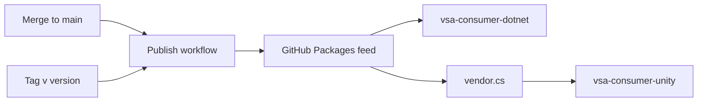

# Release and consumers

Each push to `main` publishes all Umpire packages to GitHub Packages as the next preview. A tag `v<version>` publishes a stable version. Two public consumer repos use the published packages: a .NET app and a Unity project. They are the release check: the test apps of this repository build from source, and the consumers use only what ships.

## Release flow: a merge reaches the consumers



| Item | Value |
|---|---|
| Workflow | `.github/workflows/publish.yml` |
| Steps | Test, get the version, pack each project under `framework/`, push |
| Version on `main` | `<base>-preview.<n>`: `<base>` is `<Version>` in `Directory.Build.props`, `<n>` is the highest preview tag plus one |
| Version on a tag | The tag name without `v` |
| Tag on `main` | The workflow pushes `v<base>-preview.<n>` before the packages. A rerun of the same commit uses that tag again |
| Feed | `https://nuget.pkg.github.com/MgCohen/index.json` |
| Package visibility | Public, the same as this repository |

A preview needs no manual step: merge the change to `main`.

To release a stable version:

1. Tag a commit on `main`: `git tag -a v0.2.0 -m v0.2.0`.
2. Push the tag: `git push origin v0.2.0`.
3. Set `<Version>` in `Directory.Build.props` to the next version, for example `0.3.0`. If you do not, the next previews (`0.2.0-preview.<n>`) sort below `0.2.0`, and consumers do not get them.

After a new version, update the Umpire version in each consumer repo, then make sure that its checks pass.

## Feed access

GitHub Packages needs a token to restore, also for public packages.

| Where | Token |
|---|---|
| GitHub Actions | `GITHUB_TOKEN` of the workflow, with `packages: read` |
| Dev machine | `gh auth token`, after `gh auth refresh -s read:packages` |

The `nuget.config` that `umpire new app` writes reads the token from the environment variable `GITHUB_TOKEN`:

```xml
<add key="ClearTextPassword" value="%GITHUB_TOKEN%" />
```

If `GITHUB_TOKEN` is not set, restore fails with 401.

## An existing app

`umpire init` adds the Umpire setup to an app that exists. Run it in the folder of the root project:

```bash
dotnet tool exec Umpire.Cli init --check true   # show the missing setup, write nothing
dotnet tool exec Umpire.Cli init                # add it
```

It adds the missing parts of `global.json`, `nuget.config`, the tool manifest, `Directory.Build.props` and `.gitignore`. Then it adds `Umpire.Sdk` and `Umpire.Engine.Build` to the root project. It shows each step that it cannot do, for example with central package versions. Then write the app class (`UMP030302`) and run `dotnet build`. See "Setup pipeline" in [scaffolding.md](scaffolding.md).

## The architecture check of a new app

The root project of a new app has the package `Umpire.Engine.Build`. So the rule engine checks the architecture after each build, and an error fails the build. `-p:UmpireCheck=false` turns the check off for one build. `-p:UmpireCheckMode=Warn` reports each error as a warning. `umpire doctor` and `umpire update` include this package in the one version.

## Packages of an app

`<Project Sdk="Umpire.Sdk" />` gives the general packages (Umpire.Kernel, Umpire.Markers, Umpire.Kernel.Analyzers) and the pack. `UmpirePack` selects the pack, and its default is `Vsa`: the SDK adds `Umpire.Vsa` and `Umpire.Vsa.Analyzers` with its own version. `Umpire.Vsa` depends on each VSA layer base. To change a rule value or a severity, set the key in the `.editorconfig` of the app.

## Consumer repos

| Repo | Contains | Gets VSA | Check |
|---|---|---|---|
| [vsa-consumer-dotnet](https://github.com/MgCohen/vsa-consumer-dotnet) | `umpire new app`, one module | `<Project Sdk="Umpire.Sdk" />` | CI: build and test |
| [vsa-consumer-unity](https://github.com/MgCohen/vsa-consumer-unity) | Unity 6 project, one module | DLLs in `Assets/Plugins/VSA` | Unity Test Framework, batch mode |

## Unity

The Unity consumer gets the DLLs, not the packages. The Unity limits, their tests and the extension points are in `docs/unity.md`.
