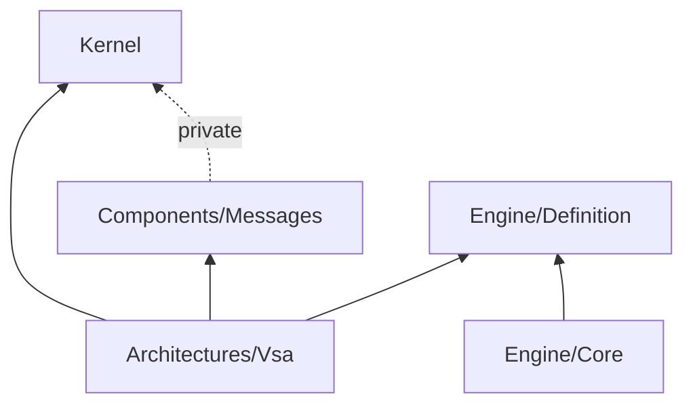

# Framework layout: kernel, components, engine and architectures

The framework has four groups. The kernel and the engine know no layer, so a second architecture can use them with no VSA package. VSA is one architecture pack on top of them.

## Groups

| Group | Folder | Purpose | Who selects it |
|---|---|---|---|
| Kernel | `framework/Kernel/` | What each app needs to start | Nobody: always there |
| Components | `framework/Components/` | Optional blocks, for example `Messages/` | The architecture |
| Engine | `framework/Engine/` | The definition API and the checks | The build hook |
| Architectures | `framework/Architectures/<Name>/` | One full pack: definition, bases, rules | The app: one for each app |



The kernel and the engine do not reference each other. Only an architecture pack uses both.

## Two kinds of type

| | Definition (data for the engine) | Runtime (logic) |
|---|---|---|
| Generic | `Concept`, `record Anchor : Concept` | `class Anchor`, `AnchorBuilder`, `IInstaller` |
| VSA | `record Layer : Concept`, the VSA layers, `record Module : Anchor` | `class Module : Anchor`, `class Plugin : Module` |

- The definition names a runtime class only by its `Type`, for example `feature.Add<Module>().OfType<VSA.Module.Module>()`. Where two types have the same name, write the full name of the runtime class.
- A definition `Anchor` is in the folder of its parent: it is the root part of a group instance.
- A runtime `Anchor` has `Name`, `Order`, `Section` and `Configure(AnchorBuilder)`. The kernel finds each one, sorts them by `Order`, then by name, and calls `Configure`.

## How the kernel starts an app

```
App.Run(args)                             VSA.Kernel
├─ AppBuilder: Host(), Keys(), Services(), Configure(builder)
│                                         VsaApp: Modules() or ScanFor(typeof(Module))
├─ AnchorScan.Anchors(base)               the root classes of the app, in order
├─ AnchorScan.Installers()                each IInstaller in the assemblies that reference VSA.Kernel
├─ Services(...)
└─ Anchor.Configure                       each anchor, last
```

The installers have no order. A test runs them in reverse order with the same result.

## Second architecture

`tests/Fixtures/Architecture/LayeredApp` has three concepts, `Ui`, `Logic` and `Data`, and no VSA type. `tests/Architecture.Tests/LayeredAppTests.cs` checks it with the same engine.

## Non-goals

- No package rename yet. Reason: the neutral product prefix comes with the names pass. The packages keep their `VSA.*` names.
- No split of the web host. Reason: its generic part is about 20 lines. Split it when a second architecture needs a web host.

## Open questions

- The neutral prefix for the kernel, the components and the engine, and for the rule IDs (`VSA1xxx`, `VSA2xxx`).
- The place of the `vsa` tool and the viewer: `tools/` as separate apps, and the templates in the VSA pack.
- The engine app as a bootstrap: built on the last released VSA, not on the source.
- The generic part of VSA.Sdk: the folder rules and the version pins, apart from the list of VSA packages.
