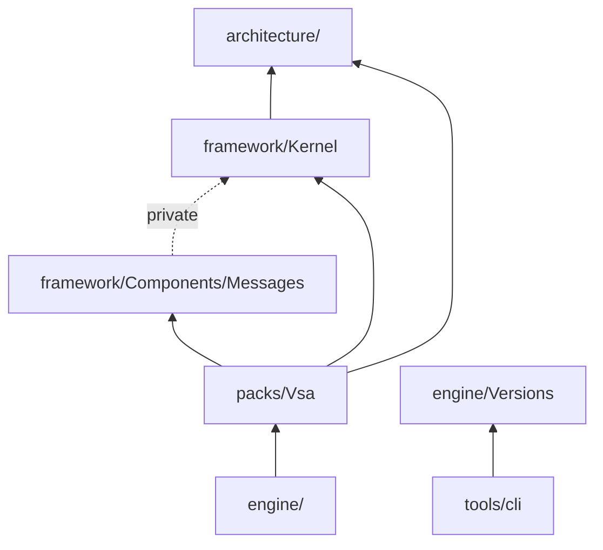

# Repository layout: architecture, framework, packs, engine and tools

Umpire has five groups of code, and each group has one top folder. The definition API depends on no other folder, and the kernel and the components know no layer, so a second architecture uses them with no VSA package. Apps use VSA. The framework uses layers of projects.

## Groups

| Group | Folder | Purpose | Who selects it |
|---|---|---|---|
| Architecture | `architecture/` | The definition API and the rule answers | Each pack and the engine |
| Framework | `framework/` | The kernel and the components | Kernel: always; components: the pack |
| Packs | `packs/<Name>/` | One full architecture: definition, bases, rules | The app: one for each app |
| Engine | `engine/` | The rule engine app and the build hook | The build hook package |
| Tools | `tools/` | The `umpire` tool and Umpire.Sdk | The developer |



## Three tiers

| Tier | Example | Layer rules | Reuse |
|---|---|---|---|
| Kernel | `framework/Kernel/` | None | Each app, each architecture |
| Component | `framework/Components/Messages/` | None, but it can have a layer shape | Many definitions |
| Plugin | `Plugins/<Plugin>/` of an app | The VSA definition checks it | One VSA app |

The terms are in `vocabulary.md`.

## Where the rule answers are

```
engine Rules step (engine/Features/Rules)
├─ BuiltApp plugin: DLL, PDB and Unity facts      ArchUnitNET (the only place)
├─ ResolvedArchitecture.Place(facts)              architecture/Resolution: Match
└─ ResolvedArchitecture.DecisionFor(a, b)         architecture/Resolution: Decide
```

`architecture/Resolution/` takes plain facts (`TypeFacts`: file, assembly, base types, uses), so a tool with no DLL reader can ask the same questions. `engine/Versions` (`Umpire.Engine.Versions`) has no pack reference. The engine app and the `umpire` tool bundle it for the version check.

The kernel references the definition API (`Umpire.Architecture`), because a `Pack` gives the `Architecture` of the app. The definition API is portable and has no ArchUnitNET.

## Two kinds of type

| | Definition (data for the engine) | Runtime (logic) |
|---|---|---|
| Generic | `Architecture`, `Concept`, `record Module : Concept` | `App`, `Pack`, `AppHost`, `class Module`, `AppTypes` |
| VSA | `VsaArchitecture`, `record Layer : Concept`, the VSA layers | `Vsa<THost>`, `VsaHost`, `class Plugin : Module`, `WebVsaHost`, `ConsoleVsaHost` |

- The definition names a runtime class only by its `Type`, for example `feature.Add<Module>().OfType<Umpire.Kernel.Module>()`. Where two types have the same name, write the full name of the runtime class.
- A definition `Module` is in the folder of its parent: it is the root part of a group instance.
- A runtime `Module` has `Name`, `Order`, `Section` and `Configure(IServiceCollection)`. The kernel finds each one, sorts them by `Order`, then by name, and calls `Configure`. A `Plugin` has `Order` 0, and a `Module` has `Order` 1.

## How the kernel starts an app

```
App.Run(args)                             Umpire.Kernel
├─ Pack.CreateHost()                      a new AppHost for each run
└─ AppHost.Create(args, app)
   ├─ CreateBuilder(args)                 open: the generic host, or the web host
   ├─ Compose(services, app)              fixed
   │  ├─ core                             IConfiguration, logging, AppTypes, auto-register
   │  ├─ Install(services, types)         open: VsaHost adds each VSA layer
   │  ├─ Module.Configure                 each module, in Order, then by name
   │  └─ app.ConfigureServices            last
   └─ Build(builder)                      open
```

See `composition.md` for each step.

## Second architecture

`tests/Fixtures/Architecture/LayeredApp` has three concepts, `Ui`, `Logic` and `Data`, and no VSA type. `tests/Architecture.Tests/LayeredAppTests.cs` checks it with the same engine.

## Non-goals

- No split of the web host. Reason: its generic part is about 20 lines. Split it when a second architecture needs a web host.
- No portable hosts project. Reason: `VsaHost` and `ConsoleVsaHost` stay in `Umpire.Vsa.Composition`, so `Vsa<THost>` has no project cycle (W11 examines a split).

## Open questions

- The engine app as a bootstrap: built on the last released Umpire, not on the source.
- The generic part of Umpire.Sdk: the folder rules and the version pins, apart from the list of Umpire packages.
- The names of "Rules", "Decide", "Resolution" and the place of `Versions` (library or plugin).
