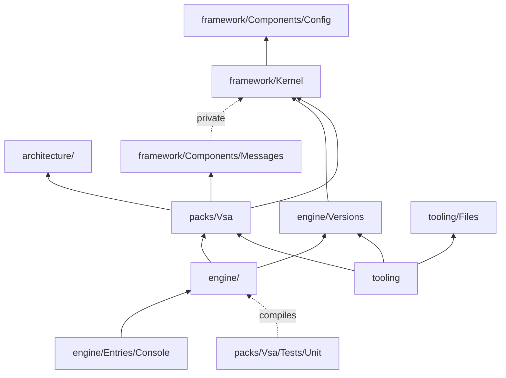

# Repository layout: architecture, framework, packs, engine and tools

Umpire has five groups of code, and each group has one top folder. The definition API references only the markers and the kernel, for the shared helpers in `Umpire.Utility` (its build gets the polyfill of the package `Umpire` and the rule values of the kernel analyzers, as each framework project does), and the kernel and the components know no layer, so a second architecture uses them with no VSA package. Apps use VSA. The framework uses layers of projects.

To make a first app and fix a first rule error, see [getting-started.md](getting-started.md).

## Groups

| Group | Folder | Purpose | Who selects it |
|---|---|---|---|
| Architecture | `architecture/` | The definition API and the rule answers | Each pack and the engine |
| Framework | `framework/` | The kernel and the components | Kernel: always; components: the pack |
| Packs | `packs/<Name>/` | One full architecture: definition, bases, rules | The app: one for each app |
| Engine | `engine/` | The rule engine: the core library and the console entry (`Entries/Console/`) | `tools/net8.0/` of the package `Umpire.Engine` |
| Tooling | `tooling/` | The `umpire` tool (a VSA app and a checked block), its file writer (`tooling/Files/`) and its templates (`tooling/Templates/`) | The developer |
| Tools | `tools/` | The bundle packages (`tools/bundle/`), with the build files of the packages, `Umpire.Engine` and the source mode, and the release archive (`tools/archive/`) | The developer |



## Shipped files

The projects of the groups are for development: their references enforce the layers. They are not packages. The bundle projects in `tools/bundle/` compile the same source files into the shipped DLLs:

| Package | DLL | Source projects | Depends on |
|---|---|---|---|
| `Umpire` | `Umpire.dll` (`netstandard2.0`) | Markers, Config, Kernels (with `Utility/`), Messages (contracts and handlers): the core | `Umpire.Engine` (for its analyzer) |
| `Umpire.Vsa` | `Umpire.Vsa.dll` (`netstandard2.0`) | Each VSA layer base, `VsaKernel`, `Plugin` and the composition (`packs/Vsa/Kernel/`, with no views): the VSA kernel | `Umpire` |
| `Umpire.Definition` | `Umpire.Definition.dll` (`netstandard2.0`) | Architecture (with no markers), Kernels.Definition | `Umpire` |
| `Umpire.Vsa.Definition` | `Umpire.Vsa.Definition.dll` (`netstandard2.0`) | Umpire.Vsa (`packs/Vsa/Definition/`) | `Umpire.Definition`, `Umpire.Vsa` |
| `Umpire.Web` | `Umpire.Web.dll` | Umpire.Hosts.Web, Umpire.Vsa.Views | `Umpire.Vsa` |
| `Umpire.Console` | `Umpire.Console.dll` | Umpire.Hosts.Console | `Umpire` |
| `Umpire.Testing` | `Umpire.Testing.dll` | Umpire.Vsa.Testing.Unit, and the query files of the engine core | `Umpire.Vsa`, `Umpire.Definition`, `Umpire.Vsa.Definition` |

The core `Umpire` holds no pack and no definition code. The VSA kernel is in `Umpire.Vsa`, so an app with another pack and no web host gets no VSA code and no VSA rule. The definition code is check-time code, so it is in the two definition packages. The views and the VSA test bases stay in `Umpire.Web` and `Umpire.Testing`, so these two packages depend on `Umpire.Vsa`.

The VSA kernel uses internal members of the kernel and of the messages, as the runtime projects do (`InternalsVisibleTo` of `Umpire.Kernels` to `Umpire.Vsa.Composition`, and of `Umpire.Messages.Handlers` to the VSA handler projects). Thus `Umpire.dll` gives its internals to `Umpire.Vsa`. The source project of the VSA definition has the name `Umpire.Vsa`, and a solution cannot hold two projects with one name. Thus the bundle project of `Umpire.Vsa` is `tools/bundle/Vsa/Umpire.Vsa.Kernel.csproj`, and it sets `AssemblyName` and `PackageId` to `Umpire.Vsa`. The `Bundle` metadata of an item in `tools/bundle/SourceMode/Umpire.SourceMode.targets` is the path of its bundle project.

The package `Umpire` depends on `Umpire.Engine`, which holds the analyzer entry of the engine and each DLL that it loads in `analyzers/dotnet/cs/`. The entry is the only Umpire analyzer. The VSA rules select their pack by namespace (`VsaRule.PackNamespace`, `PackSelection` in the analyzer entry): with no code entry, a reference to the assembly `Umpire.Vsa` selects VSA.

`BundleSourceTests` makes sure that each bundle compiles the same files as its source projects. `_UmpireUseBundle=true` (private) makes the source mode (`tools/bundle/SourceMode/`) reference the bundle projects. Only the pack of `Umpire.Engine` sets it: a repository app built with it gives `UMP030001` for each framework block, because the check entries of those blocks are in the runtime DLLs. The SDK package builds its rule engine so, because the engine loads the definition of an app and its `Architecture` type must come from the same `Umpire.Definition.dll` as the definition of the app. The source build of the engine stays on the runtime projects, so it reads the fixtures of this repository. In one assembly, a `protected internal` member cannot be overridden as `protected`, so the bases of `Architecture` and `Concept` use `protected` members and internal call methods.

## Kinds of block

Each group holds blocks of one or more kinds: app, definition, pack, kernel, component, module and library. The kinds, their entries and the composition guidelines are in `blocks.md`. The terms are in `vocabulary.md`.

## Where a new part goes

This table is a guideline. **Not enforced in 0.1.0.**

| You add | Folder |
|---|---|
| A type of the definition API | `architecture/` |
| A rule question on plain data | `engine/App/Plugins/Facts/Domain/Shared/Queries/` |
| A type that each app needs to start | `framework/Kernel/` |
| A free block for two or more packs | `framework/Components/<Name>/` |
| A new architecture | `packs/<Name>/`: `Definition/`, `Kernel/`, `Tests/` |
| A pack variant of an app | `App/Packs/<Name>/` of the app (`pack-variants.md`) |
| A new fact of a built app | `engine/App/Plugins/Facts/`, behind a fact source (`IFactSource<TQuery, TFacts>`) |
| An operation of the engine | `engine/App/Features/<Operation>/`: one feature module, one command |
| A job of the engine | `engine/App/Features/Jobs/Slices/<Name>Job/`: one request and its handler |
| A tool command | A slice in `tooling/App/Features/<Module>/Slices/<Command>/`: a request, a response and a handler |

## Where the rule answers are

```
engine CheckModel operation (engine/App/Features/Model)
├─ snapshots of the compile                       analyzer entry: ProjectFacts
├─ facts of a DLL with no snapshot                Facts plugin: DllSource (MetadataLoadContext)
└─ model rules on the app model                   Model domain: Rules/

ArchitectureTest<T> (a test of a definition, packs/Vsa/Tests/Unit)
├─ reflection: the base types of one type        TypeFactsOf
└─ ResolvedArchitecture.Place, DecisionFor        Facts plugin, Queries: PartOf, ResolvedArchitecture
```

The queries (`engine/App/Plugins/Facts/Domain/Shared/Queries/`) take plain facts (`TypeFacts` of the definition API: file, assembly, base types, the type arguments of the base types, uses), so a tool with no DLL reader can ask the same questions. They use only the definition API and `Umpire.Utility`, so the definition test base (`packs/Vsa/Tests/Unit/` and the package `Umpire.Testing`) compiles a copy of them. A test project thus gets no engine module. `engine/Versions` (`Umpire.Engine.Versions`) has no pack reference. The engine app and the `umpire` tool bundle it for the version check.

The runtime references no definition code. The type helpers `LoadedTypes` and `ClosedBase` are in `framework/Kernel/Utility/` (the part `KernelParts.Utility`). The pure path and name helpers `RelativePath`, `BuildOutput` and `CompilerNames` are in `framework/Kernel/Paths/` (the part `KernelParts.Paths`). Both folders use the namespace `Umpire.Utility`. The runtime, the engine and the version check use them from there. In the engine definition, `Domain` (and so `Domain.Shared`) can use only `KernelParts.Paths`, and `Infrastructure` can use both parts. The definition API is portable and reads no DLL.

## Two kinds of type

| | Definition (data for the engine) | Runtime (logic) |
|---|---|---|
| Generic | `Architecture`, `Architecture<TKernel>`, `Concept`, `External`, `Host`, `Hosts`, the block kind records (`Umpire.Architecture.Blocks`: `Block`, `App`, `Definition`, `Kernel`, `Component`; `Umpire.Kernels.Blocks`: `Core`, `record Module : Component`, `Pack`), `MessagesComponent` | `App`, `AppHost`, `Kernel`, `Core`, `class Module`, `AppTypes` |
| VSA | `VsaArchitecture`, `record Layer : Concept`, the VSA layers, the module kinds `record Feature : Module` and `record Plugin : Module`, `UmpireLibraries` | `VsaKernel`, `class Plugin : Module` |

- The definition names a runtime class only by its `Type`, for example `rules.For<Module>(Depth.Self).HasTypes<Umpire.Kernels.Module>().Exactly(1)`. Where two types have the same name, write the full name of the runtime class, or use an alias, for example `using VsaKernel = Umpire.Vsa.Composition.VsaKernel;`.
- A class at the top of a block folder binds to the block part, for example the module class of a feature module binds to `Feature`.
- A runtime `Module` has `Name`, `Order`, the public `Install(IServiceCollection, ModuleSettings)` and the protected `Configure(IServiceCollection)`. The kernel finds each one, sorts them by `Order`, then by name, and calls `Install`. A `Plugin` has `Order` 0, and a `Module` has `Order` 1.

## How the kernel starts an app

```
App.Run(args)                             Umpire.Kernels
├─ Start(args)
│  ├─ App.CreateHost()                    a new AppHost for each start
│  ├─ AppHost.Build(args, app)            open: plain, console or web
│  │  └─ Compose(services, arguments, app.Kernel, types)         fixed
│  │     ├─ Core.Install                  the core services
│  │     ├─ Kernel.Install                Kernel.Configure (VsaKernel: the VSA layers)
│  │     ├─ Module.Install                each module, in Order, then by name
│  │     ├─ AppHost.Configure             open
│  │     └─ DefaultLogging                the null logger, if no logger exists
│  └─ AppHost.Start(services, stop)       open: the host work and its stop sources
├─ wait for a stop request
└─ the stop                               OnStop, then AppHost.Dispose
```

See `composition.md` for each step.

## Second architecture

`tests/Fixtures/Architecture/LayeredApp` has three concepts, `Ui`, `Logic` and `Data`, and no VSA type. `tests/Architecture.Tests/LayeredAppTests.cs` checks it with the same engine.

## Non-goals

- No VSA code in a host. Reason: the hosts read only `Operation`, so another architecture can use `WebHost` and `ConsoleHost`.

## Open questions

- The engine app as a bootstrap: built on the last released Umpire, not on the source.
- The place of `Versions` (library or plugin).
- A pack variant in this repository: `packs/<Base>.<Variant>/`, or another folder.
- The checks that only one pack needs: `packs/<Name>/Checks/`.
- The templates of each pack: `tooling/Templates/<Pack>/`.
- The group folders (`framework/`, `packs/`, `tools/`): what they are, and if they stay.
- A source folder (`src/`) for all code, so that the repository root holds only a small number of folders.
- The place of `packs/`: at the top of the code folder, or under another folder.
- The place of `architecture/`: each other group uses it, so a top folder can be wrong for it.
