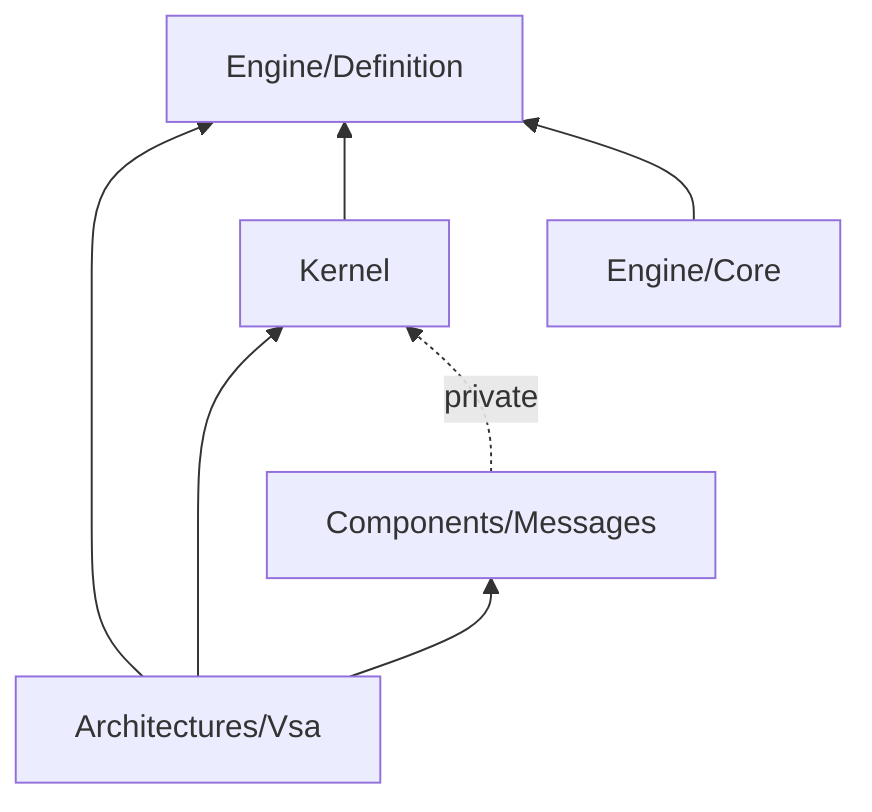

# Framework layout: kernel, components, engine and architectures

The framework has four groups. The kernel and the engine know no layer, so a second architecture can use them with no VSA package. VSA is one architecture pack on top of them.

## Groups

| Group | Folder | Purpose | Who selects it |
|---|---|---|---|
| Kernel | `framework/Kernel/` | What each app needs to start | Nobody: always there |
| Components | `framework/Components/` | Optional blocks, for example `Messages/` | The architecture |
| Engine | `framework/Engine/` | The definition API and the checks | The build hook |
| Architectures | `framework/Architectures/<Name>/` | One full pack: definition, bases, rules | The app: one for each app |



`Engine/Versions` (`VSA.Architecture.Versions`) has no VSA reference. The engine app and the `vsa` tool bundle it for the version check.

The kernel references the definition API (`VSA.Architecture`), because a `Pack` gives the `Architecture` of the app. The definition API is portable and has no ArchUnitNET. The engine core (`Engine/Core`) does not reference the kernel.

## Two kinds of type

| | Definition (data for the engine) | Runtime (logic) |
|---|---|---|
| Generic | `Architecture`, `Concept`, `record Module : Concept` | `App`, `Pack`, `AppHost`, `class Module`, `AppTypes` |
| VSA | `VsaArchitecture`, `record Layer : Concept`, the VSA layers | `Vsa<THost>`, `VsaHost`, `class Plugin : Module`, `WebVsaHost`, `ConsoleVsaHost` |

- The definition names a runtime class only by its `Type`, for example `feature.Add<Module>().OfType<VSA.Kernel.Module>()`. Where two types have the same name, write the full name of the runtime class.
- A definition `Module` is in the folder of its parent: it is the root part of a group instance.
- A runtime `Module` has `Name`, `Order`, `Section` and `Configure(IServiceCollection)`. The kernel finds each one, sorts them by `Order`, then by name, and calls `Configure`. A `Plugin` has `Order` 0, and a `Module` has `Order` 1.

## How the kernel starts an app

```
App.Run(args)                             VSA.Kernel
├─ Pack.CreateHost()                      a new AppHost for each run
└─ AppHost.Create(args, app)
   ├─ CreateBuilder(args)                 open: the generic host, or the web host
   ├─ Compose(services, app)              fixed
   │  ├─ core                             IConfiguration, logging, AppTypes, auto-register
   │  ├─ Install(services, types)         open: VsaHost adds each VSA layer
   │  ├─ Module.Configure                 each module, in Order, then by name
   │  └─ app.ConfigureServices            last
   └─ Build(builder)                      open
```

See `composition.md` for each step.

## Second architecture

`tests/Fixtures/Architecture/LayeredApp` has three concepts, `Ui`, `Logic` and `Data`, and no VSA type. `tests/Architecture.Tests/LayeredAppTests.cs` checks it with the same engine.

## Non-goals

- No package rename yet. Reason: the neutral product prefix comes with the names pass. The packages keep their `VSA.*` names.
- No split of the web host. Reason: its generic part is about 20 lines. Split it when a second architecture needs a web host.

## Open questions

- The neutral prefix for the kernel, the components and the engine, and for the rule IDs (`VSA1xxx`, `VSA2xxx`).
- The place of the `vsa` tool and the viewer: `tools/` as separate apps, and the templates in the VSA pack.
- The engine app as a bootstrap: built on the last released VSA, not on the source.
- The generic part of VSA.Sdk: the folder rules and the version pins, apart from the list of VSA packages.
