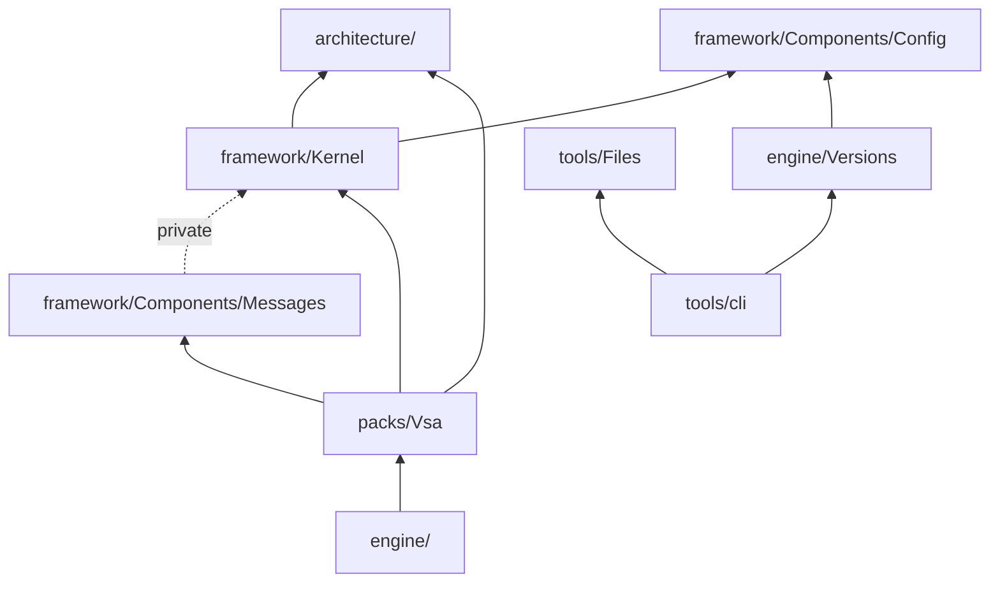

# Repository layout: architecture, framework, packs, engine and tools

Umpire has five groups of code, and each group has one top folder. The definition API references no other C# project (its build gets the polyfill of Umpire.Sdk and the rule values of the kernel analyzers, as each framework project does), and the kernel and the components know no layer, so a second architecture uses them with no VSA package. Apps use VSA. The framework uses layers of projects.

To make a first app and fix a first rule error, see [getting-started.md](getting-started.md).

## Groups

| Group | Folder | Purpose | Who selects it |
|---|---|---|---|
| Architecture | `architecture/` | The definition API and the rule answers | Each pack and the engine |
| Framework | `framework/` | The kernel and the components | Kernel: always; components: the pack |
| Packs | `packs/<Name>/` | One full architecture: definition, bases, rules | The app: one for each app |
| Engine | `engine/` | The rule engine app | No package: `tools/net10.0/` of Umpire.Sdk and Umpire.Sdk.Web |
| Tools | `tools/` | The `umpire` tool, its file writer (`tools/Files/`), the bundle packages (`tools/bundle/`) and Umpire.Sdk | The developer |



## Shipped files

The projects of the groups are for development: their references enforce the layers. They are not packages. The bundle projects in `tools/bundle/` compile the same source files into the shipped DLLs:

| Package | DLL | Source projects |
|---|---|---|
| `Umpire` | `Umpire.dll` (`net10.0`, `netstandard2.1`) | Markers, Architecture, Config, Kernels, Messages, Umpire.Vsa and each VSA layer base |
| `Umpire.Web` | `Umpire.Web.dll` | Umpire.Hosts.Web, Umpire.Vsa.Views |
| `Umpire.Console` | `Umpire.Console.dll` | Umpire.Hosts.Console |
| `Umpire.Testing` | `Umpire.Testing.dll` | Umpire.Vsa.Testing.Unit |

`BundleSourceTests` makes sure that each bundle compiles the same files as its source projects. `_UmpireUseBundle=true` (private) makes Umpire.Sdk reference the bundle projects in source mode. Only the SDK pack sets it: a repository app built with it gives `UMP030001` for each framework block, because the check entries of those blocks are in the runtime DLLs. The SDK package builds its rule engine so, because the engine loads the definition of an app and its `Architecture` type must come from the same `Umpire.dll` as the app. The source build of the engine stays on the runtime projects, so it reads the fixtures of this repository. In one assembly, a `protected internal` member cannot be overridden as `protected`, so the bases of `Architecture` and `Concept` use `protected` members and internal call methods.

## Kinds of block

Each group holds blocks of one or more kinds: app, pack, kernel, component, module and library. The kinds, their entries and the composition guidelines are in `blocks.md`. The terms are in `vocabulary.md`.

## Where a new part goes

This table is a guideline. **Not enforced in 0.1.0.**

| You add | Folder |
|---|---|
| A type of the definition API | `architecture/` |
| A rule question on plain data | `architecture/Queries/` |
| A type that each app needs to start | `framework/Kernel/` |
| A free block for two or more packs | `framework/Components/<Name>/` |
| A new architecture | `packs/<Name>/`: `<Name>Pack.cs`, `Architecture/`, `Kernel/`, `Tests/` |
| A pack variant of an app | `Packs/<Name>/` of the app (`pack-variants.md`) |
| A new fact of a built app | `engine/Plugins/BuiltApp/` |
| A step of the engine run | `engine/Features/<Step>/`: one feature module, one command |
| A tool command | `tools/cli/Commands/`, on a base in `Commands/Bases/` |

## Where the rule answers are

```
engine Rules step (engine/Features/Rules)
├─ BuiltApp plugin: DLL and PDB facts             ArchUnitNET (the only place)
├─ ResolvedArchitecture.Place(facts)              architecture/Queries: PartOf
├─ ResolvedArchitecture.DecisionFor(a, b)         architecture/Queries: ResolvedArchitecture
└─ ResolvedArchitecture.Counts, Matches(bindings) architecture/Queries: CountCheck, MatchCheck

ArchitectureTest<T> (a test of a definition)
├─ reflection: the base types of one type        architecture/Testing: TypeFactsOf
└─ ResolvedArchitecture.Place, DecisionFor        architecture/Queries: PartOf, ResolvedArchitecture
```

`architecture/Queries/` takes plain facts (`TypeFacts`: file, assembly, base types, the type arguments of the base types, uses), so a tool with no DLL reader can ask the same questions. `engine/Versions` (`Umpire.Engine.Versions`) has no pack reference. The engine app and the `umpire` tool bundle it for the version check.

The kernel references the definition API (`Umpire.Architecture`), because a `Pack` gives the `Architecture` of the app. The definition API is portable and has no ArchUnitNET.

## Two kinds of type

| | Definition (data for the engine) | Runtime (logic) |
|---|---|---|
| Generic | `Architecture`, `Concept`, the block kind records (`Umpire.Architecture.Blocks`: `App`, `Pack`, `Kernel`, `Component`, `record Module : Component`, `Library`) | `App`, `Pack`, `AppHost`, `class Module`, `AppTypes` |
| VSA | `VsaArchitecture`, `record Layer : Concept`, the VSA layers, the module kinds `record Feature : Module` and `record Plugin : Module` | `Vsa<THost>`, `VsaKernel`, `class Plugin : Module` |

- The definition names a runtime class only by its `Type`, for example `feature.Add<Module>().OfType<Umpire.Kernels.Module>()`. Where two types have the same name, write the full name of the runtime class.
- A definition `Module` is in the folder of its parent: it is the root part of a group instance.
- A runtime `Module` has `Name`, `Order` and `Configure(IServiceCollection)`. The kernel finds each one, sorts them by `Order`, then by name, and calls `Configure`. A `Plugin` has `Order` 0, and a `Module` has `Order` 1.

## How the kernel starts an app

```
App.Run(args)                             Umpire.Kernels
├─ Start(args)
│  ├─ Pack.CreateHost()                   a new AppHost for each start
│  ├─ AppHost.Build(args, app)            open: plain, console or web
│  │  └─ Compose(services, configuration, Pack.Kernel, types)    fixed
│  │     ├─ Kernel.Install                the core, then Kernel.Configure (VsaKernel: the VSA layers)
│  │     ├─ Module.Configure              each module, in Order, then by name
│  │     └─ AppHost.Configure             open, last
│  └─ AppHost.Start(services, stop)       open: the host work and its stop sources
├─ wait for a stop request
└─ the stop                               OnStop, then AppHost.Dispose
```

See `composition.md` for each step.

## Second architecture

`tests/Fixtures/Architecture/LayeredApp` has three concepts, `Ui`, `Logic` and `Data`, and no VSA type. `tests/Architecture.Tests/LayeredAppTests.cs` checks it with the same engine.

## Non-goals

- No VSA code in a host. Reason: the hosts read only `Operation`, so another architecture can use `WebHost` and `ConsoleHost`.

## Open questions

- The engine app as a bootstrap: built on the last released Umpire, not on the source.
- The place of `Versions` (library or plugin).
- A pack variant in this repository: `packs/<Base>.<Variant>/`, or another folder.
- The checks that only one pack needs: `packs/<Name>/Checks/`.
- The templates of each pack: `tools/cli/Templates/<Pack>/`.
- The group folders (`framework/`, `packs/`, `tools/`): what they are, and if they stay.
- A source folder (`src/`) for all code, so that the repository root holds only a small number of folders.
- The place of `packs/`: at the top of the code folder, or under another folder.
- The place of `architecture/`: each other group uses it, so a top folder can be wrong for it.
