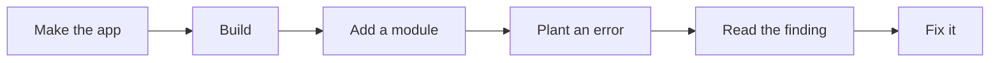

# Getting started

This guide makes a new app, adds a module and a request, and builds it. Then it plants one rule error, reads the finding of the rule engine, and fixes it. Each step has one command or one file edit, and the output that you get.



Umpire checks the architecture of an app after each build. The rule engine reads the build output and compares each use of a type with the definition. The definition of a new app is the VSA pack: Vertical Slice Architecture, with one folder for each module and for each slice.

## Before you start

| Need | Check |
|---|---|
| .NET 10 SDK | `dotnet --version` gives `10.0.x` |
| GitHub CLI | `gh --version` |
| Token for the feed | `gh auth refresh -s read:packages`, then set `GITHUB_TOKEN` to `gh auth token` |

The Umpire packages are on GitHub Packages. GitHub Packages needs the token also for public packages. If `GITHUB_TOKEN` is not set, the restore fails with 401. See [consumers.md](consumers.md) ("Feed access").

## Make the app

1. Add the Umpire feed to your user NuGet config, so `dotnet` can get the tool:

   ```bash
   dotnet nuget add source https://nuget.pkg.github.com/MgCohen/index.json -n umpire -u umpire -p "$GITHUB_TOKEN" --store-password-in-clear-text
   ```

2. Make the app `Hello`. Replace `<version>` with the latest version of `Umpire.Cli` on the [feed page](https://github.com/MgCohen/vsa-template/pkgs/nuget/Umpire.Cli):

   ```bash
   dotnet tool exec Umpire.Cli@<version> -y -- new app Hello
   ```

3. Go to the app folder:

   ```bash
   cd Hello
   ```

Each version before 0.1.0 is a preview, so the command names the version. The tool writes each file, then runs `dotnet tool restore`. It ends with this text:

```text
Next:
  cd Hello
  dotnet umpire add module <Name>
```

To add Umpire to an existing app, run `init` in the folder of its root project: `dotnet tool exec Umpire.Cli@<version> -y -- init`. It adds only the missing setup, and a second run changes nothing. It does not write the app class. Without an app class, the rule engine gives `UMP030302`. For a console app `Shop`, write these two files:

```csharp
// App/Host/ShopApp.cs
namespace Shop.App.Host;

using Umpire.Kernel;
using Umpire.Vsa;
using Umpire.Vsa.Composition;

public class ShopApp : App<Vsa<ConsoleVsaHost>>;
```

```csharp
// App/Host/Program.cs
return new Shop.App.Host.ShopApp().Run(args);
```

The setup steps are in [scaffolding.md](scaffolding.md) ("Setup pipeline").

## What the app has

```text
Hello/
├─ Hello.csproj            the one root project: it compiles each file in its folder tree
├─ Hello.slnx              the root project and Tests/
├─ appsettings.json        the settings of the web host
├─ Properties/             launchSettings.json: the start settings
├─ App/Host/               Program.cs and HelloApp.cs: the app class, the host and the definition
├─ App/Views/              the Blazor views
├─ Features/  Plugins/     the feature modules and the plugin modules (empty)
├─ Tests/                  App.Tests.csproj: the unit tests and HelloArchitectureTests.cs
├─ AGENTS.md               the instructions for an agent in this app
├─ global.json             the Umpire.Sdk version and the test runner
├─ nuget.config            the Umpire feed, with the token in GITHUB_TOKEN
├─ dotnet-tools.json       the umpire tool
├─ Directory.Build.props   all build output in artifacts~/
└─ .gitignore              the build folders and the local files
```

The root project gets its packages from two places:

| Package | From | Contains |
|---|---|---|
| `Umpire.Kernel`, `Umpire.Markers` | Umpire.Sdk | The app start, the markers |
| `Umpire.Vsa` | Umpire.Sdk, by `UmpirePack` (default `Vsa`) | The VSA pack and the base of each layer |
| `Umpire.Vsa.Analyzers` | Umpire.Sdk, by `UmpirePack` | The VSA and kernel analyzers, and their rule values |
| `Umpire.Vsa.Hosts.Web`, `Umpire.Vsa.Views` | `Hello.csproj` | The web host and the views |
| `Umpire.Engine.Build` | `Hello.csproj` | The architecture check after each build |

Each Umpire package has the version of Umpire.Sdk. The rule engine checks it on each build (`UMP030201`), and `dotnet umpire doctor` does the same check.

## Build the app

In the app folder, build the solution:

```bash
dotnet build Hello.slnx
```

The build runs the rule engine after the compile of the root project `Hello.csproj`. The engine writes one summary line:

```text
  umpire-engine: 0 errors, 0 warnings, 15591 ms.
```

The first build can take some minutes. The next builds take a few seconds.

The build can also show .NET warnings, for example `IDE0005` (an unused `using`) or `CA1812` (a class that the code does not make). The compiler gives them, not the rule engine. They do not fail the build.

## Add a module and a request

1. Add the module `Billing`:

   ```bash
   dotnet umpire add module Billing
   ```

2. Add the request `CreateInvoice` to the module:

   ```bash
   dotnet umpire add request CreateInvoice -m Billing
   ```

3. Build again. The engine gives `0 errors`.

The module `Billing` has these files:

```text
Features/Billing/
├─ BillingModule.cs                   module root: registers the services of the module
├─ Domain/Shared/BillingKey.cs        published domain: other modules read it
├─ Presenters/BillingPresenter.cs
└─ Slices/
   ├─ GetStatus/                      a status request: request, response, handler
   └─ CreateInvoice/                  CreateInvoiceRequest.cs, CreateInvoiceResponse.cs, CreateInvoiceHandler.cs
App/Views/Pages/BillingPage.razor     the page of the module, at /billing
Tests/BillingStatusTests.cs           a unit test of the status request
```

Each slice is one folder with its request, its response and its handler. A slice uses only its own types and `Slices/Shared/`. The tool writes only new files: it never writes over a file.

## Plant and fix a rule error

### Plant the error

Make the handler of `CreateInvoice` use the response of the slice `GetStatus`. Replace the content of `Features/Billing/Slices/CreateInvoice/CreateInvoiceHandler.cs`:

```csharp
namespace Hello.Features.Billing.Slices.CreateInvoice;

using Hello.Features.Billing.Slices.GetStatus;
using Umpire.Messages.Contracts;
using Umpire.Vsa.Handlers.Requests;

sealed class CreateInvoiceHandler : RequestHandler<CreateInvoiceRequest, CreateInvoiceResponse> {
    public override Task<Result<CreateInvoiceResponse>> HandleAsync(Envelope<CreateInvoiceRequest> envelope) {
        var status = new GetStatusResponse("Billing", "Open");
        return Task.FromResult<Result<CreateInvoiceResponse>>(new CreateInvoiceResponse());
    }
}
```

Build again. The compile passes, but the build fails with one error of the rule engine:

```text
C:\src\Hello\Features\Billing\Slices\CreateInvoice\CreateInvoiceHandler.cs(8,1): error UMP020101: CreateInvoiceHandler in Handlers.Requests (Features/Billing/Slices/CreateInvoice) uses GetStatusResponse in Contracts.Requests (Features/Billing/Slices/GetStatus): no rule allows it (DefaultPermission = Deny). Remove the use, or change the rule in Rules. [C:\src\Hello\Hello.csproj]
  umpire-engine: 1 errors, 0 warnings, 3583 ms.
```

### Read the finding

| Part | Value | Meaning |
|---|---|---|
| Place | `CreateInvoiceHandler.cs(8,1)` | The file, and the member with the use |
| Code | `UMP020101` | A type uses a part that the rules deny |
| From | `CreateInvoiceHandler in Handlers.Requests` | The type, and the part of its folder |
| From instance | `(Features/Billing/Slices/CreateInvoice)` | The folder of that part |
| To | `GetStatusResponse in Contracts.Requests` | The used type, and its part |
| To instance | `(Features/Billing/Slices/GetStatus)` | A different slice |
| Rule | `no rule allows it (DefaultPermission = Deny)` | A use is denied when no rule allows it |
| Fix | `Remove the use, or change the rule in Rules.` | The two ways to fix it |

The folders select the parts. Two slices are two instances of the group `Slice`, and the VSA rules let a slice use only its own types and `Slices/Shared/`. The codes of all checks are in [architecture-engine.md](architecture-engine.md) ("The checks of the Rules step").

### Fix the error

Select one fix:

| Fix | When |
|---|---|
| Remove the use | The slice does not need the type |
| Move the type to `Slices/Shared/` | Two or more slices need the type |
| Change the rule in `Rules` | The architecture of the app allows the use |

To remove the use:

1. In `CreateInvoiceHandler.cs`, delete the line `var status = ...` and the `using` of `GetStatus`.
2. Build again. The engine gives `0 errors`.

To share the type, move `GetStatusResponse.cs` to `Features/Billing/Slices/Shared/`. The engine then binds it to the part `Slice.Shared`, and each slice of `Billing` can use it. To change a rule, see [architecture-rules.md](architecture-rules.md).

## Next

Build switches of the check:

| Switch | Effect |
|---|---|
| `-p:UmpireCheck=false` | No check in this build |
| `-p:UmpireCheckMode=Warn` | Each error of the check is a warning |
| `-p:UmpireUpdateBaseline=true` | Writes the errors to `umpire-baseline.txt`, and the next builds accept them |

The analyzers check one file in the compile, for example the line length (`UMP010101`). Each analyzer package ships the values of its rules in its globalconfig file. To change a value, write it in the `.editorconfig` of the app:

```ini
[*.cs]
umpire.UMP010101.max = 140
dotnet_diagnostic.UMP010101.severity = none
```

| To learn | Read |
|---|---|
| The folders of a module and a slice | [slice-layout.md](slice-layout.md) |
| Each rule and its code | [architecture-rules.md](architecture-rules.md) |
| The rule engine, and tests of a definition | [architecture-engine.md](architecture-engine.md) |
| Rules of your own app | [pack-variants.md](pack-variants.md) |
| The kinds of block | [blocks.md](blocks.md) |
| A Unity app | [unity.md](unity.md) |
