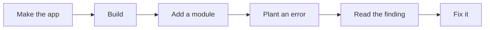

# Getting started

This guide makes a new app, adds a module and a request, and builds it. Then it plants one rule error, reads the finding of the rule engine, and fixes it. Each step has one command or one file edit, and the output that you get.



Umpire checks the architecture of an app after each build. The rule engine reads the build output and compares each use of a type with the definition. The definition of a new app is the VSA pack: Vertical Slice Architecture, with one folder for each module and for each slice.

## Before you start

| Need | Check |
|---|---|
| .NET 10 SDK | `dotnet --version` gives `10.0.x` |
| GitHub CLI | `gh --version` |
| Token for the feed | `gh auth refresh -s read:packages`, then set `GITHUB_TOKEN` to `gh auth token` |

<!-- W25: the feed source setup (umpire init), then section "Make the app". -->

## Build the app

In the app folder, build the solution:

```bash
dotnet build Hello.slnx
```

The build runs the rule engine after the compile of the root project `Hello.csproj`. The engine writes one summary line:

```text
  umpire-engine: 0 errors, 0 warnings, 98447 ms.
```

The first build can take some minutes. The next builds take a few seconds.

## Add a module and a request

1. Add the module `Billing`:

   ```bash
   dotnet umpire add module Billing
   ```

2. Add the request `CreateInvoice` to the module:

   ```bash
   dotnet umpire add request CreateInvoice -m Billing
   ```

3. Build again. The engine gives `0 errors`.

The module `Billing` has these files:

```text
Features/Billing/
├─ BillingModule.cs                   module root: registers the services of the module
├─ Domain/Shared/BillingKey.cs        published domain: other modules read it
├─ Presenters/BillingPresenter.cs
└─ Slices/
   ├─ GetStatus/                      a status request: request, response, handler
   └─ CreateInvoice/                  CreateInvoiceRequest.cs, CreateInvoiceResponse.cs, CreateInvoiceHandler.cs
App/Views/Pages/BillingPage.razor     the page of the module, at /billing
Tests/BillingStatusTests.cs           a unit test of the status request
```

Each slice is one folder with its request, its response and its handler. A slice uses only its own types and `Slices/Shared/`. The tool writes only new files: it never writes over a file.

## Plant a rule error

Make the handler of `CreateInvoice` use the response of the slice `GetStatus`. Replace the content of `Features/Billing/Slices/CreateInvoice/CreateInvoiceHandler.cs`:

```csharp
namespace Hello.Features.Billing.Slices.CreateInvoice;

using Hello.Features.Billing.Slices.GetStatus;
using Umpire.Messages.Contracts;
using Umpire.Vsa.Handlers.Requests;

sealed class CreateInvoiceHandler : RequestHandler<CreateInvoiceRequest, CreateInvoiceResponse> {
    public override Task<Result<CreateInvoiceResponse>> HandleAsync(Envelope<CreateInvoiceRequest> envelope) {
        var status = new GetStatusResponse("Billing", "Open");
        return Task.FromResult<Result<CreateInvoiceResponse>>(new CreateInvoiceResponse());
    }
}
```

Build again. The compile passes, but the build fails with one error of the rule engine:

```text
C:/src/Hello/Features/Billing/Slices/CreateInvoice/CreateInvoiceHandler.cs(8,1): error UMP020101: CreateInvoiceHandler in Handlers.Requests (Features/Billing/Slices/CreateInvoice) uses GetStatusResponse in Contracts.Requests (Features/Billing/Slices/GetStatus): no rule allows it (DefaultPermission = Deny). Remove the use, or change the rule in Rules.
  umpire-engine: 1 errors, 0 warnings, 3583 ms.
```

## Read the finding

| Part | Value | Meaning |
|---|---|---|
| Place | `CreateInvoiceHandler.cs(8,1)` | The file and the line of the type |
| Code | `UMP020101` | A type uses a part that the rules deny |
| From | `CreateInvoiceHandler in Handlers.Requests` | The type, and the part of its folder |
| From instance | `(Features/Billing/Slices/CreateInvoice)` | The folder of that part |
| To | `GetStatusResponse in Contracts.Requests` | The used type, and its part |
| To instance | `(Features/Billing/Slices/GetStatus)` | A different slice |
| Rule | `no rule allows it (DefaultPermission = Deny)` | A use is denied when no rule allows it |
| Fix | `Remove the use, or change the rule in Rules.` | The two ways to fix it |

The folders select the parts. Two slices are two instances of the group `Slice`, and the VSA rules let a slice use only its own types and `Slices/Shared/`. The codes of all checks are in [architecture-engine.md](architecture-engine.md) ("The checks of the Rules step").

## Fix the error

Select one fix:

| Fix | When |
|---|---|
| Remove the use | The slice does not need the type |
| Move the type to `Slices/Shared/` | Two or more slices need the type |
| Change the rule in `Rules` | The architecture of the app allows the use |

To remove the use:

1. In `CreateInvoiceHandler.cs`, delete the line `var status = ...` and the `using` of `GetStatus`.
2. Build again. The engine gives `0 errors`.

To share the type, move `GetStatusResponse.cs` to `Features/Billing/Slices/Shared/`. The engine then binds it to the part `Slice.Shared`, and each slice of `Billing` can use it. To change a rule, see [architecture-rules.md](architecture-rules.md).

<!-- W24: section "Next", with the switches and the place of the analyzer values. -->
