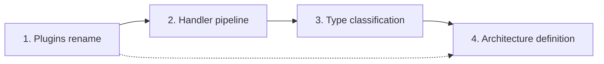

# Proposals: the next shape of VSA

Four proposals change how VSA dispatches messages, names its base modules, defines its architecture and classifies types. The handler pipeline has the highest value, because Card-Framework builds its own pipeline (`Assets/Pipeline/`) next to the VSA handlers. Each proposal is a design for review: no code exists for it.

## Order of the work

| # | Proposal | Size | Breaks consumers |
|---|---|---|---|
| 1 | [Rename Shared modules to Plugins](plugins.md) | Small: 69 files, mostly text | Yes: folder and property names |
| 2 | [Handler pipeline](../handler-pipeline.md) (done) | Medium: one project, four dispatchers | Yes: handler signatures, `Result<T>` from each send |
| 3 | [Type classification](type-classification.md) | Small: one rule, one tool command | No |
| 4 | [Architecture definition](architecture-definition.md) | Large: Sdk, router, tests, composer | No, if the VSA definition gives the same result |

- Do the rename first. It is cheap while two consumers exist, and the pipeline steps of Card-Framework then go into a plugin module.
- Do the classification before the architecture definition. The definition must say how each type gets its layer.

## Open questions

- Do the proposals go into one release (`v0.x` with breaking changes), or into one release each?
