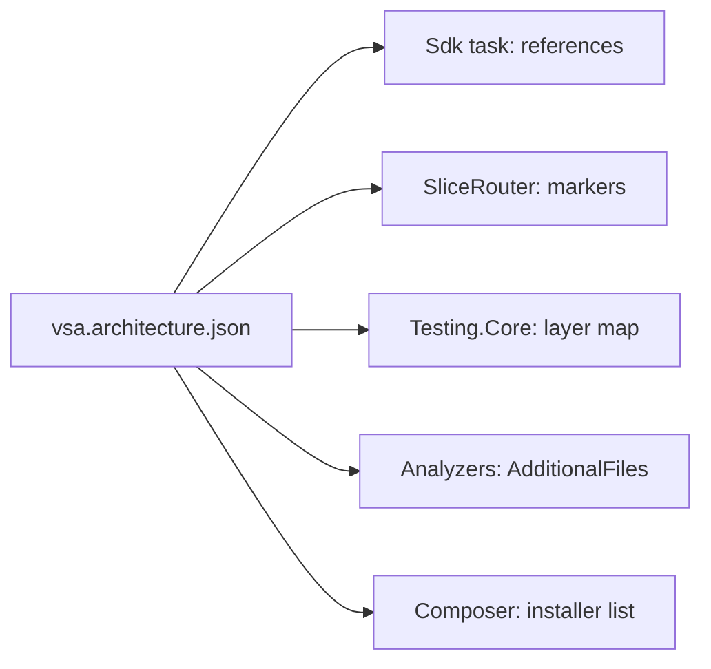

# Proposal: the architecture definition

[Index](README.md)

> Status: the architecture tests now use the engine in [architecture-engine.md](../architecture-engine.md). `Layers.cs`, `VSA.Testing.Core` and `SdkLayerMapTests` are removed. A copy is in `docs/legacy/architecture-tests/`.

The VSA layers, root folders, markers and installers go into one architecture definition. A generic engine reads the definition: the Sdk, the router, the architecture tests and the composer. VSA is then the first definition, and another app can give a different architecture with the same engine.

## The problem: the definition is in six places

| Place | Holds | Language |
|---|---|---|
| `framework/Testing/Core/Layers.cs` | The layer map | C# |
| `framework/Sdk/Sdk/VSA.Layers.targets` | The same map as references, the root folders | MSBuild |
| `framework/Sdk/Tasks/SliceRouter.cs` | The marker names and their layers | C# (no semantic model) |
| `VsaComposer.InstallLayers` | The list of installers | C# |
| `framework/Analyzers/` | Marker names in the module rules | C# |
| `framework/Tooling/Cli/Templates/` | Folder and project names | Template files |

`SdkLayerMapTests` keeps the first two the same. A layer change touches all six places.

## The design



One data file in the VSA.Sdk package gives the definition. An app can replace it with `VsaArchitecture` in `Directory.Build.props`.

```json
{
  "rootFolders": { "Modules": "module", "Plugins": "plugin" },
  "layers": {
    "Contracts.Commands": {
      "source": { "marker": "ICommand`1" },
      "references": [ { "layer": "Domain.Shared", "edge": "moduleOnly", "anyModule": true } ]
    },
    "Domain": {
      "source": { "folder": "Domain/**", "exclude": "Domain/Shared/**" },
      "references": [ { "layer": "Domain.Shared", "edge": "moduleOnly" } ]
    }
  },
  "installers": [ "VSA.Handlers.Events.EventHandlerInstaller", "VSA.Handlers.Commands.CommandHandlerInstaller" ]
}
```

| Package | Part |
|---|---|
| `VSA.Sdk` | Engine: project build, references from the definition, router |
| `VSA.Testing.Core` | Engine: the layer map loads the definition |
| `VSA.Composition` | Engine: the composer runs the installers of the definition |
| `VSA.Layers.targets`, `Layers.cs` | VSA definition: `vsa.architecture.json` |

## Steps of the work

1. Write the definition file. Make `Layers.cs` load it, and make `SdkLayerMapTests` compare the targets with it.
2. Make an Sdk task write the references from the definition. Delete the references that `VSA.Layers.targets` writes by hand.
3. Make `SliceRouter` read the markers and the folders from the definition.
4. Make the composer read the installer list. A plugin module can then add an installer.
5. Give the analyzers the file as `AdditionalFiles`, and read the marker names from it.

Each step keeps the build result the same. `tests/Consumer.Tests` and `BuildRuleTests` show that the result does not change.

## Non-goals

- No second architecture in this repository. Reason: the engine needs one real definition before a second one.
- No definition in C#. Reason: MSBuild cannot run C# before the compile, so the Sdk could not read it.

## Open questions

- Do the engine and the definition get different package names, for example `Arch.Sdk` and `VSA.Sdk`?
- Do the analyzer rules go into the definition, or stay in VSA.Analyzers with the marker names as options?
