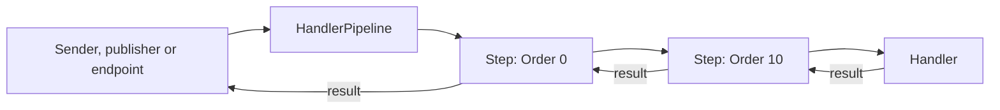

# Proposal: the handler pipeline

[Index](README.md)

Each dispatch of a message (request, command or event) runs through one pipeline of steps, then the handler. A step is a class in a module or a plugin module, and it applies to a message type and to each type that derives from it. With this pipeline, Card-Framework replaces `Pipeline<TMessage, TScope, TView>` with steps on the VSA handlers.

## The problem

VSA has three dispatchers, and none has an extension point before or after the handler:

| Message | Dispatcher | Extension point |
|---|---|---|
| Command | `InProcessCommandSender` | None |
| Event | `InProcessEventPublisher` | `IIntegrationEventObserver`, after all handlers |
| Request | `RoutedHandler.HandleAsync` (FastEndpoints) | FastEndpoints pre and post processors: not on Unity, not for commands |

Card-Framework needs validation, a scope for each run, code before and after the handler, a state for each message and a parent id for a message that a handler sends. So it has its own pipeline, router and handler bases (`Framework.Pipeline`, `Framework.TypeRouting`).

## The design



A step is a base class with the message base as its type argument. It calls `next` to run the rest of the chain, or it returns without `next` to stop the message.

```csharp
public abstract class HandlerStep<TMessage> where TMessage : class {
    public virtual int Order => 0;

    public abstract Task<TResult> RunAsync<TResult>(TMessage message, HandlerContext context, Func<Task<TResult>> next);
}

public sealed class HandlerContext {
    public Guid MessageId { get; }
    public Guid? ParentId { get; }
    public MessageKind Kind { get; }
    public IVsaResolver Services { get; }
    public IDictionary<string, object?> Items { get; }
    public CancellationToken Cancellation { get; }
    public HandlerOutcome Outcome { get; }
    public void Reject(Error error) { }
}
```

| Part | Rule |
|---|---|
| Project | `VSA.Handlers` (`framework/Core/Handlers/Core/`), a Unity layer |
| Installer | `HandlerStepInstaller` finds each `HandlerStep<>` with `context.Implementations` |
| Match | A step runs if its `TMessage` is assignable from the message type |
| Order | `Order`, then the full type name. The chain of each message type is cached |
| Parent id | An `AsyncLocal<Guid?>`: a message sent in a handler gets the id of that run |
| Outcome | `Accepted`, `Rejected` or `Faulted`, set by the pipeline |

A generic method on `TResult` lets one step apply to a command with any result, to an event and to a request.

## Example: a step of Card-Framework

A plugin module `Plugins/Game/` gives the base `GameStep<TResult> : ICommand<TResult>` and the steps. Each card slice derives from the base and gets the steps with no code.

```csharp
public sealed class ValidateGameStep(GameView view) : HandlerStep<IGameStep> {
    public override int Order => -100;

    public override async Task<TResult> RunAsync<TResult>(IGameStep message, HandlerContext context, Func<Task<TResult>> next) {
        if (message.Validate(view) is { } error) {
            context.Reject(error);
            return default!;
        }
        return await next();
    }
}
```

| `Pipeline<,,>` part | VSA form |
|---|---|
| `Validate`, `Validator<,,>` | A step with a low `Order` that calls `context.Reject` |
| `CreateScope`, `PipelineScope.Close` | A step that opens the scope before `next` and closes it in `finally` |
| `Before`, `After` | Code before and after `next` |
| `Handle`, `Handler<,,>` | `CommandHandler<TCommand, TResult>` |
| `Envelope.State` | `HandlerContext.Outcome` |
| `RunInline` and `ParentId` | `ICommandSender.SendAsync` in a handler; `HandlerContext.ParentId` |
| `Add`, `TryTake`, `SelectNext` | App code: a queue that calls `ICommandSender` |

The queue stays in the app. The order of the messages in a game is a rule of the game, not of the framework.

## Steps of the work

1. Add `VSA.Handlers` with `HandlerStep<>`, `HandlerContext` and `HandlerPipeline`.
2. Run the pipeline in `InProcessCommandSender` and `InProcessEventPublisher`.
3. Run the pipeline in `RoutedHandler.HandleAsync`, around `HandleRequestAsync`.
4. Add the router rule: a `HandlerStep<>` in a module goes to the handlers project of its message kind.
5. Add tests in `tests/Composition.Tests/` and a step to the sample.
6. Replace `Framework.Pipeline` in Card-Framework with steps in a plugin module.

## Non-goals

- No message queue in the framework. Reason: the order of the messages is a rule of the app.
- No MediatR. Reason: VSA has its own container adapter (`IVsaServices`) and must run on `netstandard2.1` with the 8.0 packages.

## Open questions

- Rejection of a command: a command result is any type. Does `context.Reject` throw `MessageRejectedException`, or must a command result be `Result<T>`?
- Event steps: does a step run one time for each event, or one time for each handler of the event?
- Does `IIntegrationEventObserver` become an event step, so the presenters use the same pipeline?
