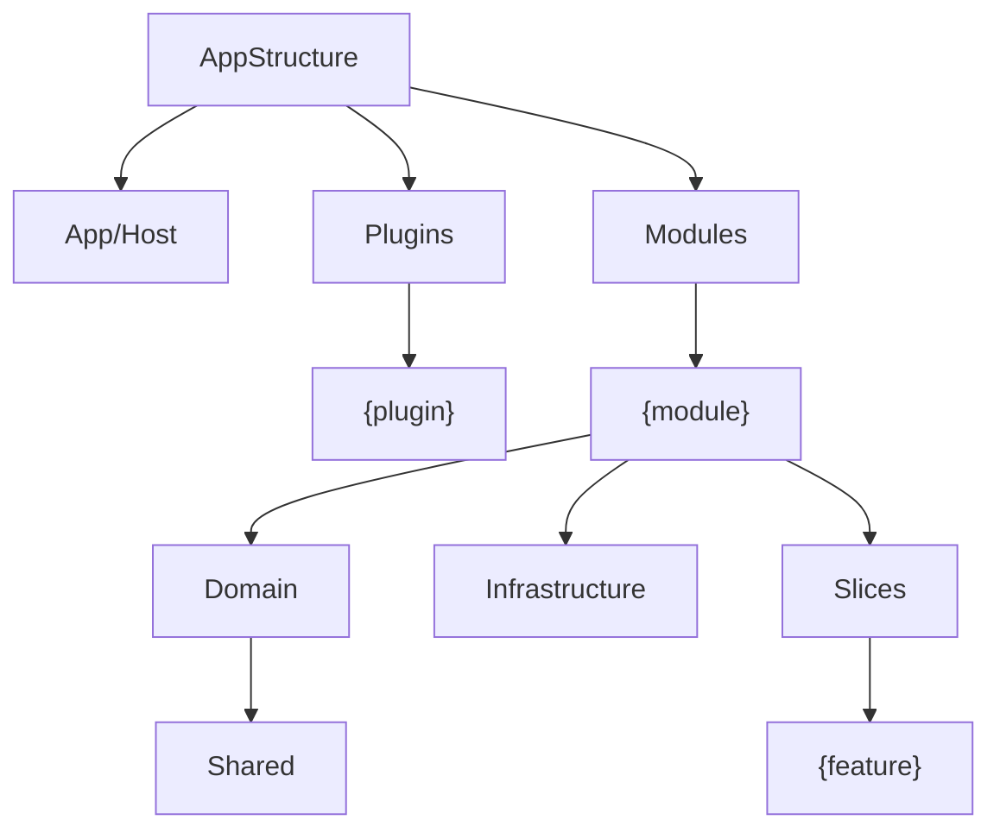

# Proposal: the structure API

[Index](../README.md)

An app defines its architecture as one tree of `Part` objects. A generic test base reads the tree and runs the same default tests for each app. The tests use native ArchUnitNET, and a small PDB reader gives the source folder of each type.

This folder is a working spike. It builds on its own and does not change the framework.

## The tree of the VSA definition



Each node is one folder level. A `{name}` node is an `Each` level: each subfolder is one item, for example one module.

## The definition

From [VsaStructure.cs](Structure/VsaStructure.cs):

```csharp
Module       = Add(new Part("Modules")).Each("module");
ModuleRoot   = Module.Add(new Part(typeof(Module))).Exactly(1);
Domain       = Module.Add(new Part("Domain"));
DomainShared = Domain.Add(new Part("Shared"));
Feature      = Module.Add(new Part("Slices")).Each("feature");
Requests     = Feature.Add(new Part(typeof(IRequest<>)));
Handlers     = Feature.Add(new Part(typeof(RequestHandler<,>))).Exactly(1);

Domain.MayUse(DomainShared);
Module.ExposeOnly(DomainShared, Requests, Responses);
Feature.ExposeOnly();
```

- A folder is written one time, relative to its parent part.
- A part with a base type has no folder. It contains the types of that kind under its parent.
- A part with `MayUse` is a layer. Each type must be in one layer.

## What a part gives

| Call | Result | Native type |
|---|---|---|
| `Domain` | All Domain types, with Shared | `IObjectProvider<IType>` |
| `Domain.Own` | Domain types, without child layers | `IObjectProvider<IType>` |
| `Domain.In("Billing")` | Domain types of one module | `IObjectProvider<IType>` |
| `Domain.Slices` | One slice for each module | `SliceAssignment` |
| `Handlers.By(Feature)` | One slice for each feature | `SliceAssignment` |

A part is the definition. The native `Slice` is only the result of a `SliceAssignment`.

## The default tests

`StructureTests<TStructure>` runs these tests for each app. Each test gets its cases from the definition.

| Test | Cases from | Native base |
|---|---|---|
| Each type is in a layer | all types | `FollowCustomCondition` |
| Each layer uses only its allowed parts | `MayUse` | `FollowCustomCondition` |
| Items have no cycles | `Each` levels | `BeFreeOfCycles` |
| Items use each other only through exposed parts | `ExposeOnly` | `SetEvaluationFunction` |
| Exact count in each item | `Exactly` | `SetEvaluationFunction` |
| Namespace matches folder | all types | `FollowCustomCondition` |

An app adds its own tests with the native API and the parts:

```csharp
public class GoodAppTests() : StructureTests<VsaStructure>(App.Dll("GoodApp"))
{
    [Test]
    public void X01_handlers_do_not_use_the_host() =>
        Types().That().Are(Def.Handlers).Should().NotDependOnAny(Def.Host).Check(Arch);
}
```

## The spike

| Folder | Contains |
|---|---|
| `Structure/` | `Part`, `AppStructure`, the PDB reader, the test base, the VSA definition |
| `GoodApp/` | A VSA app with no errors: Billing, Notes, Audit plugin |
| `BadApp/` | The same app with 7 planted errors |
| `Tests/` | The test classes of the two apps |

The apps and the VSA definition use the real framework projects of this repository (`framework/Core/`). Each app has the layout of `samples/Notes`: a `Program.cs` with `VsaBuilder`, a module root that registers its repository, and one file for each request, response and handler.

Run the tests of GoodApp (all pass):

```bash
dotnet test --project Tests
```

Run the tests of BadApp (7 fail, one for each planted error):

```bash
dotnet test --project Tests --filter "FullyQualifiedName~BadAppTests"
```

Output of one BadApp failure:

```
"Types that are in Modules/{module}/Domain (own) should use only Modules/{module}/Domain/Shared, Modules/{module}/Domain" failed:
	BadApp.Modules.Billing.Domain.Invoice uses BadApp.Modules.Billing.Infrastructure.InvoiceStore (Modules/{module}/Infrastructure). Modules/{module}/Domain may use only: Modules/{module}/Domain/Shared.
```

## Open questions

- Typed parts: `class Domain : Part`, then `App.Part<Domain>().MayUse<Infrastructure>()` and `Arch.Set<Domain>(...)`, with no fields.
- Layer paths in the messages show `{module}`. Show the real item, for example `Modules/Billing/Domain`?
- Uses of types outside the app (the framework, `System`) are not checked. How does a layer allow "the same layer of the framework"?
- The layer map is simplified. For example, Infrastructure can use the Domain.Shared of another module. Add a "same item only" option to `MayUse`?
- ArchUnitNET does not load the top-level `Program` class, so no rule checks `App/Host`. Is a check of the host necessary?
- Each app is one project. With one project for each module, the PDB reader must give the folder relative to the app root (`global.json`), not to the project.
- A plugin and a module have different layouts, so a layer such as `Handlers` is a different part in each tree. Is one part across both trees necessary?
