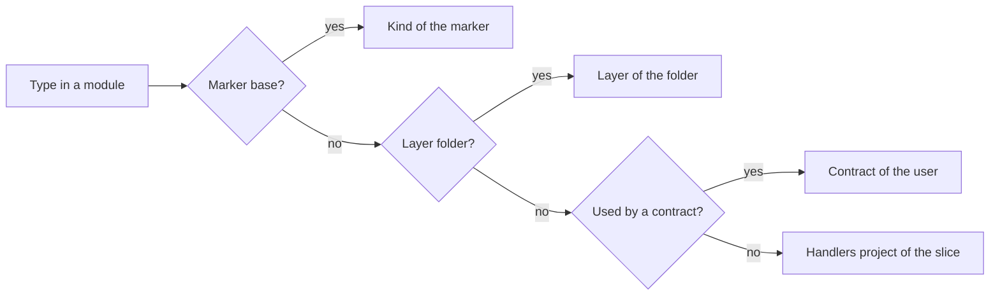

# Proposal: classify each type, without a marker on each type

[Index](README.md)

Each type of a module keeps one classification from one source, and a tool shows the source. A marker (a base class or an interface) stays only on the types that the framework dispatches on. A mandatory marker on each type is not possible: an enum cannot implement an interface or derive from a class.

## The current sources of a classification

| Source | Types | Example |
|---|---|---|
| Marker base | Requests, responses, commands, events, handlers | `CreateNoteRequest : IRequest<CreateNoteResponse>` |
| Folder | Domain, published domain, infrastructure, presenters | `Domain/Note.cs` |
| Use | DTOs and command results | `NoteDto`, used by `ListNotesResponse` |
| Module root | The module class and its settings | `NotesModule : Module<NotesSettings>` |

Each type gets its project from one of these sources (`docs/slice-layout.md`). `VSA0005` reports a slice type with two classifications, for example a DTO that a response and an event use. The result is correct, but it is not visible: a reader cannot see why `NoteDto` is in `Contracts.Requests`.

## Options

| Option | For | Against |
|---|---|---|
| A. A marker on each type | One rule for all; reflection finds each type | Not possible for enums and delegates; markers that no code reads |
| B. An optional attribute `[VsaKind(...)]` | Works on enums; overrides the router | Two ways to say one fact |
| C. Keep the sources, show the result (recommended) | No new code in modules; `VSA0005` checks it | The router logic stays in three sources |

## The design (option C)

1. Write the rule in `docs/architecture-rules.md`: "A marker exists only on a type that framework code dispatches on."
2. Add `dotnet vsa explain <Type>`: it shows the source and the project of a type.
3. Put the flow above in one function that the router and `dotnet vsa explain` use. The architecture definition then gives its inputs.

## Non-goals

- No mandatory marker on domain types. Reason: no framework code reads it, and the folder already gives the layer.

## Open questions

- Does a command result get a marker `IResult`, as a response has `IResponse`? Then the compiler checks it, as for `IResponse`.
