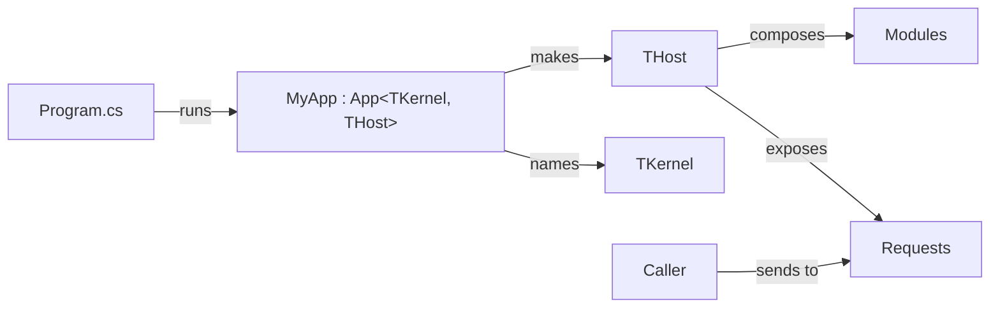

# Public API: the call sites

This document is the base shape of the Umpire API, as a user of Umpire sees it from outside. Each section gives the call site of one interaction point, in the shortest correct form. Before you add or change a public API, compare it with these shapes and with the rules in "Rules for a new API".

The code snippets come from `tests/Fixtures/Notes`, the templates in `tools/cli/Templates/` and the framework source. If a snippet and the code are different, the code is correct: fix the snippet in the same change.

## Interaction points

| Who | Wants to | Section |
|---|---|---|
| App author | Make an app | [Make an app](#make-an-app) |
| App author | Add a module | [Add a module](#add-a-module) |
| Module author | Add a request, command or event | [Add a slice](#add-a-slice) |
| Caller outside the app | Send a request | [Send a request](#send-a-request) |
| Library or shell | Embed an app | [Embed an app](#embed-an-app) |
| App author | Add root services | [Make a custom host](#make-a-custom-host) |
| App author | Add app rules | [Add app rules](#add-app-rules) |
| Test author | Test a slice or a definition | [Write a test](#write-a-test) |



## Make an app

An app is one class with two type arguments: the kernel (the pack) and the host (the platform).

```csharp
// App/NotesApp.cs
public class NotesApp : App<VsaKernel, WebHost>;

// App/Program.cs
return new NotesApp().Run(args);
```

```xml
<Project Sdk="Microsoft.NET.Sdk.Web">
  <ItemGroup>
    <PackageReference Include="Umpire.Web" Version="..." />
    <PackageReference Include="Umpire.Engine" Version="..." PrivateAssets="all" />
  </ItemGroup>
</Project>
```

- The app class has the lifecycle only: `Start`, `Run`, `Stop`, `OnStart`, `OnStop`, `State`.
- `Program.cs` has one line. The host finds the modules and the views.
- Code inside the app stops it with `AppStop.Request(exitCode)`.

| Host | Package | Exposes a request as |
|---|---|---|
| `WebHost` | `Umpire.Web` | `/api/{group}/{name}` |
| `ConsoleHost` | `Umpire.Console` | `{group} {name} --Key Value` |
| `LocalHost` | `Umpire` | `app.Send(request)` |

## Add a module

A module is a folder with one module class at its top. The folder is `App/Features/<Name>/` (a feature module) or `App/Plugins/<Name>/` (a plugin module).

```csharp
public sealed class PingModule : Module;

public sealed class NotebookModule : Module {
    protected override void Configure(IServiceCollection services) {
        services.AddSingleton<NoteStore>();
        services.AddScoped<IRepository<Note, NoteId>, NoteRepository>();
    }
}

public sealed class SettledModule : Module<SettledSettings> {
    protected override void Configure(IServiceCollection services, SettledSettings settings) =>
        services.AddSingleton(_ => new Part(settings.Name));
}
```

- A module registers services on `IServiceCollection`. Umpire has no container interface.
- The settings come from the table `[<ModuleName>]` in `.umpireconfig`.
- A plugin module class inherits `Plugin` or `Plugin<TSettings>`.

## Add a slice

A slice is one folder `Slices/<Slice>/` with one message, its response and one handler.

```csharp
public sealed record CreateNoteRequest(Guid AuthorId, string Title) : IRequest<CreateNoteResponse>;
public sealed record CreateNoteResponse(Guid Id) : IResponse;
public sealed record NoteCreated(Guid NoteId, Guid AuthorId, string Title) : IntegrationEvent;

sealed class CreateNoteHandler(IRepository<Note, NoteId> notes, IIntegrationEventPublisher events)
    : RequestHandler<CreateNoteRequest, CreateNoteResponse> {
    public override async Task<Result<CreateNoteResponse>> HandleAsync(IEnvelope<CreateNoteRequest> envelope) {
        // ...
        await events.PublishAsync(new NoteCreated(...), envelope.Cancellation);
        return new CreateNoteResponse(note.Id.Value);
    }
}
```

| Message | Handler base | Who sends it |
|---|---|---|
| `IRequest<TResponse>` | `RequestHandler<TRequest, TResponse>` | A host, a presenter, a caller |
| Command | `CommandHandler<TCommand, TResult>` | Another module (`ICommandSender`) |
| `IntegrationEvent` | `IntegrationEventHandler<TEvent>` | The slice that publishes it |

- Each handler returns `Result<T>`. An expected failure is an `Error`, not an exception.
- A request can declare the static members `Group`, `Name` and `Effect`. The hosts use them for the route and the console words.
- A host exposes only a request. A command and an event stay inside the app.
- The group is the module name and the name is the type name with no `Request` suffix, both in kebab case. `Effect` gives the HTTP method: `Read` is GET, `Delete` is DELETE, `Write` is POST.

## Send a request

Each transport sends the same request type. The caller gets `Result<TResponse>` or its transport form.

```csharp
// Inside the app: a presenter or a handler
var listed = await requests.SendAsync(new ListNotesRequest());       // IRequestSender

// Another module: a command
var changes = await commands.SendAsync(new FindChangesCommand(...), ct);  // ICommandSender
```

```text
POST /api/notebook/create-note      { "authorId": "...", "title": "First note" }
myapp notebook create-note --Title "First note"
```

```csharp
// A caller that holds an app with a LocalHost
Result<CreateNoteResponse> created = app.Send(new CreateNoteRequest(author, "First note"));
Result<CreateNoteResponse> created = await app.SendAsync(new CreateNoteRequest(author, "First note"), ct);
```

## Embed an app

A library, a test or a shell (for example Unity) holds the app as an object. It starts the app, sends requests and stops it. It does not read the services of the app.

```csharp
public class NotesApp<THost> : App<VsaKernel, THost> where THost : AppHost, new();

var app = new NotesApp<LocalHost>();
app.Start([]);
var result = app.Send(new ListNotesRequest());
app.Stop();
```

| Step | Call | Rule |
|---|---|---|
| Start | `app.Start(args)` | Makes a new host each time |
| Send | `app.Send(request)` | Only for `THost : LocalHost` |
| Stop | `app.Stop()` | Then `Start` can start it again |
| Scope the modules | `ModuleProvider = new FixedModules(...)` | Set it in the constructor of a host |

- A shell with its own container calls `host.Compose(services, arguments, kernel, types)` and builds the container itself.
- A launcher implements `IAppEntry<TKernel>`, so the rule engine finds it.
- A module library is a normal project or package with a `PackageReference` to `Umpire.Vsa`. The app that references it finds its modules.

## Make a custom host

Root services go in a host subclass. The app class names it.

```csharp
public sealed class NotesHost : WebHost {
    protected override void Configure(IServiceCollection services, AppTypes types) { /* ... */ }
}

public class NotesApp : App<VsaKernel, NotesHost>;
```

The overridable members of `AppHost` are `Configure`, `Arguments`, `Settings`, `TypesOf`, `Build`, `Start` and `Dispose`, and the `init` property `ModuleProvider`.

## Add app rules

The rules of an app are in the project `Definition/<Name>.Definition.csproj`, with a `PackageReference` to `Umpire.Vsa.Definition`.

```csharp
public sealed class EngineArchitecture : VsaArchitecture {
    protected override void Configure(ArchitectureConfig config) => config.Roots.Add<Entries>();

    protected override void Rules(RuleBook rules) {
        rules.For<Infrastructure>().Uses<ArchUnitLibraries>();
        rules.For<DefinitionRoot>().Uses<EngineLibraries>();
    }
}
```

- `Rules` has no `base.Rules` call. The engine calls each level of the chain.
- The rule verbs are `Uses`, `Denies`, `Has<T>()`, `HasTypes<T>()`, `Takes<T>()`, `Are<T>()` and `Type<T>().OnlyIn<S>()`.

## Write a test

```csharp
public sealed class CreateNoteTests : VsaUnitTest {
    [Test]
    public async Task Creates_the_note() {
        var result = await Handle(new CreateNoteRequest(author, " First note "));
        Assert.That(result.IsSuccess, Is.True);
        Assert.That(Events.OfType<NoteCreated>().Single().NoteId, Is.EqualTo(result.Value.Id));
    }
}

public sealed class NotesArchitectureTests : VsaArchitectureTest {
    [Test]
    public void A_request_binds_to_its_slice() {
        var place = At<CreateNoteRequest>(Slice("Notebook", "CreateNote"));
        Assert.That(place.Part, Is.EqualTo("Contracts.Requests"));
    }
}
```

## Rules for a new API

Compare each new public API with these rules. If it breaks one, change the API or add the case to this document with its reason.

1. **One entry, one line.** A user writes one class and one call for each interaction point. `Program.cs` stays `return new MyApp().Run(args);`.
2. **Types select, code does not.** The kernel, the host and the handler kind are type arguments or base classes. No registration call selects them.
3. **Same message on each host.** A request works on the web, the console and `LocalHost` with no change to the module.
4. **Results, not exceptions.** Each send returns `Result<T>`. A transport converts it to its own form.
5. **The app is closed.** Outside code reaches the app through a transport only. `Services` and the host stay private.
6. **Folders give the place.** A new kind of type gets its place from its folder, not from an attribute.
7. **Standard .NET first.** Use `IServiceCollection`, `IServiceProvider`, `ILogger<T>` and NUnit. Do not wrap them.
8. **Portable.** A call site in a portable layer compiles on `netstandard2.0` and runs in Unity.

## Open questions

- Embed an app: does a library get a typed client for an app (for example `notes.CreateNote(...)`), or only `app.Send(request)`?
- `Send` on a host that is not a `LocalHost`: is a test host or a Unity host a `LocalHost` subclass, or a second transport?
