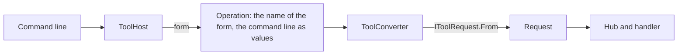

# Scaffolding: the umpire tool

The `umpire` tool (package `Umpire.Cli`) writes new apps, modules, plugin modules, requests and commands from templates. The templates are one compilable app in this repository, so `Umpire.slnx` builds them as normal code (`dotnet run solution.cs` makes `Umpire.slnx`). The tool and the Umpire packages have one version. The rule engine checks it on each build (`UMP030401`), `umpire doctor` runs the same check, and `umpire update` moves all to the latest version.

To make a first app and fix a first rule error, see [getting-started.md](getting-started.md).

## Commands

| Command | Writes | Edits |
|---|---|---|
| `new app <Name>` | The root project `<Name>.csproj`, `App/` (`Program.cs`, `<Name>App.cs`, `Features/`, `Plugins/`, `Tests/`), `Views/`, then the setup files of `init` | None |
| `init [--source <feed>] [--check true]` | Each missing setup file | Each setup file that has no Umpire setup: it adds the missing entry, element or line. See "Setup tasks" |
| `add module <Name>` | Module root, published domain, status request, presenter, page, unit test | None |
| `add request <Name> -m <Module>` | Request, response, handler | None |
| `add command <Name> -m <Module>` | Command, result, handler | None |
| `add plugin <Name>` | Plugin root (inherits `Plugin`), `Contracts/Commands/` with the base command `<Name>Step<TResult>` | None |
| `add pack <Name>` | In `App/Packs/<Name>/`: the kernel project `Kernel/` (`<Name>Kernel`) and the definition project `Definition/` (`<Name>Architecture`). See `pack-variants.md` | None |
| `test [-c <configuration>]` | None | None. It runs `dotnet run --project` for each project of the app whose name ends with `.Tests`, so it needs no `test` entry in `global.json` |
| `check [-c <Debug\|Release>] [--mode <Warn\|Error>]` | None | None. It builds the app and runs the check job with the rule engine of the app. See "The check of an app" |
| `doctor` | None | None |
| `update [--version <version>]` | None | The Umpire versions in the project files and `Directory.*.props` |

Rules for all commands:

- A name is a PascalCase C# identifier. Names that start with `VSA` are forbidden. These names are also forbidden, because they break the build: `App`, `Views`, `Pages`, `Home`, `Features`, `Plugins`, `Pack`, `Packs`, `System`, `Microsoft`.
- A name cannot contain a template name (`SampleApp`, `SampleModule`, `SampleAction`, `SampleChange`, `SamplePlugin`, `SamplePack`).
- A request name cannot end with `Request`, `Response` or `Handler`. A command name cannot end with `Command`, `Result` or `Handler`.
- `add request -m` and `add command -m` use the module name as its folder has it, so `-m billing` gives `Billing`.
- An option that takes one value stops the command if you give it two times, for example `-m A -m B`.
- Each command writes only new files, except `init` and `update`. `init` adds the missing setup to existing files, and `update` changes only the Umpire versions.
- Each command writes all files or no files, except `init` and `update`. If one file exists, the command stops and writes nothing. For `new app`, this includes each setup file of `init`, also a file that already has the full setup.
- `add request` and `add command` stop if the module does not exist.
- `add module` stops if `App/Plugins/<Name>/` exists, and `add plugin` stops if `App/Features/<Name>/` exists: the two would have the same module name.
- `add pack` stops if `App/Packs/<Name>/` exists.
- `new app` writes a `nuget.config` that gets the Umpire packages from GitHub Packages, with the token in `GITHUB_TOKEN` (see `docs/consumers.md`). Each `--source` replaces that feed, for example a local folder.
- `new app` writes a `Directory.Build.props` with `UseArtifactsOutput` and `ArtifactsPath`, so all build output goes to `artifacts~/` in the app folder. No `bin/` or `obj/` folder is next to the code. A folder whose name ends with `~` is not source: the rule engine and `umpire init` do not read it. To use another folder, change `ArtifactsPath`.
- `new app` writes a `.gitignore` for the build folders and the local files (`artifacts~/`, `bin/`, `obj/`, `TestResults/`, `*.user`, `.vs/`).
- The app has one root project. A module, a request, a command and a plugin add only source files, and the root project compiles them.

## The tool is an app

The tool is a VSA app with a console host, in `tooling/`. `App/Program.cs` is only `return new UmpireTool<ToolHost>().Run(args);`. The build checks `tooling/` as a block (`UmpireBlock`), with the definition `tooling/Definition/` (`ToolArchitecture`). The assembly name and the package id are `Umpire.Cli`.

| Part | Type | Job |
|---|---|---|
| App class | `UmpireTool<THost> : App<VsaKernel, THost>` | The lifecycle. The tests close it with a `LocalHost` |
| Host | `ToolHost : ConsoleHost` | Converts the command line into the request of one command |
| Commands | `ToolCommands`, `ToolConverter` (`App/Host/`) | The forms of the requests, the selection, and the operation converter of the tool |
| Plugin | `App/Plugins/Commands/` | `IToolRequest<TSelf>`, `IChildProcessRequest`, `ToolResponse`, `ToolHandler<,>`, `CommandForm`, `CommandOption`, `CommandInput`, `UmpireException`, `Dotnet`, `ChildProcess` |
| Modules | `App/Features/` | `Tool` (help, version), `Scaffold` (new app, init, add), `Checks` (test, check), `Versions` (doctor, update) |



Each request declares its `CommandForm` (the words, the summary, the place in the usage, the name and the options) and a static `From(ToolCall)`. The host replaces the VSA operation converter with `ToolConverter`. The host makes the operation from the command line: its name is the group and the name of the selected form, and its values are the words of the line in order. The converter makes the request from those words with the form of the request, and an `UmpireException` there gives an error result. A form selects the command line that starts with its words. The form of `version` selects only `--version`. A command line that no form selects goes to `help`, and `help` gives the error with the usage. The base handler `ToolHandler<,>` changes an `UmpireException` into the error `umpire: <message>` with exit code 1. Another exception gives `umpire: ` and the full exception text, with exit code 1. An error of the command line (for example no name) gives the same form. The tool uses no module settings (no settings provider).

After Ctrl+C or SIGTERM, `umpire test` and `umpire check` give the exit code of their child process (`IChildProcessRequest`, `ConsoleHost.CancelsOnSignal`). The signal cancels the operation. The tool sends SIGTERM to the child (not on Windows, where Ctrl+C reaches the child directly), waits for it up to 10 seconds (`Dotnet.StopTime`), then kills the child and its process tree. After a signal, the tool starts no new child. If `umpire test` stops before its last test project, it gives the exit code of the last child, or 130 if that code is 0. Each other console app keeps exit code 0 after a signal.

## The check of an app

`umpire check` runs the rule engine version of the app, not an engine of the tool.

1. The tool finds the root project of the app in the current folder.
2. It runs `dotnet msbuild <root project> -restore -getProperty:...`. The property `UmpireEngineFile` comes from the package `Umpire.Engine` that the app restored. In source mode, it is the engine of the source build.
3. It runs `dotnet exec --roll-forward <UmpireEngineRollForward> <UmpireEngineFile> jobs check --project <app> --bin <TargetDir> --block <UmpireBlock>`, with `--mode` if you give it.
4. The engine builds the app, checks it and writes the report. The exit code of the tool is the exit code of the engine.

If the app has no `Umpire.Engine`, the engine file does not exist, or the root project has more than one target framework, the tool stops with the fix. `-c` takes only `Debug` and `Release`, because the engine finds the configuration in the output folder.

## Add a command

Each command of the tool is one slice in a feature module of `tooling/App/Features/`. The help text comes from the forms of the requests.

| File | Content |
|---|---|
| `<Name>Request.cs` | `sealed record <Name>Request(...) : IRequest<<Name>Response>, IToolRequest<<Name>Request>`, with `static CommandForm Form` and `static <Name>Request From(ToolCall call)`. Add `IChildProcessRequest` if the command runs a child process |
| `<Name>Response.cs` | `sealed record <Name>Response(int ExitCode) : ToolResponse(ExitCode)` |
| `<Name>Handler.cs` | `sealed class <Name>Handler : ToolHandler<<Name>Request, <Name>Response>`, with `Run(request, ct)` |

To add a command:

1. Add the slice. Give the options as `CommandOption` values. `Required` shows the option as necessary, and the handler checks it (`form.Missing(option)`). `Many` accepts more than one value.
2. In `From`, read the input with `call.Input(Form)`, then `input.Name`, `input.Value(option)` or `input.All(option)`.
3. In the handler, for an error for the user, throw `UmpireException`. The tool shows the message and stops with exit code 1. A command in an app finds the app folder with `RootProject.AppOfCurrentFolder()`.
4. A new module goes in `ToolModules.All()` (`App/Host/`).
5. Add a test in `tests/Cli`. `CommandTests` makes sure that each request has a form with its own words and its own place. `ToolAppTests` makes sure that the host selects the request of each command line.

A command in an app checks the input in this order: the name, then the app folder, then the required options. `AddFiles.Run` makes the template names in one place. An `AddKind` with a `Folder` is a module kind or a pack: `AddKind.EnsureFree` stops on the app name, a base name, its own folder and the folder of each other module kind. An `AddKind` with no `Folder` is a slice kind: it takes `-m <Module>`.

## Template format A

```
tooling/Templates/
├─ AGENTS.md.template                 new app (the tool removes ".template")
├─ SampleApp.csproj                   new app (the root project, becomes <Name>.csproj)
├─ SampleApp.slnx.template           new app (becomes <Name>.slnx)
├─ .umpireconfig                     setup (only for an app with more than one project)
├─ nuget.config.template             setup (each --source replaces the umpire feed and removes the credentials)
├─ .gitignore.template               setup
├─ appsettings.json, Properties/       new app
├─ Views/                                         new app
├─ Views/Pages/SampleModulePage.razor             add module
├─ App/Program.cs, App/SampleAppApp.cs            new app (SampleAppApp.cs becomes <Name>App.cs)
├─ App/Features/SampleModule/**                   add module
│  ├─ Domain/Shared/SampleModuleKey.cs             add module (the published domain)
│  ├─ Slices/GetStatus/**                          add module (the status request)
│  ├─ Slices/SampleAction/**                       add request
│  └─ Slices/SampleChange/**                       add command
├─ App/Features/.gitkeep                          new app (keeps the empty Features/ folder)
├─ App/Packs/SamplePack/**                        add pack (the Kernel and Definition projects)
├─ App/Plugins/SamplePlugin/**                    add plugin (module class, Contracts/Commands/SamplePluginStep.cs)
├─ App/Plugins/.gitkeep                           new app (keeps the empty Plugins/ folder)
├─ App/Tests/App.Tests.csproj                     new app
├─ App/Tests/SampleModuleStatusTests.cs           add module
├─ Directory.Build.props                          source mode only, not copied
├─ Directory.Build.props.template                 the setup pipeline (init, new app): the artifacts output
```

The path of a template file gives its command. The tool uses the first rule that matches:

| Rule | Path | Command | Replaced names |
|---|---|---|---|
| 1 | Contains `SampleAction` | `add request` | `SampleAction`, `SampleModule` |
| 2 | Contains `SampleChange` | `add command` | `SampleChange`, `SampleModule` |
| 3 | Contains `SamplePlugin` | `add plugin` | `SamplePlugin` |
| 4 | Contains `SamplePack` | `add pack` | `SamplePack` |
| 5 | Under `App/Features/SampleModule/`, or file name contains `SampleModule` | `add module` | `SampleModule` |
| 6 | One of the setup templates (`SetupTemplates` in `Templates.cs`) | The setup pipeline (`init`, `new app`) | None |
| 7 | Other | `new app` | `SampleApp` |

`ScaffoldingTests.EachTemplateFileHasOneCommand` lists each template file with its command. If you add a template file, add it to this test.

The tool also replaces the kebab form of each name, for routes: `sample-module` becomes `billing`, and `sample-action` becomes `create-invoice`.

The suffix `.template` keeps a file inactive in this repository, for example a `nuget.config` that would change the feeds of the template build. The tool removes the suffix. In each template file, the tool replaces `{{UmpireVersion}}` with its own version.

## Source mode and package mode

The templates build in this repository in source mode, as the fixtures do: `Templates/Directory.Build.props` imports `tools/bundle/SourceMode/Umpire.SourceMode.props`. Each template `.csproj` has the consumer form already: the .NET SDK and a `PackageReference` to each Umpire package. The tool changes only the source-mode versions:

| Source mode (repository) | Package mode (consumer) |
|---|---|
| `Version="$(UmpireVersion)"` | `Version="<tool version>"` |
| `Version="$(UmpireNUnitVersion)"`, `Version="$(UmpireNUnitAdapterVersion)"` | The NUnit versions of this repository, which the tool holds as assembly metadata (`ToolVersion.NUnit`, `ToolVersion.NUnitAdapter`) |
| `<ProjectReference Include="$(UmpireFrameworkSourceDir).../Umpire.X.csproj" />` | `<PackageReference Include="Umpire.X" Version="<tool version>" />`. No template has one now |

In source mode, `Umpire.SourceMode.targets` changes each Umpire `PackageReference` to its source projects, and `Umpire.SourceMode.props` reads the NUnit versions from `Directory.Packages.props`. If a template `.csproj` has a source-mode property that the tool cannot change, the tool stops with an error.

## Tests of a new app

`App/Tests/App.Tests.csproj` is a `Microsoft.NET.Sdk` project with `OutputType` `Exe`, `EnableNUnitRunner` `true`, the packages `Umpire.Testing`, `NUnit` and `NUnit3TestAdapter`, and one reference to the root project. NUnit runs on Microsoft.Testing.Platform. `umpire test` runs it with `dotnet run --project`, so the app needs no `global.json`. The NUnit versions come from `Directory.Packages.props` of this repository. The templates do not import `Directory.Packages.props`.

An engine run checks the architecture of the host (see [architecture-engine.md](architecture-engine.md)). The root project references `Umpire.Engine`, and the build files of the package `Umpire` run the engine after the build of the root project (an executable that is not a test project). The engine reads the rules of `App/<Name>App.cs`. The test project does not check the architecture.

## Setup tasks

`umpire init` adds the Umpire setup to an existing app, in the current folder. `umpire new app` plans its app files, then runs the same setup tasks on the planned files only: it reads no file on disk, so each task gives the full template. Then one check (`TextFile.WriteAllOrNone`) stops if a file of the plan exists. The tasks are the list `SetupTasks.Default` in `tooling/App/Features/Scaffold/Domain/Setup/`, with one class for each task in `Tasks/`.

```
umpire init                          umpire new app <Name>
   │                                     ├─ the app files (root project, App/, Views/, slnx, AGENTS.md)
   ▼                                     ▼
SetupTasks.Plan ──► each task: Done | Change(file, content) | ByHand(message)
   ├─ show each task, with the message of each by-hand task
   ├─ --check true: write nothing, exit 1 if a task is not done
   ├─ write each change ("created" or "changed"), then list the by-hand tasks
   └─ exit 1 if a by-hand task is left
```

| Task | File | Done when | No file | A file without the setup | By hand |
|---|---|---|---|---|---|
| `global-json` | `global.json` | No file, or a file with no `msbuild-sdks` → `Umpire.Sdk` or `Umpire.Sdk.Web` | Nothing: the app needs no `global.json` | Nothing | A pin of the removed Umpire SDK (the version is on each package reference), comments |
| `nuget-config` | `nuget.config` | A source has the key `umpire`. With `--source`: each source path is a source | The template | Adds the `umpire` source and its credentials. With `--source`: each missing source, with a free key | Not valid XML |
| `git-ignore` | `.gitignore` | Each line of the template is in the file | The template | Adds the missing lines | None |
| `build-props` | `Directory.Build.props` | The file exists | The template (`UseArtifactsOutput`, `ArtifactsPath`, and an import of the `Directory.Build.props` of a parent folder, if one exists) | Nothing: the app owns the file | None |
| `umpire-packages` | The root project | The project references the package of its pack and `Umpire.Engine` | Not possible | Adds `Umpire.Web` (a web project) or `Umpire.Vsa`, if the project has neither and does not reference `Umpire` itself, and `Umpire.Engine` with `PrivateAssets="all"`, with the tool version (`VersionOverride` with central package versions). The removed `Umpire.Sdk` becomes `Microsoft.NET.Sdk`, and `Umpire.Sdk.Web` becomes `Microsoft.NET.Sdk.Web`, with `TargetFramework` `net10.0`, `Nullable` and `ImplicitUsings` if the project has no target | An `<Sdk>` element of the removed Umpire SDK, no `Sdk` attribute, not valid XML |
| `umpire-config` | `.umpireconfig` | The file exists, or the app has one project | Writes the template. In `init`, only if the app has more than one project | Nothing | None |

Rules of a task:

1. A task only plans. The tool writes all changes after all tasks.
2. A task adds. It does not remove, reorder or change a value of the app.
3. A conflict is a by-hand task, with the fix in its message.
4. The tool writes each file with `TextFile` (`tooling/Files/`). A new file is LF with no byte order mark. A changed file keeps its byte order mark and gets its dominant line ending: CRLF if the file has more CRLF lines than LF lines, else LF.
5. A new XML element gets the indent of the first child element of the file.
6. A changed JSON file keeps its indent, but the tool writes all of the JSON again in the indented form. So a JSON file with comments is a by-hand task.
7. Two tasks can change one file. A task plans on the planned content of the tasks before it.
8. A second run of `init` gives "done" for each task.

`init` needs exactly one `.csproj` in the current folder: the root project. It writes only in that folder. A file in a parent folder stays, and the new file does not hide it:

- The new `nuget.config` has no `<clear />`.
- The new `Directory.Build.props` imports the `Directory.Build.props` of a parent folder, if one exists.

`new app` does not read the parent folders, except to find central package versions: then each template `PackageReference` gets `VersionOverride` in place of `Version`. `add` does the same for its project files. `init` does not write the app class: if the app has none, the rule engine gives `UMP030502`.

To add a task:

1. Write a class in `Scaffolding/Setup/Tasks/` that inherits `SetupTask`. Give it an `Id` and `Plan(SetupContext)`.
2. Read each file with `context.Read(path)`. It gives the planned content, or the file on disk.
3. Return `Done()`, `Change(file, content)` or `ByHand(message)`.
4. Add the task to `SetupTasks.Default`, in its order.
5. Add tests to `tests/Cli/SetupTests.cs`. `ASecondRunOfEachTaskChangesNothing` runs each task two times.

The task ids are stable. A later version can let a consumer skip or add a task by its id.

## One version

`new app` writes the version of the tool to these files. The `doctor` command runs the version check of the rule engine (`VersionCheck`, see "One version" in [architecture-engine.md](architecture-engine.md)) with the version of the running tool. It fails if a slot has a different version. The `update` command writes the version of the tool (or `--version`) to all of them, and checks nothing.

| File | Item |
|---|---|
| The running tool | `Umpire.Cli` |
| Each `.csproj` and `Directory.*.props` | Each reference to `Umpire` or an `Umpire.*` package (`Version`, `VersionOverride`, an exact range `[1.0.0]`) and each `PackageVersion` of one. A reference with no version uses its `PackageVersion`. A version with a property, for example `$(UmpireVersion)`, is not checked |

The tool runs with `dotnet tool exec Umpire.Cli@<version> -y -- <command>`, so the app needs no tool manifest. A consumer can also install the tool, as a global tool (`umpire <command>`) or in a tool manifest of the app (`dotnet umpire <command>`). The commands that need an app (`add`, `test`, `doctor`, `update`) find the app folder: the nearest `.umpireconfig` at or above the current folder, else the nearest folder with a project that references an Umpire package (or still names the removed Umpire SDK). `doctor` reports each use of the removed Umpire SDK, in a project or in `global.json`, as work by hand.

## Update

`umpire update` moves an app to a new Umpire version:

1. The tool writes the version of the running tool (or `--version`) to each place in the table above. It changes no other item. A package reference with no version keeps its `PackageVersion`.
2. The tool shows the changed files. Then run `dotnet build`.

`update` does not change a tool manifest. If the app has one, run `dotnet tool update Umpire.Cli` first, so that the manifest and the app get the same version.

The running tool is the old version. So run `umpire doctor` after the update, not in the same command.

## Empty Domain

A new module has an empty Domain. When you add the first entity, write an `IRepository<T, TId>` for it in `Infrastructure/`, and register it in the module class.
