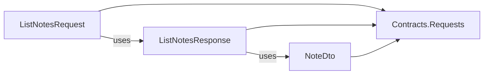

# Slice layout (spike)

A slice module keeps all files of one feature in one flat folder, `Slices/<Feature>/`, with any file names. The layer projects are in one folder, `Projects/`. VSA.Sdk reads the type in each slice file and selects its project. The assemblies and the layer map are the same as in the layer-folder layout. The Notes sample uses this layout. Ping and the `vsa` templates use the layer-folder layout.

## Layout

```
Modules/Notes/
├─ Notes.csproj, NotesModule.cs, NotesSettings.cs     module root
├─ Projects/                                           layer projects, with obj~/ and bin~/
│  ├─ Notes.Domain.csproj  Notes.Infrastructure.csproj  Notes.Presenters.csproj
│  ├─ Notes.Contracts.Requests.csproj  Notes.Contracts.Events.csproj
│  └─ Notes.Handlers.Requests.csproj  Notes.Handlers.Events.csproj
├─ Domain/  Infrastructure/  Presenters/
└─ Slices/
   ├─ CreateNote/       CreateNoteRequest.cs, CreateNoteResponse.cs, NoteCreated.cs, CreateNoteHandler.cs
   ├─ DeleteNote/       DeleteNoteRequest.cs, DeleteNoteResponse.cs, NoteDeleted.cs, DeleteNoteHandler.cs
   ├─ ListNotes/        ListNotesRequest.cs, ListNotesResponse.cs, NoteDto.cs, ListNotesHandler.cs
   └─ LogNoteCreated/   NoteCreatedHandler.cs
```

All files of one slice have one namespace, for example `Notes.Slices.CreateNote`. An event is in the slice that publishes it.

## How VSA.Sdk selects the project of a file

| File type | Project |
|---|---|
| `IRequest<TResponse>` | `Contracts.Requests` |
| `IResponse` | `Contracts.Requests` |
| `IntegrationEvent` | `Contracts.Events` |
| A DTO that a contract type uses | The contracts project of that contract type |
| `RoutedHandler<,>` | `Handlers.Requests` |
| `IntegrationEventHandler<>` | `Handlers.Events` |
| Other types | The handlers project of the slice |

`Domain`, `Infrastructure` and `Presenters` take the files of their own folders.



The task `VsaRouteSliceFiles` (`framework/Sdk/Sdk/VsaSliceRouter.cs`) does the selection before each compile, also in the design-time build of the IDE. It reads the syntax with a small scanner, not with the compiler, and it finds types by their simple names:

1. A DTO name is first found in the same slice, then in `Slices/Shared/`.
2. A name that is in neither, and not in another slice, is not a slice type (`Guid`, `NoteId`).

`IResponse` is a marker interface. `IRequest`, `RoutedHandler`, `IBus.Send` and `VsaUnitTest.Handle` require it on the response, so the compiler rejects a response without it.

## Rules

| ID | Check |
|---|---|
| `VSA0002` | A project in `Projects/` has the name `<Module>.<Layer>` |
| `VSA0003` | Routing of the slice files (next table) |
| `VSA1003` | Contracts projects hold only contract types and their DTOs |

| `VSA0003` error | Example |
|---|---|
| Request handler and event handler in one slice | `CreateNote/` has `CreateNoteHandler` and a `NoteCreated` handler |
| Files, but no handler in the slice | `Extra/Helper.cs` |
| Contract type and handler type in one file | `CreateNoteRequest` and a `RoutedHandler` in one file |
| Request type and event type in one file | A request and an event in one file |
| DTO used by a request and an event | `NoteDto` in `CreateNoteResponse` and in `NoteCreated` |
| Contract uses a type of another slice | `CreateNoteResponse` uses `ListNotes/NoteDto` |
| Contract uses a handler type | `CreateNoteRequest(CreateNoteHandler H)` |
| Non-contract file in `Slices/Shared/` | `Shared/TitleRules.cs` |
| File directly in `Slices/` | `Slices/Loose.cs` |

The layer map stays the same, so the compiler also stops the forbidden uses between projects. Examples: a contract that uses a Domain type, a presenter that uses a handler.

## Build output

Projects in one folder cannot share `obj/`. Each project in `Projects/` writes to `obj~/<Project>/` and `bin~/<Project>/`. Unity does not import folders whose names end in `~`. Git ignores them (`*~`).

## Open questions

- A `.cs` file outside `Slices/`, `Domain/`, `Infrastructure/`, `Presenters/` and the module folder compiles in no project, and the build gives no message.
- A hand-written `Compile` item in a project in `Projects/` is not stopped.
- Each routed project reports the same `VSA0003` errors, so one error shows up to four times.
- The scanner finds types by simple names. A Roslyn-based task would be exact, but VSA.Sdk would then ship a task DLL.
- Events that more than one slice publishes: put them in `Slices/Shared/`? The router supports it, because the type selects the project.
- `dotnet ef migrations add` writes to the project folder. Use `--output-dir ../Infrastructure/Migrations`, or set it in VSA.Sdk?
- Move Ping, the `vsa` templates and `tests/Fixtures` to the slice layout, or keep both layouts?
