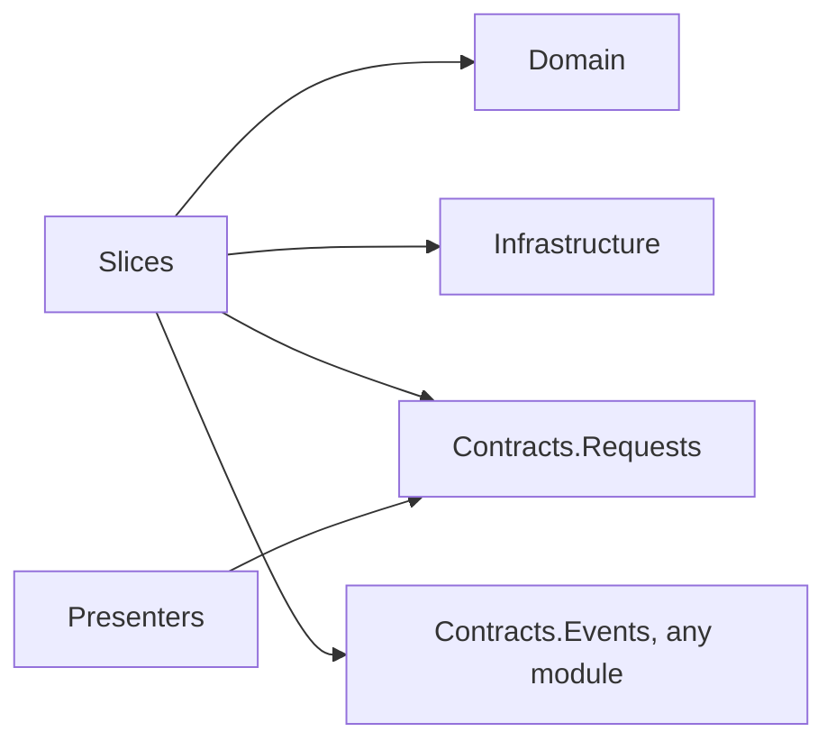

# Slice layout (spike)

A slice module keeps all files of one feature in one folder, `Slices/<Feature>/`. The layer projects are in one folder, `Projects/`, and each project takes its files from the feature folders. The assemblies and the layer rules are the same as in the layer-folder layout. The Notes sample uses this layout. Ping and the `vsa` templates use the layer-folder layout.

## Layout

```
Modules/Notes/
├─ Notes.csproj                         module root: NotesModule.cs, NotesSettings.cs
├─ NotesModule.cs  NotesSettings.cs
├─ Projects/                            the layer projects, with obj~/ and bin~/
│  ├─ Notes.Domain.csproj
│  ├─ Notes.Infrastructure.csproj
│  ├─ Notes.Presenters.csproj
│  ├─ Notes.Contracts.Requests.csproj
│  ├─ Notes.Contracts.Events.csproj
│  └─ Notes.Slices.csproj
├─ Domain/  Infrastructure/  Presenters/
└─ Slices/
   ├─ CreateNote/
   │  ├─ CreateNoteHandler.cs
   │  ├─ Request/   CreateNoteRequest.cs, CreateNoteResponse.cs
   │  └─ Event/     NoteCreated.cs
   ├─ DeleteNote/   DeleteNoteHandler.cs, Request/, Event/
   ├─ ListNotes/    ListNotesHandler.cs, Request/ (with NoteDto.cs)
   └─ LogNoteCreated/
      └─ NoteCreatedHandler.cs
```

All files of one slice have one namespace: `Notes.Slices.CreateNote`.

## Which project compiles a file

VSA.Sdk finds the layer from the project name: `Notes.Contracts.Requests` is layer `Contracts.Requests`. Then it adds the files of that layer.

| Project | Files |
|---|---|
| `Notes` (root) | `*.cs` in the module folder |
| `Notes.Domain` | `Domain/**` |
| `Notes.Infrastructure` | `Infrastructure/**` |
| `Notes.Presenters` | `Presenters/**` |
| `Notes.Contracts.Requests` | `Slices/**/Request/**` |
| `Notes.Contracts.Events` | `Slices/**/Event/**` |
| `Notes.Slices` | Other files of `Slices/**` |

## The Slices layer

`Slices` has the request handlers and the event handlers of the module. It has the edges of both handler layers:



The host loads request endpoints and event handlers from `Slices`, as it does from `Handlers.Requests` and `Handlers.Events`.

## Build output

Projects in one folder cannot share `obj/`. Each project in `Projects/` writes to `obj~/<Project>/` and `bin~/<Project>/`. Unity does not import folders whose names end in `~`. Git ignores them (`*~`).

## Rules

| Check | Slice layout |
|---|---|
| `VSA0001` (references by hand) | Same as the layer-folder layout |
| `VSA0002` | A project in `Projects/` must have the name `<Module>.<Layer>` |
| Layer references (VSA.Sdk) | Each reference has a layer-folder form and a `Projects/` form |
| `VSA2001` (layer map test) | Same: it reads the assembly names |
| `VSA1001`, `VSA1002` (analyzers) | Same: they check one type |

## Open questions

- A helper file in `Request/` becomes public API with no message. Extend `VSA1001` to each public type of a contracts assembly?
- A `.cs` file outside the folders in the table compiles in no project. Add a build error for it?
- `dotnet ef migrations add` writes to the project folder. Use `--output-dir ../Infrastructure/Migrations`, or set it in VSA.Sdk?
- Merge `Contracts.Requests` and `Contracts.Events` into one `Contracts` project?
- Move Ping, the `vsa` templates and `tests/Fixtures` to the slice layout, or keep both layouts?
