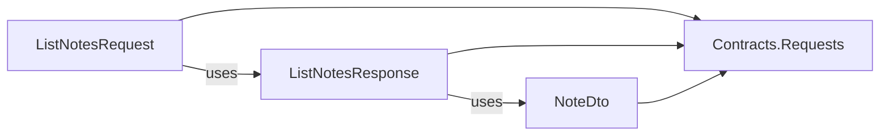

# Module layout

A module (`Modules/<Module>/`) and a Shared module (`Shared/<Module>/`) have the same layout. A module keeps each feature in one flat folder, `Slices/<Feature>/`, with any file names. Its layer projects are in one folder, `Projects/`. VSA.Sdk reads the type in each slice file and selects its project, so the assemblies follow the layer map.

## Layout

```
Modules/Notes/
├─ Notes.csproj, NotesModule.cs, NotesSettings.cs     module root
├─ Projects/                                           layer projects, with obj~/ and bin~/
│  ├─ Notes.Domain.csproj  Notes.Infrastructure.csproj  Notes.Presenters.csproj
│  ├─ Notes.Contracts.Requests.csproj  Notes.Contracts.Events.csproj
│  └─ Notes.Handlers.Requests.csproj  Notes.Handlers.Events.csproj
├─ Domain/  Infrastructure/  Presenters/
└─ Slices/
   ├─ CreateNote/       CreateNoteRequest.cs, CreateNoteResponse.cs, NoteCreated.cs, CreateNoteHandler.cs
   ├─ DeleteNote/       DeleteNoteRequest.cs, DeleteNoteResponse.cs, NoteDeleted.cs, DeleteNoteHandler.cs
   ├─ ListNotes/        ListNotesRequest.cs, ListNotesResponse.cs, NoteDto.cs, ListNotesHandler.cs
   └─ LogNoteCreated/   NoteCreatedHandler.cs
```

A module with commands and a published domain (`tests/Fixtures/CommandApp`):

```
Modules/Cards/
├─ Cards.csproj, CardsModule.cs                        module root, with <VsaModuleUses>Resources</VsaModuleUses>
├─ Projects/
│  ├─ Cards.Domain.Shared.csproj  Cards.Presenters.csproj  Cards.Contracts.Events.csproj
│  └─ Cards.Contracts.Commands.csproj  Cards.Handlers.Commands.csproj
├─ Domain/Shared/       Cost.cs
├─ Presenters/          CostLabel.cs
└─ Slices/
   └─ PayCost/          PayCostCommand.cs, PayCostResult.cs, CostPaid.cs, PayCostHandler.cs
```

- A module has only the layer projects that it needs. Ping has `Contracts.Requests` and `Handlers.Requests`.
- All files of one slice have one namespace, for example `Notes.Slices.CreateNote`.
- An event is in the slice that publishes it. A slice has one kind of handler: a request handler, an event handler or a command handler.
- `Slices/Shared/` holds contracts that more than one slice uses.

## Projects and files

| Project | Files |
|---|---|
| `<Module>` (root) | `*.cs` in the module folder |
| `<Module>.Domain.Shared` | `Domain/Shared/**` |
| `<Module>.Domain` | `Domain/**`, except `Domain/Shared/**` |
| `<Module>.Infrastructure` | `Infrastructure/**` |
| `<Module>.Presenters` | `Presenters/**` |
| `<Module>.Contracts.Requests` | Slice files with `IRequest<T>` or `IResponse` types |
| `<Module>.Contracts.Events` | Slice files with `IntegrationEvent` types |
| `<Module>.Contracts.Commands` | Slice files with `ICommand<T>` types |
| `<Module>.Handlers.Requests` | Other files of the slices with a `RoutedHandler` |
| `<Module>.Handlers.Events` | Other files of the slices with an `IntegrationEventHandler` |
| `<Module>.Handlers.Commands` | Other files of the slices with a `CommandHandler` |

The layer of a project in `Projects/` comes from its name. A file with no marker type goes with the contract type that uses it (a DTO):



A command result has no marker. It goes to `Contracts.Commands` because its command names it: `PayCostCommand : ICommand<PayCostResult>`.

`IResponse` is a marker interface. `IRequest`, `RoutedHandler`, `IBus.Send` and `VsaUnitTest.Handle` require it on the response, so the compiler rejects a response without it.

## The router

The task `VsaRouteSliceFiles` (`framework/Sdk/Tasks`) selects the files of each contracts and handlers project. It runs before `BeforeCompile`, so the files are in `@(Compile)` for the build, the design-time build of the IDE and the analyzers.

1. It parses each slice file with the Roslyn syntax parser.
2. It finds the contract types and the handler types by their base types. A base that is not a marker counts with its own bases, to any depth. The router also reads the slice files of the Shared modules for these bases, but it does not route them:

   ```
   DealDamage        : Message, IRequest<MessageId>   → Contracts/Requests
   DealDamageHandler : MessageHandler<DealDamage>      → MessageHandler : RoutedHandler → Handlers/Requests
   PayCost           : Effect<PayCostResult>           → Effect<T> : ICommand<T>       → Contracts/Commands
   PayCostHandler    : CommandHandler<PayCost, PayCostResult>                          → Handlers/Commands
   ```

3. It follows the type names that a contract type uses. A name is found first in the same slice, then in `Slices/Shared/`.
4. The other files of a slice go to the handlers project of the slice.
5. In a Shared module, a file in `Slices/Shared/` that no contract uses goes to `Contracts/Requests`. It is a base type for the modules, for example `abstract record Id(long Value)`. `VSA1003` does not check the contracts projects of a Shared module.

The router runs before the compile, so it has no semantic model and matches types by simple name. A base type from a NuGet package, not from `Shared/`, is unknown to the router. The compiler and `VSA1003` then check the result with the real types.

The `VSA.Sdk` package holds the task DLL and its Roslyn dependencies in `Sdk/tasks/`. In this repository (source mode), `framework/Sdk/Tasks` builds the DLL, and MSBuild runs it in its own process (`TaskHostFactory`), so a rebuild of the task never finds the DLL locked.

## Rules

| ID | Check | When | Shown in |
|---|---|---|---|
| `VSA0001` | Reference written by hand | Restore, build, design-time build | Build output, IDE error list |
| `VSA0004` | Wrong project folder or name | Restore, build, design-time build | Build output, IDE error list |
| `VSA0005` | Routing of the slice files (next table) | Build, design-time build | Build output, IDE error list |
| `VSA0006` | Hand-written `Compile` item, or uncompiled file | Restore, build, design-time build | Build output, IDE error list |
| `VSA0007` | `VsaModuleUses` out of a module root, or a bad name | Restore, build, design-time build | Build output, IDE error list |
| `VSA1003` | Contracts projects hold only contract types and their DTOs | Compile, also while you type | Editor and build |
| `VSA1005`–`VSA1007` | `Domain.Shared` types hold only immutable data | Compile, also while you type | Editor and build |
| `CS` errors | Forbidden uses between projects, from the layer map | Compile | Editor and build |
| `VSA2001` | Module projects follow the layer map | Test run | Test results |

`VSA0001`, `VSA0004` and `VSA0006` are in one target, `_VsaCheck`. Their lists are made at evaluation, so the order of the requested targets does not change the result.

| `VSA0005` error | Example |
|---|---|
| Request handler and event handler in one slice | `CreateNote/` has `CreateNoteHandler` and a `NoteCreated` handler |
| Request handler and command handler in one slice | `CreateNote/` has `CreateNoteHandler` and a `CommandHandler<A, B>` |
| Files, but no handler in the slice | `Extra/Helper.cs` |
| Contract type and handler type in one file | `CreateNoteRequest` and a `RoutedHandler` in one file |
| Request type and event type in one file | `CreateNoteRequest` and `NoteCreated` in one file |
| DTO used by a request and an event | `NoteDto` in `CreateNoteResponse` and in `NoteCreated` |
| DTO used by a response and a command | `NoteDto` in `CreateNoteResponse` and in `SaveNote : ICommand<bool>` |
| Contract uses a type of another slice | `CreateNoteResponse` uses `ListNotes/NoteDto` |
| Contract uses a handler type | `CreateNoteRequest(CreateNoteHandler H)` |
| Non-contract file in `Slices/Shared/` | `Shared/TitleRules.cs` |
| File directly in `Slices/` | `Slices/Loose.cs` |

Each of the six routed projects reports the same `VSA0005` errors, so one error can show up to six times.

## The published domain (Domain/Shared/)

`Domain/Shared/` is the published domain of a module. It goes to the project `<Module>.Domain.Shared`, and `<Module>.Domain` leaves it out. Other modules use these types in their commands, events and handlers.

```csharp
// Modules/Resources/Domain/Shared/ResourceKey.cs
public sealed record ResourceKey(string Name);

// Modules/Cards/Domain/Shared/Cost.cs: Cards lists Resources in VsaModuleUses
public sealed record Cost(ResourceKey Resource, int Amount);
```

- Put keys, ids and data records here. Put the rules in `Domain/`, for example `Resources/Domain/Wallet.cs`.
- A type holds only immutable data: `VSA1005`, `VSA1006` and `VSA1007` check it (see `architecture-rules.md`).
- If `Domain/Shared/` has files and the module has no `Domain.Shared` project, the build fails with `VSA0006`.

Which layer references which domain project:

| Layer | Own Domain | Own Domain.Shared | Other Domain | Other Domain.Shared |
|---|---|---|---|---|
| `Domain.Shared` | No | – | No | Listed modules |
| `Domain` | – | Yes | No | No |
| `Infrastructure` | Yes | Yes | No | No |
| `Contracts.*` | No | Yes | No | All modules |
| `Handlers.*` | Yes | Yes | No | All modules |
| `Presenters` | No | Yes | No | Listed modules |

"All modules" also includes the Shared modules. A `Domain.Shared` project also gets the `Domain.Shared` project of each Shared module, as each layer does.

The listed modules are in `<VsaModuleUses>` of the module root. Write the list only there, with `;` between the names:

```xml
<!-- Modules/Cards/Cards.csproj -->
<Project Sdk="VSA.Sdk">
  <PropertyGroup>
    <VsaModuleUses>Resources</VsaModuleUses>
  </PropertyGroup>
</Project>
```

The layer projects cannot see a property of the root project, so VSA.Sdk reads the root project file as text. `VSA0007` fails the build if a layer project sets `VsaModuleUses`, if a Shared module sets it, or if a name is not another module with a `Domain.Shared` project.

## Three meanings of Shared

| Name | What it is | Who uses it | List |
|---|---|---|---|
| `Shared/` (root folder) | Shared modules: the base of each layer | The same layer of each module | `<VsaUses>` in a Shared layer project |
| `Slices/Shared/` | Contracts that more than one slice uses | The slices of one module | None |
| `Domain/Shared/` | The published domain of one module | Other modules (table above) | `<VsaModuleUses>` in the module root |

The namespace of the published domain is `<Module>.Domain.Shared`. `Shared` is a VB keyword, so `VSA.globalconfig` sets CA1716 to not check namespaces.

## Commands

A command goes from one module to another in the same process. It has one handler and one result.

| Message | Sent by | Handlers | Result | Transport |
|---|---|---|---|---|
| Request (`IRequest<T>`) | A client or a module | One `RoutedHandler` | `IResponse` | HTTP (`IBus.Send`) |
| Command (`ICommand<T>`) | A handler of a module | One `CommandHandler` | Any type of the slice | In process, `ICommandSender` |
| Event (`IntegrationEvent`) | A handler, after a change | Zero or more | None | `IIntegrationEventPublisher` |

A request and a command are messages (`IMessage`). An event is not a message. Name the types `<Name>Command`, `<Name>Result` and `<Name>Handler`:

```csharp
// Modules/Resources/Slices/ChangeResource/
public sealed record ChangeResourceCommand(ResourceKey Resource, int Delta) : ICommand<ChangeResourceResult>;
public sealed record ChangeResourceResult(bool Changed, int Value);

sealed class ChangeResourceHandler(Wallet wallet) : CommandHandler<ChangeResourceCommand, ChangeResourceResult> {
    public override Task<ChangeResourceResult> HandleAsync(ChangeResourceCommand command, CancellationToken ct) {
        var changed = wallet.TryChange(command.Resource, command.Delta, out var value);
        return Task.FromResult(new ChangeResourceResult(changed, value));
    }
}
```

To send a command, get `ICommandSender` from the services and call `SendAsync`:

```csharp
// Modules/Cards/Slices/PayCost/PayCostHandler.cs
sealed class PayCostHandler(ICommandSender commands, IIntegrationEventPublisher events) : CommandHandler<PayCostCommand, PayCostResult> {
    public override async Task<PayCostResult> HandleAsync(PayCostCommand command, CancellationToken ct) {
        var changed = await commands.SendAsync(new ChangeResourceCommand(command.Cost.Resource, -command.Cost.Amount), ct);
        ...
    }
}
```

- Each handler project (`Handlers.*`) gets the `Contracts.Commands` project of each module, so each handler can send each command.
- A command has exactly one handler. If two handlers handle one command, the host stops start-up. If a command has no handler, `SendAsync` fails.
- The host registers `ICommandSender` (`AddVsaCommands`) and each handler of a `Handlers.Commands` project.
- A unit test sends a command to its handler with `VsaUnitTest.Send` (see `architecture-rules.md`).

VSA has no direction check for commands. See L-04 in "Open questions".

## Build output and tools

Projects in one folder cannot share `obj/`, so each project in `Projects/` writes to `obj~/<Project>/` and `bin~/<Project>/`. Unity does not import folders whose names end in `~`. Git ignores them (`*~`).

| Tool | Behavior |
|---|---|
| Solution Explorer | The module root shows `Slices/` as `None` items |
| Design-time build | Each routed project gets its slice files |
| `dotnet watch` | The module root gives slice files as `Watch` items |
| `dotnet ef migrations add` | Add `--output-dir ../Infrastructure/Migrations` |

## Open questions

- Events that more than one slice publishes: put them in `Slices/Shared/`? The router supports it, because the type selects the project.
- Should VSA.Sdk set the migrations folder of `dotnet ef`?
- L-04: which direction can commands go between modules? No check stops two modules that send commands to each other.
