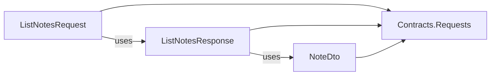

# Module layout

A module (`Modules/<Module>/`) and a Shared module (`Shared/<Module>/`) have the same layout. A module keeps each feature in one flat folder, `Slices/<Feature>/`, with any file names. Its layer projects are in one folder, `Projects/`. VSA.Sdk reads the type in each slice file and selects its project, so the assemblies follow the layer map.

## Layout

```
Modules/Notes/
├─ Notes.csproj, NotesModule.cs, NotesSettings.cs     module root
├─ Projects/                                           layer projects, with obj~/ and bin~/
│  ├─ Notes.Domain.csproj  Notes.Infrastructure.csproj  Notes.Presenters.csproj
│  ├─ Notes.Contracts.Requests.csproj  Notes.Contracts.Events.csproj
│  └─ Notes.Handlers.Requests.csproj  Notes.Handlers.Events.csproj
├─ Domain/  Infrastructure/  Presenters/
└─ Slices/
   ├─ CreateNote/       CreateNoteRequest.cs, CreateNoteResponse.cs, NoteCreated.cs, CreateNoteHandler.cs
   ├─ DeleteNote/       DeleteNoteRequest.cs, DeleteNoteResponse.cs, NoteDeleted.cs, DeleteNoteHandler.cs
   ├─ ListNotes/        ListNotesRequest.cs, ListNotesResponse.cs, NoteDto.cs, ListNotesHandler.cs
   └─ LogNoteCreated/   NoteCreatedHandler.cs
```

- A module has only the layer projects that it needs. Ping has `Contracts.Requests` and `Handlers.Requests`.
- All files of one slice have one namespace, for example `Notes.Slices.CreateNote`.
- An event is in the slice that publishes it. A slice has one kind of handler.
- `Slices/Shared/` holds contracts that more than one slice uses.

## Projects and files

| Project | Files |
|---|---|
| `<Module>` (root) | `*.cs` in the module folder |
| `<Module>.Domain` | `Domain/**` |
| `<Module>.Infrastructure` | `Infrastructure/**` |
| `<Module>.Presenters` | `Presenters/**` |
| `<Module>.Contracts.Requests` | Slice files with `IRequest<T>` or `IResponse` types |
| `<Module>.Contracts.Events` | Slice files with `IntegrationEvent` types |
| `<Module>.Handlers.Requests` | Other files of the slices with a `RoutedHandler` |
| `<Module>.Handlers.Events` | Other files of the slices with an `IntegrationEventHandler` |

The layer of a project in `Projects/` comes from its name. A file with no marker type goes with the contract type that uses it (a DTO):



`IResponse` is a marker interface. `IRequest`, `RoutedHandler`, `IBus.Send` and `VsaUnitTest.Handle` require it on the response, so the compiler rejects a response without it.

## The router

The task `VsaRouteSliceFiles` (`framework/Sdk/Tasks`) selects the files of each contracts and handlers project. It runs before `BeforeCompile`, so the files are in `@(Compile)` for the build, the design-time build of the IDE and the analyzers.

1. It parses each slice file with the Roslyn syntax parser.
2. It finds the contract types and the handler types by their base types. A base that is not a marker counts with its own bases, to any depth. The router also reads the slice files of the Shared modules for these bases, but it does not route them:

   ```
   DealDamage        : Message, IRequest<MessageId>   → Contracts/Requests
   DealDamageHandler : MessageHandler<DealDamage>      → MessageHandler : RoutedHandler → Handlers/Requests
   ```

3. It follows the type names that a contract type uses. A name is found first in the same slice, then in `Slices/Shared/`.
4. The other files of a slice go to the handlers project of the slice.
5. In a Shared module, a file in `Slices/Shared/` that no contract uses goes to `Contracts/Requests`. It is a base type for the modules, for example `abstract record Id(long Value)`. `VSA1003` does not check the contracts projects of a Shared module.

The router runs before the compile, so it has no semantic model and matches types by simple name. A base type from a NuGet package, not from `Shared/`, is unknown to the router. The compiler and `VSA1003` then check the result with the real types.

The `VSA.Sdk` package holds the task DLL and its Roslyn dependencies in `Sdk/tasks/`. In this repository (source mode), `framework/Sdk/Tasks` builds the DLL, and MSBuild runs it in its own process (`TaskHostFactory`), so a rebuild of the task never finds the DLL locked.

## Rules

| ID | Check | When | Shown in |
|---|---|---|---|
| `VSA0001` | Reference written by hand | Restore, build, design-time build | Build output, IDE error list |
| `VSA0004` | Wrong project folder or name | Restore, build, design-time build | Build output, IDE error list |
| `VSA0005` | Routing of the slice files (next table) | Build, design-time build | Build output, IDE error list |
| `VSA0006` | Hand-written `Compile` item, or uncompiled file | Restore, build, design-time build | Build output, IDE error list |
| `VSA1003` | Contracts projects hold only contract types and their DTOs | Compile, also while you type | Editor and build |
| `CS` errors | Forbidden uses between projects, from the layer map | Compile | Editor and build |
| `VSA2001` | Module projects follow the layer map | Test run | Test results |

`VSA0001`, `VSA0004` and `VSA0006` are in one target, `_VsaCheck`. Their lists are made at evaluation, so the order of the requested targets does not change the result.

| `VSA0005` error | Example |
|---|---|
| Request handler and event handler in one slice | `CreateNote/` has `CreateNoteHandler` and a `NoteCreated` handler |
| Files, but no handler in the slice | `Extra/Helper.cs` |
| Contract type and handler type in one file | `CreateNoteRequest` and a `RoutedHandler` in one file |
| Request type and event type in one file | `CreateNoteRequest` and `NoteCreated` in one file |
| DTO used by a request and an event | `NoteDto` in `CreateNoteResponse` and in `NoteCreated` |
| Contract uses a type of another slice | `CreateNoteResponse` uses `ListNotes/NoteDto` |
| Contract uses a handler type | `CreateNoteRequest(CreateNoteHandler H)` |
| Non-contract file in `Slices/Shared/` | `Shared/TitleRules.cs` |
| File directly in `Slices/` | `Slices/Loose.cs` |

Each of the four routed projects reports the same `VSA0005` errors, so one error can show up to four times.

## Build output and tools

Projects in one folder cannot share `obj/`, so each project in `Projects/` writes to `obj~/<Project>/` and `bin~/<Project>/`. Unity does not import folders whose names end in `~`. Git ignores them (`*~`).

| Tool | Behavior |
|---|---|
| Solution Explorer | The module root shows `Slices/` as `None` items |
| Design-time build | Each routed project gets its slice files |
| `dotnet watch` | The module root gives slice files as `Watch` items |
| `dotnet ef migrations add` | Add `--output-dir ../Infrastructure/Migrations` |

## Open questions

- Events that more than one slice publishes: put them in `Slices/Shared/`? The router supports it, because the type selects the project.
- Should VSA.Sdk set the migrations folder of `dotnet ef`?
