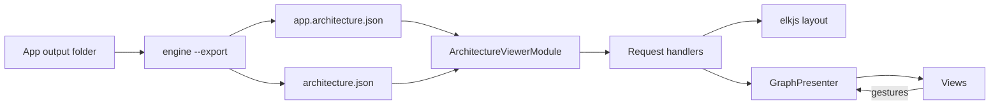

# Architecture viewer

The architecture viewer draws the architecture of a VSA app as a graph, and lets you edit links and rules. It is a VSA app in `framework/Tooling/Viewer/`, built against the framework source, as `samples/Notes` is. It does not ship yet. Its input is two files that the architecture engine exports from an app: the architecture file (the definition as data) and the snapshot file (the resolved app). The model of both files is `VSA.Architecture.Data` (see `architecture-data.md`).

## Parts

| Part | Path | Contains |
|---|---|---|
| Module | `Features/ArchitectureViewer/` | Domain, Domain.Shared, Infrastructure, Presenters, 13 request slices |
| Root project | `Viewer.csproj` | The one project of the app. It compiles the module, the views and the host, and copies `Data/` |
| Views | `App/Views/` | Pages, panels, graph and shape components |
| Host | `App/Host/` | `ViewerApp` (selects `WebVsaHost`), `ViewerDefinition` (the app rules) and the fixed `Program.cs` line |
| Static files | `wwwroot/` | `app.css`, elkjs and its interop script |
| Default input | `Data/` | `vsa.json` and `notes.vsa.json` of `samples/Notes`, made by the engine export (`--export`) |
| Licenses | `THIRD-PARTY-NOTICES.md`, `LICENSE-EPL-2.0.md` | Z.Blazor.Diagrams (MIT), elkjs 0.9.3 (EPL-2.0) |
| Tests | `tests/Viewer.Tests/` | Unit and browser tests |

## Stack

| Item | Choice |
|---|---|
| Drawing | Own Razor components that write SVG. No diagram library |
| Layout and routes | elkjs 0.9.3, called through `elk-interop.js` (JS interop) |
| Gestures | Pan, zoom, select, drag, link and keyboard behaviors, copied from Z.Blazor.Diagrams and adapted to own records |
| Render mode | Blazor Interactive Server. No WebAssembly host |
| Node shapes | `Fields`, `Simple`, `Part`. A shape is a Domain class and a view with `[NodeShape]` |

## Data flow



`ArchitectureViewerModule` reads the snapshot file in the setting `Viewer:Snapshot`, and the architecture file that its `architecture.name` names, in the same folder. If the setting is empty, it reads the one snapshot file in `Data/` and its architecture file in the app folder (`AppContext.BaseDirectory`). Both views run ELK on load: the App view gets its graph from the `app` section of the snapshot file (`AppGraph`). The Definition view loads the architecture file with `JsonDefinition`, resolves the pairs with `Resolve()`, and draws them (`DefinitionGraph`).

## Make the export

1. Build the app, for example `dotnet build samples/Notes`.
2. Run `dotnet engine/bin/Debug/net10.0/vsa-engine.dll --root samples/Notes --bin samples/Notes/bin/Debug/net10.0 --export out`. The engine writes `out/vsa.json` and `out/notes.vsa.json`.
3. Start the viewer with `--Viewer:Snapshot out/notes.vsa.json`.

## Export shape

Both files are described in `architecture-data.md`. The snapshot file (version 2) has these sections:

| Section | Fields |
|---|---|
| `architecture` | `name`, `source`, `hash`: the architecture that the snapshot used |
| `app` | `name`, `instances`, `types`, `dependencies`, `findings` |
| `app.instances[]` | `id`, `layer`, `many`, `parent`, `path`, `items` |
| `app.dependencies[].uses[]` | `from`, `to`, `access`, `rule` (the text of the rule, or null) |

## Edit and export the definition

1. Open the Definition view.
2. Remove a rule, flip a rule between allow and deny, or draw a new rule.
3. Push "Export definition". The panel shows the new architecture file, with "Copy JSON" and "Download <name>.json".
4. To edit it again, import the file with "Import architecture file".
5. To check the app with it, run the engine with `--definition <file>`.

The export applies the edits to the loaded architecture file with `DefinitionEdit` (`VSA.Architecture.Data`). The export is always a data-driven definition: the viewer does not write C# code. The what-if links of the App view are not in the export.

## Run the viewer

1. Run `dotnet run --project framework/Tooling/Viewer`.
2. Open `http://localhost:5205`.

## Tests

| Kind | Tests | Needs |
|---|---|---|
| Unit | `SelectItemTests` (2) | Nothing |
| Export | `ExportImportTests` (4): the export of `samples/Notes` goes into the import. `LoopTests` (3): an edited definition goes through the engine and back into the import | `samples/Notes` and the engine build |
| Browser | 23 tests in category `Browser` | Playwright Chromium (the tests install it on the first run, about 150 MB) |

At the start of the run, `NotesExport` runs the engine with `--export` on the output of `samples/Notes` and writes a temporary snapshot file and architecture file. The test project builds the engine and `samples/Notes` with `ReferenceOutputAssembly="false"`, so their assemblies stay out of the test output.

The browser tests start `Viewer.dll` from its output folder on a free port, with `ASPNETCORE_ENVIRONMENT=Development` and `--Viewer:Snapshot` set to that file. At the start of the run, `ViewerSetup` installs the Playwright Chromium if it is missing, and starts it one time. Each test opens a new browser context and page, so each test has a new Blazor circuit and new presenter state.

| Run of `Viewer.Tests` (100 tests, no build) | Duration |
|---|---|
| One browser for each test (Edge) | 3 min 58 s |
| One Chromium for the whole run | 1 min 33 s |

To run only one kind, use a filter:

```bash
dotnet test --project tests/Viewer.Tests -- --filter "TestCategory!=Browser"
dotnet test --project tests/Viewer.Tests -- --filter "TestCategory=Browser"
```

## Decisions

| Decision | Reason |
|---|---|
| Folder `framework/Tooling/Viewer/`, own `Directory.Build.props` and `VSA.Sdk.Dev.props` | Same in-repo form as `samples/`. `VsaAppRoot` is the viewer folder |
| One root project `Viewer.csproj`, assembly name `Viewer` | Each app has one root project (main). The name is not `App`, so `VSA.slnx` has no name twice |
| Default input in `Data/`, copied to the host output | The viewer starts with no setting. `vsa view` (next PR) gives the setting |
| No `layout.json` | The viewer runs ELK on load for the App view, as it does for the Definition view |
| The engine exports the files, not the viewer | The engine loads the assemblies of the app. The viewer and the app cannot load in one process. One export for each tool |
| `ViewerDefinition` gives two app rules: Infrastructure and Host may use the `Core` part itself (`Depth.Self`) | `VSA.Architecture.Data` binds to `Core`. The app class names layer types, which are in `Core`. Both rules are temporary (issue #89) |
| The viewer reads the file with `VSA.Architecture.Data` | One model for each tool. The root project references it |
| The import fails on a missing field (`RespectRequiredConstructorParameters`) | A drift between the export and the import fails the tests |
| `IsPackable` false | `LocalFeed` packs each packable project under `framework/`. A package changes the consumer tests |
| `Microsoft.Playwright` 1.64.1, with plain NUnit fixtures | No Playwright base class is necessary, because one `[SetUpFixture]` owns the browser |
| Playwright Chromium, not an installed browser | Each Playwright release is tested with its own Chromium version. The same version runs on each machine and in CI. It has a fast headless shell |
| One Chromium for the whole run, a new context for each test | A browser start for each test took about 6 s. The context keeps the tests apart |
| 23 separate browser tests, not one long script | A long script stops at the first failure. Separate tests show each failure |
| View code follows the repository analyzer rules | `App/Views` gets the VSA analyzer as framework code: block bodies, explicit types |

## Follow-up work

| Item | Content |
|---|---|
| `VSA.Viewer` package and `vsa view` | Ship the viewer. `vsa view` runs the engine export, then starts the viewer on it |
| Export of what-if links | The App view links are not in the architecture file |
| Folding | Fold groups for large apps |

## Known limits

- Tested on `samples/Notes` only.
- An ELK drop puts the card about 71 px from the drop point. The order stays.
- An exported remove stays drawn until "Discard changes".
- The page loads the IBM Plex Sans font from Google Fonts.

## Open questions

- In-process requests: each viewer gesture is a request with an HTTP route, so it is also a public endpoint. Add a request type that runs only in the process?
- Views and `Domain.Shared`: views see only presenter types, so `Mapping` copies 22 records into view items. Keep this pattern, or let views see `Domain.Shared`?
- WebAssembly: `VSA.Views` needs `Microsoft.AspNetCore.App`. If it uses `Microsoft.AspNetCore.Components` only, the viewer can also run as WebAssembly. Change it?
- CI and the browser tests: CI runs `dotnet test VSA.slnx` on `ubuntu-latest`, and the tests install Chromium there. If Chromium needs system libraries that the image does not have, add `playwright install --with-deps chromium` to `.github/workflows/ci.yml`, or filter out the category `Browser`.
- Folder name: `framework/Tooling/Viewer/` can change when there are more tools.
