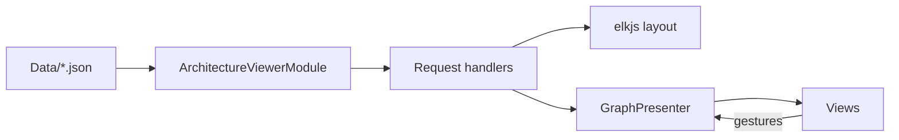

# Architecture viewer

The architecture viewer draws the architecture of a VSA app as a graph, and lets you edit links and rules. It is a VSA app in `framework/Tooling/Viewer/`, built against the framework source, as `samples/Notes` is. It does not ship yet: it reads a sample export of `samples/Notes` from `Data/`.

## Parts

| Part | Path | Contains |
|---|---|---|
| Module | `Features/ArchitectureViewer/` | Domain, Domain.Shared, Infrastructure, Presenters, 13 request slices |
| Views | `App/Views/` (`Viewer.Views.csproj`) | Pages, panels, graph and shape components |
| Host | `App/Host/` (`Viewer.Host.csproj`) | The fixed `Program.cs` line, `Data/` copy |
| Sample input | `Data/` | `architecture.json`, `layout.json` of `samples/Notes` |
| Licenses | `THIRD-PARTY-NOTICES.md`, `LICENSE-EPL-2.0.md` | Z.Blazor.Diagrams (MIT), elkjs 0.9.3 (EPL-2.0) |
| Tests | `tests/Viewer.Tests/` | Unit, architecture and browser tests |

## Stack

| Item | Choice |
|---|---|
| Drawing | Own Razor components that write SVG. No diagram library |
| Layout and routes | elkjs 0.9.3, called through `elk-interop.js` (JS interop) |
| Gestures | Pan, zoom, select, drag, link and keyboard behaviors, copied from Z.Blazor.Diagrams and adapted to own records |
| Render mode | Blazor Interactive Server. No WebAssembly host |
| Node shapes | `Fields`, `Simple`, `Part`. A shape is a Domain class and a view with `[NodeShape]` |

## Data flow



`ArchitectureViewerModule` reads `Data/layout.json` and `Data/architecture.json` from the app folder (`AppContext.BaseDirectory`). `Viewer.Host.csproj` copies `Data/*.json` to its output.

## Run the viewer

1. Run `dotnet run --project framework/Tooling/Viewer/App/Host`.
2. Open `http://localhost:5205`.

## Tests

| Kind | Tests | Needs |
|---|---|---|
| Unit | `SelectItemTests` (2) | Nothing |
| Architecture | Generated `ArchitectureTests` (75) on the viewer app | Nothing |
| Browser | 23 tests in category `Browser` | Playwright Chromium (the tests install it on the first run, about 150 MB) |

The browser tests start `App.Host.dll` from its output folder on a free port, with `ASPNETCORE_ENVIRONMENT=Development`. At the start of the run, `ViewerSetup` installs the Playwright Chromium if it is missing, and starts it one time. Each test opens a new browser context and page, so each test has a new Blazor circuit and new presenter state.

| Run of `Viewer.Tests` (100 tests, no build) | Duration |
|---|---|
| One browser for each test (Edge) | 3 min 58 s |
| One Chromium for the whole run | 1 min 33 s |

To run only one kind, use a filter:

```bash
dotnet test --project tests/Viewer.Tests -- --filter "TestCategory!=Browser"
dotnet test --project tests/Viewer.Tests -- --filter "TestCategory=Browser"
```

## Decisions

| Decision | Reason |
|---|---|
| Folder `framework/Tooling/Viewer/`, own `Directory.Build.props` and `VSA.Sdk.Dev.props` | Same in-repo form as `samples/`. `VsaAppRoot` is the viewer folder |
| Project files `Viewer.Host.csproj` and `Viewer.Views.csproj`, assembly names `App.Host` and `App.Views` | `VSA.slnx` cannot have two `App.Host` projects in the `/framework/` folder (the templates have one) |
| Sample input in `Data/`, copied to the host output | Until `vsa view` writes the export, the viewer has fixed input |
| `IsPackable` false | `LocalFeed` packs each packable project under `framework/`. A package changes the consumer tests |
| `Microsoft.Playwright` 1.64.1, with plain NUnit fixtures | No Playwright base class is necessary, because one `[SetUpFixture]` owns the browser |
| Playwright Chromium, not an installed browser | Each Playwright release is tested with its own Chromium version. The same version runs on each machine and in CI. It has a fast headless shell |
| One Chromium for the whole run, a new context for each test | A browser start for each test took about 6 s. The context keeps the tests apart |
| 23 separate browser tests, not one long script | A long script stops at the first failure. Separate tests show each failure |
| CA1812 off in `ArchitectureViewer.Handlers.Requests` | False warning on handlers that are found by type (issue #41) |
| View code follows the repository analyzer rules | `App/Views` gets the VSA analyzer as framework code: block bodies, explicit types |

## Follow-up work

| Item | Content |
|---|---|
| `VSA.Viewer` package and `vsa view` | Ship the viewer. `vsa view` runs the engine export, then starts the viewer on it |
| Export from the engine | Replace `Data/` with the export of the current app |
| `vsa apply` | Write `changes.json` into the definition |
| Folding | Fold groups for large apps |

## Known limits

- Tested on `samples/Notes` only: 17 nodes, 39 edges.
- An ELK drop puts the card about 71 px from the drop point. The order stays.
- An exported remove stays drawn until "Discard changes".
- The page loads the IBM Plex Sans font from Google Fonts.

## Open questions

- Rule data: the engine export gives rules as structured data (terms and conditions). `ArchitectureImport` parses rule text. Align with the export shape?
- In-process requests: each viewer gesture is a request with an HTTP route, so it is also a public endpoint. Add a request type that runs only in the process?
- Views and `Domain.Shared`: views see only presenter types, so `Mapping` copies 22 records into view items. Keep this pattern, or let views see `Domain.Shared`?
- WebAssembly: `VSA.Views` needs `Microsoft.AspNetCore.App`. If it uses `Microsoft.AspNetCore.Components` only, the viewer can also run as WebAssembly. Change it?
- CI and the browser tests: CI runs `dotnet test VSA.slnx` on `ubuntu-latest`, and the tests install Chromium there. If Chromium needs system libraries that the image does not have, add `playwright install --with-deps chromium` to `.github/workflows/ci.yml`, or filter out the category `Browser`.
- Folder name: `framework/Tooling/Viewer/` can change when there are more tools.
