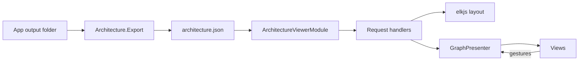

# Architecture viewer

The architecture viewer draws the architecture of a VSA app as a graph, and lets you edit links and rules. It is a VSA app in `framework/Tooling/Viewer/`, built against the framework source, as `samples/Notes` is. It does not ship yet. Its input is `architecture.json`, which the architecture engine exports from an app. The model of the file is `VSA.Architecture.Data` (see `architecture-data.md`).

## Parts

| Part | Path | Contains |
|---|---|---|
| Module | `Features/ArchitectureViewer/` | Domain, Domain.Shared, Infrastructure, Presenters, 13 request slices |
| Views | `App/Views/` (`Viewer.Views.csproj`) | Pages, panels, graph and shape components |
| Host | `App/Host/` (`Viewer.Host.csproj`) | The fixed `Program.cs` line, `ViewerApp` with the app rules, `Data/` copy |
| Default input | `Data/` | `architecture.json` of `samples/Notes`, made by `Architecture.Export` (`framework/Tooling/Export/`) |
| Licenses | `THIRD-PARTY-NOTICES.md`, `LICENSE-EPL-2.0.md` | Z.Blazor.Diagrams (MIT), elkjs 0.9.3 (EPL-2.0) |
| Tests | `tests/Viewer.Tests/` | Unit, architecture and browser tests |

## Stack

| Item | Choice |
|---|---|
| Drawing | Own Razor components that write SVG. No diagram library |
| Layout and routes | elkjs 0.9.3, called through `elk-interop.js` (JS interop) |
| Gestures | Pan, zoom, select, drag, link and keyboard behaviors, copied from Z.Blazor.Diagrams and adapted to own records |
| Render mode | Blazor Interactive Server. No WebAssembly host |
| Node shapes | `Fields`, `Simple`, `Part`. A shape is a Domain class and a view with `[NodeShape]` |

## Data flow



`ArchitectureViewerModule` reads the file in the setting `Viewer:Architecture`. If the setting is empty, it reads `Data/architecture.json` from the app folder (`AppContext.BaseDirectory`). Both views run ELK on load: the App view gets its graph from the `app` section (`AppGraph`), and the Definition view from the `definition` section (`DefinitionGraph`).

## Make the export

1. Build the app, for example `dotnet build samples/Notes/App/Host`.
2. Run `dotnet run --project framework/Tooling/Export -- samples/Notes/App/Host/bin/Debug/net10.0 samples/Notes out/architecture.json`.
3. Start the viewer with `--Viewer:Architecture out/architecture.json`.

The arguments are the app output folder, the app root and the output file. The export finds the definition with `DiscoveredApp.FromFolder`, then loads the app with `AppArchitecture.Load`.

## Export shape

| Section | Fields |
|---|---|
| `definition` | `name`, `unlisted`, `own`, `parts`, `rules`, `pairs` |
| `definition.parts[]` | `id`, `layer`, `parent`, `path`, `many`, `hasFolder`, `ofType` |
| `definition.rules[]` | `id`, `text`, `source`, `access`, `pairs`, `from[]`, `to[]` |
| `definition.rules[].from[]`, `to[]` | `layer`, `reach`, `access`, `filters[]` (`kind`, `layer`) |
| `definition.pairs[]` | `from`, `to`, `condition`, `access`, `rule`, `order`, `memberAccess` |
| `app` | `name`, `root`, `instances`, `types`, `dependencies`, `findings` |

Version 2 adds the rule terms (`from`, `to`) and `memberAccess`. The text of a rule stays for display. The import reads the terms, not the text, because the text now has access options such as `Domain(Internal)`.

## Run the viewer

1. Run `dotnet run --project framework/Tooling/Viewer/App/Host`.
2. Open `http://localhost:5205`.

## Tests

| Kind | Tests | Needs |
|---|---|---|
| Unit | `SelectItemTests` (2) | Nothing |
| Export | `ExportImportTests` (4): the export of `samples/Notes` goes into the import | `samples/Notes` builds |
| Architecture | Generated `ArchitectureTests` (75) on the viewer app | Nothing |
| Browser | 23 tests in category `Browser` | Microsoft Edge |

At the start of the run, `NotesExport` runs `Architecture.Export` on the output of `samples/Notes` and writes a temporary `architecture.json`. The test project builds `Architecture.Export` and `samples/Notes` with `ReferenceOutputAssembly="false"`, so their assemblies stay out of the test output.

The browser tests start `App.Host.dll` from its output folder on a free port, with `ASPNETCORE_ENVIRONMENT=Development` and `--Viewer:Architecture` set to that file. They use `Microsoft.Playwright.NUnit` with the installed Edge (`Channel = "msedge"`), so no browser download is necessary. Each test opens a new page, so each test has a new Blazor circuit and new presenter state. If Edge is not installed, the browser tests are ignored.

To run only one kind, use a filter:

```bash
dotnet test --project tests/Viewer.Tests -- --filter "TestCategory!=Browser"
dotnet test --project tests/Viewer.Tests -- --filter "TestCategory=Browser"
```

## Decisions

| Decision | Reason |
|---|---|
| Folder `framework/Tooling/Viewer/`, own `Directory.Build.props` and `VSA.Sdk.Dev.props` | Same in-repo form as `samples/`. `VsaAppRoot` is the viewer folder |
| Project files `Viewer.Host.csproj` and `Viewer.Views.csproj`, assembly names `App.Host` and `App.Views` | `VSA.slnx` cannot have two `App.Host` projects in the `/framework/` folder (the templates have one) |
| Default input in `Data/`, copied to the host output | The viewer starts with no setting. `vsa view` (next PR) gives the setting |
| No `layout.json` | The viewer runs ELK on load for the App view, as it does for the Definition view |
| `Architecture.Export` is a separate executable | It loads the assemblies of the app. In the test process, two `App.Host` assemblies cannot load |
| `ViewerApp : VsaApp<ViewerApp>` gives two app rules: Infrastructure and Host may use the `Core` part itself (`Depth.Self`) | `VSA.Architecture.Data` binds to `Core`. The app class names layer types, which are in `Core`. Both rules are temporary (issue #89) |
| The viewer reads the file with `VSA.Architecture.Data` | One model for each tool. The Infrastructure layer gets it with `VsaAppReference` (temporary, issue #89) |
| The import fails on a missing field (`RespectRequiredConstructorParameters`) | A drift between the export and the import fails the tests |
| `IsPackable` false | `LocalFeed` packs each packable project under `framework/`. A package changes the consumer tests |
| `Microsoft.Playwright.NUnit` 1.64.1, base class `PlaywrightTest` | Runs on Microsoft.Testing.Platform with no change. The package excludes the build assets of `Microsoft.NET.Test.Sdk` |
| Each test launches Edge itself | The settings of `PageTest` come from a `.runsettings` file. Code sets `Channel = "msedge"` directly |
| 23 separate browser tests, not one long script | A long script stops at the first failure. Separate tests show each failure |
| CA1812 off in `ArchitectureViewer.Handlers.Requests` | False warning on handlers that are found by type (issue #41) |
| View code follows the repository analyzer rules | `App/Views` gets the VSA analyzer as framework code: block bodies, explicit types |

## Follow-up work

| Item | Content |
|---|---|
| `VSA.Viewer` package and `vsa view` | Ship the viewer. `vsa view` runs the engine export, then starts the viewer on it |
| `vsa apply` | Write `changes.json` into the definition |
| Folding | Fold groups for large apps |

## Known limits

- Tested on `samples/Notes` only.
- An ELK drop puts the card about 71 px from the drop point. The order stays.
- An exported remove stays drawn until "Discard changes".
- The page loads the IBM Plex Sans font from Google Fonts.

## Open questions

- In-process requests: each viewer gesture is a request with an HTTP route, so it is also a public endpoint. Add a request type that runs only in the process?
- Views and `Domain.Shared`: views see only presenter types, so `Mapping` copies 22 records into view items. Keep this pattern, or let views see `Domain.Shared`?
- WebAssembly: `VSA.Views` needs `Microsoft.AspNetCore.App`. If it uses `Microsoft.AspNetCore.Components` only, the viewer can also run as WebAssembly. Change it?
- CI and the browser tests: CI runs `dotnet test VSA.slnx` on `ubuntu-latest`. That image has Microsoft Edge, so the browser tests can run there (about 2.5 minutes). If they are slow or unstable on CI, filter out the category `Browser` in `.github/workflows/ci.yml`?
- Folder name: `framework/Tooling/Viewer/` can change when there are more tools.
