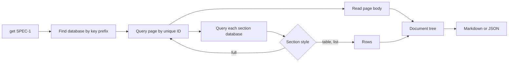

# notion-context

`notion-context` reads Notion pages and their related pages, and writes one Markdown or JSON document for an agent. A TOML config defines the databases and the document types, so a new page type needs no code change. The tool uses only the Python standard library (Python 3.11 or later).

## Why a script and not the MCP

A spec is a graph of pages. The Notion MCP and the REST API return one part of that graph for each call. The agent then must join the parts in its context. The script joins the parts in code.

Cost to read one spec:

| Path | Agent calls | Agent tokens | Repeatable |
|---|---|---|---|
| MCP, through linked views | ~7 | ~7,000 | No |
| MCP, through relations | ~4 | ~1,700 | No |
| `notion-context get SPEC-1` | 1 | ~450 | Yes |

Linked views ("filtered to this page") are for people. The API cannot read their filters. The script reads the relation properties, which hold the same links.

## How it works



## Prepare

1. Make an internal integration in Notion: **Settings → Connections → Develop or manage integrations**.
2. Share each database with the integration: **••• → Connections → Add connection**.
3. Set the token in the environment: `export NOTION_TOKEN=ntn_...`. Do not commit the token.
4. Copy `notion-context.example.toml` to `notion-context.toml`. Change the database ids.
5. Run `python3 -m notion_context check`.

Run the tool from this folder. If you run it from a different folder, add this folder to `PYTHONPATH`.

## Commands

| Command | Result |
|---|---|
| `get SPEC-1` | Page and sections, default document |
| `get SPEC-1 --doc spec-brief` | The same page, with a different document |
| `get SPEC-1 --format json --out spec.json` | JSON tree in a file |
| `query issues --where Status=Ready --where Area=rules` | Rows that match all filters |
| `query issues --where Status=!Done --columns Key,Title` | Negated filter, selected columns |
| `schema issues` | Property names, types and options |
| `check` | Compares the config with the live schemas |

Global options: `--config PATH` (or `NOTION_CONTEXT_CONFIG`) and `--stats` (API call count on stderr).

`check` returns exit code 1 if it finds an error. Other errors return exit code 2.

## Config

### Databases

```toml
[databases.issues]
id = "070982194a904e4a8ea9de8c3b303b34"
key = "Key"          # unique_id property; gives keys such as ISS-12
document = "issue"   # default document for `get ISS-12`
# prefix = "ISS"     # optional; read from the schema if not set
```

A database with no `key` can be a section source, but `get` cannot find its pages.

### Documents

A document is one output type. It has fields, an optional page body and sections.

```toml
[documents.spec]
database = "specs"
fields = ["Status", "Goal"]   # ["*"] for all properties
body = true                   # page body as Markdown

[[documents.spec.sections]]
title = "Issues"
database = "issues"
backlink = "Spec"             # relation on issues that points to the spec
filter = ["Status=!Done"]     # optional, AND
columns = ["Key", "Title", "Status"]
style = "table"               # table | list | full
# document = "issue"          # with style full: each item as an issue document
```

| Section key | Use |
|---|---|
| `backlink` | Section relation to the root; 1 query |
| `relation` | Root relation; 1 call for each item |
| `style = "full"` | Each item as a full document |

Full documents nest to `settings.max_depth` levels.

Set exactly one of `backlink` and `relation`. Use `backlink` when a two-way relation exists, because it needs fewer calls.

A page that was already visited in the same tree shows as one line. Thus, a cycle such as spec → issue → spec stops.

### Settings

| Key | Values | Default |
|---|---|---|
| `child_databases` | `skip`, `link` (one line), `rows` (all rows) | `link` |
| `max_depth` | Levels of `full` sections | `3` |

Linked views in a page body are always skipped.

## Add a new page type

1. Run `schema <database id>` to see the property names.
2. Add a `[databases.<alias>]` entry.
3. Add a `[documents.<name>]` entry with its sections.
4. Run `check`, then `get <KEY>`.

## Body conversion

| Notion block | Markdown |
|---|---|
| Headings, toggle headings | `#` headings, below the document heading |
| Lists, to-dos, toggles | Nested lists |
| Code, quote, callout, equation | Fence, `>` quote, `$$` block |
| Table | Pipe table |
| Bookmark, image, file, embed | Link |
| Child page | `- Subpage: <title>` |

The tool reads nested blocks recursively, to 8 levels. Mentions show as their plain text.

## Limits

- The Notion API allows about 3 requests a second. On HTTP 429 or 5xx, the client waits (`Retry-After`, or 1, 2, 4… seconds) and tries again, 5 times maximum.
- Each `full` item and each nested block costs more requests. For large specs, use `table` or `list` sections.
- The API version is `2022-06-28`. The tool reads data only. It does not write to Notion.

## Tests

```sh
python3 -m unittest discover -s tests
```

The tests use an in-memory fake client. They do not use the network.
